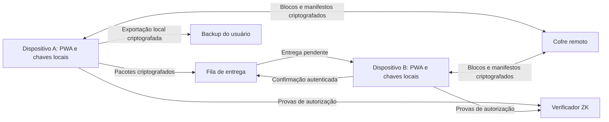

# Capacity audit follow-up — 16 October 2026

## Profile publication outside history opening — 18 October 2026

The assembled trace and real coordinator regression show explicit opening and
startup awaiting an automatic own name/photo publication before reading verified
history. Reuse the existing bounded, idempotent ProfileBroadcast lifecycle after
foreground verification/startup maintenance. Include the current approved private
contact even outside the loaded directory page, excluding archive-only contacts.
Ordinary automatic selected-history rechecks retain maintenance priority throughout
their probe/pins/projection/confirmation. Explicit opening and fresh live-change
rechecks of the visible direct conversation keep interactive priority. Hidden
conversations and unrelated maintenance are not promoted. One bounded priority
bit survives coalescing and clears on reset/covered full refresh; no hint grants
content or authority. No additional recipient state, plaintext transport,
retention or authority cache is introduced. Existing encrypted profile sharing, fresh history confirmation,
user-send gates and background retry triggers remain. A newly updated name/photo
can arrive after the conversation opens. See the [startup contract](docs/BOOT_CONTATOS_CONVERSAS.md#profile-publication-follows-verified-history--18-october-2026).

## Cross-tab authority scheduling — 18 October 2026

The owner requires five to ten tabs in one browser to work well. The native
account SDK lock remains exclusive. Per-controller priority alone does not order
work across tabs, so a focused admission module limits maintenance to one waiting
turn-gate contender while sharing foreground admission. A queued exclusive
maintenance turn blocks later shared arrivals, preserving background progress.
All waits consume the existing cumulative eight-second acquisition budget; every
operation still obtains fresh authority and runs its current checks. No active
work is interrupted and no authorization result is shared or cached.

The [startup contract](docs/BOOT_CONTATOS_CONVERSAS.md#cross-tab-authority-admission--18-october-2026)
defines ordering, deadlines and native-lock recovery. Keep failed performance
profiles explicit. Local scheduling success does not certify assembled acceptance,
maximum users or phone performance. Calls stay deferred and last.

## Client history scheduling correction — 18 October 2026

The owner requested continuing the capacity audit after the assembled history
profile exposed client authority waiting. Identical `VaultSync.refresh` callers
may share one queued vault read only until its authorized vault callback starts.
A session reset, online/offline mode change, explicit local opening or another
vault operation separates that group. Never retain an active/completed result,
skip removal checks or change account SDK exclusivity and authority deadlines.

The first visible directory startup keeps interactive priority through its pin
reads and runtime preparation; hidden startup and later automatic rechecks keep
maintenance priority. Queued refresh groups also match priority. Explicit
conversation opening and earlier-history navigation keep the existing interactive
priority through pin reads, synchronization, delivery, local history and final
confirmation. Content/delivery/local-history form one bounded authority read;
exposure still requires independent fresh authority and server confirmation. Automatic refreshes retain maintenance priority and the existing
four-interactive-turn fairness rule. Each authority still runs its current
verification; no queue, lock, timeout, transport or backend limit is relaxed.

The [startup contract](docs/BOOT_CONTATOS_CONVERSAS.md#queued-vault-reads-and-selected-history-priority--18-october-2026)
defines ordering, failure propagation and regression coverage. Use the existing
integrated release process after passing checks; source correctness, publication
and finite assembled acceptance remain separate. Calls stay deferred and last.

**Ponto importante:** this is a focused scheduling correction, not a new capacity
ceiling, stale authorization cache or proof of faster physical-phone startup.

## Shared live transport between tabs — owner approval, 18 October 2026

The owner explicitly chose one authenticated own-origin SSE transport shared by
tabs of the same account/device/browser session, preserving empty hints and each
tab's fresh signed authorization/snapshots. Use existing Web Locks and
BroadcastChannel, without credentials/content on the channel, new dependencies,
server channel quotas or manual steps. Nginx/shared HTTP/2 and runtime changes
were not selected. Other-project preservation remains mandatory.

The [implementation contract](docs/BLOCO_10A_AUDIO_E_TEMPO_REAL.md#shared-live-transport-between-tabs--owner-approval-18-october-2026)
defines ownership, freshness, handoff, isolation, cleanup and HTTP/1.1 validation.
Calls remain deferred and last.

**Ponto importante:** approval of this client correction does not establish
publication, mixed-load acceptance or a maximum-user count.

## Foreground call latency correction — 18 October 2026

During the capacity audit, the owner reported about eight seconds before an
Android-to-iPhone call rang and authorized continuing the diagnosis/correction.
Use an empty transient hint over the existing authenticated SSE stream to wake
the signed call snapshot after successful signaling/control changes. Preserve
five-second fallback polling, twenty-second authority, encrypted identity/SDP
verification and own TURN; no new persistence, dependency or external relay.
Headphone/mute controls support acoustic feedback but do not establish acceptable
speakerphone audio. Keep physical audio/latency acceptance separate from source
verification and publication. See the [call contract](docs/BLOCO15_CHAMADAS_VOZ.md#foreground-signaling-wakeups--18-october-2026).

## Database upload lifecycle audit correction — 18 October 2026

The owner requested completion of the database audit. Concrete regressions were
reproduced and corrected without changing quotas, retention, authorization,
cryptographic formats, wire bytes or migration history:

- Startup recovery of private, group and status uploads uses independently
  committed batches of at most 32 rows with a UUID cursor, preserving every
  field except the interrupted writing status/token. Failed batches can resume.
- An identical social reservation still checks current authority, consent and
  exact descriptor identity, but requires no new growth allowance. Any missing
  descriptor still requires both owners' quotas and physical capacity atomically.
- Private/group collection continues returning already deleting work for durable
  removal retries without rewriting those rows. New expiry selections remain
  bounded to eight and never expire accepted media through temporary cleanup.

See [database upload contracts](docs/DATABASE_UPLOAD_CONTRACTS.md) for the concrete
contract-to-test map and unchanged lock/I/O boundaries. The exact code-only
release follows [Git and deployment](docs/GIT_E_DEPLOY.md#reviewed-upload-lifecycle-correction--18-october-2026).
No reset, new migration, dependency/runtime or infrastructure change is included.

**Ponto importante:** the demonstrated upload regressions are distinct from the
remaining assembled throughput/resource acceptance. Legacy coordination gates
and the existing vault-v1 sequence boundary remain unchanged; this is not a new
unlimited-history or maximum-user-capacity claim.

## Approved worker boot correction — 17 October 2026

The existing three worker definitions are linked from a later data mount. A
recorded early-boot `LoadState=not-found` and the linked-unit storage contract
justify root-resident definitions. After reviewing prepared source `f2ef135`,
the owner replied “pode seguir”, explicitly approving integration into main,
exact-commit CI and the scoped infrastructure operation described below. This
supersedes the preparation-only status; approval does not prove activation.
Healthy current workers do not constitute a completed reboot rehearsal.

Only the existing deployment command gains the explicit `--worker-boot` option.
Its private, ignored `VPS_WORKER_BOOT_REVIEW.json` binds the integrated commit to
exact SHA-256 values of the three unchanged worker templates. A complete legacy
layout or a complete root layout is accepted; mixed paths, altered unit bytes,
unsafe root-file ownership/mode/device, missing enablement or missing per-role
leases refuse maintenance. Root files must also match the retained volume copies.

The transition exchanges exactly three own definition links for root-owned 0644
regular files and their three enablement links for relative root targets. It
retains original volume definitions, drop-ins, users, swap policy, namespaces,
resource settings and dependencies. PostgreSQL already waits for readiness before
its start job completes; existing worker ordering after PostgreSQL/data is kept.
No new readiness service, schema, dependency or application behavior is introduced.

The separate layout action follows verified code publication. It verifies the
manager graph, rereads definitions, then restarts one own worker at a time, with
a thirty-second readiness window and the other two workers unchanged and ready.
Readiness requires loaded/running process state and exactly one exclusive
single-key advisory lock for each role in the current database, including both
key halves and the lock namespace. Probe connection/query/process deadlines are
bounded; credentials stay in the owned process environment and subprocess memory.

Failure restores only the six validated original links, rereads definitions and
returns affected workers to readiness. Unexpected edits prevent overwrite and
leave private failure evidence. Interrupted/failed attempts require inspection;
there is no blind retry or SQL/object restore. Completed repetition verifies the
receipt and current layout without another restart. The existing executor source
and SSH budgets remain 256 KiB and 64 KiB; standard-library base85 with level-nine
zlib replaces base64 transport to fit the added modules without raising a gate.

**Ponto importante:** the owner approved this exact operation; completed checks
and activation evidence remain separate prerequisites/results. Passing local
checks, integration into clean pushed main, exact passing main CI and fresh
private preservation/accounting checks precede the operation. The ordinary code publication
still briefly stops/restarts our web and three workers; only the subsequent
layout action preserves web/PostgreSQL/media/push/TURN process identities. Keep
combined-volume recovery margins and the remaining capacity acceptance open.

## Signed community reader coordination — 18 October 2026

The continued capacity audit demonstrated exclusive admission timeouts for four
concurrent global feed reads at 30000 synthetic roots. Apply the already approved
shared read-authority contract to the complete signed feed/follower reader, with
fresh session/device checks after waits and SQL read-only enforcement. Preserve
exclusive social/device/contact mutations, optional public identity, visibility,
pagination and all charging. No schema, runtime, dependency or timeout change.
Details and regression boundaries: [capacity and concurrency](docs/CAPACITY_AND_CONCURRENCY.md#concurrent-signed-feed-and-follower-reads--18-october-2026).

## Group and social snapshot read coordination — 17 October 2026

The P-DB-C follow-up restricts this correction to current-group reads and social
personal snapshots. They use the existing shared contact-admission and account
read locks, current session/device checks and SQL read-only transaction contract.
Current-group lookup no longer requests a row update lock. Existing group changes
and other social operations retain their write coordination; no gate is removed
from a charged writer or partially adopted upload operation.

Social snapshot resolves its optional public identity and current anchor/removal
state in one authorized read transaction. A missing public identity still returns
null. A waiting read rechecks committed revocation before returning. Private
routing, membership isolation, signing/wire bytes, quotas, retained bytes and
accounting remain unchanged. No SQL migration, dependency or pool change belongs
to this correction. PostgreSQL regression tests hold shared admission/account
locks, verify concurrent reads and queued revocation, reject invalid sessions and
outsiders, and verify group mutations remain exclusive.

Actual VPS diagnostics confirmed contact-admission waiting during mixed read
bursts. They also found a separate pre-application transport problem: anonymous
live-health requests over the external path showed slow connection/TLS and
timeouts before TCP connection. The same TLS/Unix route inside the VPS completed
ninety-six requests at width thirty-two without errors. Do not attribute those
multi-second external delays to the measured short SQL lock waits, claim this
source correction resolves them, or change shared networking from that evidence.

**Ponto importante:** this is a scoped P-DB-C read correction, not a new numbered
capacity block or completion claim. Integrated CI, exact code-only database
source review and authorized deployment precede any VPS activation. Keep the
remaining write/upload contracts, transport diagnosis, worker boot, physical
pressure/recovery, media/TURN and representative acceptance visible.

## Reviewed group-part correction deployment — 17 October 2026

After the four acceptance corrections were prepared and tested, the owner
requested integration into main and deployment to the VPS. This authorizes the
exact 090→091 correction through the existing `npm run deploy:staging` command,
from clean pushed main with passing exact-commit CI. Use `npm run deploy:check`
for preflight. No capacity/proxy, media-worker or request-limit flag is needed.

The internal `deploy_group_media_parts.py` pins live application `1b5c1e7` and
reviewed application `d1258c0`, verifies all ninety applied migrations unchanged,
the current validated twelve-part constraint, unchanged own units and dedicated
volume. Before maintenance it requires loaded workers and their three leases.
Stop only our web and three workers; retain/rehearse the existing private SQL
and object backups, run the existing migration runner, preserve all row columns
including pending reserved bytes, and reconcile derived/global accounting.
Verify the validated thirty-nine-part constraint before reopening the same
services. No proxy reload, TURN/configuration change, reset or shared-service
restart belongs to this release. Existing deployment-budget/CSS fixes remain.

Before reopening, existing phase-aware recovery restores and verifies the old
SQL/objects/code. After reopening, stop our writers and retain the new state for
review; never restore an older dump over newly accepted thirty-nine-part data.
Retain the migration backup, previous release, exact-commit public build/source
proof and operational receipt in the private evidence tree.

**Ponto importante:** deployment activates the corrections; it does not close
the capacity audit. Repeat the failed bounded VPS cases and keep physical
pressure/recovery, worker boot and remaining integrated acceptance visible.

## Capacity acceptance corrections — owner request on 17 October 2026

The owner requested correcting the four findings from integrated acceptance.
Independent attachment collectors tolerate only already-removed entries; path/
regular-file validation, other I/O errors and parent-directory synchronization
before SQL collection remain mandatory. ICE gathering waits for a relay in the
current local description even while the browser still reports the previous
generation as complete. Keep relay-only SDP/stat verification and existing
credential renewal, cancellation and negotiation deadlines.

Public prepared-media GET supports a single byte range and strong If-Range;
HEAD keeps the full representation length without a body. Every request still
checks current release before/after full-file integrity verification. Hashing and
delivery use bounded buffers with request-owned memory, a pinned descriptor,
backpressure and cancellation. The server's sixty-second read deadline matches
the existing anonymous public-media client deadline. Full-file verification still
costs disk I/O; the client still waits for its anonymous complete Blob, so these
corrections do not close every remaining P-MEDIA playback/resource requirement.
No new origin, authenticated public-media download or dependency is introduced.
Range semantics follow [RFC 9110 section 14](https://www.rfc-editor.org/rfc/rfc9110.html#section-14).

The owner separately approved preparing and locally testing forward migration
091 for the approved 10 MB group-file progress: permit thirty-nine 262,144-byte
parts instead of twelve, preserve existing progress and all applied migrations
001–090. This approval does not activate SQL on the VPS. No quota, E2EE, retention,
signing format, relay configuration, shared service or existing test dataset is
changed by this preparation. Integrated checks/CI and the separately reviewed
existing-executor schema transition remain required before activation.

**Ponto importante:** source correction and actual VPS activation/acceptance are
separate states. Keep physical storage, worker boot/readiness, remaining P-DB/
P-MEDIA/P-TURN and representative load acceptance visible.

## Capacity integration — owner approval on 17 October 2026

The owner requested integrating the prepared capacity work into main, updating
its isolated VPS environment and testing there, then explicitly approved the
conflict resolutions after reviewing the private integration packet. Preserve
main's applied migrations 001–072 byte for byte, including ranking activity,
10 MB private/group attachments and community addresses. The eighteen unapplied
capacity migrations formerly numbered 070–087 are integrated as 073–090; their
prior source identities remain in Git history and earlier block reports refer
to those original numbers. No applied migration identity or checksum changes.

The unapplied statement-accounting and allocated-source catalog guards now
require all 81 charged sources, including `community_addresses`. Private upload
reservation keeps the approved 10 MB file bound, 96 kB thumbnail bound and exact
both-owner/pending/physical accounting. Private/group transfer part bounds follow
the 10 MB context; social/status keep their 3 MB product bounds. Daily reads retain
both current public-profile projection and scoped receipt allocation. Social
uploads retain main's current conversation/block authorization alongside memory
admission; obsolete pending-count ceilings are not restored.

This approval supersedes the earlier branch-only/final-activation timing for
this integration and VPS test release. It does not declare the capacity audit
finished: remaining database contention, public-media delivery, real storage,
TURN/network and representative acceptance remain visible. Exact integrated
checks and main CI precede deployment through the existing executor. Prepare a
reviewed 072→090 transition and scoped failure/recovery checks before activation;
source integration alone never activates SQL, templates or services. The existing
authorization to discard this app's pre-launch test data remains available only
within its recorded scope. No reset has been performed by this integration.

**Ponto importante:** report actual activation and VPS evidence separately from
source validation. Preserve the other project, main's deploy byte-budget fix,
stylesheets and unrelated session changes. Private access, migration mapping,
operational baselines and receipts remain exclusively in the main `.local/`.

## Owner decision — disposable pre-launch data (17 October 2026)

The owner explicitly authorized discarding all existing 0xDMme pre-launch test
data when a reset is simpler or faster than preserving or converting it, and
reported that the app has no active users. Prioritize a clean initialization for
the final capacity release when it reduces implementation or transition work.
Do not require legacy-data import, historical backfill or restoration of the
current test dataset solely to retain that dataset. This decision supersedes
contrary current-test-data preservation requirements in earlier capacity notes;
those notes remain evidence of the already implemented and validated approach.

Scope is only this app's disposable pre-launch database and payload/state data.
Preserve source history, deployment/access credentials, canonical identity, infrastructure isolation
and the other project's files/services/databases. The existing final-batch
activation timing remains: this records authorization, not an immediate reset or
release activation. Prepare the exact scoped reset, clean initialization and
recovery procedure before using it; no additional permission is needed merely
for the already authorized discard of this test dataset. Real user data accepted
outside this pre-launch scope is not covered by this decision.

Preserve all behavior required after initialization: E2EE, authentication,
authorization, consent/revocation, personal quotas, exact accounting, delivery,
idempotency, durability, retention and recovery across growing new histories.
Continue populated synthetic tests where they exercise those future histories,
concurrent operations, failure handling or recovery. Remove legacy upgrade/
preservation work only when the selected transition no longer uses it; do not
remove regression coverage just because the deployment starts empty.

The existing `content_usage` compatibility view and legacy writer gates also
coordinate still-active code paths in the prepared release. A reset alone does
not remove that runtime dependency, replace their lock order or make concurrent
claims safe. Evaluate a coherent final schema and remaining writer adoption
before retiring those contracts. Do not silently delete published migration
history, renumber old checksums or mix unrelated protocol/crypto/account-identity
changes into the reset. Review initialization, stale-session handling, exact
integrated CI, resource/load acceptance and operational recovery for the selected
final transition. Hardware/free-space measurement and privacy boundaries remain.

The twenty-ninth source block adopts complete private attachment reservation
in volume-mode web writers. Migration 087 freezes the bounded file/thumbnail
selection and every new source row before growth; one physical credit covers
only missing files plus concrete SQL/metadata work. Shared contact admission,
ordered account locks and fresh consent/session checks precede byte-owner locks.
BEFORE guards and a pre-COMMIT checkpoint enforce exact descriptors, owners,
message routing, initial writer/parts/state/time, charges and complete effects.
Both-owner quota and pending/global accounting remain exact. Identical retries
preserve existing parts/writers without another credit or charge, including under
physical pressure. New pending partitions are acquired in UUID/bucket order.
The existing coordinator and connection budget are reused. Private begin/finish/
release/cancel/recovery/expiry, social reservation/lifecycle/admission and other
writers remain separate contracts. No reset or VPS activation is included.
See [private reservation](docs/STORAGE_CAPACITY.md#private-upload-reservation--block-29).

The twenty-eighth source block adopts SQL confirmation of actual vault/private/
social file reclamation on the existing coordinator. Migration 086 binds one
eligible retained-vault receipt or deleting media row, resolves all accounts under
shared admission, locks accounts before byte-owner rows and rechecks after waits.
Only exact retained-byte release or deletion is permitted; verify source absence/
receipt state and accounting before COMMIT. Filesystem removal remains outside
SQL transactions and must complete durably before confirmation. Missing/previously
confirmed rows are no-ops without grants, and failed SQL confirmation can retry
an already removed object. Recheck directory durability even when an attachment
namespace is absent. Volume-mode workers split their existing four connections
into three SQL owners and one coordinator; web retains 15+1. No new process pool
budget, new payload permission, history conversion, reset or activation is added.
Upload/expiry transitions and other general/group/retention writers remain separate.
See [file reclamation](docs/STORAGE_CAPACITY.md#file-reclamation-confirmation--block-28).

Cleanup regression correction — 17 October 2026: the owner requested repair of
valid eight-item personal cleanup refusals caused by historical device references.
Migration 085 preserves 077–084 and the existing 64 MiB per-connection SQL reserve.
For `message-remove` and `personal-clean`, a larger concrete work envelope must
reserve its positive excess from actual physical headroom on the same coordinator.
All grant and legacy physical-policy reads include that excess until snapshot-safe
completion/recovery; growth credits retain their full charge. Ordinary maintenance
within the basic allowance remains available under pressure. The vault lifecycle's
specific bound and all source/owner/actual-cost/completeness guards remain.
Distinguish bounded temporary plan metadata from cumulative reference/read deletion
work. Keep the full signed selection and one COMMIT, with no smaller batch, new
payload grant, source conversion, reset or activation. Representative SQL/WAL/
physical/load acceptance remains pending. This corrects blocks 23/27 rather than
adding another capacity feature. See [cleanup correction](docs/STORAGE_CAPACITY.md#cleanup-history-envelope-correction--17-october-2026).

The twenty-seventh source block adopts complete mixed/vault-only/social-only
personal cleanup on the existing coordinator's per-owner 64 MiB SQL reserve.
Migration 084 adds `personal-clean` as maintenance, not a new payload grant or
pool. Compose the published private-removal plan/guards with a bounded metadata
plan for vault charge transfers, exact receipts/retained bytes, social message/
media charges, device receipt deletion and both-owner collection. Preserve all
ordered participant locks and current authority/wallet/revision/selection checks.
Unchanged retries create no plan or credit. One signed selection still commits
once; source guards enforce supported fields and budget before writes, and final
completeness checks every selected effect and journal/global partition before
COMMIT. Social collection requires both current personal receipts before clearing
ciphertext; media status changes follow collection and retain file charges.
Ready/writing promises survive. Metadata size is checked before bulk temporary
plan copying; accepted ciphertext is never a plan body or new payload promise.
Original/action selections retain their serial behavior and whole-lot rollback.
No old-data conversion, reset or activation. Actual filesystem reclamation and
other writer families keep their existing gates; physical/SQL/TOAST/WAL and
representative integrated-load acceptance remain open. See
[mixed cleanup adoption](docs/STORAGE_CAPACITY.md#mixed-personal-cleanup-allocator-adoption--block-27).

The twenty-sixth source block prepares participant-scoped mixed personal
cleanup. Resolve private routing and social profile-to-account ownership through
explicit schema-owner contracts under shared admission, lock the complete account
set in UUID order, then recheck routing/current authority and the signed selection.
The selection still commits once across vault/private/social effects. Only
private-only selections use the existing private removal allocator; mixed and
vault/social-only effects retain their legacy global/cross-table accounting gates.
No partial per-kind grant or commit is permitted. Social cleanup validates
presence/hash/ownership from metadata through its own authority module, without
fetching ciphertext merely for validation. Cleanup remains available without new
consent, as before; it grants no delivery permission. Prior receipts, wallet
confirmation, directory revision, error priority, retained vault payload charges,
both owners' quotas and file charges until actual deletion remain unchanged.
This is the mixed coordination prerequisite, not complete mixed allocator adoption.
Prepare one coherent bounded plan/source/completeness contract for all selected
kinds and their actual lifecycle effects next. No schema, old-data conversion,
reset or VPS activation. See [mixed cleanup coordination](docs/STORAGE_CAPACITY.md#mixed-personal-cleanup-coordination--block-26).

The twenty-fifth source block adopts missing private-opening/export device
references on the existing durable allocator. Migration 083 binds one bounded
metadata-only temporary plan (at most 32 inspected IDs) to the account, current
device and operation. Preserve ordered participant locks, authority/snapshot,
consent and original/related removal checks. Collect the concrete missing
references before source writes, reserve one growth envelope on the existing
coordinator, allow only pending reference inserts and exact 256-byte packet
increments, and verify complete effects/global accounting before COMMIT. Existing
references need no credit; received/pending/revoked semantics and unavailable
entries remain unchanged. The response cutoff retains the last inspected object's
reference effect. A malformed later selection rolls back the whole operation
without acquiring a growth credit. The new envelope covers metadata growth and
SQL overhead; existing ciphertext is neither a new payload promise nor copied
into plans. This is not a maintenance exemption or another connection pool.
Mixed cleanup and other writer families retain their gates. No old-data conversion,
reset or VPS activation. SQL/TOAST/WAL, physical margins and representative mixed
load acceptance remain open. See [opening adoption](docs/STORAGE_CAPACITY.md#private-opening-allocator-adoption--block-25).

The twenty-fourth source block isolates private payload opening/export in
`message-opening.ts` and coordinates each bounded window with every participant
in UUID order. Routing discovery projects metadata under shared contact admission;
current session/directory, signed snapshot, routing, personal removals and consent
are checked after account locks. Existing references perform no INSERT or global
capacity assertion, including under pressure; missing references still add exactly
256 bytes atomically with packet accounting under the existing legacy growth gate.
This is the opening coordination prerequisite, not allocator adoption. A window
retains its 32-ID and 16,000,000-byte response contracts, unavailable statuses and
last-inspected-object effects. The remaining adoption needs one concrete bounded
plan for all missing references actually inspected, source guards and pre-COMMIT
completeness on the existing coordinator. Do not reserve growth for unchanged
references or treat reference creation as maintenance. No schema, protocol,
old-data conversion, reset or VPS activation is included. See
[opening coordination](docs/STORAGE_CAPACITY.md#private-opening-coordination--block-24).

The twenty-third source block adopts actual private sender deletion and
private-only personal cleanup on the existing transaction-owned allocator.
Migration 082 introduces a bounded `message-remove` maintenance scope, using the
existing 64 MiB per-owner SQL operating reserve without a new payload promise or
connection pool. Keep the complete participant locks from block 22, validate all
selected metadata before source effects, enforce the exact supported row changes
and verify packets, references/reads, receipts, accepted-attachment transitions
and journals before COMMIT. A bounded session-local metadata plan is truncated
on COMMIT and discarded on rollback/disconnect; it stores no ciphertext bodies
and cannot grow with history. Both personal/global counters and deletion charges
retain their existing formulas. Mixed vault/social selections and remaining
writer families retain their legacy coordination. No old-data conversion, reset
or VPS activation is included. Physical SQL/TOAST/WAL and representative mixed-load
acceptance remain separate. See [actual removal adoption](docs/STORAGE_CAPACITY.md#private-removal-allocator-adoption--block-23).

The twenty-second source block prepares the participant-lock prerequisite for
private sender deletion and private-only personal cleanup. A personal batch can
span multiple peers: resolve immutable routing under shared contact admission,
lock the complete participant set in UUID order, then recheck current authority
and routing before any mutation. Mixed vault/private/social selections retain
one exclusive-authority transaction. Keep both owners' counters, attachment
states, references, read marks, collection and journals atomic. Validation of
presence/hash/ownership projects metadata only. Receipt pages use read-only
admission; object opening/export still uses write admission for charged device
references. Unchanged removal retries perform no charged effects or global-ledger
assertion. This block deliberately retains the global source/cross-table guards
for actual cleanup mutations: it does not claim allocator adoption or completion
of P-DB-B/P-DB-C. Prepare their complete source/envelope/completeness contract
next, without imposing a smaller deletion/cleanup batch or changing retention.
No schema change, legacy conversion, reset or VPS activation is included. See
[removal coordination](docs/STORAGE_CAPACITY.md#private-removal-coordination--block-22).

The twenty-first source block prepares participant-scoped private delivery ACKs
and volume-mode read marks. Resolve only immutable message routing under the
shared consent gate, acquire both accounts in UUID order, then recheck authority
and stored participants. Preserve ACK semantics across consent changes, removal,
revocation and retries; queue state changes add no charged bytes. Read marks use
the existing coordinator and a concrete metadata envelope with BEFORE source and
pre-COMMIT completeness/privacy checks. Unchanged adopted retries reserve/write
nothing, including under physical pressure; new marks retain quota and capacity
admission. Migration 081 changes guards/scopes without old-data conversion or
backfill. Existing read-batch bounds remain protocol batching, not visitor caps.
Fresh-schema synthetic tests and the assembled encrypted message flow validate
new-data contracts. Removal/attachment coordination, representative load and final
activation remain pending. See [receipt coordination](docs/STORAGE_CAPACITY.md#private-message-receipts--block-21).

The twentieth source block prepares volume-mode private-message admission on the
existing durable allocator. Keep consent and ordered participant locks, both
personal quotas, recovery, relation/removal rules and idempotency. Migration 080
binds the complete packet, ready attachment acceptance, device references, both
change checkpoints/pruning and push hints to a concrete pre-write envelope.
Actual source effects are checked before writes, and completeness before COMMIT.
Vault and message adapters share the existing coordinator connection; no pool
budget is added. Other writer families, representative load acceptance and the
final schema/VPS activation remain pending. See
[private-message adoption](docs/STORAGE_CAPACITY.md#private-message-admission--block-20).

The nineteenth source block completes prepared vault lifecycle adoption after
the owner's explicit review/approval of migration 079. Completion and final
discard use scoped operating-SQL envelopes; discarding retains its prior physical
promise until actual removal, and startup recovery processes all interrupted
records in bounded batches beyond the former 256-record pass. Local preservation,
quota, concurrency, pressure, recovery and reversal checks passed, including
checkpoint rollback when global accounting is unavailable. Other writer families
and representative load acceptance remain pending. VPS migration and activation
remain reserved for the final reviewed release. See [vault lifecycle adoption](docs/STORAGE_CAPACITY.md#complete-vault-lifecycle-adoption--block-19).

The eighteenth source block connects vault reservation to durable pre-write
credits after the owner's explicit scope approval. Migration 078 partitions exact
global accounting behind a compatibility view, coordinates legacy final admission
with grants and preserves owner/cross-table rules. Only volume-mode web vault
reservation adopts the new path; other writers retain their guards. The existing
web connection budget includes its coordinator. Local checks passed for
preservation, quotas, competing claims, scoped envelopes, recovery and maintenance
reversal. Representative load acceptance, schema activation and the final VPS
release remain separate. See
[vault allocator adoption](docs/STORAGE_CAPACITY.md#vault-allocator-adoption--block-18).

The seventeenth source block prepares durable, transaction-owned credits as the
first part of the global allocator protocol. A separate bounded coordinator
transaction holds its guard only while collecting completed owners, measuring
fresh physical headroom and committing an exact operation envelope. Keep credits
until a fresh PostgreSQL snapshot proves the top-level owner completed; never
expire a live grant by clock. Preserve promises across coordinator replacement,
rollback and disconnected writers. Migration 077 adds empty accounting tables
only. This component is not connected to application writers: all old runtime
guards remain until pre-write envelopes, source accounting and owner/cross-table
coordination adopt the protocol together. No new runtime pool or VPS activation
is included. See [transaction-owned allocations](docs/STORAGE_CAPACITY.md#transaction-owned-allocations--block-17).

The sixteenth source block consolidates global charged-byte changes from 80
source tables into exact statement transition deltas. Preserve their original
events, profile overhead, global-before-owner/cache ordering, physical admission
baselines and transaction rollback. Generation cache accounting joins its global
batch; ranking entries already use statement accounting. This removes repeated
ledger writes during batches, not the singleton guard itself. Migration 076
changes accounting triggers only, with no source/counter backfill or VPS
activation. Review transition-table memory/spills and activation separately.
The atomic global allocator and remaining locks are still pending. See
[statement accounting](docs/STORAGE_CAPACITY.md#global-statement-accounting--block-16).

The fifteenth source block replaces the staging fixed global content budget with
fresh own-volume availability, conservative pending-write envelopes and an
explicit PostgreSQL/release operating reserve. Keep the existing global guard
for atomic claims, per-user quotas and charge amounts. Scoped cleanup can use
operating space without granting payload promises. Pin the existing service
bind mount, fail closed on measurement errors, and preserve all deployment
backup checks/retention. Numeric budgets remain for local fixtures. Migration
075 supplies transaction-local baselines only; no VPS activation is included.
The global allocator/remaining lock redesign and resource/load acceptance stay
pending. See [physical storage admission](docs/STORAGE_CAPACITY.md).

The fourteenth source block prepares incremental pending-write envelopes for
vault, private/group/status/social media and public community preparation.
Aggregate fixed UUID-prefix partitions without reading reservation history;
preserve source charges, individual quotas, states, global usage and rollback.
Expose only aggregate counters in private database observations. This is a
prerequisite for physical-volume admission, not removal of the effective global
budget or singleton contention. Preserve the coordinated global guard until its
atomic replacement is implemented. Migration 074/backfill/rollback and activation
remain separately reviewed. See [physical storage preparation](docs/STORAGE_CAPACITY.md).

The thirteenth source block prepares exact incremental attachment quota totals,
preserving all statuses, participant charges and personal-removal exclusions.
Reconcile affected message/participant state under the existing global guard,
so cross-table and combined-statement changes cannot double-apply deltas.
Personal quota reads use indexed counters only. Preserve retained bytes,
individual quotas, authorization, accepted data and earlier migrations.
Migration 073 includes populated backfill and historical reconciliation;
activation/backfill/rollback review and representative load remain separate.
Global physical admission, singleton contention and remaining coordination are
still pending. See [exact quota accounting](docs/QUOTA_ACCOUNTING.md).

The twelfth source block prepares exact counters for directly owned personal
charges, separately keyed by account and public profile. Preserve the former
formula, 1 GB quota, owner mapping, retained-byte subtraction and transactional
rollback. Block 12 retained the attachment sum; block 13 above prepares its
cross-table accounting without changing exclusions. Prepare migration/backfill and
reference reconciliation with a separate activation/rollback review; no VPS or
global-capacity changes are included. Migration 072 preserves ledger-before-owner
lock order for personal/group deltas without changing earlier checksums or
weakening global admission. See [exact quota accounting](docs/QUOTA_ACCOUNTING.md).

The eleventh source block prepares exact per-group quota counters. Preserve all
existing charged-byte rules and the approved media/text split; maintain the
derived totals transactionally and fail closed when accounting is unavailable.
Use indexed counter reads for quota and accepted-media occupancy. Prepare a
versioned populated-history backfill with write coordination, reconciliation
and separate activation/rollback review. Personal sums, the singleton global
counter and remaining admission locks stay pending. See
[exact quota accounting](docs/QUOTA_ACCOUNTING.md).

The tenth source block replaces fixed global login/handoff/device-link and
volatile opening/recovery/enrollment counts with shared memory admission.
Retained opaque state owns its original expiry and memory reservation; indexed
lookups and per-entry timers avoid full-state scans. Keep challenge attempts,
abuse windows, signatures, session binding, account locks, unique-use conflicts
and existing temporary validity. Bounded SQL expiry cleanup skips locked rows;
remove only advisory locks used for the retired counts. Shutdown and failed
handoff persistence release their state. No schema or VPS activation is included;
physical storage admission and representative load acceptance remain pending.

The ninth source block removes serial notification dispatch and the call-push
three-send/512-entry counts. Durable markers use stable bounded keyset pages;
independent sends from later pages can proceed while earlier sends wait, subject
to shared memory admission. New markers and completion events wake the consumer
without waiting for unrelated sends; deadline queries exclude active devices
and shutdown awaits their owner. Volatile call invitations retain memory for their
entire queued/active lifecycle and use owned deadline/retry timers instead of
rescanning the whole queue for every completion. Coalesce by device without
overlapping replacement sends. Preserve current authorization, generic payloads,
provider restrictions, generation guards, retry limits and deadlines. No schema,
dependency, service or network activation is part of this source block.

The eighth source block replaces fixed call/channel visitor counts with shared
memory reservations retained for each volatile object's lifecycle. Keep one
call per account, authenticated device limits, consent, first-answer ownership,
replay protection and expiry. The former `HASH_TALK_CALL_CAPACITY` setting is
retired. These signaling changes do not enlarge the active relay-port range or
establish a supported simultaneous-call count; final relay resource/port/network
validation and notification dispatch changes remain pending.

The seventh source block replaces the four-per-account and 256-global pending
upload counts with resource admission. Each reservation operation owns a shared
memory reservation before entering the database; durable payload and metadata
bytes continue to count atomically toward the existing storage budgets. Keep
authorization, idempotency, writer leases, abandoned-upload cleanup and all
accepted-data retention rules. A bounded vault preview prioritizes the requesting
device's local draft, so resumability does not depend on its place among other
reservations. Global storage sizing and exact-accounting scalability remain
separate work; no environment setting or migration is activated by this block.

The sixth source block scopes private-message consent admission to ordered
participant locks. Independent pairs share the consent gate; consent mutations
and remaining general/maintenance operations stay exclusive. Preserve the
ledger-before-byte-owner lock order for attachment accounting. Singleton byte
accounting and historical quota sums remain separate pending capacity work.

The fifth source block queues independent media preparations instead of refusing
the second one. CPU/memory-derived decoder slots, per-media command ordering,
memory-bounded pending metadata, existing deadlines and owned cancellation
preserve the writer-lease lifecycle. Remove the worker's four-connection and
single-command gates and its per-UID process bound; keep canonical command/path
validation, byte/virtual-memory limits and isolation. Final activation must
include the reviewed isolated worker bundle through the existing executor.

The fourth source block replaces fixed transfer/object-writer counts with
process-wide memory reservations and bounded, yielding temporary-file cleanup.
Individual quotas, consent, leases, integrity checks and accepted-data retention
remain unchanged. No storage budget or schema migration is changed by this
block; the stale global environment budget remains separate pending work.

The owner explicitly approved preparing removal of the remaining TURN/push CPU,
memory, task, connection and bandwidth ceilings, accepting increased resource
use on the shared VPS. Preserve overload control, validate the resource budgets
and network isolation, and defer activation to the single integrated release.
Swap/core-dump prohibitions, short-lived credentials, the own-relay ACL and
generic notification payloads remain unchanged. Relay-port expansion and other
remaining capacity work still require their coordinated implementation/tests.

The owner subsequently chose a single activation after the remaining blocks
are integrated and verified. The second source block allows authenticated
read operations to share admission/account locks, with PostgreSQL read-only
enforcement and unchanged consent/device-revocation coordination. Mutations,
message-body opening, backup references and one-time-key claims keep exclusive
coordination until their accounting and lock scope are revised separately.

The owner authorized starting removal of the artificial limits found in the
capacity audit. Keep individual storage quotas, encryption, authorization,
retention and abuse protection. Replace small test-environment visitor counts
with capacity tied to the application's available resources. The first block
removes HTTP admission/socket/transfer barriers and fixes trusted proxy client
identity; database coordination, quota accounting, media queues and remaining
service limits are separate implementation blocks. See
[capacity and concurrency](docs/CAPACITY_AND_CONCURRENCY.md) for behavior,
regressions, activation ordering and remaining work. This decision supersedes
older fixed HTTP connection/operation and per-response speed caps; it does not
approve changing the other project's infrastructure or weakening data safety.

# 0xDMme — decisões e plano de implementação

**Release source growth — authorized on 17/10/2026:** the owner requested fixing
the deployment file-count restriction and integrating it into main immediately.
Replace the 1,024-entry manifest ceiling and 4,096-member authored/build extraction
ceiling with a consistent 1 MiB serialized-manifest budget and the existing
128 MiB expanded archive budget, counting headers and padding. Preserve transfer,
runtime, integrity, exact-source, CI, compatibility and rollback guards. This is
an isolated deployment correction; it does not activate the pending capacity work
or change application behavior, schema, dependencies or shared infrastructure.
**Ponto importante:** use the existing deployment executor from reviewed main;
source integration and actual VPS publication have separate evidence. See the
[deployment contract](docs/GIT_E_DEPLOY.md#release-file-growth--owner-authorized-fix-on-17102026).

**Optimistic private text presentation — authorized on 16/10/2026:** the owner
requested displaying own text immediately and replacing verbose send/history
placeholders with a retry cross when sending fails. Render session-local drafts
in the same keyed history as verified messages, using their existing stable IDs.
Only real server acceptance earns a sent check; delivery/read markers retain
their existing verified meaning. Keep ciphertext-before-transmission, authority,
retention, quotas and exclusive SDK operation. Restore ordinary encrypted drafts
under current authority after the history gate opens. Bound the own-text display
cache to 64 entries of at most 128 KiB, hide it on invalidation and clear session
plaintext on replacement. The owner initially requested Git-only delivery, then
explicitly authorized main integration and VPS activation and resumed the release
after context compaction. Preserve the latest integrated main, require full CI for
the exact pushed release, and reuse the existing deployment executor with its
preservation, readiness, public-source verification and retained rollback checks.
**Ponto importante:** presentation is optimistic; actual persistence, acceptance
and delivery remain distinct. See the
[activation scope](docs/GIT_E_DEPLOY.md#optimistic-private-texts--activation-authorized-on-16102026).
See the [presentation contract](docs/DIAGNOSTICO_LAG_CHAT.md#optimistic-own-text-presentation--16102026).

**Measured private text-send repair — authorized on 16/10/2026:** after the
complete desktop capture demonstrated rejected Enter attempts and foreground
blocking beyond publication, the owner approved applying the fix. Separate
bounded local text/reply admission, durable FIFO persistence and exclusive
transmission. Preserve stable IDs, strict ciphertext-before-transmission, fresh
remote authorization, recipient trust/recovery and existing send quotas. Keep
unsaved local input visibly distinct from durable pending work and server
acceptance; guard ordinary page closing/PWA activation until it is saved, and
discard unsaved plaintext on session replacement. Defer normal account-wide
rechecks during a typing burst without delaying immediate invalidation. Existing
editing/media/group/handle flows remain unchanged. The owner subsequently
authorized main integration and VPS activation, with a notification immediately
after the integrated main commit is published. Require that commit's full CI
and the existing deployment executor with preservation, readiness, public-file
verification and retained rollback. **Ponto importante:** physical send cadence
still requires acceptance; no server, SQL, dependency or crypto-format transition
is approved or included. See the
[implementation contract](docs/DIAGNOSTICO_LAG_CHAT.md#applying-the-measured-private-text-send-repair--16102026).
See the [activation scope](docs/GIT_E_DEPLOY.md#consecutive-private-texts--activation-authorized-on-16102026).

**Consecutive message-send diagnosis — 16/10/2026:** the owner asked to remove
the pause between Enter submissions, accepting a desktop console capture if the
actual bottleneck cannot be established from source alone. The private send path
holds its busy gate through submission and follow-up work; source inspection does
not assign physical timings to those phases. Extend the opt-in local collector to
record Enter intent, actual click/submit events and fixed composer-control states
without input values or message content. Keep request/lock/response timing, bounded
memory and explicit cleanup. **Ponto importante:** the collector does not change
sending, authorization, SDK exclusion or durability; use the capture to distinguish
rejected Enter attempts from transmission and follow-up cost before changing them.
See [send capture instructions](docs/DIAGNOSTICO_LAG_CHAT.md#consecutive-text-send-capture--16102026).

**Public DM continuity repair — 16/10/2026:** while checking the pause between
consecutive sends, the owner reported `DM session changed.` on the Android handle
messages page. Reproduce the cancellation boundary with the actual signed client
and retain the existing immediate invalidation of verified history. Distinguish
initial stream connection from loss of an established stream, wait for an active
handshake before a coalesced recheck, and prevent obsolete operation results/errors
from replacing the current view. Preserve real HTTP errors, session replacement,
authorization, E2EE, storage and polling budgets. No backend, dependency, migration
or activation is included. **Ponto importante:** the text-send interval remains a
separate investigation; this repair does not claim a measured mobile speedup.
See [continuity contract](docs/PARIDADE_CHATS.md#public-dm-connection-continuity--16102026).

**Usable mobile conversations — 16/10/2026:** after the next physical capture,
the owner clarified that a published contact could not be opened while startup
was still busy and requested fixing both startup waits. Accept a visible private
conversation choice during startup, retaining only the latest pending recipient.
Run it at the next exclusive foreground boundary before unrelated maintenance;
never change the crypto engine's recipient during another operation. Keep draft
typing local and enable sending only after the selected history is verified.
Coalesce initial profile-triggered presence work into post-initialization
maintenance. Load groups, resume durable outbox work, update presence and release
optional app warmups in separate bounded turns, preserving live invalidation,
online authority/removal checks, consent, recovery and session cancellation.
No dependency, protocol, backend, migration or retention change is included.
The source repair passed 85 targeted scenarios and full exact-commit CI. The
owner subsequently authorized main integration and VPS activation on 16/10/2026,
then explicitly resumed the release after context compaction. Require the exact
integrated commit's full CI and the existing deployment executor with preservation,
readiness, verified public files and retained rollback. A new physical comparison
is still required before claiming a speedup. See the
[activation scope](docs/GIT_E_DEPLOY.md#usable-mobile-conversations--activation-authorized-on-16102026).
See [functional startup contract](docs/BOOT_CONTATOS_CONVERSAS.md#usable-conversations-during-mobile-startup--16102026).

**Measured private-directory boot repair — 16/10/2026:** after the complete
physical console capture located repeated authenticated work before initial
directory publication, the owner approved applying the fixes. Defer optional
session warmups while the foreground private chat directory starts, coalescing
readiness rechecks during that interval. Keep calls and incoming group links immediate, keep other
foreground screens on their normal startup path. The newer functional-startup
contract above supersedes release at first directory publication; navigation and
a current-session startup failure still release deferred work.
Logout, device/CSRF changes and authorization loss discard the pending warmup.
Every operation retains its own existing online authorization, revocation and
history gates. No stale authority cache, new protocol, backend, migration,
dependency or persistent plaintext is introduced. Exact physical timings and
captures remain private in `.local/`; a new physical comparison is required
before claiming a mobile speedup. See [boot scheduling contract](docs/BOOT_CONTATOS_CONVERSAS.md#foreground-directory-startup--16102026).

The owner subsequently authorized main integration and VPS activation on
16/10/2026, then explicitly resumed that release after context compaction.
Use the existing deployment executor with full exact integrated-commit CI,
preservation/readiness checks, verified public assets and retained rollback.
See [activation scope](docs/GIT_E_DEPLOY.md#private-directory-boot-repair--activation-authorized-on-16102026).

**Feed vote position repair — 15/10/2026:** during acceptance of the authorized
discovery release, the owner reported that upvoting jumps to the top of the feed.
The confirmed-vote callback still used the existing reload-from-start path,
which resets both cursor and scroll; this path predates the module extraction.
Update the confirmed score and pressed vote controls in the existing card instead,
preserving its page, nodes, media and reply draft. If the returned post is no
longer visible, retain the existing refresh/removal path. Signed reads/writes,
revision checks, authorization and explicit feed refresh behavior remain unchanged.
This is a frontend acceptance repair under the approved discovery release flow,
with exact integrated-commit CI and the existing deployment executor. See the
[repair contract](docs/PERFIL_PUBLICO_E_FEEDS.md#feed-votes-preserve-reading-position--15102026).

**Discovery refactor approved on 15/10/2026:** the owner required a verified source
checkpoint before proceeding with the separate hotspot task. Extract ranking
presentation first, then feed cards; preserve behavior and keep loading/pagination,
session generations and resource lifecycle in the discovery coordinator. Existing
interaction modules remain authoritative. This supersedes the earlier proposal
to extract feed loading during this task. Record existing UI behavior in tests
before moving code, use separate validated commits and inspect responsive previews.
The checkpoint includes uncommitted source and Git history, with private recovery
evidence in `.local/`; it excludes live databases and VPS state. The owner then
explicitly authorized main integration and VPS activation after the three task
commits passed CI. Use the existing deployment command, the integrated commit's
full CI, preservation/readiness checks and code rollback. No dependency, backend
or schema change is included. See the
[module contract](docs/PERFIL_PUBLICO_E_FEEDS.md#discovery-module-extraction--owner-approval-on-15102026).

**Anexos de até 10 MB nos chats privados e de grupo — decisão do proprietário em 16/10/2026:** o teto de anexo do chat privado e dos grupos passa de 3 MB para 10 MB, com a migração 071 e ativação autorizadas. DMs pelo `@`, status, fotos de perfil/grupo/comunidade e mídia pública mantêm seus tetos. A cota de 1 GB por conta, a cota dos grupos, E2EE, retenção e recuperação não mudam; cada arquivo maior consome proporcionalmente mais cota. Cada registro do backup independente passa a admitir 14 MB para conter uma mídia de 10 MB em base64. **Ponto importante:** versões antigas do app abertas em outro aparelho não abrem anexos acima de 3 MB até atualizar. [Contrato](docs/BLOCO_08_FOTOS_E_ARQUIVOS.md).

**Última mensagem na lista, AM/PM e ativação — pedido do proprietário em 15/10/2026:** após concluir a paridade e edição, mostrar a última mensagem enviada ou recebida diretamente na lista dos dois chats, com checks somente nos envios e leitura conforme privacidade, sem marcar recebidas como lidas ao olhar a lista. O proprietário esclareceu que se refere à lista, sem notificações com app fechado. Usar AM/PM nos dois chats e integrar/ativar o conjunto com CI integral do commit exato, build local, executor existente, preservação e rollback. **Ponto importante:** preservar E2EE e separação de contextos; sem nova migração, dependência ou infraestrutura. [Contrato atual](docs/PARIDADE_CHATS.md).

**Paridade dos chats e edição pelo `@` — pedido do proprietário em 15/10/2026:** alinhar a experiência do chat pelo perfil público à do chat privado, preservando identidade, consentimento e recursos exclusivos de cada contexto. O pedido posterior autoriza edição de texto próprio também pelo `@`, substituindo a proibição histórica de edição sem liberar encaminhamento privado, chamadas, grupos, vídeos enviados, cartões privados, transações ou contratos. Preservar E2EE, histórico, cotas, bloqueio, recuperação e remoções. **Ponto importante:** entrega em branch, sem ativação automática ou migração. [Matriz e contrato](docs/PARIDADE_CHATS.md).

**Correção do registro de DM pelo `@` — 15/10/2026:** o erro de contexto em `dm-register` foi reproduzido com a autoridade do cliente e o validador do servidor: a tradução do nome técnico do aparelho divergia do valor histórico aceito no protocolo. Compartilhar o identificador fixo, corrigir somente o nome local antes da assinatura e preservar alias, chaves, eventos assinados e separação da identidade privada. **Ponto importante:** correção em branch, sem ativação, migração ou nova dependência. [Contrato e regressões](docs/COMUNIDADES_PUBLICAS.md#corte-7--base-de-dms-pelo--local-em-06102026).

**Ativação do enquadramento e zoom da foto — autorizada em 15/10/2026:** após a CI integral de `af5e05f`, o proprietário pediu integrar à main e enviar à VPS. A autorização substitui a restrição de ativação do registro abaixo somente para este lote. Conservar backend, 69 migrações, dependências, runtime e infraestrutura; exigir CI do commit integrado e executor existente com build local, preservação, prontidão e rollback. **Ponto importante:** confirmar recibo `published` e versão servida; teste em celular físico permanece pendente. [Contrato operacional](docs/GIT_E_DEPLOY.md#enquadramento-e-zoom-da-foto-privada--ativação-autorizada-em-15102026).

**Foto privada do cabeçalho — pedido de 15/10/2026:** corrigir o fundo aparente e o enquadramento central e permitir ampliar ao tocar. Usar exclusivamente a foto privada já recebida no aparelho, sem sincronização ou busca pública nova; ampliação fecha ao mudar contato, foto, sessão ou página. Reutilizar o visualizador existente por uma interface de apresentação independente da leitura pública, conservando E2EE e retenção. **Ponto importante:** implementação em branch; ativação na VPS é etapa separada. [Contrato e limites](docs/UI_CONVERSAS.md#enquadramento-e-ampliação-da-foto-privada--15102026).

**Ativação de foto privada e URLs — autorizada em 15/10/2026:** após a entrega de `0455607`, o proprietário pediu integrar à main e ativar na VPS. Esta autorização substitui a restrição de ativação do registro abaixo somente para este lote. Preservar backend, 69 migrações, dependências, Node, modelos e infraestrutura; exigir CI integral do commit integrado e executor existente com build local, preservação, prontidão e rollback. **Ponto importante:** exigir recibo `published` e versão servida conferida; teste com conta real em celular físico permanece pendente. [Contrato operacional](docs/GIT_E_DEPLOY.md#foto-privada-e-urls--ativação-autorizada-em-15102026).

**Foto privada automática e URLs — pedido do proprietário em 15/10/2026:** escolher ou remover a foto privada salva imediatamente o perfil cifrado, sem confirmação adicional; isso substitui a preparação de foto pendente, preservando a confirmação explícita de nome e privacidade. Endereços de navegação passam a inglês, com compatibilidade dos links antigos e destinos próprios para painéis, categorias de configurações, usuários e comunidades. O fragmento restaura somente o contexto público e o arranjo, sem incluir conversa privada, wallet ou conteúdo. **Ponto importante:** implementação em branch, sem ativação automática, backend, migração ou dependência nova. Contratos, limites da validação e proposta de separação dos hotspots em [Foto privada e URLs](docs/PERFIL_PRIVADO_E_ROTAS.md).

**Ativação do boot mobile — autorizada em 15/10/2026:** após a CI integral de `9be4698`, o proprietário pediu enviar a melhoria à main e ativar na VPS. Esta autorização substitui a restrição de ativação do registro de boot abaixo. Integrar somente os commits deste lote, preservando backend, 69 migrações, dependências, runtime, modelos e infraestrutura instalada; exigir CI do commit integrado, build local e executor existente com preservação, prontidão e rollback. **Ponto importante:** publicação exige recibo e versão servida conferidos; o tempo total em aparelho físico permanece sem medição. [Contrato operacional](docs/GIT_E_DEPLOY.md#boot-de-contatos-e-conversas--ativação-autorizada-em-15102026).

**Boot mobile — melhoria solicitada em 15/10/2026:** o proprietário relata lentidão para contatos/conversas aparecerem tanto na abertura quanto na retomada. Um ensaio com a carga real das listas e transporte fictício reproduziu downloads e autoridades repetidos por contato, mesmo com ciphertext local. Abrir agenda/pins em lotes de até 16 objetos, obtendo autoridade atual e conferindo remoções antes/depois; reutilizar somente ciphertext validado contra o commit autenticado e o AAD existente. Cache corrompido, falha, exclusão, revogação ou troca de sessão não liberam conteúdo. **Ponto importante:** o ganho medido não é o tempo total do celular; não há ativação autorizada nesta etapa, mudança de backend, migração, dependência, criptografia, retenção ou telemetria. [Contrato e medições](docs/BOOT_CONTATOS_CONVERSAS.md).

**Ativação da correção de atraso — 15/10/2026:** depois da CI integral aprovada em `4aaa019`, o proprietário pediu integrar à main e ativar na VPS. Esta decisão substitui a restrição de ativação dos dois registros abaixo, somente para o medidor local e a correção de atraso deste chat. Preservar os demais trabalhos fora da entrega, backend, 69 migrações, dependências, runtime e serviços instalados; exigir CI do commit exato integrado e publicado, build no Mac e o executor existente. **Ponto importante:** publicação depende de recibo e versão servida verificados; medição física e investigação de voz continuam pendentes. [Contrato operacional](docs/GIT_E_DEPLOY.md#atraso-na-abertura-dos-chats--ativação-autorizada-em-15102026).

**Prioridade solicitada em 15/10/2026:** após a captura real de latência, o proprietário pediu focar primeiro no atraso de abertura/troca de conversa, deixando a investigação de quedas de voz para depois. Reduzir consultas redundantes sem retirar conferência de snapshot, exclusões ou autorização. Janelas individuais já confirmadas com snapshot igual não dependem de recarregar identidades do cofre; carga nova e publicação de perfil conservam a conferência de identidades. Estado/entrega/confirmação e recibos compartilham suas autoridades dentro de operações coerentes, com validação no servidor a cada pedido. A abertura explícita e seus recibos precedem manutenção ainda não iniciada na mesma aba, mantendo a exclusão nativa entre abas e progresso limitado da manutenção. Contrato, orçamento e ensaio comparativo no [bloco 07](docs/BLOCO_07_MENSAGENS.md#redução-do-atraso-na-abertura--15102026). Não inclui ativação, mudança de protocolo, banco, dependências, retenção ou investigação de voz.

**Investigação de estabilidade solicitada em 15/10/2026:** o proprietário relata demora com a página visível em desktop/mobile, principalmente ao alternar conversas, e pede um medidor executado no console para observar os disparos de sincronização antes de atribuir a causa. Preparar captura opt-in, local, limitada e removível, com eventos fixos de navegação/visibilidade, estado de sincronização, categorias e tempos de requisições, fila/ocupação da exclusão local e atraso da interface. Não registrar conteúdo, identidade, chaves, corpos HTTP ou dados de aparelho/rede nem enviar telemetria. A linha do tempo e posições do chamador são evidência para investigação, não diagnóstico automático. Esta etapa não altera as guardas de histórico/chamadas nem autoriza ativação. Uso, cobertura e limites em [diagnóstico de lag do chat](docs/DIAGNOSTICO_LAG_CHAT.md).

Decisão de 11/10/2026: retirar os tetos operacionais de backup de objetos (256 MiB), banco/dump/SQL (64 MiB), inclusive a recusa por tamanho físico do PostgreSQL. Usar medição de espaço real, arquivos temporários privados e hashes por blocos; preservar integridade, isolamento, rollback e CI. Substitui a aprovação anterior de ampliar só o backup de objetos. [Contrato do deploy](docs/GIT_E_DEPLOY.md).

Decisão de 11/10/2026: remover o teto de 2 MiB do pacote principal de fontes correspondentes no build, no servidor e na verificação HTTP do deploy. O pacote conserva todos os inputs/licenças, hashes e seleção explícita; mantém os orçamentos independentes de empacotamento e da versão inteira. [Contrato atualizado](docs/FONTES_FRONTEND.md). Substitui somente o teto histórico do pacote principal, sem mudar cotas de arquivos dos usuários.

Atualização solicitada em 11/10/2026: dono como primeiro seguidor, badges de dono/mod e membro novo por **dois dias**, personalizados manuais antes da automação, confirmação das alterações de perfis/comunidades, menu único, edição por uma hora, bloqueio/denúncias, sininho opt-in por conta e expansão de texto. [Contratos e cortes](docs/CONTROLES_SOCIAIS_E_BADGES.md). Substitui salvamento instantâneo e amplia avisos antes restritos a respostas diretas. Notificações privadas e moderação mantêm seus contratos.

Data: 29 de setembro de 2026  
Estado: bloco 00 concluído; seleção técnica e prova funcional do bloco 01 concluídas; base local web/PWA do bloco 02 implementada, com validação automatizada de persistência; bloco 03 — Wallet, conta e perfil — concluído em 02/10/2026; blocos 04 — Dispositivos, chaves e recuperação — e 05 — Cofre remoto e cópia local — concluídos localmente com revisão no Mac, conforme autorização do proprietário. Testes físicos mobile dos blocos 04–05 ficam para depois. Bloco 06 — Contatos, consentimento e bloqueio — concluído localmente em 03/10/2026. Bloco 07 — Mensagens individuais e fila sem expiração — concluído localmente em 03/10/2026, com Olm/Megolm, recuperação desde a aceitação, confirmação por aparelho, exclusão bilateral, bloqueio, revogação e chat oculto durante sincronização. Validação automatizada e ensaios no navegador concluídos; testes físicos e aceite de segurança posteriores. Ainda não há aplicação de chat para dados reais.

Nome público aprovado em 01/10/2026: **0xDMme**. Domínio **0xdmme.app**, comprado pelo proprietário via **Namecheap**. Configurar HTTPS público válido em ambiente de teste isolado na infraestrutura própria para destravar os ensaios mobile. A identidade visual completa continua pendente; o domínio não representa lançamento do chat para dados reais.

Os nomes históricos da pasta/repositório e os identificadores técnicos `hash-talk`/`hash_talk` permanecem por compatibilidade com persistência, protocolos, configurações e ensaios aprovados. A alteração de marca não autoriza migrar chaves, cookies, bancos, formatos criptográficos ou identidade Git. [Configuração e pendências do domínio](docs/DOMINIO_E_AMBIENTE_TESTE.md).

## 1. Objetivo do produto

Construir um mensageiro privado acessível pela web, no computador e no celular, com perfil próprio, autenticação por wallet, experiência familiar de chat e interações úteis com blockchain.

Em 05/10/2026, o proprietário aprovou a direção de uma camada social de comunidades públicas, separada do mensageiro privado, com leitura aberta na web, posts de qualquer conta autorizada e descoberta por feed/diretório de comunidades. A interface conceitual foi aceita como base inicial dessa camada. A execução foi organizada em dez cortes com aceites próprios; cortes 1–9, Perfil/Configurações reunidos, identidade pública, comunidades/governança, posts, interação, feed/descoberta e DMs pelo `@` com mídia, histórico e cofre pessoal completo e preparação restrita de mídia dos posts/replies, estão implementados localmente. Análise automática e exposição pública da mídia continuam no corte 10. Ver [comunidades públicas](docs/COMUNIDADES_PUBLICAS.md).

O aplicativo será uma PWA: um site responsivo que também pode ser adicionado à tela inicial. Não dependerá de publicação em lojas de aplicativos.

O requisito central é que o backend não receba o conteúdo legível das conversas nem as chaves que permitem descriptografá-las. A criptografia acontece nos dispositivos. Provas de conhecimento zero serão usadas para reduzir as informações reveladas na autorização de determinadas operações.

**Princípio central do produto: PRIVACY FIRST.** Privacidade é requisito de arquitetura, implementação, experiência e aceite de cada recurso. Não reduzir criptografia, expor identificadores ou reter dados privados silenciosamente para facilitar desenvolvimento, desempenho, depuração ou lançamento. Quando houver conflito, preservar a proteção definida e explicitar a limitação funcional. Esse princípio não substitui o modelo de ameaças nem autoriza promessas de anonimato ou segurança absolutos.

Este documento registra o escopo, a arquitetura pretendida e a sequência de execução. Não representa software já implementado, auditado ou pronto para produção.

## 2. Decisões consolidadas

**Ampliação do ranking em 08/10/2026:** implementar manutenções por eventos e
isolamento dos cortes 9–10, visualizações públicas e entrega em commits
separados, com envio/ativação pela rotina revisada da VPS. O proprietário
escolheu únicos estimados por navegador/post, incluindo leitura sem login:
marca aleatória própria por post no navegador, somente hash por post no
backend até a exclusão do post, sem conta/wallet/IP/fingerprint ou histórico
correlacionável entre posts. A interface mostra só o total; não promete pessoas
físicas únicas nem conta visitas anteriores à ativação. Percentuais de
crescimento ficam internos. Contratos e aceite operacional no
[plano do ranking](docs/RANKING_COMUNIDADES_TRENDING.md).

**Implementação ampliada local em 08/10/2026:** cortes 9–10 usam consumidores
independentes por eventos, vencimentos e fallback de cinco minutos. VPS terá
três processos próprios (ranking, conteúdo privado, coleta pública), com pool
1+uma conexão de sinais/trava cada, dentro do orçamento global existente de
768 MiB/50% CPU/128 tarefas. Web isolado conserva pool 4+sinais. Visualizações
usam um segundo de exposição, marcas distintas por post, admissão idempotente
e coleta após exclusão. Não entram no Trending v1. Migrações 044–049, backup,
preservação e rollback são revisão específica do executor existente; nenhum
novo provedor/runtime/relaxamento de moderação foi aprovado. A entrega final
registrará CI, commits e resultado real da ativação. As referências históricas
abaixo a 9–10 pendentes ou execução somente local descrevem a autorização anterior.

| Tema                          | Decisão                                                                                                                                                                                                                                                |
| ----------------------------- | ------------------------------------------------------------------------------------------------------------------------------------------------------------------------------------------------------------------------------------------------------ |
| Plataforma                    | Aplicação inteiramente web, responsiva e instalável como PWA.                                                                                                                                                                                          |
| Identidade                    | Perfil próprio e identificador estável dentro do app; wallet como forma de autenticação.                                                                                                                                                               |
| Ecossistema inicial           | Login EVM e Solana na V1, conforme capacidades da wallet. Criação e transferência de grupos não exigem token nem wallet auxiliar.                                                                                                                      |
| Troca/recuperação de wallet   | Fora do escopo inicial. Isso não cancela recuperação do histórico/cofre com a wallet original e sua assinatura exclusiva, ou aparelho autorizado; contas legadas usam o código até migrar.                                                             |
| Perfil                        | Nome e foto editáveis; controles de visibilidade.                                                                                                                                                                                                      |
| Contatos                      | Adicionar por wallet, atribuir apelido particular e manter agenda criptografada.                                                                                                                                                                       |
| Cadastro prévio               | Permitir salvar uma wallet ainda não cadastrada; oferecer convite quando ela não estiver habilitada para mensagens.                                                                                                                                    |
| Criptografia                  | Conteúdo privado ponta a ponta, incluindo mensagens, arquivos e status privado. Conteúdo submetido para publicação em comunidades tem contrato explícito separado na seção 6.4, sem acesso às chaves privadas.                                         |
| Histórico                     | Cofre pessoal completo dentro de cota e cofre próprio para cada grupo. Preservação criptografada; armazenamento local para desempenho e uso offline.                                                                                                   |
| Dispositivos                  | Chaves e autorização próprias por dispositivo; sincronização entre aparelhos autorizados.                                                                                                                                                              |
| Vinculação                    | Aprovação por aparelho existente via QR code/código, ou recuperação por assinatura exclusiva da wallet original.                                                                                                                                       |
| Recuperação                   | Login com wallet recupera acesso à conta; conteúdo exige aparelho autorizado ou assinatura exclusiva de recuperação. Código antigo só em contas ainda não migradas.                                                                                    |
| Backup                        | Exportação e importação local de arquivo criptografado; inclusão de mídias selecionável.                                                                                                                                                               |
| Hash de backup                | Verificação auxiliar e registro opcional de versões; nunca única prova de legitimidade ou única condição de restauração.                                                                                                                               |
| Entrega offline               | Fila criptografada sem expiração automática para mensagens aceitas, com exceção explícita das mídias de grupo sujeitas à retenção rotativa, inclusive pendentes.                                                                                       |
| Capacidade                    | Cota vigente de 1 GB decimal por conta, revisável por decisão futura, com controle de admissão. Não prometer armazenamento ou tráfego ilimitados.                                                                                                      |
| Cofre cheio                   | Aviso antecipado, exportação/exclusão pelo usuário e bloqueio de novas aceitações que não possam ser preservadas. Nunca descartar silenciosamente mensagens já aceitas. Grupos têm cota própria e retenção aprovadas nas seções 14–16 e no bloco 11.   |
| Contabilização                | Conteúdo pessoal consome a cota de 1 GB da conta; conteúdo compartilhado de grupo usa o cofre próprio do grupo. Download em outro aparelho não duplica a cobrança lógica. Status libera espaço ao expirar.                                             |
| Cofre de grupo                | Decidido em 05/10/2026: 2 GB por grupo, compartilhados e criptografados, independentes de 1 GB pessoal. Divisão: 1.500 MB mídia/500 MB texto e controle. Mídias podem expirar automaticamente, inclusive pendentes.                                    |
| Token e criação de grupos     | Criação e transferência de propriedade gratuitas, sem token e sem teto de quantidade por conta, aprovadas em 05/10/2026. Preservar frequência de uma criação por minuto/dez por hora, consentimento e capacidade global.                               |
| Exclusão                      | Separar apagar do aparelho, apagar do próprio cofre e solicitar exclusão para todos; não prometer eliminar cópias externas.                                                                                                                            |
| Organizações                  | Emissor explícito e vínculo verificável com o projeto; assinatura de wallet desconhecida não concede selo de oficial.                                                                                                                                  |
| Limite de grupos              | Começar com limite conservador, cujo número será definido após testes de sincronização/capacidade.                                                                                                                                                     |
| Anexos iniciais               | Mensageiro privado: máximo fixo de 3 MB por arquivo, sem vídeo inicial. Comunidades: GIFs em posts/replies e vídeos até 60 s/720p aprovados; contrato de bytes/formatos e validação próprios pendentes.                                                |
| Histórico de grupos           | Novos membros recebem mensagens posteriores à entrada; não têm acesso automático ao histórico anterior.                                                                                                                                                |
| Primeira versão pública       | Núcleo básico proposto, mais áudio gravado, grupos, status, ZK e presença/leitura configuráveis. Áudio, grupos, status e ZK são implementados depois do núcleo básico.                                                                                 |
| Presença e leitura            | Online e confirmação de leitura na V1, com controles individuais em Privacidade. Último acesso removido por decisão do proprietário em 12/10/2026.                                                                                                     |
| Descoberta/visibilidade       | Mensageiro privado: endereço exato ou link/QR, sem diretório público de pessoas; solicitações antes do chat, foto para aprovados e agenda particular. Descoberta de comunidades públicas separada na seção 6.4.                                        |
| Comunidades públicas          | Nome/foto próprios, feed, exploração e posts de qualquer conta autorizada sem exigir seguir. Criação gratuita, proprietário/moderadores e transferência com aceite; sem cotas por comunidade. Preservar capacidade global, sem alterar cotas privadas. |
| Identidade nas comunidades    | Um perfil público por conta, `@` global único sem distinguir maiúsculas/minúsculas, inicialmente fixo; avatar editável. DMs pelo `@` usam só essa identidade, sem revelar perfil privado/wallet; vínculo interno de autenticação aceito.               |
| Mídia pública e moderação     | GIFs em posts/replies, vídeos até 60 s/720p. Moderação automática própria para pornografia real/IA/desenhada; biquíni/roupa curta não bastam para recusa. Moderação na etapa final, validada antes de exposição pública; sem revisão humana de todos.  |
| Chamadas                      | Voz individual priorizada em 05/10/2026, antes dos acordos e dos itens ZK adiados. Ponta a ponta, TURN obrigatório, sem gravação ou histórico persistente da chamada. Voz em grupo e videochamadas continuam fora da V1.                               |
| Notificações                  | Mensageiro privado: Web Push, som quando permitido, mute por conversa/grupo e bloqueio. Comunidades: somente respostas ao conteúdo do usuário; não avisar votos, seguidores, novos posts ou atividade genérica.                                        |
| Infraestrutura                | Operação própria, com possibilidade de usar a VPS existente informada pelo proprietário; componentes gratuitos e nenhuma contratação/expansão paga automática. Medir disco, banda e recursos reais.                                                    |
| Banco de dados                | PostgreSQL como banco principal; mídias criptografadas em armazenamento de objetos/arquivos separado. Autovacuum precoce nas tabelas de alta rotatividade, com orçamento de recursos e monitoramento desde o início; ver seção 19.                     |
| Proteção de lançamento        | Proteção DDoS mínima comprovada antes de publicação aberta, incluindo mitigação upstream e defesa da aplicação. Provedor/proxy e cobertura serão verificados na VPS; nenhuma contratação automática.                                                   |
| Blockchain                    | Recursos opcionais; mensagens comuns e login não exigem transações nem gas.                                                                                                                                                                            |
| Diferenciais blockchain da V1 | Representantes/permissões verificáveis e acordos assinados dentro da conversa, inicialmente com assinaturas fora da blockchain. Demais propostas ficam no roadmap.                                                                                     |
| ZK                            | Manter a base de privacidade/autorização de grupos já planejada. Votações privadas, elegibilidade por ativos e credenciais/cotas avançadas ficam após a V1. Assinatura digital comum não deve ser anunciada como prova ZK.                             |

As bibliotecas criptográficas foram selecionadas no bloco 01; integração do protocolo e compatibilidade de wallets/redes ainda precisam dos aceites dos blocos responsáveis. Cota vigente de 1 GB, teto de anexos (10 MB em chats privados e grupos desde 16/10/2026, 3 MB nos demais contextos) e política de cofre completo estão decididos; não alterá-los silenciosamente por conveniência técnica. As regras de contabilização e admissão precisam ser implementadas de modo consistente; ver seção 12.

## 3. Restrições de custo e operação

- Não contratar serviços pagos, iniciar assinaturas ou comprar infraestrutura como parte da implementação.
- O proprietário comprou `0xdmme.app` via Namecheap em 01/10/2026. Configuração do domínio está autorizada; não contratar hospedagem, SSL pago, SDK/relay ou outros serviços automaticamente.
- Para os ensaios HTTPS, o proprietário aceitou em 01/10/2026 serviços isolados na mesma VPS e recarga validada/graciosa do Nginx. Preservar integralmente o outro projeto; não alterar seus arquivos, banco, serviços, certificados, firewall ou dependências. Limites de recursos e recuperação devem abranger somente o 0xDMme; riscos residuais do host/rede compartilhados foram explicados. Ver [preparação do domínio](docs/DOMINIO_E_AMBIENTE_TESTE.md).
- Em 01/10/2026, o proprietário autorizou commits por escopo, push da branch ao GitHub e transferência de código por Git para repositório exclusivo na VPS. Preservar identidade/autenticação Karma sem vínculo com ohsael, manter dados privados em `.local/` e distinguir sincronização de fontes de ativação da release. Ver [Git e envio à VPS](docs/GIT_E_DEPLOY.md).
- Em 10/10/2026, o proprietário removeu o teto individual de 2 MiB do pacote principal de código-fonte público (`source-<hash>.tar.gz`), incluindo as verificações do servidor e do deploy. Substitui as menções anteriores a esse teto para o pacote principal. Permanecem a distribuição completa de fontes/licenças, a seleção explícita sem dados privados, 1024 arquivos/24 MiB intermediários, os orçamentos totais do deploy e os limites dos demais assets e anexos. O pacote principal continua fora do cache da PWA. Ver [fontes correspondentes](docs/FONTES_FRONTEND.md).
- Em 01/10/2026, após a publicação da correção mobile `17d04b6`, o proprietário aprovou padronizar um comando explícito de deploy de código, mantendo o build no Mac/ambiente de desenvolvimento. Exigir CI aprovada para o commit exato, preparar a release pelo Git próprio da VPS, guardar retorno e reiniciar somente o serviço web próprio. Push não publica automaticamente; alterações de dependências/Node, migrações e infraestrutura compartilhada exigem revisão própria. Acesso, inventários, baselines e evidências ficam exclusivamente em `.local/`. Ver [procedimento](docs/GIT_E_DEPLOY.md).
- Em 09/10/2026, o proprietário pediu corrigir a demora recorrente do deploy. Manter o executor e as proteções existentes; executar check e integrações em paralelo, conferir retenção antes do upload, registrar tempos por fase e liberar somente artefatos temporários de código com falha/rollback/recuperação verificados. Preservar dados, backups, tentativas ambíguas e limites; não aumentar recursos nem antecipar ganhos sem medição. [Contrato da revisão](docs/GIT_E_DEPLOY.md#agilidade-do-deploy--correção-solicitada-em-09102026).
- Em 02/10/2026, após a revisão da entrega `203274b`, o proprietário autorizou explicitamente ativar os blocos 04–05 com QR 0.7.2 e migrações 004–009, backup do banco/objetos próprios e manutenção temporária somente do serviço web próprio. Preparar pacote no Mac, exigir CI exata e preservar os outros serviços. Usar uma transição específica vinculada às fontes revisadas; não abrir exceção geral para novas dependências/migrações. O retorno do banco só é automático antes de reabrir o escritor; depois disso, preservar novas gravações e interromper o próprio serviço em falha. Esta aprovação substitui a pendência de autorização de publicação dos blocos 04–05, sem antecipar sucesso da execução ou aceite físico mobile.
- Em 09/10/2026, o proprietário mandou retirar os tetos de recursos do 0xDMme na VPS: o outro projeto está parado e não deve limitar este. Saem os limites de CPU, memória, processos, banda de disco, prioridade reduzida, heap do Node e o ajuste que fazia o 0xDMme ser o primeiro encerrado por falta de memória, nos serviços próprios (app, PostgreSQL próprio, workers, mídia, renovação de certificado) e nos executores de deploy e Git. Fica o swap desligado, por privacidade: chaves e conteúdo descriptografado não vão para o disco. Prazo máximo de cada operação do executor, orçamentos de disco, limites de requisição e proteção contra abuso continuam. Configuração do PostgreSQL (conexões, memória do banco) é revisão separada. No mesmo dia, o proprietário mandou alocar ao 0xDMme todo o disco livre, deixando 30 GB para o sistema: a imagem de dados (`/var/lib/0xdmme/runtime.img`, montada em `/var/lib/0xdmme/data`) passou de 2 GiB para 906 GiB, crescida em uso sem mover dados. Antes ela não comportava sequer um cofre pessoal cheio (1 GB) e um grupo cheio (2 GB).
- Reutilizar a máquina, conexão e armazenamento disponíveis. Eletricidade, tráfego, discos e manutenção continuam sendo recursos finitos.
- O serviço depende de conectividade pública, HTTPS e disponibilidade da máquina. Verificar CGNAT, portas, endereço público e alternativas antes da publicação.
- Preferir ferramentas com licença compatível e operação própria. Camadas gratuitas externas podem servir como opção, mas seus limites e dependências devem ser documentados.
- Transações reais têm taxas de rede. O usuário que acionar uma operação on-chain deverá aceitar e pagar a taxa pela wallet.
- Desenvolver contratos e integrações inicialmente em ambiente local/rede de testes. Implantar contratos em rede real também pode custar: isso exige uma decisão separada de financiamento ou uso de contratos existentes adequados.
- O proprietário decidiu planejar um token próprio, provavelmente em Solana. A emissão, compra, liquidez, taxas e eventual lançamento não estão autorizados por este documento. O chat e a criação/transferência de grupos permanecem gratuitos, sem exigência de token, conforme atualização da seção 15 em 05/10/2026.

## 4. Modelo de segurança e limites da promessa

### 4.0 Privacy first: critérios obrigatórios e transversais

- Proteger conteúdo privado no cliente antes do envio, usando protocolos e implementações estabelecidos. Banco, backend, objetos, logs e serviços intermediários não recebem conteúdo privado legível nem segredos de descriptografia. A direção aprovada em 05/10/2026 permite que o backend acesse somente conteúdo explicitamente submetido para publicação na camada de comunidades, inclusive imagens aguardando análise; não autoriza abrir conversas, agenda, cofre, status privado ou chaves. Os cortes 2–3 implementam metadados públicos e fotos candidatas restritas; posts e análise automática ainda exigem seus contratos/aceites, conforme [comunidades públicas](docs/COMUNIDADES_PUBLICAS.md).
- Autenticar identidades e alterações de dispositivos/chaves; criptografia sem verificação do destinatário não atende ao objetivo.
- Minimizar metadados, identificadores expostos e retenção. Uma prova ZK não justifica ignorar IP, sessões, logs ou padrões de acesso.
- Respeitar visibilidade, consentimento, bloqueios e preferência de leitura no protocolo e nos eventos distribuídos, não apenas na interface.
- Falhar de forma segura: indisponibilidade não autoriza fallback para comunicação sem a proteção prometida.
- Proteger também o frontend distribuído, atualizações, dependências, notificações, backups e recuperação. Não introduzir chave mestra administrativa ou scripts de análise que capturem conteúdo privado.
- Verificar o comportamento com tráfego, armazenamento e logs de teste, usando dados sintéticos; não coletar conversas reais para depuração.
- A aprovação de um recurso exige evidência das propriedades prometidas. Se a proteção não puder ser demonstrada, o recurso não está pronto para disponibilização pública.
- Nas chamadas individuais, esconder o IP entre participantes é obrigatório; o retransmissor ainda observa IPs de origem. Não descrever essa arquitetura como anonimato perante a infraestrutura.

### 4.1 O que a arquitetura deve proteger

- Conteúdo privado contra leitura pelo banco, pelo backend de armazenamento e por quem obtiver apenas seus arquivos. Conteúdo submetido para publicação em comunidades tem a visibilidade explícita e o tratamento próprio descritos na seção 6.4; envio para análise não equivale a aprovação ou disponibilidade pública.
- Chaves privadas dos dispositivos e chaves do cofre contra envio acidental ao servidor, logs ou ferramentas de análise.
- Integridade e autenticidade das mensagens, anexos, backups e alterações de configuração.
- Inclusão de novos dispositivos contra autorização unilateral do servidor.
- Histórico contra dependência exclusiva do armazenamento do navegador.
- Metadados, sempre que viável, mediante minimização, retenção curta de logs e credenciais privadas.

### 4.2 Limites explícitos

- Ponta a ponta não protege contra um aparelho comprometido, extensões maliciosas ou o próprio destinatário copiando uma conversa.
- Um frontend web malicioso pode tentar capturar conteúdo e segredos enquanto estão em uso. A segurança também depende do código distribuído, das atualizações e das dependências. ZK não elimina esse limite.
- Servidores e serviços de push podem observar metadados. ZK não oculta automaticamente IP, horários, tamanho de arquivos ou padrões de acesso.
- Wallets públicas podem revelar histórico financeiro. Usar perfil próprio não apaga vínculos já conhecidos.
- Uma cópia em um único disco não garante durabilidade. Um servidor pode perder, omitir ou devolver versões antigas de dados mesmo sem conseguir lê-los.
- Revogar um dispositivo impede acessos futuros conforme o protocolo; não apaga o que ele já recebeu. Rotacionar chaves não torna inacessíveis cópias antigas já obtidas.
- Um arquivo histórico recuperável tem seu próprio risco: obter sua chave e uma cópia permite ler o conteúdo preservado. Não prometer que o backup herda automaticamente todas as propriedades de sigilo futuro das sessões de mensagens.
- Não anunciar segurança absoluta, anonimato completo ou equivalência de auditoria com aplicativos consolidados.

## 5. Arquitetura proposta

O servidor contém diretório de identidades/dispositivos, autenticação, fila, armazenamento de objetos criptografados, serviço de sincronização, envio de push e verificadores de autorização. Esses componentes podem inicialmente compartilhar a mesma máquina.

O app criptografa e descriptografa. O backend roteia e persiste. Adaptar dados de mensagens para o formato do cofre é responsabilidade dos clientes: o servidor não pode descriptografar uma mensagem para criar seu backup.

Esse fluxo descreve o mensageiro privado. A camada pública planejada tem contrato distinto: conteúdo submetido para publicação pode ser lido pelo backend para servir posts e executar moderação automática própria. Não compartilhar chaves nem converter conteúdo privado em público automaticamente.

### 5.1 Distribuição dos dados

| Dado                                             | Tratamento                                                                                              |
| ------------------------------------------------ | ------------------------------------------------------------------------------------------------------- |
| Identidade, vínculo com wallet e chaves públicas | Diretório no servidor, com autorização verificável para alterações.                                     |
| Nome escolhido para descoberta/solicitação       | Metadado no servidor, mostrado conforme a descoberta permitida; não é apresentado como secreto.         |
| Foto e cartão para contatos aprovados            | Cifrados pelo canal Olm/Megolm e recuperáveis pelo cofre, sem foto legível ou URL pública no servidor.  |
| Perfil privado e agenda                          | Criptografados no cofre e nos dispositivos autorizados.                                                 |
| Mensagens pendentes                              | Pacotes criptografados na fila, com referências de entrega.                                             |
| Histórico recuperável                            | Blocos criptografados e manifestos autenticados no cofre.                                               |
| Arquivos grandes                                 | Objetos criptografados; download local sob demanda.                                                     |
| Chaves secretas                                  | Dispositivos; eventual cópia remota somente encapsulada sob proteção que o servidor não consegue abrir. |
| Recuperação                                      | Segredo gerado no cliente e guardado pelo usuário; nunca enviado legível.                               |
| Preferências e apelidos                          | Sincronização criptografada, com resolução de conflitos.                                                |
| Push                                             | Endpoints e material necessário ao envio no servidor; conteúdo genérico por padrão.                     |
| Logs                                             | Sem conteúdo ou segredos; dados operacionais mínimos e política explícita de retenção.                  |
| Conteúdo de comunidades públicas planejadas      | Legível somente no contrato explícito de publicação/moderação; nenhum acesso novo ao conteúdo privado.  |

### 5.2 Cofre, sessões e chaves

- Usar um protocolo de mensageria estabelecido e uma implementação mantida; não criar protocolo criptográfico próprio.
- Separar autenticação da wallet, autorização de dispositivos, sessões de mensagens e recuperação do cofre.
- Usar criptografia autenticada e formatos versionados nas estruturas persistidas.
- Prever rotação, migração e revogação. Não usar uma assinatura pública de login como segredo de criptografia.
- Cada usuário possui sua política de conservação do histórico. A exclusão explícita de uma mensagem pelo remetente, aprovada para o bloco 07 em 03/10/2026, remove o conteúdo dos chats e cofres automáticos de ambos; backups independentes salvos/exportados antes da exclusão conservam sua cópia. Não confundir essa ação bilateral com a limpeza de uma cópia pessoal ou a exportação de backup.
- Manter integridade verificável dos manifestos e identificar versões. Hashes isolados não impedem omissão ou rollback; definir como clientes reconhecem estados antigos e conflitos.
- Busca inicial no histórico será local, após descriptografia. Não enviar termos de busca privados ao servidor.

### 5.3 Vários dispositivos

- Cada aparelho possui identificador e chaves próprios.
- Dispositivos autorizados recebem novas mensagens, inclusive cópias de mensagens enviadas por outros aparelhos do mesmo usuário.
- Um novo aparelho pode recuperar histórico autorizado do cofre ou de um aparelho existente.
- Transferir histórico não significa clonar o estado de sessões criptográficas antigas.
- A lista de dispositivos precisa de alterações autenticadas, verificação no cliente e indicação de novas autorizações.
- O backend não pode inserir silenciosamente uma chave destinatária sob alegação de que pertence a um aparelho do usuário.
- Documentar verificação de identidade/chaves, inclusive os limites do primeiro contato. Avaliar transparência de chaves e comparações por QR code.
- Usar identificadores estáveis de mensagens/operações para evitar duplicação após reconexões e reenvios.
- Definir precedência e versionamento para alterações simultâneas em contatos, mute, bloqueios e exclusões.

### 5.4 Entrega, exclusão da fila e persistência

Estados que não podem ser confundidos:

1. **Pendente local:** o cliente ainda não obteve aceitação durável do servidor.
2. **Aceita pelo servidor:** pacote persistido e capacidade reservada para a entrega.
3. **Entregue ao dispositivo:** recebimento verificado e gravado pelo cliente, com confirmação autenticada.
4. **Preservada no cofre:** conteúdo necessário à recuperação persistido em formato recuperável pelos aparelhos autorizados.
5. **Lida:** evento opcional enviado pelo destinatário, conforme sua preferência.

Confirmar entrega no navegador não equivale a confirmar backup. Se a fila for descartada antes de o cofre estar atualizado, existe uma janela de perda que precisa ser eliminada ou explicitamente comunicada no estado da mensagem.

Regras da fila:

- Não aplicar TTL automático a mensagens aceitas.
- Uma confirmação de push, conexão WebSocket ou leitura de bytes não autoriza exclusão.
- Acompanhar entregas por dispositivo e, em grupos, por destinatário aplicável.
- Não apagar o pacote necessário ao computador apenas porque o celular confirmou recebimento.
- Decisão do proprietário em 03/10/2026 para o bloco 07: manter a pendência de cada aparelho até sua própria confirmação autenticada de recebimento verificado e gravado. A cópia recuperável no cofre não substitui essa confirmação. Uma confirmação do celular não resolve a pendência do computador. A remoção final do pacote exige também a preservação recuperável no cofre e a resolução de todas as referências necessárias; exclusão explícita pelo remetente e revogação seguem as exceções aprovadas no bloco 07; a limpeza pessoal após backup, aprovada no bloco 09, pode encerrar somente as pendências da própria conta. Sem TTL ou descarte por inatividade.
- A remoção final do objeto depende de todas as referências necessárias terem sido resolvidas; remover uma referência não garante remoção do objeto compartilhado.
- No bloco 07, exclusão explícita pelo remetente vale antes ou depois do recebimento e retira a mensagem do chat dos dois participantes e das entregas pendentes, preservando somente backups independentes salvos/exportados antes da exclusão; o conteúdo também é removido do cofre automático de ambos. Bloqueio suspende pendências sem apagá-las; retomada exige novo consentimento. Revogação barra o aparelho e resolve somente sua referência quando o cofre recuperável estiver comprovado. Exclusão de conta ainda exige política própria; não simular nenhuma dessas ações por inatividade.
- Controlar cotas antes de aceitar dados; ao atingir capacidade, recusar novos envios de forma clara e preservar os já aceitos.
- Mensagens explicitamente efêmeras e status terão regras próprias de expiração escolhidas no produto; isso não altera a regra das mensagens comuns pendentes.

Apagar a fila não apaga o histórico do cofre. A interface e a política de dados precisam explicar essa distinção.

### 5.5 Backup e recuperação

- Revisão aprovada em 04/10/2026: exportação completa gerada no dispositivo, sem seleção de itens, incluindo histórico local importado, conversas, versões, reações e mídias suportadas. Vídeos ficam para uma etapa posterior.
- Informar tamanho estimado, itens indisponíveis e o que ficou fora do arquivo.
- Importação processada localmente; não exigir upload do arquivo inteiro ao backend.
- Formato autenticado e versionado, vinculado à identidade apropriada, com validação de estrutura e proteção contra arquivos malformados.
- Permitir backups antigos válidos. O último hash no servidor não deve bloquear restauração legítima.
- Distinguir restauração histórica de reativação de permissões antigas: um backup anterior não pode reautorizar aparelho revogado ou desfazer silenciosamente bloqueios atuais.
- Recuperação com a wallet original e sua assinatura exclusiva deve funcionar sem aparelho anterior, se reproduzir a assinatura da configuração. Contas legadas usam o código até migrar explicitamente.
- Sem aparelho autorizado e sem conseguir reproduzir a assinatura exclusiva (ou sem código em conta legada), perde-se acesso ao conteúdo. Não introduzir chave mestra administrativa para contornar isso.
- Exportar, por si só, não apaga conteúdo nem libera cota. A limpeza do cofre é uma ação explícita separada, limitada ao conteúdo preservado em uma exportação completa validada. Novidades posteriores ao corte permanecem no servidor.
- O teto de anexos de conversa (10 MB em chats privados e grupos desde 16/10/2026) não vale para o arquivo agregado de backup. Importar backup é leitura local; republicar conteúdo no cofre continua sujeito à cota pessoal de 1 GB.

### 5.6 Simplificação aprovada em 04/10/2026

O proprietário autorizou implementar esta revisão após discussão dos fluxos. Estas decisões substituem os controles de laboratório e os passos manuais anteriores dos blocos 04–10; não exigem compatibilidade de produto com usuários legados, pois ainda não há usuários ativos.

- Cofre mostra somente uso/disponibilidade de 1 GB, salvar backup completo, validar/importar arquivo e resetar o conteúdo pessoal do backend com confirmação. Sincronização, paginação, integridade e retomada são automáticas; falhas apresentam uma ação contextual.
- Preferências, lembrete de backup, descoberta por wallet/convite, aparelhos e vinculação por QR/código ficam nos controles de Configurações, reunidos na tela Perfil na entrega local da seção 5.10. Avatar, nome, wallet e cópia do endereço ficam no topo dessa tela. Na revisão solicitada em 07/10/2026, a gestão dos links privados de convite de contato passa para Contatos. A VPS conserva a organização publicada até uma ativação autorizada.
- Login com wallet reutiliza sempre a conta existente do mesmo ecossistema/endereço e conduz automaticamente à abertura das chaves e à autorização do aparelho. Assinatura pública de login não é chave de conteúdo; a prova privada de recuperação continua necessária, sem editor técnico ou escolha de revogações durante login.
- Vinculação por QR/código autoriza o aparelho na mesma conta sem exigir wallet no destino. Uso comum e leitura local com chaves válidas dispensam wallet. Reset remoto, autorizar outro aparelho e revogar exigem sessão comprovada pela wallet; uma confirmação vale para as demais operações sensíveis nessa sessão. Logout, expiração, troca de conta ou revogação invalidam essa capacidade; o backend a impõe em cada operação.
- Histórico importado permanece cifrado no aparelho, consultado em páginas e integrado ao histórico novo, sem republicação automática. Arquivos independentes continuam recuperáveis fora do armazenamento do navegador; web/PWA permanece sujeita às quotas e limpeza local. Aplicativo nativo não foi incluído nesta implementação.
- Validação confere integridade, vínculo da conta e completude. Exportação incompleta não habilita reset; importação não restaura bloqueios, consentimento ou autorizações antigas.
- Convites/QR de contato e pedidos por wallet permanecem. Verificação de conta/permissões ocorre no backend; assinaturas e continuidade das chaves são verificadas automaticamente no cliente. Retirar comparação manual não fornece, por si só, prova independente contra servidor malicioso no primeiro contato; essa limitação foi discutida e o fluxo automático aprovado.

Detalhes da implementação: vinculação requer a origem aberta/visível para assinar automaticamente; o servidor não possui as chaves. A migração 019 distingue sessões vinculadas sem wallet de confirmações sensíveis por wallet. Em 04/10/2026, após informar essa migração pendente, o proprietário autorizou concluir, commitar e atualizar o site na VPS. A ativação deve usar o executor existente, com transição 018 → 019 restrita às fontes revisadas, backup/ensaio de restauração e preservação dos dados e serviços compartilhados; nenhuma exclusão de conteúdo faz parte do deploy. Backup/histórico usam processamento paginado, OPFS cifrado quando disponível e orçamento local explícito, conforme [bloco 09](docs/BLOCO_09_BACKUP_E_RECUPERACAO.md). Silêncio da conversa fica em Configurações. Controles, roteiros e aceites de interfaces anteriores nos documentos dos blocos são registros históricos substituídos por esta seção.

**Ponto importante:** simplicidade de interface não autoriza remover criptografia, consentimento, revogação, validação de backup ou limites operacionais. Não executar exclusão de dados como parte da limpeza de interface.

Revisão visual aprovada em 07/10/2026: implementar a proposta **Conversa em foco**, incorporando a navegação Conversas/Comunidades e filtros existentes e mantendo o perfil no rodapé esquerdo. Mensagens em bolhas, ações no menu de cada mensagem e compositor compacto na base; mobile segue a organização da referência do WhatsApp com identidade própria. Remover dessa composição os rótulos “Conversas privadas” e “Criptografia de ponta a ponta”, preservando as proteções e o bloqueio durante sincronização. Decisão e critérios em [UI de conversas](docs/UI_CONVERSAS.md). A autorização de implementação não estabelece aceite físico ou ativação dessa revisão.

Revisão da aba Contatos solicitada em 07/10/2026: simplificar texto e agrupar ações, com listas de contatos liberados, solicitações, agenda e bloqueios; formulário contextual para wallet/convite e busca somente nos itens já carregados. Salvar na agenda, solicitar e aceitar continuam separados. Contratos, paginação, conflitos e permissões são preservados; [UI de contatos](docs/UI_CONTATOS.md). Implementação local não estabelece ativação ou aceite físico.

Correção mobile em 05/10/2026, solicitada pelo proprietário: restaurar uma sessão consulta as chaves locais e retoma um retorno ainda válido, sem abrir a wallet novamente. Novo login continua conduzindo automaticamente à autorização privada; quando uma sessão restaurada não tem chaves autorizadas, a ação **Abrir conta** em Configurações → Aparelhos retoma esse mesmo fluxo. Pedidos expirados ou encerrados pelo servidor deixam de bloquear a atualização; pedidos válidos e operações privadas continuam protegidos. O limite de 60 segundos é o prazo máximo do preparo offline, não uma espera para abrir o app. Reuso de assets públicos exige SHA-256 igual ao build candidato; navegação de rede pendente usa o shell já instalado após oito segundos. Diagnóstico e limites de aceite em [base web](docs/BLOCO_02_BASE_WEB.md) e [aparelhos](docs/BLOCO_04_DISPOSITIVOS_E_RECUPERACAO.md). Implementação local não implica publicação ou aceite físico.

**Publicação autorizada e verificada em 05/10/2026:** após o pedido explícito do proprietário, release `793bf21` ativada pelo executor existente, com CI integral aprovada, 38 assets públicos e preservação verificados. Conferência independente confirmou manifesto, prontidão, banco com 25 migrações e 48 tabelas, backups e release anterior retidos. HTTPS entregou HTML, JavaScript e Worker do commit exato. Sem nova migração, dependência ou mudança compartilhada. Reteste físico mobile permanece pendente; [registro do deploy](docs/GIT_E_DEPLOY.md#ativação-da-correção-mobile--autorizada-em-05102026).

Correção solicitada em 07/10/2026: o login mobile recolhe a prova pública e o retorno privado cifrado na mesma visita à wallet, preservando a confirmação no navegador original. A autorização das chaves deve concluir antes de liberar o cofre, sem segunda navegação automática depois de confirmar o endereço. Preparar o identificador ainda não persistido de um cadastro novo não cria conta ou sessão na wallet; a transação original mantém identidade estável e recusa conflitos. Retomada por foco/visibilidade/página revalida chaves e pedidos válidos, sem reiniciar login automaticamente. Assinaturas privadas, confirmação original, QR e revogação permanecem obrigatórios. [Contrato e limites](docs/BLOCO_04_DISPOSITIVOS_E_RECUPERACAO.md#continuidade-do-login-mobile--correção-solicitada-em-07102026). O proprietário autorizou aplicar, enviar e ativar o fix na VPS, com continuidade após compactações até concluir. Reutilizar o executor aprovado, com CI exata e preservação; aprovação e testes sintéticos não estabelecem aceite físico.

O reteste físico posterior da mesma correção mantém o aceite aberto. A revisão conserva o pedido público junto ao receptor não exportável em IndexedDB, com um único registro de cinco minutos, sem assinatura secreta, renovação do prazo ou autoridade própria. Outra aba do mesmo navegador precisa do cookie original e das verificações de destino/sessão; outro navegador não é recuperado automaticamente. ACK recusado e respostas antigas não podem remover um pedido novo. Backpack Android passa pelo documento final doc-3 mantendo o link emitido; MetaMask/Phantom no iPhone usam seus handlers nativos para o mesmo destino HTTPS próprio, sem novo protocolo de autenticação, relay, dependência ou custo. O sistema operacional ainda controla a abertura. Detalhes e limites no mesmo contrato; não anunciar resolução física apenas por teste sintético.

Publicação verificada em 07/10/2026: release `91a82e8` ativa pelo executor oficial, com [CI integral aprovada](https://github.com/karma352431231-ship-it/0xDMme/actions/runs/37611372387). Prontidão e hashes públicos conferidos; 43 migrações, 77 tabelas, banco/objetos, configurações e processos preservados. Fontes em `6f8f2ab`, sem nova dependência ou migração. [Registro operacional](docs/GIT_E_DEPLOY.md#continuidade-do-login-mobile--ativação-autorizada-em-07102026); aceite físico continua pendente.

**Reuso do histórico na sessão aprovado em 12/10/2026:** o proprietário solicitou eliminar a repetição de carga após a conversa já sincronizada e escolheu manter a conferência de segurança ao voltar à aba/reconectar. Pausas normais conservam o índice e a última janela inteiramente confirmada, oculta até comparar o snapshot autenticado atual, atualizar entrega e confirmar novamente. Estado igual reutiliza a janela sem reler índice/conteúdo; estado diferente processa a atualização com reuso dos pacotes já verificados. Exclusão, alteração de autorização, troca de sessão e falha descartam o reuso. Preparação concluída fica ociosa até atividade/retomada; presença sozinha não a reinicia enquanto o SSE estiver saudável. Sem SSE, conservar a sondagem limitada existente. Não significa sincronizar uma vez para sempre: mensagens novas e mudanças remotas continuam sendo conferidas. [Contrato atualizado](docs/BLOCO_10A_AUDIO_E_TEMPO_REAL.md#reuso-do-histórico-na-sessão--12102026). Implementação local autorizada; publicação e aceite físico permanecem separados.

### 5.7 Navegação de chat aprovada em 05/10/2026

O proprietário solicitou reorganizar a interface com as referências visuais fornecidas. Esta revisão substitui a posição de navegação descrita nos blocos anteriores; mantém as regras de consentimento, criptografia, histórico e perfil.

A disposição desta seção é substituída pela seção 5.11 (09/10/2026) à medida que suas etapas forem implementadas.

A disposição abaixo registra a interface já publicada. Perfil/Configurações e a navegação básica de Comunidades foram implementados localmente nos cortes 1–3, conforme seções 5.9–5.10; o corte 6 acrescentou feed/descoberta e o corte 7 a base de DMs pelo `@` locais. A VPS não foi alterada por esses cortes.

- Desktop: a coluna esquerda abriga contatos aprovados, conversas do histórico local e grupos adicionados, numa lista com rolagem independente. Perfil, nome e wallet permanecem fixos no rodapé dessa coluna. Os três pontos ao lado do nome abrem Configurações. Status e Cofre saem da navegação principal por enquanto; suas rotas e operações existentes são preservadas.
- Mobile: logo e nome 0xDMme no topo, lupa à direita e barra inferior com Conversas, Contatos, Configurações e Perfil. Não colocar três pontos no cabeçalho. A lista dá lugar ao chat selecionado, com retorno para Conversas.
- A lupa pesquisa nomes/wallets dos chats carregados e palavras nas mensagens sincronizadas/importadas neste aparelho. A busca é local, com paginação e conferências de sessão; nenhum termo privado segue para o servidor. Não prometer pesquisa em mensagens que este aparelho ainda não possui. Arquivadas continuam encontráveis pela lupa.
- Adicionar contato continua acessível pela lista e pela aba mobile; aprovação continua necessária para enviar mensagens. Criar grupo e tratar convites ficam nas opções do filtro Grupos, conservando os requisitos de elegibilidade.

Após a entrega local, o proprietário autorizou explicitamente ativar a nova interface na VPS em 05/10/2026. A release `685b9d1` foi publicada pelo executor existente, com CI do commit exato, checkout limpo e conferências de preservação; sem novas dependências, migrações ou alterações de infraestrutura.

**Ponto importante:** esconder itens da navegação não apaga dados nem altera permissões. A ativação permanece restrita ao ambiente de testes e não substitui o aceite em aparelhos físicos. Implementação e validação em [interface de chat responsiva](docs/INTERFACE_CHAT_RESPONSIVA.md).

### 5.8 Filtros e menu por contato — aprovados em 05/10/2026

O proprietário pediu substituir “Organizar conversas” por filtros no topo, simplificar o formulário e colocar as ações junto a cada contato, com toque prolongado no celular.

- Filtros Todos, Não lidas, Favoritos, Grupos e Arquivadas compartilham a mesma lista no desktop e mobile. Fixadas aparecem primeiro; Não lidas usa os estados já conferidos, sem inventar contadores ou marcar leitura ao abrir o menu.
- Salvar uma wallet na agenda a inclui imediatamente na lista, com apelido particular, mesmo sem cadastro ou aprovação. Abrir uma wallet sem conversa aprovada leva ao formulário contextual para pedir conversa. Não fazer descoberta, solicitação ou aprovação automática ao salvar.
- Remover os botões “Novo contato” e “Bloquear esta wallet” do formulário. O menu da linha oferece bloquear, arquivar/desarquivar, fixar/desfixar, adicionar/remover favorito e remover contato. Desktop usa a seta ao passar o mouse ou focar; mobile usa toque de 500 ms, cancelado quando houver rolagem. Teclado também pode abrir o menu.
- Remover contato grava o marcador existente da agenda cifrada, retira a linha da lista e permite salvar novamente. Não bloqueia, revoga consentimento, apaga mensagens ou elimina versões anteriores/backups. Bloquear continua retirando a aprovação nos dois sentidos. Os requisitos existentes de arquivamento/silêncio permanecem; wallets sem aprovação e cópias locais não têm alertas remotos para silenciar.
- Favoritos ficam no cofre cifrado com registro próprio de preferências, preservando o formato legado de fixação/arquivamento. A chave do favorito individual acompanha a wallet; a do grupo acompanha o grupo. Não criar tabela, dependência ou armazenamento legível no backend. Paginar a abertura da agenda e limpar os dados carregados ao trocar de conta.

Após a entrega local e a CI integral de `e0cb062`, o proprietário autorizou explicitamente a ativação na VPS em 05/10/2026 pelo executor existente. A release foi publicada com manifesto, assets, HTTPS e preservação conferidos, backups e versão anterior retidos. Nenhuma dependência, migração ou infraestrutura foi alterada.

**Ponto importante:** remover da agenda não interrompe uma conversa aprovada. Para impedir novos envios, usar Bloquear. A revisão passou nas verificações locais e no navegador com dados fictícios; toque físico permanece pendente. Evidências e limites em [interface de chat responsiva](docs/INTERFACE_CHAT_RESPONSIVA.md).

### 5.9 Camada social de comunidades — direção aprovada em 05/10/2026

Em 09/10/2026, a seção 5.11 moveu as DMs pelo `@` para Contatos → Públicos e substituiu a barra mobile; as demais regras desta seção continuam.

- Separar Conversas de Comunidades. Conversas preserva a tela, contatos e grupos privados existentes. Comunidades usa a coluna esquerda para as comunidades seguidas, com acessos a Feed geral e Explorar.
- Feed geral mistura posts de várias comunidades, com apresentação social inspirada em X/Reddit. Seguir uma comunidade não é condição para publicar, votar, comentar ou responder; permanecem autenticação, regras de moderação e restrições aplicáveis ao participante.
- Explorar permite abrir comunidades antes de seguir, com classificações de maiores e mais engajadas. Nome, foto e regras pertencem à própria comunidade. A interface conceitual apresentada na conversa foi aceita como base inicial; dados fictícios e interações locais não representam implementação.
- O proprietário rejeitou orientar essa camada como site de fórum/suporte: memes, posts, comentários, respostas em árvore, tags e votos são o centro da experiência. Não tornar guias, respostas aceitas ou categorias de perguntas requisitos desta entrega por terem sido sugeridos anteriormente.
- Não expor wallet, nome privado ou dados privados a visitantes/moderadores da comunidade. Aprovado um perfil público por conta, `@` único global sem distinguir maiúsculas/minúsculas, inicialmente fixo e avatar editável. O vínculo interno de autenticação com a wallet foi aceito; isso não equivale a identidade distinta por comunidade ou anonimato perante o operador.
- Aprovadas criação gratuita por conta com perfil público, proprietário que nomeia moderadores e transferência com aceite. Comunidades permanecem abertas à publicação de qualquer conta autorizada, sem cotas por comunidade; não modificar a capacidade global da VPS ou as cotas privadas por consequência.
- GIFs em posts/replies e vídeos de até 120 segundos/720p aprovados (revisão do proprietário em 11/10/2026). Notificações somente para respostas, sem alertas de votos, seguidores ou novos posts. O contrato completo de mídia permanece a detalhar; o fechamento do plano e o corte 5 adotaram avisos ao autor do pai imediato, sem fanout por toda a árvore nem autoaviso.
- Decisão substituta do proprietário: DMs pelo `@` usam apenas identidade pública e ficam à esquerda da área Comunidades, junto das comunidades seguidas. Somente 1–1, com texto, áudio, foto, GIF e links; sem vídeos, chamadas, grupos, pedidos de transação ou contratos/acordos. Não compartilhar perfil privado, wallet ou fundir contextos automaticamente. Contato pela wallet preserva o perfil privado e as regras existentes.
- Mobile: substituir Configurações por Comunidades na navegação inferior, preservando Conversas, Contatos e Perfil. Na revisão visual de 07/10/2026, o proprietário adotou o print com Feed, Explorar e Minhas no topo, substituindo a variante Seguindo do fechamento anterior. Seguindo continua acessível no feed e nas listas pessoais; DMs pelo `@` mantêm acesso identificado. Perfil reúne informações da própria conta e todos os controles de Configurações na mesma tela, conforme seção 5.10.

**Revisão visual aprovada em 07/10/2026:** aplicar às Comunidades os prints desktop/mobile apresentados: tema escuro, sidebar com Feed geral/Explorar, lista de comunidades com foto própria, cards com comunidade/autor/data no topo e ações compactas. Solana/Criadores são exemplos, sem comunidades fictícias incorporadas ao produto. Sem foto aprovada, usar a inicial; a seta central inferior é do Codex e não pertence ao app. Preservar recursos de gestão, listas privadas, filtros, transferências e DMs em acessos secundários, sem reduzir a V1. Ordenação continua no contrato existente (recentes, mais votados, mais comentados), sem inventar fórmula de “Em alta”.

**Ponto importante:** a direção e a base visual não reduzem a V1 privada nem autorizam contratação/deploy/migrações. DMs pelo `@` permanecem E2EE e não revelam a identidade privada; a moderação própria na etapa final aplica-se ao conteúdo submetido à publicação em comunidades, validada antes da exposição pública. Não foi selecionado modelo/runtime. Decisões e pendências em [comunidades públicas](docs/COMUNIDADES_PUBLICAS.md).

### 5.10 Perfil e Configurações reunidos — plano fechado em 05/10/2026

O proprietário definiu uma única tela Perfil em mobile e desktop: foto, nome, wallet e demais dados da própria conta no topo, com todas as configurações de usuário logo abaixo. Não substituir essa reunião por um botão que obrigue abrir outra tela de Configurações, não manter controles duplicados e não remover funções/permissões existentes. Entradas antigas de Configurações devem levar à tela reunida, preservando parâmetros e operações de confirmação/retorno em andamento.

Perfil nessa navegação é a área privada do próprio dono. A gestão do perfil público `@`, implementada localmente no corte 2, fica em bloco identificado; ver sua wallet nessa área não publica a wallet, a foto ou o nome privados. Preservar controles de privacidade/descoberta, notificações, chamadas, conta, aparelhos/vinculação/recuperação, aplicativo e representantes, bem como acesso a cofre/backup/status e proteções de ações sensíveis.

**Prévia pública na seção em 09/10/2026:** o proprietário pediu mostrar o perfil público dentro da própria seção de configurações, sem navegação obrigatória pelo link. Reutilizar a leitura anônima de visitantes, com apenas @ e foto aprovada; manter a preparação restrita separada e conservar o endereço público compartilhável. Ver [UI de configurações](docs/UI_CONFIGURACOES.md).

Revisão solicitada em 07/10/2026: reduzir espaço e texto na UI de configurações em desktop/mobile. Perfil permanece na mesma tela, com identidade no topo e categorias recolhíveis; uma categoria aberta por vez, mantendo formulários montados e rascunhos. Ajuda longa fica em detalhes. Criar, copiar, trocar, revogar e mostrar o QR do convite privado de contato passam exclusivamente para **Contatos → Meu convite**; descoberta continua no Perfil e vinculação continua em Aparelhos. [UI de configurações](docs/UI_CONFIGURACOES.md). Esta autorização não altera autenticação/permissões nem ativa a revisão na VPS.

Dividir a implementação em **10 cortes**: (1) Perfil e navegação; (2) identidade pública; (3) comunidades/governança; (4) posts/tags; (5) replies/votos/notificações de respostas; (6) feed/exploração; (7) DMs pelo `@` com texto/links; (8) mídia/histórico E2EE das DMs; (9) mídia pública; (10) moderação automática/aceite integrado. Responsabilidades, validações e contratos a fechar estão no [plano de cortes](docs/COMUNIDADES_PUBLICAS.md#cortes-de-implementação--10-entregas-revisáveis).

**Entrega local do corte 1 em 05/10/2026:** Perfil/Configurações reunidos, atalhos antigos compatíveis sem modificar fragmentos, rascunhos preservados ao alternar aliases e retorno ao topo nas trocas de página. Controles e links de cofre/backups/status integrados; instruções passam a apontar para Perfil → Aparelhos. Validação integral, regressões de navegação e conferência com conta fictícia registradas em [interface responsiva](docs/INTERFACE_CHAT_RESPONSIVA.md). A barra mobile inicialmente manteve Conversas, Contatos e Perfil. Os cortes 2–3 foram implementados localmente em 06/10/2026, conforme seção 6.4; Comunidades já entrou na barra com diretório, seguidos e gestão funcionais. Os cortes 4–8 acrescentaram posts/interação/feeds e DMs pelo `@` com mídia/histórico e cofre locais; preparação de mídia dos posts/replies já está local no corte 9; análise e exposição pública continuam no corte 10.

**Ponto importante:** cortes são unidades revisáveis de trabalho, não dez deploys automáticos. O corte 1 não publica wallet/perfil privado nem antecipa Comunidades/DMs. Sem nova dependência, migração ou alteração da VPS. Mídia pública continua sujeita à validação de proteção no corte final; DMs permanecem E2EE e fora da análise de conteúdo pelo backend.

### 5.11 Painéis e temas — redesign aprovado em 09/10/2026

**Public participation and transient menus — owner decision on 14/10/2026:**
show a prominent invitation with a direct public-profile setup link instead of
the expected missing-profile diagnostic in the community sidebar. Style all
three contact creation choices consistently. Small option menus dismiss on an
outside click/tap and Escape across the app, without treating settings sections,
editors or confirmation dialogs as transient menus. Preserve authorization,
explicit profile creation and draft data. See [UI contract](docs/UI_MENUS_E_PERFIL_PUBLICO.md).

**Wallet entry and recovery language — owner decision on 14/10/2026:** polish
wallet selection and device-code sign-in on desktop/mobile, with official wallet
marks and compact availability labels. The owner approved recovery v3 with one
language fixed at creation, accepting language metadata alongside recovery
configuration. Preserve existing v2 recovery bytes and access; interface changes
must not change a stored recovery document. Carry the originating browser's
language through mobile handoff. SIWE and unrelated signed documents stay as
previously approved. See [recovery language](docs/I18N.md#recovery-document-language-approved-on-14102026).

After the website-mark restriction was identified, the owner approved using
only explicitly licensed icons from the official developer/brand repositories,
preserving original notices and adding no SDK, fees or runtime external requests.
This does not approve promotional trademark reuse. See [mark provenance](vendor/wallet-marks/README.md).

**Fresh test accounts — owner decision on 14/10/2026:** after the v2 transition,
the owner chose to delete all app test data, including public communities/posts,
and register again using the same wallets. This explicitly authorized one-time
reset removes old account bindings, recovery and content rather than adding v1
compatibility. Preserve schema, installation identity, code/configuration and
the other VPS project. Wallet seeds/funds and browser-local/exported copies are
outside the operation. The previous prohibition on automatic deletion still
applies to routine migrations/deployments. See the [reset scope and safeguards](docs/GIT_E_DEPLOY.md#complete-test-data-reset-authorized-on-14102026).

**Idiomas oficiais — decisão do proprietário em 13/10/2026:** inglês e chinês
simplificado (`en`, `zh-CN`), apresentados como English e 简体中文. Traduzir a
interface inteira, acessibilidade, datas, avisos e erros; conteúdo dos usuários,
nomes, wallets, identificadores e formatos persistidos permanecem intactos.
Na primeira entrada com a conta e o cofre prontos, oferecer o idioma no início
das configurações básicas. Permitir a troca em Perfil → Privacidade. A escolha
acompanha a conta em um registro próprio do cofre cifrado; não acrescentar campos
ao registro antigo de configurações, pois seus leitores validam chaves exatas.
Antes de abrir a conta, usar o idioma suportado preferido do navegador, com
inglês como padrão. Uma cópia local não identificadora permite a abertura
imediata e os avisos em segundo plano. Troca explícita aguarda a gravação no
cofre e respeita operações e rascunhos antes de recarregar.

Inicialmente, o proprietário deixou os textos criptográficos para uma migração
separada. Em 13/10/2026, autorizou iniciá-la antes do lançamento e dispensou
compatibilidade com as assinaturas anteriores de teste. Aprovou documentos
próprios bilíngues fixos, inglês + chinês simplificado, independentes do idioma
da interface. Versionar recuperação, autorizações e provas; preservar bibliotecas,
regras de consentimento, contexto, cotas e sigilo, sem apagar dados automaticamente.
Não acrescentar preferência de idioma aos registros operacionais do servidor.
O login Ethereum continua SIWE em inglês: EIP-4361 exige uma declaração ASCII.
O proprietário aprovou a explicação traduzida no app, sem substituir o protocolo.
Esta migração de formatos não exige alteração das tabelas SQL.
Antes de integrar ou publicar v2, o proprietário aprovou substituir os avisos
alarmistas da recuperação pelo texto específico de configurar/restaurar acesso
às mensagens e configurações privadas do 0xDMme. Aplicar o mesmo tom ao ensaio,
identificando dados de exemplo e ausência de acesso à conta real. Preservar
avisos de sigilo, finalidade, origem e ausência de poderes financeiros em ambas
as escritas; atualizar os vetores assinados. Não migrar dados automaticamente.
O proprietário autorizou continuar esta tarefa após compactações e enviar a
branch nova ao GitHub. Inicialmente, merge e ativação ficaram para depois.
Em pedido posterior de 13/10/2026, autorizou revisar os commits mais recentes,
completar as duas traduções, integrar na `main` e ativar na VPS. Preservar os
fluxos novos de respostas, sincronização e edições/exclusões de grupos e excluir
o trabalho não integrado de outras worktrees. Contrato em [Idiomas](docs/I18N.md).

**Ponto importante:** não traduzir mensagens, publicações ou dados dos usuários.
Os documentos bilíngues mudam assinaturas e derivação da recuperação; formatos
antigos de teste podem deixar de abrir e autorizações antigas podem ser rejeitadas.
A autorização posterior permite merge e ativação verificada, mas não reset ou
exclusão de dados, compatibilidade inventada com formatos antigos ou mudanças de
dependências/serviços compartilhados.

O proprietário declarou que a interface atual é uma base de MVP e aprovou a proposta de redesign apresentada em 09/10/2026, com ajustes próprios. Esta seção substitui, onde conflitam, a navegação das seções 5.7 e 5.9, a localização das DMs pelo `@`, o tema claro de Conversas aprovado em 07/10/2026 e a organização de [Contatos](docs/UI_CONTATOS.md). Regras de consentimento, criptografia, histórico, identidade pública e Perfil/Configurações reunidos (seção 5.10) continuam.

Após as alterações visuais dessa entrega, o proprietário confirmou em 09/10/2026 que a UI atual é o modelo final adotado; próximas mudanças visuais devem preservar seu esquema e padrão. A correção do travamento mobile na confirmação de assinatura conserva essa UI e impede que o documento avulso da wallet inicialize painéis exclusivos do app. [Registro da correção](docs/BLOCO_03_CONTA_E_PERFIL.md#inicialização-da-confirmação-após-o-redesign--09102026).

- Desktop: trilho de ícones (Painel completo, Conversas, Comunidades, Atividade e avatar/Perfil no pé). O padrão é **Contatos | Conversa | Feed**, com o feed na maior área. A conversa recolhe pela seta no seu canto e reabre por **Conversa ao lado** ou ao abrir um contato; há modos só conversas e só comunidades, e duas colunas em telas menores. Painel de contexto fechável para detalhes de contato/grupo e, nas comunidades, ranking/Sobre.
- Contatos no desktop e topo de Conversas no mobile com **Privados | Públicos**. Públicos recebe as DMs pelo `@`, que deixam a lateral de Comunidades; as listas não se misturam e as restrições da seção 5.9 permanecem (1–1, sem chamadas, grupos, vídeos, transações ou acordos, sem expor wallet/perfil privado).
- Mobile: barra **Conversas, Comunidades, Atividade e Perfil**. Agenda, bloqueados e Meu convite vão para Perfil → Contatos; adicionar contato fica no botão de nova conversa; pedidos aparecem em Atividade. Salvar, solicitar e aceitar continuam separados.
- **Atividade** reúne no aparelho pedidos, respostas em comunidades, chamadas perdidas, convites e transferências já recebidos pelo app, sem tabela, notificação ou dado novo no servidor; qualquer dado novo exige revisão separada.
- Três temas: **Preto** (padrão desde 12/10/2026), **Azul** (navy do logo) e **Branco**, escolhidos em Perfil → Aparência. Com conta conectada, a escolha acompanha a conta pelo cofre cifrado (decisão de 11/10/2026 abaixo); visitantes guardam no aparelho. O degradê do logo fica restrito a marca, contadores, anel de status e área ativa.
- Pré-requisitos: horário e prévia só com dados do histórico local.
- **Fontes, links de código e Comunidades — decisão do proprietário em 09/10/2026:**
  - **Fontes:** Figtree (texto) e Sora (títulos), OFL-1.1, em arquivos do próprio app. O mono continua do sistema.
  - **Rodapé:** sai de todas as telas do app. "Código e licenças", "Desenhos e licenças dos emojis" e "Fontes do motor de mensagens" ficam em **Perfil → Sobre o app**. O Perfil abre sem conta, então a oferta de código continua livre de cadastro.
  - **Comunidades:** a aba isolada segue o modelo aprovado, **sem a coluna de ranking à direita**. O Ranking fica na navegação lateral.
- **GIFs de catálogo — decisão do proprietário em 09/10/2026:** aba GIF no painel de emojis do compositor das conversas 1-1, com o catálogo do **KLIPY** (o mesmo do Discord desde a desativação da API do Tenor). Escolhida a opção pelo link, depois de apresentados os metadados expostos e os termos.
  - O navegador consulta o KLIPY diretamente: termos buscados, IP dos aparelhos e GIFs exibidos chegam ao KLIPY, inclusive no aparelho de quem recebe. A mensagem continua E2EE e leva só o link da mídia.
  - Não há identificador de usuário nem referência do site, e não há anúncios. A atribuição "Search KLIPY"/"Powered by KLIPY" é exibida, como os termos exigem.
  - Os termos proíbem guardar o conteúdo, por isso não há cópia no cofre nem proxy de mídia. O serviço web continua sem saída para a internet; a chave pública vem de `HASH_TALK_KLIPY_API_KEY`, e sem ela a aba não aparece.
  - Ativar exige pôr a chave na configuração do nosso serviço na VPS. A chave de produção (sem limite de 100 chamadas/hora) depende de pedido do proprietário no painel do KLIPY.
- Ordem: (1) tokens e temas sem mudar layout; (2) limpeza de ruído; (3) painéis do desktop; (4) Comunidades; (5) Atividade, status e cofre; (6) navegação mobile com teste físico. Detalhes e registro de cada etapa em [painéis e temas](docs/UI_PAINEIS_E_TEMAS.md).

- **Chamadas perdidas — decisão do proprietário em 09/10/2026:** o app não registrava chamadas não atendidas. Entre guardar só na abertura, só no aparelho, no cofre ou no servidor, o proprietário escolheu o **cofre cifrado**, visível em todos os aparelhos da conta. Registro de configuração existente (`settings`) com entidade e rótulo próprios, para que versões antigas do app o ignorem; o servidor guarda apenas blocos opacos, sem quem ligou ou quando, e não há migração. Retenção: últimas 50 chamadas, até 30 dias, e o usuário pode limpar a lista. Conta na cota do cofre e entra no backup cifrado. Limitação aceita: só registra chamadas que tocaram com algum aparelho aberto e logado; com o app fechado não há registro. Registro no servidor foi descartado por expor metadado legível.

- **Visitante sem wallet — decisão do proprietário em 11/10/2026:** em Conversas, quem não conectou a wallet (e não tem histórico local neste aparelho) não vê a lista de contatos nem a conversa vazia (“Vamos conversar?” e a barra de conexão). No desktop fica só o cartão **Conta por wallet** à esquerda e as comunidades ocupam o espaço da lista; vale também para **Só conversas**. Abaixo de 1280 px some a lista de contatos e a navegação lateral continua; no mobile fica só o cartão. Visitante com histórico local continua vendo a lista.
- **Configurações iniciais e escolhas por conta — decisão do proprietário em 11/10/2026:** na primeira entrada com a conta pronta, um assistente oferece três pontos de partida (**Reservado**, **Equilibrado**, **Social**) e uma revisão de todas as opções antes de salvar: tema, quem pode pedir conversa, online, confirmação de leitura, GIFs/vídeos externos, push (mensagens, chamadas, identificar chamada), sons e lembrete de backup. Os perfis prontos só pré-marcam; nada é aplicado sem confirmar, e “Agora não” mantém tudo como está (o assistente volta na próxima entrada). As escolhas valem **por conta, não por aparelho**: tema, sons, mídia externa e push ficam num registro `settings` próprio do cofre cifrado (entidade fixa por conta, rótulo “Configurações da conta”), aplicado em cada aparelho ao entrar e atualizado quando a pessoa muda essas opções em Perfil. Privacidade e descoberta já eram da conta (perfil cifrado e servidor) e não são duplicadas. O push pede a permissão do navegador no próprio toque de salvar. Em outro aparelho, a permissão do navegador continua local: se já concedida, a inscrição é feita sozinha; se nunca pedida, aparece uma vez o convite “Ativar notificações”; se negada, nada acontece. Push desligado na conta desinscreve os aparelhos ao abrirem. Isso substitui “salvo somente no aparelho” para o tema, a escolha de som “persistida neste navegador” (03/10/2026) e “outro aparelho pede consentimento próprio” da mídia externa (10/10/2026). O arranjo dos painéis e a última categoria do Perfil continuam no aparelho. Sem migração, dependência ou dado legível novo no servidor. Detalhes em [UI de configurações](docs/UI_CONFIGURACOES.md).

- **app.css split — owner decision on 17/10/2026:** `app.css` becomes the ordered list of stylesheet imports, and its parts move to the modules that own them (theme tokens in `app/theme.css`), keeping the exact cascade order. This supersedes the 09/10 consolidation made for the old 540-file release ceiling, now replaced by byte budgets. No behavior change; published as `6b0021e`. The same day `communities/community.css` became the ordered import list of its section files, with the same verification ([details](docs/UI_PAINEIS_E_TEMAS.md#communitycss-split-into-section-files--17102026)). Details in [UI panels](docs/UI_PAINEIS_E_TEMAS.md#appcss-split-into-feature-stylesheets--17102026).
- **All-black columns, post dividers and feed spacing — owner decision on 17/10/2026:** in the Preto theme every column (rail, Contacts, feed, chat, ranking) is black; Azul and Branco keep their panel colors through the new `--panel` token. Posts in lists are separated by a hairline (X model) instead of boxed cards with gaps. On large monitors the side columns grow a little so the centered feed leaves less empty space (reduced, not removed), and the floating "+" is placed from the feed's right edge so it stays inside the feed, on the split screen and on the Communities page. Scrollbars across the whole site have no track and show only while scrolling, fading 2 s after it stops (mouse devices). Public `@` contacts show their photo without the initials on top. Presentation only: no server, data or privacy change. Details in [UI panels](docs/UI_PAINEIS_E_TEMAS.md#all-black-dividers-and-scrollbars--17102026).
- **Ranking sidebar, Chat | Communities and active growth — owner decision on 16/10/2026:** the full Communities page puts the ranking beside the feed (FOMO style), and the split screen's right column switches between Chat (the default) and Communities. Active members now include public voters, and growth against the previous 24 hours is shown as a raw percent with no cap. This supersedes the earlier aggregate-only vote rule and the "show missing history" rule. It requires migration 070 (vote time and previous active members) and metrics version 2. The ranking updates within seconds of posts, replies and votes. Details in [ranking](docs/RANKING_COMUNIDADES_TRENDING.md#active-members-and-growth-display--owner-decision-on-16102026) and [UI](docs/UI_PAINEIS_E_TEMAS.md#ranking-sidebar-and-chat--communities--16102026).
- **Settings organization — owner decision on 16/10/2026:** the Profile and settings blocks get even card spacing, a one-column vault with **Reset vault** in a danger zone, a **New organization** step, the app language under **Appearance and language**, and muting moved from Settings into the conversation menu. Each block keeps its own save button; a single save bar was not adopted. No rule, storage or privacy change. Details in [settings UI](docs/UI_CONFIGURACOES.md#settings-organization--16102026).
- **Center feed (option A) and related fixes — owner decision on 15/10/2026:** on wide screens the full layout becomes **Contacts | Feed in the center | Conversation** in a fixed right column (400 px), replacing the earlier Contatos | Conversa | Feed default. Contacts are unchanged. With the conversation collapsed, the feed uses the full Communities page width (900 px of content), centered. The Post buttons leave the headers: the floating "+" opens **Post** and **Create community**. The opened post loses its box (X model), reply pictures and GIFs shrink by another 30%, and read Activity items keep avatar colors. Private contacts now show the photo from their verified private profile card in the conversation list and header. Each user sends an updated card to all confirmed contacts after a profile change, not only when a conversation is opened. No server, migration or privacy change: cards stay end-to-end encrypted messages. Details in [UI panels](docs/UI_PAINEIS_E_TEMAS.md#center-feed-and-fixes--15102026).
- **Ping character and community actions — owner decision on 14/10/2026:** the logo's chat bubble with a face (option A1, no arms) becomes the app's character, **Ping**. The app icon, favicon, PWA icon and X profile photo stay faceless; Ping appears only in empty, waiting, warning and confirmation moments, one per screen, with the same expressions on desktop and mobile. Two new one-line texts were approved: "Encrypted on this device" at the start of a private conversation and "Support never asks for your seed phrase" in public `@` conversations. The communities "⋯" menu drops items already reachable as the Mine tab and the Following chip, and creating a community gets an exposed floating button. Details in [Ping and community actions](docs/UI_PAINEIS_E_TEMAS.md#ping-character-and-community-actions--14102026).
  **Ponto importante:** a revisão muda a apresentação e o lugar de acesso, não as proteções. DMs pelo `@` continuam E2EE e separadas da identidade privada; preferências de tema/layout não vão legíveis ao servidor (o tema da conta viaja só cifrado no cofre). Implementação local não ativa a revisão na VPS nem substitui aceite físico.

## 6. Escopo funcional

### 6.1 Mensageiro e conta

- Login/logout por wallet, perfil, foto e descoberta por endereço conforme privacidade.
- Convites, pedidos de conversa, aceitar/rejeitar, bloquear/desbloquear.
- Em 09/10/2026, o proprietário pediu retirar a escolha manual EVM/Solana ao adicionar contatos: identificar o ecossistema pelo endereço completo validado, tanto ao salvar na agenda quanto ao solicitar conversa. A escolha de ecossistema no login e os formatos de conta/API permanecem; [contrato do formulário](docs/UI_CONTATOS.md#ecossistema-automático-no-formulário--09102026).
- Apelidos privados, busca local de contatos e conversas.
- Texto, respostas, reações, edição, encaminhamento e exclusão com semântica definida.
- Fotos, arquivos, áudio gravado e figurinhas, conforme seleção de escopo. Vídeos reproduzíveis ficam fora da versão inicial do mensageiro privado; a aprovação de vídeos na camada pública está na seção 6.4.
- GIFs por arquivo; catálogo externo pelo KLIPY conforme a decisão de 09/10/2026 na seção 5.11.
- Grupos, administradores, convites, saída/remoção e controle de participação.
- Status de texto e foto para contatos aprovados, com exclusões por perfil e duração de 24 horas; fora dos backups. Vídeo somente em etapa posterior.
- Arquivar, fixar, marcar não lida, indicadores de envio/entrega e leitura opcional.
- Online presente na V1, com controle de visibilidade em Privacidade. Último acesso removido em 12/10/2026. Confirmação de leitura pode ser desativada pelo usuário. Digitação permanece opcional no escopo.
- Notificações, som permitido pela plataforma, mute por contato/grupo e horários/preferências.
- Gestão de dispositivos, espaço, mídias, backups e recuperação.
- Mensagens temporárias, visualização única e exclusão para todos dependem de regras claras; não prometer impedir captura ou cópias externas.
- Chamada de voz individual foi antecipada em 05/10/2026, com ponta a ponta, retransmissão obrigatória e sem persistência da chamada. Chamadas em grupo e videochamadas ficam fora da V1.

“Todas as funções do WhatsApp” é a direção de abrangência, não um critério fechado de aceite. Cada versão terá uma lista verificável; não prometer paridade de funcionamento em todos os navegadores.

### 6.2 Recursos blockchain: V1 e roadmap

**Na V1:** representantes e permissões verificáveis; acordos assinados pelas partes dentro da conversa. Ver blocos 12A–12B. A primeira implementação não depende de publicar credenciais, acordos ou transações na blockchain.

**No roadmap, fora da V1:**

- Enviar e solicitar pagamentos pelo chat.
- Dividir contas e acompanhar parcelas.
- Comprovantes verificáveis de transações.
- Evolução dos acordos com registros on-chain opcionais e acompanhamento de execução financeira.
- Provas de existência de conteúdo, sem publicar a conversa.
- Publicação permanente opcional, com ação explícita e custos conhecidos.
- Grupos por posse de token/NFT ou outro requisito verificável.
- Identidade/perfil com comprovação de controle de wallet ou nome compatível.
- Comunidades com elegibilidade comprovada por ZK, sem exposição desnecessária da carteira.
- Identidades distintas por comunidade, com legitimidade verificável.
- Contato contextual a partir de NFT, wallet de organização ou ativo.
- Discussão e aprovação de operações de multisig pelo chat.
- Votações privadas com elegibilidade e unicidade de participação verificáveis.

Todas as sugestões estão detalhadas na seção 13. Inclusão no roadmap não autoriza adicioná-las à V1.

Uma prova de existência não armazena o conteúdo e não comprova concordância de outra pessoa sem sua assinatura. Usar compromissos criptográficos adequados para evitar adivinhação de mensagens curtas. Publicação permanente não implica confidencialidade eterna nem disponibilidade gratuita.

### 6.3 Recursos ZK

| Prioridade                | Recurso                                    | Condições de projeto                                                                                               |
| ------------------------- | ------------------------------------------ | ------------------------------------------------------------------------------------------------------------------ |
| Após a V1                 | Votação privada de membros                 | Prova de participação, contexto da votação e prevenção de voto duplicado.                                          |
| Base de privacidade da V1 | Autorização de grupos privados             | Credenciais e operações sem expor desnecessariamente a identidade ao serviço; manter o escopo técnico já aprovado. |
| Posterior                 | Elegibilidade por token/NFT                | Estado confiável da blockchain, atualidade e revogação da elegibilidade.                                           |
| Posterior                 | Cotas com credenciais privadas             | Impedir reutilização sem identificador global em toda operação; não prometer resistência a múltiplas contas.       |
| Posterior                 | Acesso ao cofre com menor vínculo à wallet | Separar emissão e apresentação de credenciais; analisar correlação por sessão, objeto, IP e horário.               |

Provas podem ser verificadas no backend sem transação on-chain. Medir custo de geração em celulares reais. Bibliotecas e circuitos auditados são candidatos; a integração do aplicativo ainda exige revisão própria.

### 6.4 Comunidades públicas — camada social planejada

**Perfil e DMs diretas — atualização aprovada em 15/10/2026:** o proprietário
retirou a solicitação/aceite somente das DMs pelo `@`: abrir um perfil permite
iniciar conversa E2EE diretamente, sem seguir ou obter aprovação do destinatário.
Pedidos e recusas históricos sem bloqueio deixam de impedir mensagens; bloqueios
bilaterais, aparelho autorizado, chaves disponíveis, tipos permitidos, cotas e
limites de envio permanecem. O consentimento do chat privado por wallet não muda.
No perfil, Posts substitui Conversas geradas e Respostas substitui Participação;
até três comunidades mostram foto/nome, acima disso usam o resumo expansível.
Seguidores em comum de usuários já existem e conservam a leitura assinada e os
bloqueios entre os participantes. Contrato em [perfil público](docs/PERFIL_PUBLICO_E_FEEDS.md).

Após a CI integral de `3bfc25d`, o proprietário autorizou integrar este lote à
main e ativar na VPS pelo executor existente, com CI do commit final, build no
Mac, preservação e rollback. Conservar as 69 migrações, dependências, Node,
modelos e infraestrutura. O executor fixa somente a transição exata de código
social entre `08dff88` e `3bfc25d`; chats por wallet mantêm aceite e bloqueios.

**Feed e discussões aprovados em 12/10/2026:** Descobrir → Destaques aceita replies com cinco votos líquidos ou três outros perfis na ramificação, priorizando autores seguidos entre os elegíveis e limitando um comentário por original/autor. Seguindo aceita um reply por original, o mais antigo entre autores seguidos. Discussão começa em Mais discutidos, com alternativas por votos/data; ramificações priorizam as respostas com maior placar líquido de votos (esclarecimento do proprietário em 12/10/2026), preservando linhas de parentesco, recolher/expandir e outras respostas. Continuar este fio abre a subdiscussão inicialmente em Mais votados. Participantes distintos pesam mais que mensagens repetidas das mesmas contas. Escolhas técnicas, limites de renderização, privacidade e migração local no [contrato](docs/PERFIL_PUBLICO_E_FEEDS.md#feed-e-árvore-de-discussão--critérios-aprovados-em-12102026). Manter apenas no Git, sem envio à VPS.

**Interações no perfil ajustadas em 10/10/2026:** o proprietário solicitou responder, votar e usar os controles normais das publicações diretamente na atividade do perfil, mantendo comunidade e pai original. Reutilizar autorização e operações da comunidade; seguir um perfil não concede participação. A ordem visual passa a ser Título → Conteúdo (texto e mídia) → Tag → Ações nos cards do perfil, feed e comunidade. Atualizar o placar sem descartar respostas em edição. Sem novas migrações ou dependências. [Contrato e revisão de responsabilidades](docs/PERFIL_PUBLICO_E_FEEDS.md#interações-nas-publicações--ajuste-de-10102026).

**Publicação do perfil autorizada em 10/10/2026:** o proprietário autorizou registrar e aplicar as migrações 050–052 no banco próprio e publicar a página após CI integral aprovada, com backup verificado e pausa temporária do web e dos três workers próprios. A 050 acrescenta somente campos compatíveis, com default `before`; as regras novas de vídeo em desenvolvimento continuam fora da release. Preservar todos os registros/objetos anteriores e o ledger de capacidade; retorno verificado antes de reabrir, conservação de novas escritas e revisão se falhar após reabrir. [Transição revisada de publicação](docs/GIT_E_DEPLOY.md#página-pública-individual--publicação-autorizada-em-10102026).

**Seguir pelo feed mobile — 12/10/2026:** o proprietário escolheu um popup ao tocar no botão compacto “Seguir” de um card do Feed/Seguindo no mobile, para escolher explicitamente a comunidade ou o autor. Reutilizar vínculos e autorização existentes, sem alterar outros pontos de entrada nem as regras da timeline nesta etapa. Manter as correções apenas no Git, sem envio à VPS. [Contrato](docs/PERFIL_PUBLICO_E_FEEDS.md#escolha-de-seguir-no-feed-mobile--12102026).

**Individual public profiles approved on 10/10/2026:** the handle page adds a
public banner, Overview/Posts/Replies and four metrics: distinct posts that
received a public reply from another profile, participation (posts and replies
separately), public-profile age and followed communities. The owner explicitly
made the complete followed-community list public, including communities without
posts; this supersedes its earlier private treatment. Do not invent dates for
older profiles. Following profiles remains reversible and independent of DM,
with individual follow relationships restricted to their owner. Separate later
decisions govern opted-in publication notifications. Feed combines recent public
community activity, followed profiles and trending posts. Following includes
followed communities and followed profiles' posts/replies, without duplicates.
Every publication keeps its community and discussion context. Public banners
retain preparation/moderation, 3 MB/2,048 px and the existing seven-day candidate
deadline. Wallets, private identity, DMs, saved and hidden items remain private.
The 15/10/2026 decision below supersedes upvote privacy only. Local implementation
does not authorize VPS migration/activation. See the [profile/feed contract](docs/PERFIL_PUBLICO_E_FEEDS.md).

**Descrição do perfil e edição no lugar (10/10/2026):** o proprietário pediu descrição pública de texto e emoji e configurações sem botões e avisos de análise desnecessários: banner e foto trocados ao tocar neles, prévia igual ao perfil público, aviso de análise só quando o arquivo é recusado ou não aprovado. Escolhas de implementação: até 280 caracteres/cinco linhas, sem análise automática (mesma regra do `@`), tabela própria com revisão e cobrança (migração 053). Migração/ativação na VPS dependem de aprovação separada. [Contrato](docs/PERFIL_PUBLICO_E_FEEDS.md).

**Ajuste solicitado em 09/10/2026:** criar o perfil público pelo botão confirma explicitamente o `@` escolhido, sem uma caixa adicional. O nome público continua sendo esse `@` fixo; identidade privada e publicação de foto permanecem separadas. Nos chats, enviar imagens/arquivos originais de até 3 MB e mostrar imagens compatíveis automaticamente na conversa verificada. [Contrato atualizado](docs/CHAT_ORIGINAIS_E_PREVIAS.md).

**Implementação dos rankings autorizada em 08/10/2026:** executar localmente cortes 1–8 do plano, incluindo revisão do push comum, com continuidade após compactação e decisões técnicas autônomas registradas para revisão final. O proprietário escolheu upvotes pela variação líquida agregada recente (opção B, até 14 dias, sem histórico de votantes), recém-criadas com idade máxima de sete dias e arquivadas fora de Trending/recém-criadas, conservadas em Maiores/listagem completa. Parâmetros iniciais e fronteiras no [registro de execução](docs/RANKING_COMUNIDADES_TRENDING.md#execução-dos-cortes-18--autorizada-em-08102026). Autorização local não inclui migração/ativação na VPS; cortes 9–10 permanecem posteriores.

**Histórico do planejamento do ranking em 08/10/2026, substituído pela entrega abaixo:** o proprietário definiu substituir a experiência de Explorar comunidades por Trending, Maiores e Comunidades recém-criadas, sem pontos para gastar ou boost. Trending combina atividade e crescimento em 24h/sete dias, equilibrando ganho absoluto e percentual; os seis critérios escolhidos são participantes distintos, posts que geram conversa, retorno, constância, diversidade de autores e upvotes agregados em posts. Maiores mantém seguidores atuais; recém-criadas destaca comunidades novas e pequenas ganhando engajamento. Preservar leitura pública, participação sem follow e privacidade dos votos individuais. Naquela investigação, fórmula, pesos, novidade/tamanho e contratos temporais ainda estavam abertos; o código anterior mantinha placar líquido sem histórico temporal de upvotes e não registrava data de criação das comunidades. Direção, limites, cenários e etapas no [plano do ranking](docs/RANKING_COMUNIDADES_TRENDING.md). Esse parágrafo registra a etapa documental anterior à implementação; a entrega histórica do corte 6 abaixo descreve o contrato que existia antes do ranking.

**Lições de implementação documentadas em 08/10/2026:** o proprietário pediu incorporar a experiência de outro ranking ao [desenho de processamento/publicação](docs/RANKING_COMUNIDADES_TRENDING.md#9-aprendizados-de-outro-ranking-aplicados-à-implementação): comunidades afetadas, trabalho durável após commit, métricas e fórmula versionadas, geração compartilhada consumida pela API, expiração de janelas, deduplicação exata, reversões/moderação e custo do fluxo completo. Recomposição por comunidade afetada é a proposta inicial; incrementos mais complexos dependem de medição. Essa diretriz foi aplicada nos cortes locais abaixo. O relato externo não aprova infraestrutura/ativação nem comprova desempenho deste projeto.

**Acionamento e próxima etapa definidos em 08/10/2026:** o proprietário definiu eventos confirmados e próximos vencimentos como fluxo principal, com verificação periódica somente como fallback de recuperação. Aplicar durante o ranking a marcação durável, o sinal após commit, a continuidade dos lotes elegíveis e o agendamento das janelas. Após entregar Trending/Maiores/recém-criadas, revisar push comum, manutenções acopladas, coletores e demais rotinas existentes, incluindo isolamento de falhas por responsabilidade quando necessário. Heartbeats/timeouts de protocolo preservam sua finalidade; estados efêmeros de chamadas/recuperação não ganham persistência por consequência. Direção e aceite nas [seções 9.8 e 10.1 do plano](docs/RANKING_COMUNIDADES_TRENDING.md#98-acionamento-por-eventos-e-prazos--direção-definida-em-08102026). Push comum foi antecipado ao corte 8; demais manutenções e novos serviços continuam nos cortes 9–10. Ativação e migrações na VPS exigem revisão própria.

**Entrega local do ranking em 08/10/2026 — cortes 1–8:** Ranking/Trending, Maiores e recém-criadas, seis métricas exatas, fórmula versionada, deltas agregados de positivos por post, produtor por eventos/prazos e geração compartilhada paginável implementados. Migrações 044–047 somente no banco exclusivo de testes. Push comum usa sinais após commit, drena lotes e agenda retries; reserva periódica de cinco minutos preservada. Escolhas iniciais sob autonomia: recém-criadas com até 500 seguidores/três participantes e data comprovada, regularização de crescimento 100/50, janela observada completa antes de crescimento, agrupamento 100 ms, lotes de 32/16 e cache de 64 MiB com cursores de até cinco minutos. Pressão expira gerações antigas sem truncar candidatos. Contratos, validação, decisões para revisão e limites operacionais no [documento do ranking](docs/RANKING_COMUNIDADES_TRENDING.md). **Ponto importante:** sem publicação/ativação na VPS; cortes 9–10 e aceite físico/operacional permanecem posteriores.

**Processador público autorizado em 07/10/2026:** após a explicação de que o FFmpeg não estava instalado e exigia isolamento, o proprietário pediu habilitar também envio/preparação de mídia e retomar a calibração depois. Serviço e socket Unix próprios, orçamento separado de quatro CPUs/8 GiB, sem elevar o orçamento do web ou acessar dados privados, banco, credenciais ou arquivos do outro projeto. Runtime FFmpeg/ffprobe externo, com os mesmos hashes do benchmark e GPL preservada no runtime interno; sem nova dependência npm/Node e sem distribuição desses executáveis no frontend. Unidades próprias e drop-in do web têm rollback limitado às nossas adições; a aplicação continua ativada pelo executor existente, com CI exata e migrações revisadas. Esta decisão não aceita o candidato de moderação, não altera a política artística e não libera publicação de mídia sem análise aceita. Evidências e acesso somente em `.local/`; ver [processador](docs/PROCESSADOR_MIDIA_COMUNIDADES.md).

**Ativação dos demais fluxos solicitada em 07/10/2026:** depois de informado das migrações pendentes, o proprietário pediu ativar os commits do aplicativo para testar os fluxos normais enquanto a calibração continua. Revisão operacional restrita ao predecessor `44af35f` e às fontes de `04b1bbf`, schema 027→043, com 26 tabelas novas inicialmente vazias, checksums anteriores, preservação integral dos dados/objetos, backup e retorno verificados pelo executor existente. A conferência não encontrou tabelas/uploads públicos legados na VPS. Preservar configurações, runtime e serviços compartilhados; a galeria continua em seu processo independente, sem reinício ou exclusão dos casos. Não aceitar o candidato nem liberar mídia pela calibração. O pedido inicial não incluiu instalar o processador; a autorização adicional abaixo cobre essa etapa. Detector real ainda não aceito: publicação de mídia continua aguardando análise, com falhas/retenção explícitas. Execução e aceite ficam registrados em [Git e deploy](docs/GIT_E_DEPLOY.md#ativação-dos-fluxos-de-comunidades--solicitada-em-07102026).

Leitura sem conta, comunidades com nome/foto próprios, feed geral, exploração por tamanho/engajamento, posts de contas autorizadas sem exigir seguir, tags, votos em posts, respostas em árvore e votos em respostas. Criação gratuita por conta com perfil público; proprietário nomeia moderadores e pode transferir com aceite. As comunidades podem definir suas regras de moderação; isso não permite relaxar a proibição global de pornografia/conteúdo sexual explícito.

GIFs podem ser publicados em posts/replies e vídeos de até 120 segundos/720p estão aprovados (revisão de 11/10/2026). **Contrato do corte 9 aprovado em 06/10/2026:** por postagem/resposta, até quatro fotos ou três GIFs ou um vídeo, sem mistura. Fotos mantêm preparação até 3 MB/2.048 px; GIFs até 10 MB por arquivo/20 segundos/20 FPS; vídeo original até 100 MB e resultado até 100 MB/120 segundos/720p/30 FPS. Normalizar resolução/FPS com informação sobre perda de qualidade, preservando proporção/orientação e áudio; recusar duração excessiva sem corte silencioso. Legenda opcional quando há mídia. Formatos e processamento implementados usam PNG/JPEG/WebP preparados, GIF e vídeo MP4/MOV/WebM normalizado para MP4 H.264/AAC. O proprietário autorizou implementação integral, ensaio isolado com quatro threads e 8 GiB e continuidade após compactação até concluir este corte. Restrições adicionais de produto exigem revisão; orçamento de produção, ativação e migrações na VPS não estão incluídos nessa autorização. Ver [contrato detalhado](docs/COMUNIDADES_PUBLICAS.md#contrato-de-envio-do-corte-9--aprovado-em-06102026). Não importar o teto privado de 3 MB para vídeo/GIF nem adiar esses formatos por conveniência. Sem cotas por comunidade; falta de capacidade global recusa novos bytes antes da aceitação e preserva existentes. Notificações somente para respostas ao conteúdo do usuário, não votos/seguidores/novos posts.

**Revisão de 11/10/2026 aprovada pelo proprietário:** vídeos de posts/replies passam a aceitar até dois minutos (120 s), mantendo 100 MB de origem, 25 MB de resultado, 720p/30 FPS e validação da duração integral. O player deve carregar quando entrar na tela, sem reprodução automática, permitindo iniciar com um clique. Remover o botão de baixar mídia, o fundo azul e as faixas laterais excessivas de vídeos verticais. Aumento de duração não autoriza encurtar a análise de frames, ampliar retenção ou alterar o detector; o limite preparado foi revisto depois, na mesma sessão, para 100 MB; adequar o orçamento de frames ao máximo de duração vigente. Esta decisão substitui a duração anterior de 60 s; ensaios históricos preservam seus resultados próprios. O proprietário aprovou na mesma sessão validar e renovar o aceite exato do pipeline para a cobertura de dois minutos, conservando detector, pesos, política e privacidade. O aceite exato anterior pode permanecer somente para aprovações existentes; toda nova análise usa a identidade atual.

**Revisão adicional de 11/10/2026:** após o upload real de 17,96 MB alcançar o teto de 25 MB na conversão, o proprietário determinou remover esse teto e aplicar a correção da espera entre partes. Vídeo de origem e preparado passam a ter teto de 100 MB, mantendo 120 s/720p/30 FPS. O contexto de assinatura pode ser reaproveitado somente por partes próximas, por até três segundos e 16 partes, com assinatura individual, validação fresca de cada operação pelo servidor/banco, descarte em mudança de sessão ou erro e sem reter a trava da conta ou chaves de conteúdo. Reservas antigas devem proteger a capacidade do novo resultado antes de preparar; sem alterar retenção ou reescrever mídia aprovada. O worker isolado e o aceite exato devem acompanhar os limites revisados, preservando pesos, detector, políticas e aprovações anteriores. Publicação usa o comando existente, com revisão própria do bundle do worker e rollback. Após a revisão automática bloquear a autorização restrita ao web, o proprietário autorizou explicitamente ampliar esse comando com módulo interno, atualizar o bundle revisado e reiniciar somente `0xdmme-media.service` além da ativação web já aprovada; sem migração, dependências ou outro projeto.

Moderação automática própria deve analisar mídia antes da exposição. A regra definida pelo proprietário proíbe genitais expostos, seios femininos expostos e atos sexuais explícitos, reais, de IA ou desenhados, sem inferir ato sexual somente por uma pose, conforme a simplificação de 11/10/2026, com a exceção de nudez artística em pinturas aprovada abaixo; biquíni/roupa curta ou provocação não são pornografia por si só. Permitidos são aprovados automaticamente, forte indicação de explícito é recusada, incertos ficam retidos com contestação/revisão excepcional. Não exigir aprovação humana de todos os posts; só suspeitos ficam retidos após análise. Precisão, limiares, frames de GIF/vídeo, recursos e falhas precisam de validação.

**Revisão de GIFs públicos em 10/10/2026:** após a avaliação de desempenho, o proprietário aprovou seguir com GIFs por links de um catálogo externo filtrado, selecionados no app, substituindo o envio de GIFs próprios nas comunidades. Esta decisão prevalece sobre o contrato anterior de uploads de GIFs e sua análise própria de todos os frames; não altera fotos nem resolve o destino dos vídeos. A fonte conhecida sozinha não comprova o filtro: validar configuração/classificação do catálogo, procedência do item e termos antes de implementar/ativar a exceção. O navegador de quem visualiza carrega a mídia do provedor, que recebe seu IP; essa consequência foi apresentada antes da escolha. O KLIPY já integrado às conversas 1–1 é a base existente, sem adoção automática de outro fornecedor ou novos termos pagos. Detalhes e pendências no [registro da moderação](docs/MODERACAO_AUTOMATICA_COMUNIDADES.md#revisão-de-gifs-e-latência-de-vídeos--10102026).

**Latência de vídeo esclarecida em 10/10/2026:** o proprietário definiu até quatro segundos para a análise do vídeo, separado do tempo de upload. A execução de 28,2 segundos não atende ao aceite de análise antes da publicação. A transferência direta sintética de 100 MB do Mac à VPS levou aproximadamente seis segundos; não mediu o uploader HTTP do app nem a preparação/moderação. A escolha posterior abaixo substitui a espera síncrona pela análise; não autoriza contratação de infraestrutura.

**Vídeos — decisão posterior em 10/10/2026:** o proprietário escolheu agregar reprodução de vídeos externos no feed e manter uploads próprios, com análise depois da postagem. Conteúdo considerado impróprio deve sair do público e gerar warning ao autor. Isso substitui a exigência anterior de analisar vídeos integralmente antes de expô-los: durante a espera, o vídeo pode ser visto/baixado, e sua remoção não recolhe cópias anteriores. Preservar a política de conteúdo, análise de todos os frames, fila durável e validação do detector antes da ativação. A implementação reaproveita os avisos/contestação existentes: rejeição gera um aviso idempotente, resultado incerto fica restrito e falha técnica não é infração; manter o prazo restrito de até sete dias para contestação/coleta, sem banimentos ou pontuações de punição inventados. Fotos permanecem com análise anterior à publicação. Para o primeiro player externo, usar YouTube com carregamento por ação explícita, sem miniatura/reprodução de terceiro antes do toque; informar a conexão ao provedor e enviar somente a origem do app como Referer exigido pelo player. Não ampliar automaticamente para outros provedores; a delimitação posterior abaixo define as DMs.

**Delimitação posterior dos players em 10/10/2026 — substituída pelo consentimento abaixo:** o proprietário incluiu comunidades e conversas pela identidade `@`, depois pediu uma preferência geral para todos os chats privados e provedores compatíveis. A retirada intermediária dos players foi reconsiderada após esclarecer que o IP de cada leitor que carrega a mídia chega ao provedor. A direção vigente é a decisão seguinte.

**Consentimento geral de mídia externa — aprovado em 10/10/2026:** antes de criar o `@`, apresentar aviso compacto sobre IP, buscas, dados do navegador/cookies e reprodução coletados pelos provedores; explicar que o app não envia wallet, chaves ou histórico de conversas e mantém a criptografia. Oferecer permitir mídia externa ou manter somente links, sem condicionar a criação do perfil à permissão. Uma escolha geral cobre feed, DMs pelo `@` e todos os chats privados, para os provedores efetivamente integrados; não usar permissões por conversa/provedor. Contas com `@` já existente recebem o mesmo aviso antes do primeiro carregamento externo. Visitantes e contas sem `@` não carregam players externos de vídeo; GIFs são a exceção, com aviso específico do KLIPY antes de busca/carregamento para quem não tem o consentimento geral. Recusa mantém links sem conexão automática; a escolha pode ser revista no Perfil. Lembrar por conta, sem enviar a preferência a terceiros; desde 11/10/2026 a escolha acompanha a conta pelo cofre cifrado (seção 5.11, Configurações iniciais), em vez de cada aparelho pedir consentimento próprio, e uma escolha já feita ali não é perguntada de novo ao criar o `@`. Vídeos continuam exigindo toque para carregar/reproduzir, sem prévia externa antecipada. O player integrado nesta entrega é YouTube; provedores não integrados ou que impeçam incorporação continuam como links, sem scraping/proxy/novo serviço pago. Manter a leitura aberta das comunidades e os GIFs hospedados pelo próprio app fora desse aviso. A identidade `@` pública não torna a DM pública: as mensagens continuam E2EE e fora da análise da VPS. A análise posterior de uploads próprios permanece limitada às publicações das comunidades. Não alterar identidade, rede de saída ou vinculação interna entre conta e wallet.

**Ativação solicitada em 09/10/2026:** o proprietário pediu habilitar a análise e escolheu o escopo completo de mídia pública, inclusive GIFs e vídeos. A revisão de GIFs acima substitui essa parte da direção anterior; as demais regras permanecem. Concluir integração e aceite do detector real antes de publicar. A calibração experimental não equivale a esse aceite. Escopo e evidências no [documento da moderação](docs/MODERACAO_AUTOMATICA_COMUNIDADES.md#decisões-vigentes).

**Revalidação inicial em 09/10/2026:** depois da recusa indevida de imagens de cor lisa, o proprietário escolheu corrigir o candidato contextual atual e revalidá-lo com exemplos independentes, preservando os modelos e toda a política. O protótipo corrigido não foi aceito/ativado. A medição local de CPU excedeu o contrato vigente de seis minutos por trabalho e concessão de dez minutos para vídeos completos. A integração foi pausada; as propostas de processamento por etapas com progresso durável ou ampliação de prazos foram apresentadas e rejeitadas conforme a decisão posterior abaixo, sem ignorar frames. Evidências, limites de precisão e opções no [registro de revalidação](docs/MODERACAO_AUTOMATICA_COMUNIDADES.md#revalidação-do-candidato-contextual--09102026).

**Velocidade — decisão posterior em 09/10/2026:** o proprietário rejeitou processamento por etapas e prazos maiores como acomodação da lentidão. Autorizou recomeçar a rota de moderação para torná-la utilizável; selecionar a partir da velocidade real, preservando toda a mídia/política, licenças compatíveis e análise própria. A combinação lenta CLIP/SigLIP2 não deve ser integrada/ativada por compromisso com a escolha anterior. A decisão não autoriza amostragem de frames, novo serviço pago ou envio externo de mídia.

**Avaliação sem nova rodada do proprietário — 09/10/2026:** o proprietário recusou fornecer novas imagens e autorizou continuar com os resultados existentes e o corpus público de pesquisa já aprovado. Não abrir outra galeria de coleta nem pedir novos uploads. A galeria anterior guardava originais somente em memória por 24 horas; seu prazo terminou em 08/10/2026. Os relatórios preservam scores e referências de 39 casos, sem os arquivos originais, e não permitem medir outro modelo nesses mesmos pixels. Não renovar a retenção ou apresentar esses relatórios como validação de um candidato novo. A continuidade deve usar o corpus público com licença/proveniência verificadas, preservando a política integral; ativação continua dependendo da precisão e do desempenho comprovados.

**Exceção artística aprovada pelo proprietário em 06/10/2026:** permitir nudez artística em pinturas, inclusive genitais/seios expostos, mantendo a proibição de atos sexuais explícitos também em pinturas. Pinturas digitais ou geradas por IA estão incluídas quando forem de fato pinturas; a autoria por IA não concede a exceção a uma imagem fotográfica. Não estender automaticamente a exceção a qualquer desenho, ilustração ou anime. O proprietário reconheceu que a delimitação é difícil: casos ambíguos ficam retidos e podem ser contestados ao operador, sem liberar pela classe dominante do modelo. A proibição de genitais/seios femininos expostos em fotos/imagens fotográficas e desenhos fora dessa exceção continua. A decisão substitui a proibição anterior de nudez em toda arte pintada; precisão/corpus e limiares precisam refletir a distinção entre nudez artística e atos sexuais, sem depender apenas do rótulo técnico `porn`.

**Prioridade autorizada em 10/10/2026 — poses (histórico, critério substituído em 11/10/2026):** o proprietário autorizou uma nova recalibração da decisão entre os modelos existentes, em branch/worktree próprios, priorizando poses que simulam ou apresentam atos sexuais. Não exigir nova rodada de pinturas de IA para esta tarefa nem novos uploads do proprietário. A regra artística vigente permanece; seus controles existentes continuam como regressão. Corrigir retenções indevidas com o corpus autorizado, congelar o candidato e conferir exemplos novos de poses/exercícios antes de integração/ativação. Não liberar casos por nome, origem ou referência esperada. Resultados e limites em [MODERACAO_POSES.md](docs/MODERACAO_POSES.md).

**Integração autorizada em 10/10/2026 — “faz o codigo”:** depois da rodada congelada de poses e da correção neutra, o proprietário pediu conectar o detector ao aplicativo no mesmo branch separado. Esta autorização permite implementar e testar o runtime exato, scanner/fila, fotos públicas de perfil/banner/comunidade e mídia de posts, incluindo a análise posterior de vídeos com retirada pública e advertência idempotente. A hipótese anterior reprovada continua registrada; a nova implementação usa a política/taxonomia de poses congeladas, sem retomar ajustes após observar os controles. Nenhuma análise de DM, inferência externa, nova imagem voluntária, treinamento, dependência npm ou regra de punição é acrescentada. A configuração privada exige o hash exato aceito pelo operador, pesos fixados e runtime compatível; sem ela, a análise permanece desativada e vídeos não ganham liberação provisória. Código/testes não estabelecem aceite de precisão ou desempenho na VPS. Instalação/isolamento do runtime, medição e aceite operacional precedem a ativação e o deploy integrado. [Contrato de integração](docs/INTEGRACAO_MODERACAO_POSES.md).

**Ativação condicionada autorizada em 10/10/2026:** o proprietário pediu ativar a integração na VPS e autorizou instalar o runtime privado revisado, validar e ativar somente se passar. Reutilizar Python 3.12 existente, versões e pesos fixados, sem pacotes globais; alterar apenas configuração de web/worker público. Exigir isolamento nativo, controles licenciados de poses/exercícios, todos os frames dentro do prazo vigente e preservação antes/depois. Não alterar política, prazo, DMs ou dependências npm. Código pelo executor existente, integrado/enviado com CI integral; evidências e rollback próprios em `.local/`. A retenção do controle de IA convertido continua como limitação documentada, sem reabrir calibração. [Plano operacional](docs/INTEGRACAO_MODERACAO_POSES.md).

**Esclarecimento da calibração em 07/10/2026 — substituído pela simplificação de 11/10/2026 abaixo:** o proprietário manteve proibido o exemplo de pose sexual com região genital coberta e aprovou incluir poses que simulam ou apresentam um ato sexual. Na comparação seguinte, manteve permitidas a foto com foco nos glúteos e a ilustração de maiô azul, mesmo provocativas, pois a provocação por si só não basta. Portanto, a extensão é à simulação/apresentação de ato sexual por pose; não é uma proibição genérica de glúteos, roupas curtas ou toda pose sensual. Nudez artística em pinturas continua permitida, sem autorizar atos sexuais ou sua simulação. A distinção precisa de exemplos/validação próprios; scores técnicos `sexy`, `porn` ou `hentai` não a estabelecem sozinhos.

**Calibração com a rodada existente, autorizada em 07/10/2026:** depois de enviar os exemplos adicionais, o proprietário pediu ajustar o que for possível com o material já enviado, sem exigir outra leva ou precisão de 100%. A rodada tem 39 originais únicos, com 28 referências permitidas e 11 proibidas. Preservar as referências escolhidas e a política; usá-las para avaliar/ajustar os critérios, sem fornecer referência/ID ao detector, treinar pesos, exportar imagens ou ampliar retenção. Os 22 exemplos adicionais reprovaram a hipótese OpenCLIP anterior por duas recusas indevidas. A comparação local SigLIP2/OpenCLIP produziu critérios experimentais com 20 permissões, cinco recusas e 14 revisões no mesmo lote, sem decisões automáticas contrárias às referências. Isso é calibração, não validação independente ou aceite de um detector. Manter suspeitos/divergências para revisão; não exigir novo envio do proprietário como condição para concluir esta rodada. Código, limites e lacunas na [avaliação do corte 10](docs/MODERACAO_AUTOMATICA_COMUNIDADES.md#ajuste-com-os-39-exemplos-existentes).

**Decisões do corte 10 em 06/10/2026:** avaliar NudeNet e revisar as obrigações AGPL antes de adotá-lo, sem autorização automática para relicenciar o backend. Bytes de uploads ainda não aprovados, incluindo suspeitos e falhas de análise, podem permanecer por no máximo sete dias; informar o descarte ao autor. Conteúdo já aprovado e registros de governança/contestação preservam a retenção vigente. Somente o operador do serviço pode revisar excepcionalmente a análise global, em ferramenta restrita; gestores locais não podem relaxar a proibição de explícito. A seleção de modelo/pesos/runtime e a comprovação de cobertura continuam pendentes, conforme [corte 10](docs/COMUNIDADES_PUBLICAS.md#moderação-automática-própria--proposta-técnica).

**Revisão documental do candidato em 06/10/2026:** pacotes NudeNet 3.4.2 têm textos AGPL-3.0 e metadados MIT divergentes; não tratar como MIT. Pesos derivados de Ultralytics YOLO exigem considerar a orientação do licenciador sobre fontes da aplicação integrada, além das obrigações do próprio NudeNet. A adoção de NudeNet foi pausada para decisão de escopo/licença; esse candidato não foi executado ou instalado na aplicação. A taxonomia anatômica não comprova, sozinha, atos sexuais ou cobertura em IA/desenhos. Evidência fixada, opções e aceite pendente na [avaliação do corte 10](docs/MODERACAO_AUTOMATICA_COMUNIDADES.md).

**Escolha do proprietário após a revisão em 06/10/2026:** avaliar primeiro modelos com licenças permissivas, mantendo a licença atual do backend. Retomar a seleção nessa direção, sem adotar NudeNet, publicar/relicenciar o backend ou contratar licença automaticamente. Preservar todos os requisitos de política, análise própria e comprovação do corte 10.

**Corpus autorizado em 06/10/2026:** conjunto público de pesquisa com exemplos adultos permitidos e explícitos, somente na avaliação local, após verificar licença e proveniência; sem conteúdo de usuários do 0xDMme nem envio de imagens a serviços externos. Não presumir autorização para redistribuir exemplos ou treinar outro modelo.

**Avaliação permissiva posterior em 06/10/2026:** NSFWJS/MobileNet e Viddexa Nano executados apenas em ambientes isolados, sem alterar dependências/banco da aplicação. Ensaios de todos os 3.004 frames e equivalência da conversão Viddexa/ONNX concluídos localmente. Cinco exemplos públicos licenciados são evidência qualitativa, sem corpus representativo, limiares ou aceite de precisão. Seleção, integração e publicação continuam pendentes; não reduzir a política por desempenho. Detalhes na [avaliação do corte 10](docs/MODERACAO_AUTOMATICA_COMUNIDADES.md#avaliação-permissiva-local-em-06102026).

**Encerramento da rodada de validação em 10/10/2026:** após o proprietário apontar o prolongamento da avaliação, congelar um candidato e concluir um desafio fixo, sem novas imagens voluntárias nem outra variante nesta rodada. OpenCLIP ViT-B/32 FP32 com Viddexa Nano, taxonomia experimental `v4` e política `v3` coincidiram com oito de onze referências novas e retiveram três arquivos; 22 dos 54 controles neutros também ficaram retidos. Candidato não apto para ativação por usabilidade, com cobertura de precisão ainda insuficiente; não tratar ausência de erro observado em um conjunto pequeno/correlacionado como aceite da política integral. A rodada ficou encerrada com o detector desativado naquele momento; o estado posteriormente verificado consta na calibração de 11/10/2026. Sem alteração das regras, runtime da VPS ou publicação da análise posterior de vídeos por consequência. [Protocolo, limites e resultado](docs/MODERACAO_AUTOMATICA_COMUNIDADES.md#encerramento-da-rodada-congelada--10102026).

**Nova coleta voluntária em 11/10/2026:** o proprietário pediu enviar aproximadamente 40–50 imagens e marcar somente se devem passar ou ser bloqueadas, para calibração autônoma enquanto dorme; escolheu a galeria privada com dois botões. Autoriza essa nova coleta, substituindo a restrição de novos envios durante a rodada anterior já encerrada. A coleta separa marcação de inferência, conserva originais somente em memória por até 24 horas, nos limites anteriores de 256 casos/512 MiB, e fecha as referências ao concluir o envio. Não autoriza treinamento de pesos, exportação automática dos originais, ampliação de retenção ou ativação de uma nova política. Separar ajuste e teste com originais únicos e medir bloqueios, liberações e retenções indevidos. **Ponto importante:** calibrar critérios não equivale a demonstrar precisão universal nem a publicar uma alteração no serviço. [Contrato da nova coleta](docs/MODERACAO_AUTOMATICA_COMUNIDADES.md#nova-coleta-voluntária--11102026).

**Simplificação da moderação aprovada em 11/10/2026:** após a rodada, o proprietário pediu abandonar a calibração/julgamento de pose e confirmou expressamente que nudez explícita e atos sexuais explícitos visíveis continuam proibidos. Roupa sensual, biquíni, glúteos e qualquer pose, inclusive uma pose antes considerada simulação, não constituem infração por si quando não há exposição anatômica proibida nem ato sexual efetivo visível. Esta decisão substitui a extensão a poses de 07/10/2026; não desativa a moderação. Preservar a exceção já aprovada de nudez artística em pinturas sem ato sexual, inclusive pinturas digitais/IA; fotos, anime/ilustrações fora dessa exceção não a herdam. Evidência incerta de nudez/ato efetivo e falhas mantêm o fluxo restrito previsto, sem punição por erro técnico. A nova regra não autoriza treinamento, envio externo, retenção maior ou ativação automática. **Ponto importante:** avaliar a categoria de pose como infração foi retirado; vestir roupa sensual não garante que o modelo nunca erre em anatomia/ato efetivo. [Implementação local e limites](docs/MODERACAO_AUTOMATICA_COMUNIDADES.md#simplificação-sem-julgamento-de-pose--11102026).

**Resultado da calibração de 11/10/2026:** envio encerrado com 36 originais (21 permitidos/15 proibidos), separados antes da inferência em 26 para ajuste e dez para teste. Baseline conferida no runtime de poses configurado e aceito no ambiente de testes, com serviços ativos; os estados anteriores de detector desativado são históricos. O ajuste local de quatro limites de fusão, sem trocar pesos/descrições ou regras, reduz retenções de permitidos de onze para seis ao agregar original e miniatura. No teste reservado, mantém três dos seis permitidos retidos e não melhora sua liberação; quatro proibidos continuam recusados. Nenhuma recusa indevida ou liberação proibida observada na rodada, sem estabelecer precisão representativa. **Ponto importante:** seis permitidos ainda dependem da revisão prevista; candidato local congelado e validado não foi integrado nem ativado automaticamente. A rodada preserva política, retenção e trabalho concorrente. [Medições e limites](docs/MODERACAO_AUTOMATICA_COMUNIDADES.md#calibração-dos-36-originais--11102026).

**Primeira implementação posterior:** fila global durável e avatares com admissão coordenada, avisos/contestação assinados e descarte; migrações 038–039 somente no banco de testes. Candidatos anteriores sem data de envio não ganham nova janela de retenção: ficam agendados para descarte, com aviso ao autor. A regra não expira conteúdo já aprovado. Benchmarks sintéticos isolados na infraestrutura própria concluídos, preservando serviços e removendo exclusivamente seus temporários. Sem modelo integrado ou exposição pública automática; precisão/scanner, demais mídias, ferramenta restrita e aceite do corte 10 continuam pendentes. [Contratos e validação](docs/MODERACAO_AUTOMATICA_COMUNIDADES.md#fila-durável-e-primeira-integração).

**Ampliação local da integração do corte 10:** fotos de comunidades e mídia preparada de posts/replies agora recebem análise própria com hashes, autor e prazo, sem publicar arquivos. O máximo de sete dias da mídia conta desde a reserva; temporários sem post mantêm 24 horas, aprovados vinculados não expiram. Descarte preserva texto/links e libera capacidade após remoção física. Migrações 040–041 somente no banco exclusivo de testes. Execução durável e ferramenta restrita do operador preparadas; scanner concreto/calibração e publicação continuavam pendentes neste bloco. [Estado, contratos e ferramenta](docs/MODERACAO_AUTOMATICA_COMUNIDADES.md#fotos-de-comunidades-e-mídia-de-postsreplies).

**Executor e leitura pública preparados posteriormente:** migrações 042–043 somente no banco de testes, hashes de avatar/foto e política artística `v2`; reanálise conserva prazo original e histórico. Projeções/downloads de perfil, comunidade e posts/replies/feeds usam o mesmo vínculo de revisão e bytes; ocultação/exclusão fecha a leitura, corrupção impede entrega. O scanner percorre todos os frames preparados e miniaturas em lotes de quatro, com contagem independente, aborto e falha sem aprovação. Ensaio temporal com 3.012 frames passou, incluindo marcadores breves no meio/fim; detector sintético não comprova precisão sexual. Aplicativo sem detector ativado, inventário aceito vazio; seleção/calibração e aceite integrado mantêm o corte 10 aberto. [Contratos e verificações](docs/MODERACAO_AUTOMATICA_COMUNIDADES.md#política-atual-e-leitura-pública).

**Avaliação experimental restrita aprovada em 06/10/2026:** após consolidar as fontes, o proprietário escolheu antecipar testes de artes no navegador em um ambiente restrito na VPS, mostrando resultados de um detector candidato sem liberar posts automaticamente. Preservar a política artística e a licença atual do backend. Usar processo/arquivos próprios com orçamento e limpeza, sem migração ou alteração do serviço público, dados do aplicativo ou infraestrutura compartilhada. Imagens voluntárias servem à avaliação; não enviar seus bytes para terceiros nem incorporar ao treinamento. O resultado experimental não estabelece aceite de precisão ou adoção do modelo. [Contrato de avaliação](docs/MODERACAO_AUTOMATICA_COMUNIDADES.md#avaliação-experimental-restrita).

**Galeria temporária da rodada aprovada posteriormente:** o proprietário pediu guardar imagens e resultados somente para a calibração atual e autorizou implementar o histórico visual. Cada caso vincula ID, hash dos bytes originais, imagem, scores do candidato e referência explicitamente escolhida pelo avaliador. A referência é anotação separada, nunca entrada da inferência. Guardar a rodada somente em memória do processo isolado, até o encerramento/expiração do ambiente (máximo 24 horas), com até 256 casos/512 MiB, incluindo miniaturas. Recarregar a interface conserva a rodada enquanto esse processo existir; reiniciar o processo perde a rodada. Oferecer exportação privada sem perda dos originais e ação explícita para apagar a rodada ao terminar; exportações voluntariamente baixadas ficam sob controle do proprietário. Substitui o descarte após cada análise somente neste experimento. Não muda a retenção do aplicativo, não guarda um corpus permanente e não autoriza treinamento ou envio automático a serviços externos. Limiar 95 continua candidato a avaliar, sem aprovação automática abaixo dele ou recusa de pinturas permitidas.

Um perfil público por conta, `@` único global sem distinguir maiúsculas/minúsculas, inicialmente fixo e avatar editável, foi aprovado. O vínculo interno de autenticação com a wallet foi aceito, sem revelar wallet/nome privado na camada pública. A decisão atual inclui DMs pelo `@` com E2EE e identidade pública, à esquerda da área Comunidades: somente 1–1, texto, áudio, foto, GIF e links; sem vídeo, chamada, grupo, pedido de transação ou contrato/acordo. Não converter essas DMs no chat com perfil privado, herdar consentimento entre contextos ou compartilhar wallet/cartão privado automaticamente. O contato por wallet permanece na área Conversas, conforme regras existentes.

A camada não herda silenciosamente histórico, chaves, cotas ou regras de descoberta dos grupos privados. Diretório de comunidades não é diretório de wallets/pessoas privadas. Comunidades com elegibilidade por ZK e identidades distintas por comunidade da seção 6.2 continuam propostas posteriores independentes. A execução foi dividida nos 10 cortes da seção 5.10, antecipando identidade/comunidades/interação/DMs/navegação e deixando a análise automática no corte final, sem expor uploads públicos antes do aceite nem analisar conteúdo E2EE das DMs. A relação com a data de lançamento da V1 não foi definida.

**Regras do perfil público aprovadas em 06/10/2026:** `@` de 3–30 caracteres usando letras sem acento, números e `_`, sem distinguir maiúsculas/minúsculas, e nomes do sistema reservados. Ao excluir a conta, liberar o nome para reutilização, conforme escolha explícita do proprietário. Uma nova conta recebe outro identificador público; não transferir histórico ou consentimento por reutilização do nome. Criação explícita e fotos restritas antes da moderação, conforme contrato do corte 2.

**Corte 2 implementado localmente em 06/10/2026:** gestão opcional do perfil público em Perfil, UUID público independente, unicidade transacional, `@` fixo, leitura sem conta e sem campos privados. Fotos escolhidas explicitamente são candidatas restritas ao dono, com revisão e capacidade global, sem cobrança ao cofre pessoal ou exposição prévia à moderação. Migração 028 apenas no banco de testes, sem dependência, alteração de formatos privados ou deploy. Detalhes e validação em [comunidades públicas](docs/COMUNIDADES_PUBLICAS.md#corte-2--identidade-pública-local-em-06102026).

**Corte 3 aprovado e implementado localmente em 06/10/2026:** criação/edição, seguidos privados, papéis, transferência com aceite e governança. Suspensões temporárias e banimento reversível com motivo restrito ao afetado e gestores, uma contestação por sanção e revisão por gestores. Moderadores sancionam participantes; só o proprietário nomeia/remove moderadores e transfere com aceite do destinatário. Encerrar significa arquivar: conservar leitura, regras e registros, bloqueando participação. Sem exclusão definitiva ou limpeza automática desses registros. Seguir permanece opcional para participar e não concede gestão; nomes podiam repetir, com UUID público estável; a decisão de 12/10/2026 abaixo passa a exigir unicidade. Navegação desktop/mobile funcional, fotos restritas aos gestores, migração 029 apenas no banco de testes. Posts/feed/DMs e ativação continuam pendentes. Contratos, testes e conferência visual no [corte 3](docs/COMUNIDADES_PUBLICAS.md#corte-3--comunidades-e-governança-local-em-06102026).

Ver [plano consolidado e contratos por corte](docs/COMUNIDADES_PUBLICAS.md).

**Corte 4 aprovado e implementado localmente em 06/10/2026:** posts de texto com título/tag opcionais, leitura sem conta, permalinks, paginação recente e filtro de tag. Tags locais inicialmente Discussão/Opinião/Memes, geridas pelos gestores, uma tag opcional por post. Exclusão pelo autor elimina o texto do banco ativo e preserva marcador; edições substituem sem histórico de versões. Moderação oculta reversivelmente, com motivo restrito e uma contestação por remoção. Exclusão própria impede restauração; registros de moderação são preservados. Backups/cópias externas conservam seus limites próprios. Migração 030 apenas no banco exclusivo de testes, com autorização, concorrência e contabilidade validadas; sem mídia pública ou deploy. Replies/votos, feed e DMs ficam nos próximos cortes; detalhes no [corte 4](docs/COMUNIDADES_PUBLICAS.md#corte-4--posts-e-tags-locais-em-06102026).

**Título, tags e mídia dos posts revistos pelo proprietário em 11/10/2026:** substitui "título/tag opcionais" e "uma tag opcional por post" do corte 4. Post (não resposta) exige título; texto fica opcional; exige ao menos uma tag quando a comunidade oferece tags ativas, até cinco, escolhidas como botões lado a lado. A primeira tag continua em `community_posts.tag_id` e as demais vão para `community_post_extra_tags` (migração 055, tabela inicialmente vazia; a regra de conteúdo passa a aceitar título, texto ou mídia, sem invalidar linhas existentes). O filtro por tag encontra qualquer tag do post. Posts antigos sem título ou tag continuam válidos; a regra vale ao criar e ao editar. Respostas não têm título nem tag. O seletor de mídia mostra uma miniatura por arquivo com X. "Postar" passa pela lista de comunidades e abre o formulário já aberto. Migração/ativação na VPS dependem da revisão de deploy própria.
**Revisão aprovada em 11/10/2026 — feed, postagem e bloqueio automático:** abrir Postar em popup sem sair da timeline, escolhendo comunidade antes do formulário completo; pedir confirmação de descarte com qualquer texto/tag/anexo. Voltar de post restaura filtros, página e posição após releitura; seleção explícita de feed/filtros e F5 reiniciam. Mensagens @ ocupa a lateral na sua aba; Seguidas fica em Comunidades. Miniperfis incluem descrição e o banner existente (imagem individual aprovada, faixa gerada da comunidade). Bloqueio automático retira o post/resposta inteiro das listas públicas para todos, fecha anexos e atividade derivada e avisa o autor na Atividade com o motivo, preservando acesso restrito/contestação. Isso substitui a exposição pública do texto junto de mídia bloqueada dos cortes anteriores, sem mudar retenção. IDs lidos ficam limitados ao aparelho; Web Push continua genérico. **Ponto importante:** implementação nesta branch somente no Git local, sem envio, ativação ou escolha de detector na VPS. Contratos em [perfil e feeds](docs/PERFIL_PUBLICO_E_FEEDS.md#feed-e-seguindo) e [moderação](docs/MODERACAO_AUTOMATICA_COMUNIDADES.md#decisões-vigentes).

**Corte 5 implementado localmente em 06/10/2026:** respostas em árvore com pai/original estáveis, leitura pública paginada e marcadores preservados; edição/exclusão e moderação reutilizam o contrato do corte 4. Votos reversíveis por perfil/alvo, revisões e retries transacionais, somente placares públicos. Avisos por conta apenas para o autor do pai imediato, sem autoaviso nem notificações por posts/votos/follows; caixa paginada na área Comunidades e push genérico existente com consentimento/revogação e preferências por aparelho. Sem cópia de conteúdo nos avisos nem divulgação de votos individuais. Migração 031 apenas no banco exclusivo de testes, sem nova dependência, mídia pública ou deploy. Feed/DMs continuam nos próximos cortes; contratos e validação no [corte 5](docs/COMUNIDADES_PUBLICAS.md#corte-5--replies-votos-e-avisos-locais-em-06102026).

**Corte 6 implementado localmente em 06/10/2026:** feed geral/seguidos, descoberta por total público de seguidores ou quantidade de posts/replies visíveis no período; ordenação recente/placar líquido/respostas diretas e janelas de 24h/7d/30d/histórico. Salvos e ocultos sincronizados por conta/aparelho autorizado, sem listas públicas, conteúdo copiado ou avisos; referências conhecidas pelo servidor, sem E2EE/expiração automática e sem cobrança ao cofre privado. Ocultar afeta feeds pessoais, preservando o permalink público. Cursores vinculam filtros/janela; placares permanecem vivos. Leitura geral sem criar perfil público preservada. Migração 032 aplicada somente no banco exclusivo de testes, sem ativação/dependência/deploy. Contrato e validação no [corte 6](docs/COMUNIDADES_PUBLICAS.md#corte-6--feed-e-descoberta-local-em-06102026).

**Corte 7 implementado localmente em 06/10/2026:** solicitações/aceite/recusa, bloqueio com revisão e novo aceite após desbloquear, lista de DMs pelo `@` e texto/links E2EE na área Comunidades. Olm/Megolm e diretórios assinados vigentes reutilizados com identidades, aliases, raízes/chaves e store SDK próprios; sem herdar consentimento, perfil, histórico ou chaves do chat por wallet. Segredo de recuperação guardado cifrado no cofre pessoal; texto aceito sem TTL, cota pessoal por conta e proteção contra cascatas que destruiriam mensagem/autoridade necessária. Migrações 033–035 apenas no banco exclusivo de testes, sem dependência, alteração do login ou deploy. Contrato, evidências e limites no [corte 7](docs/COMUNIDADES_PUBLICAS.md#corte-7--base-de-dms-pelo--local-em-06102026).

**Corte 8 implementado localmente em 06/10/2026:** áudio, fotos/GIFs E2EE, transferência por partes e retomada, histórico por snapshot, confirmação após cópia cifrada durável, recuperação e registros próprios no backup pessoal. Limpeza assinada libera somente a cobrança/cópia pessoal; conteúdo aceito mantém retenção até os dois participantes removerem suas cópias. Cápsula de identidade social cifrada pelo cofre privado preservada após reset/recuperação, sem expor segredos ao backend. Exportação deduplica cópias durante a geração e recusa hashes divergentes. Migração 036 somente em testes, 17 testes direcionados, 12 de integração social e 27 da integração privada passaram; sem dependência ou deploy. Foto/GIF, geração completa e leitura local foram conferidos na interface; download/importação do arquivo independente não foram confirmados pela automação do navegador interno e permanecem no aceite final, junto dos ensaios físicos. Detalhes em [corte 8](docs/COMUNIDADES_PUBLICAS.md#corte-8--mídia-e-cofre-das-dms-local-em-06102026).

**Corte 9 implementado localmente em 06/10/2026:** mídia em posts/replies com legenda opcional, preparação/retomada, validação real por FFmpeg/ffprobe, miniaturas e prévia restritas, vínculo/substituição/exclusão transacionais e coleta limitada. Reserva protege capacidade global sem cota pessoal/comunidade; apenas temporários sem vínculo expiram. A leitura pública não recebe referências/bytes antes do corte 10. Migração 037 somente no banco exclusivo de testes, sem pacote npm novo ou ativação da VPS. Benchmark pesado do processador real passou nos sete arquivos sintéticos e as verificações de preservação dos serviços existentes passaram. Configuração externa, limites e aceites pendentes em [processador](docs/PROCESSADOR_MIDIA_COMUNIDADES.md) e [corte 9](docs/COMUNIDADES_PUBLICAS.md#corte-9--mídia-de-posts-e-replies-local-em-06102026).

**Revisões aprovadas pelo proprietário em 06/10/2026:** remover os tetos genéricos de 60 escritas e 240 leituras HTTP por minuto/endereço de conexão das operações normais da API, incluindo uploads, mensagens, posts/replies, feed, histórico, consultas de estado e downloads. Não substituir por outro teto por minuto; usuários compartilhando conexão/proxy e um vídeo de 100 MB em 382 partes não devem esperar a renovação dessas quotas. Consultas/escritas normais não ocupam buckets limitados. Remover também o contador específico de 240 sincronizações/encerramentos de chamadas por sessão; preservar a admissão de 900 pedidos de chamadas/min por transporte e 60 comandos de chamada/min por sessão. Permanecem seis desafios de autenticação/min, frequência de criação de grupos, autorização/assinaturas, limites de tamanho, concorrência, armazenamento e prazos. Esta decisão substitui os tetos temporários gerais do bloco 03; não altera cotas/retenção, limites do serviço existente ou autorização de deploy.

## 7. Operação de implementação

O estado inicial de todos os blocos é **não iniciado**. O progresso passa a ser registrado no bloco correspondente. Ao executar um bloco, registrar arquivos alterados, decisões, testes, limitações e evidências de conclusão no repositório, mantendo inventários e evidências de infraestrutura somente nos registros privados locais conforme a decisão do bloco 00.

### Bloco 00 — Inventário, requisitos e critérios de lançamento

**Depende de:** nada.

**Estado:** concluído para preparação local. Base reproduzida em instalação separada, matriz de validação proposta, triagem de dependências e estimativas iniciais registradas. Essa conclusão permite iniciar os protótipos do bloco 01 com dados sintéticos; não valida produção, compatibilidade nos aparelhos ou capacidade sob carga.

Preparação inicial: branch base `main`, branches de trabalho `codex/<objetivo>`, [README](README.md) com orientação de desenvolvimento e [.gitignore](.gitignore) para configurações privadas e dados locais. Por decisão do proprietário, autoria e autenticação Git são configuradas apenas neste repositório, usando a conta proprietária e seu email GitHub `noreply`, com credenciais separadas pelo caminho do repositório. O nome do repositório não define automaticamente o nome público do produto.

Decisão de documentação: inventários de máquinas, serviços, capacidade, diagnósticos e recuperação são privados e ficam somente em arquivos locais ignorados pelo Git. Não reproduzir esses dados nos documentos versionados, nos commits ou em artefatos de CI. O repositório registra somente requisitos de produto, decisões técnicas e instruções reproduzíveis sem informações da infraestrutura do proprietário.

Decisão técnica de preparação: TypeScript 6.0.3 com `strict`, Node 24 e npm; ESLint com informação de tipos, dependency-cruiser e Prettier adotados. Versões exatas e lockfile preservam a combinação compatível; TypeScript 7 fica fora da faixa do typescript-eslint selecionado. As dependências são de desenvolvimento; licenças dos pacotes diretos foram conferidas, e a licença de distribuição do projeto continua pendente. O comando `check` reúne lint, tipos, fronteiras, formatação e testes que comprovam falhas nos controles. Na conclusão do bloco 00, a preparação aceitava somente development, sem rede ou banco. Evolução posterior: bloco 01 selecionou a criptografia e autorizou a GPL do frontend; bloco 02 acrescentou a base HTTP/PWA e PostgreSQL locais. Budgets de produção e licença do restante do backend continuam pendentes.

Entrega inicial: inventário privado, matriz proposta para desktop/Android/iOS, estimativas de disco/tráfego e isolamento sem aplicação na hospedagem. Os limites são propostas a calibrar nos blocos dos recursos, sem alterar cotas de produto ou garantir quantidades de usuários. A [triagem de candidatos criptográficos](docs/CRIPTOGRAFIA_CANDIDATOS.md) registra compatibilidade declarada, licenças, lacunas e critérios de prova; nenhuma dependência de runtime foi adotada. Testes em aparelhos e Linux, execução remota do CI, recuperação e desempenho reais continuam como validações posteriores obrigatórias nos blocos correspondentes.

Verificação da base: lint, tipos, fronteiras, formatação e 13 testes passaram. Instalação em outra pasta, sem dependências prévias e usando o cache local, reproduziu os controles e a execução com a versão de Node documentada. Perfil inválido encerra com código 1 e mensagem fixa. Isso não comprova compatibilidade em dispositivos, criptografia ou capacidade de produção. CI preparado, ainda sem execução remota verificada.

**Ponto importante:** o bloco 00 conclui a preparação inicial e libera protótipos locais com dados sintéticos. Criptografia e produção continuam pendentes de validação; envio ao remoto depende de confirmação do proprietário e inventários privados permanecem fora dele.

1. Inspecionar ambiente de desenvolvimento, máquina de hospedagem, conexão e armazenamento disponíveis.
2. Criar repositório organizado, convenções, arquivo de configuração de exemplo e registro de decisões técnicas.
3. Definir navegadores/dispositivos de teste e recorte da primeira versão.
4. Inventariar bibliotecas, licenças e dependências externas propostas.
5. Estimar orçamento de disco/tráfego por usuário e a capacidade inicial de operação.
6. Definir fronteiras dos módulos e configurar verificações de higiene junto ao primeiro esqueleto de código, conforme seção 20; não esperar o projeto crescer para introduzi-las.

**Entrega:** ambiente reproduzível, matriz de compatibilidade e limites iniciais propostos.

**Aceite:** outra instalação consegue iniciar o esqueleto seguindo a documentação, sem credenciais privadas no repositório e sem contratação paga.

### Bloco 01 — Modelo de ameaças e prova técnica de criptografia

**Depende de:** 00.

**Estado:** concluído para seleção técnica e viabilidade. [Prova e decisão técnica](docs/BLOCO_01_PROVA_CRIPTOGRAFICA.md) e [revisão de dependências](docs/DEPENDENCIAS_E_SELECAO_BLOCO_01.md): Matrix Crypto WASM 18.9.0 (Olm/Megolm), Web Crypto para cofre e Semaphore 4.14.3 para autorização ZK de grupos. Roteiros orientados desktop/Android/iPhone concluídos; não repetir sem mudança relevante, falha ou risco específico novo. Árvore npm e lock Rust revisados; exceção informativa de manutenção `derivative` registrada. Proprietário autorizou disponibilizar o frontend e seu código correspondente sob GPL-3.0 compatível; ver [licenças](LICENSES.md). Laboratórios continuam isolados e encerrados; medidas/identificação de ambientes somente locais. Seleção não certifica auditoria nem os módulos ainda ausentes: vínculo wallet/dispositivos, grupos e persistência criptográfica serão integrados e validados nos blocos correspondentes. Histórico real continua bloqueado até esses aceites.

1. Comparar implementações estabelecidas de mensageria quanto a web, grupos, dispositivos, licença e operação própria.
2. Selecionar protocolo/biblioteca após validar em navegador e celular; não decidir apenas pela popularidade.
3. Prototipar envio offline, sessões por dispositivo, verificação de identidade e revogação.
4. Prototipar criptografia autenticada do cofre e recuperação em navegador limpo.
5. Fazer uma prova pequena de geração/verificação ZK para medir viabilidade, sem integrá-la ainda ao fluxo principal.

**Entrega:** decisão técnica documentada e protótipos descartáveis ou isolados.

**Aceite:** leitura do armazenamento do servidor não revela conteúdo; alterações são detectadas; dispositivo não autorizado falha; limitações de segurança e desempenho estão registradas.

**Marco obrigatório:** não construir o histórico real em cima de criptografia improvisada enquanto esse bloco estiver inconclusivo.

### Bloco 02 — Base web e infraestrutura local

Correção de atualização mobile em 04/10/2026: a interface antiga do bloco 03 observada pelo proprietário deve poder acessar o shell atual sem limpar as chaves locais. Instalação pública limitada a 60 segundos e entrada fixa `/?atualizar=1`, mantendo mesma origem, segurança, exclusão de queries do cache e ativação explícita. Depois da ativação escolhida, retornar ao endereço sem query para conservar acesso offline. Diagnóstico, cobertura e limite do aceite físico em [base web/PWA](docs/BLOCO_02_BASE_WEB.md).

Correção aprovada pelo proprietário no mesmo dia: a URL padrão deve abrir a interface publicada quando houver conexão, sem depender de parâmetros especiais. Navegação de `/` prioriza a rede, com o cache da release completa como alternativa em falha de rede, sem mascarar erros HTTP nem substituir o documento offline isoladamente. Mantidas a ativação explícita e a proteção das operações pendentes. O Worker já ativo no navegador precisa receber essa atualização; preparação pendente no aparelho ainda exige diagnóstico físico. A entrada de recuperação permanece por compatibilidade.

**Depende de:** 00 e viabilidade do 01.

**Estado:** base local implementada; [decisão e execução](docs/BLOCO_02_BASE_WEB.md). Interface responsiva/navegação, manifesto e Worker com cache restrito a assets públicos e atualização explícita, build local, HTTP somente em loopback, headers/origem restritos, saúde e desligamento seguro. PostgreSQL 16 isolado, migração com checksum/lock e módulo de objetos opacos fora do banco, sem endpoints de upload antes de conta/autorização/cota. Driver `pg` MIT, pool limitado, timeouts e durabilidade/autovacuum preservados. Configuração PostgreSQL de desenvolvimento versionada e aplicada exclusivamente ao cluster local; métricas agregadas com snapshot privado em `.local/`, sem endpoint público. Instalação PWA com limpeza de candidato incompleto, deadlines, tentativas limitadas e cache público anterior preservado; instalação e navegação offline confirmadas no navegador integrado após corrigir a retenção de respostas não consumidas na instalação. Aceite físico de instalação/atualização permanece pendente. Testes reais de banco e ciclo de vida local; CI atualizado, execução remota ainda não verificada. HTTPS/origem estável de produção, configuração/budgets da VPS e aceite físico de PWA permanecem nos marcos de integração/publicação, sem alteração da VPS nesta etapa. Interface ainda não recebe dados reais nem representa chat pronto.

1. Criar interface responsiva, navegação, manifesto PWA e service worker com política de atualização.
2. Criar backend, PostgreSQL e armazenamento de objetos criptografados separado na infraestrutura própria. Aplicar política de manutenção, pools e observabilidade da seção 19 desde a criação do banco.
3. Implementar migrações, verificações de saúde, configuração e desligamento seguro.
4. Definir HTTPS, origem estável, headers de segurança e política de scripts/dependências.

**Entrega:** aplicação navegável em desktop e mobile, com backend persistente.

**Aceite:** reiniciar serviços não perde estado persistido; layout funciona nos dispositivos escolhidos; aplicação não depende de script remoto desnecessário.

### Bloco 03 — Wallet, conta e perfil

**Depende de:** 01 e 02.

**Estado:** concluído no escopo aprovado em 02/10/2026. Autenticação EVM/Solana, conta e perfil, sessão separada do histórico, logout e cadastro inicial de dispositivo implementados e verificados. O proprietário confirmou a conclusão do último fluxo mobile pendente, Backpack/iPhone em EVM/Solana, após a publicação de `d64711c`; preservar os aceites anteriores de Phantom, MetaMask e Backpack/Android. Evidências de implementação, verificações automatizadas e aceites: [bloco 03](docs/BLOCO_03_CONTA_E_PERFIL.md). Os registros de pendências mobile abaixo são históricos e foram encerrados pelo aceite final.

**Ponto importante:** o cadastro inicial do login permanece pendente de autorização E2EE. A autoridade criptográfica separada, vinculação, revogação e recuperação foram implementadas localmente no bloco 04. O login isolado continua sem liberar o histórico.

1. Implementar login EVM e Solana e documentar compatibilidade por capacidade da wallet, inclusive mobile. Alvos conhecidos atuais: MetaMask, Phantom e Backpack; descoberta por EIP-6963 e Wallet Standard permite outras wallets compatíveis, exceto Solflare, retirada pelo proprietário em 02/10/2026.
2. Implementar desafio de autenticação com domínio, nonce, validade e proteção contra replay.
3. Criar identificador de conta estável, nome, foto e preferências de visibilidade.
4. Separar sessão de autenticação da autorização para abrir histórico.
5. Implementar encerramento de sessão e cadastro inicial do dispositivo.

**Entrega:** login por wallet e perfil funcional.

**Aceite:** assinatura reutilizada, expirada ou de domínio incorreto falha; login não movimenta fundos; login isolado não abre cofre já existente.

**Implementação local em 30/09/2026:** login EOA no formato SIWE com parser oficial Spruce e ethers 6, sessão separada do histórico, cadastro de dispositivo pendente, UUID estável, nome e perfil privado AES-GCM. A rede conectada é vinculada ao desafio; nenhum RPC, saldo ou transação é necessário ao login. MetaMask e Phantom foram escolhidas pelo proprietário. Foto/preferências são cifradas; integração da chave com autorização/recuperação/sincronização segue nos blocos 04/05. Detalhes, limites e evidências: [bloco 03](docs/BLOCO_03_CONTA_E_PERFIL.md).

**Duração da sessão aprovada em 08/10/2026:** o proprietário exigiu que a conta permaneça logada por pelo menos 160 dias. O prazo de novas sessões passa de 12 horas para 160 dias corridos desde a confirmação do login ou a entrada por vinculação, sem depender de atividade e sem renovação automática. Cookie e registro no banco usam o mesmo prazo; temporizadores do navegador e do recebimento em tempo real precisam reprogramar esperas acima do limite de cerca de 24,8 dias, sem encerrar antecipadamente. Logout, substituição da sessão no mesmo navegador, revogação de aparelho e controles existentes da wallet continuam válidos. Sessões já emitidas conservam sua validade original; a mudança não recupera cookies perdidos nem altera armazenamento/chaves. Sem nova dependência ou migração. Implementação local e publicação são etapas distintas; detalhes no [bloco 03](docs/BLOCO_03_CONTA_E_PERFIL.md#duração-da-sessão--08102026).

**Decisão de conexão em 30/09 e 01/10/2026:** o proprietário aprovou conectores escritos no projeto, protocolos documentados e bibliotecas compatíveis com GPL, sem SDK/relay pago, preservando o Semaphore. Aceita abrir a wallet, conectar/assinar no navegador interno e voltar ao Safari/PWA quando a conexão direta não estiver disponível. O fluxo não exige copiar código: o servidor próprio guarda um pedido de uso único por até cinco minutos, vinculado por cookie ao navegador/dispositivo de origem, e esse navegador confirma o endereço verificado antes de receber sua sessão. Assinar na wallet não cria automaticamente uma sessão no Safari nem libera chaves de histórico. Não aceitar pedidos recebidos de terceiros; ambos os contextos exibem domínio e finalidade. EVM e Solana são identidades distintas e não se fundem automaticamente por pertencerem à mesma wallet. Login Solana não impede as provas Semaphore locais/off-chain escolhidas.

**Ajuste de interface aprovado em 01/10/2026:** no perfil, um único botão “Conectar wallet” abre primeiro os nomes das wallets, sem duplicação por ecossistema. Selecionar uma wallet abre uma segunda etapa com os ecossistemas implementados para ela: por padrão MetaMask EVM, Phantom/Backpack EVM e Solana, Solflare Solana. Capacidades adicionais e outras wallets seguem os providers compatíveis descobertos, sem duplicar nomes ou ecossistemas. O indicador inicial agrega a detecção; a segunda etapa informa a disponibilidade por ecossistema. Abrir as etapas não solicita contas nem assinatura. Ausência de provider não comprova ausência da instalação; manter a abertura mobile disponível. Isso não muda autenticação, contas, ZK ou retorno.

**Correção MetaMask solicitada em 02/10/2026:** o proprietário encerrou o fluxo Phantom e relatou ausência de Solana no seletor MetaMask e tela branca ao abrir EVM. O link fornecido confirma codificação indevida de todos os delimitadores do destino depois de `/dapp/`; o handler da versão pública MetaMask Mobile `v8.13.1` não decodifica esse trecho antes de montar a URL HTTPS. Preservar domínio, porta, caminho e query como URL, codificando somente seus valores. Acrescentar MetaMask/Solana às opções conhecidas; seu navegador interno registra Wallet Standard com conexão e assinatura de mensagens, conforme o código publicado. Usar o conector genérico existente, exigir capacidade e conta Solana válidas, sem SDK/relay, RPC, dependência ou mudança de identidade. O seletor Android pertence ao SO; corrigir o link não comprova sua remoção nem sucesso físico. Aceite MetaMask EVM/Solana permanece pendente; não reabrir o fluxo Phantom encerrado nem repetir a matriz do bloco 01.

**Resultado e revisão em 02/10/2026:** após publicar `0a1914b`, o proprietário confirmou MetaMask/EVM funcionando. Corrigiu o relato Solana: a página abre, mas mostra pedido ausente/inválido, com provider ainda não avaliado; isso não confirma falha de assinatura nem incompatibilidade Solana da MetaMask. Backpack abre o app, sem navegador/pedido, tanto EVM quanto Solana; seu link está no formato oficial documentado, com causa física ainda não estabelecida. O proprietário retirou explicitamente Solflare do acesso: remover opção, conectores específicos e abertura mobile e não reapresentá-la por descoberta genérica. Isso substitui sua presença na matriz anterior, sem excluir Solana das demais wallets. Preservar os caminhos Phantom e MetaMask/EVM confirmados; não substituir o protocolo de login para encobrir falhas não diagnosticadas.

**Precisão do diagnóstico de entrada em 02/10/2026:** distinguir a rejeição emitida por `/wallet-entry` de um fragmento de pedido inválido. O redirecionamento de erro mantém `invalid=1` e acrescenta somente a categoria fixa `parameters` (estrutura/campos recusados) ou `unavailable` (pedido não disponível ou incompatível). Não expor o motivo bruto, ticket, endereço, assinatura ou inventário. A interface limpa o fragmento, bloqueia restauração de pedido anterior e informa a categoria; nenhuma assinatura, sessão ou extensão de validade é concedida. A indicação antiga não comprovava a causa MetaMask/Solana; diagnóstico novo também não deve simular correção do fluxo.

**Evidência de navegação Backpack Android em 02/10/2026:** o proprietário confirmou que o caminho sem versão `/ul/browse/` abre o navegador interno. Em prova pública sem autenticação, `ref` externo foi encaminhado ao endereço de destino e houve erro HTTP; removê-lo fez a página inicial do 0xDMme carregar. Corrigir os links Backpack apenas no Android para esse caminho, codificando o destino completo e omitindo a query externa; preservar o formato dos outros aparelhos até aceite específico. A documentação oficial diverge entre [página geral](https://docs.backpack.app/deeplinks/other-methods) e [página específica](https://docs.backpack.app/deeplinks/other-methods/browse). Isso corrige o encaminhamento observado, sem substituir protocolo, criar sessão ou comprovar assinatura. O D1 MetaMask/Solana posterior à publicação confirma pedido rejeitado na entrada; causa específica ainda pendente. Detalhes e capturas físicas ficam em `.local/`, conforme o [bloco 03](docs/BLOCO_03_CONTA_E_PERFIL.md).

**Revisão aprovada da Backpack em 02/10/2026:** o proprietário confirmou que HTTPS `/ul/v1/browse/<destino-codificado>` sem `ref` externo funciona no Android, inclusive fechando o app antes do clique. Autorizou aplicar essa rota aos acessos Backpack/EVM e Backpack/Solana; isso substitui a escolha anterior de `/ul/browse/` publicada em `b0307c1`, cuja abertura foi inconsistente. Preservar o destino completo com ticket, wallet e ecossistema e usar o mesmo link na tentativa automática e no botão explícito. Não incorporar preparo manual de Explore, intents, esquema próprio, SDK ou relay. O proprietário relatou todos os fluxos funcionando no iPhone; preservar seus links. A confirmação da mensagem Backpack no fluxo normal Android será testada depois da publicação. Retorno manual, assinatura e confirmação explícita do endereço permanecem inalterados.

**Revisão Backpack/iOS em 02/10/2026:** o relato geral de sucesso no iPhone foi corrigido: Backpack/EVM e Backpack/Solana chegam a `/wallet.html` com D1 `sem-fragmento` e `pedido-ausente`, sem avaliar provider. O problema está na entrega/recuperação do pedido, antes de conexão ou assinatura; não há prova da causa interna na wallet. Preservar Backpack Android aprovada em ambos os ecossistemas após `c0b35c6` e MetaMask Android aprovada pelo proprietário após revogar e reconectar a permissão. Ajustar somente o destino Backpack em iOS para `/wallet.html#configuracoes?ticket=…&ecosystem=…&wallet=Backpack`, codificado integralmente no mesmo HTTPS `browse` v1 com `ref`. Usar o leitor de fragmento já existente, que retira o ticket do histórico antes de continuar e preserva o pedido temporário de aprovação pelo prazo já aprovado. Isso dispensa o redirecionamento e a recuperação por cookie nessa abertura, sem mudar o protocolo de desafio/assinatura, a expiração/consumo no servidor, o retorno manual ou a confirmação explícita do endereço. Nenhuma conexão/assinatura automática, sessão independente, dependência, relay ou etapa manual nova. O teste físico da correção iOS permanece pendente.

**Entrada direta Backpack/iOS em 02/10/2026:** o proprietário repetiu o teste após verificar/ativar a atualização e informou o mesmo erro. O transporte por fragmento de `bf6de51` não obteve aceite. Substituí-lo somente no iOS por `/wallet-entry?ticket=…&ecosystem=…&wallet=Backpack&view=page`, dentro do mesmo HTTPS `browse` v1. O modo fixo `page` é exclusivo da Backpack, removido antes da validação normal dos campos, com duplicação/campos extras recusados. O servidor valida o pedido pendente e o prazo antes de entregar HTTP 200 com a página própria e o estado de aprovação em um bloco JSON não executável; não redireciona nem cria cookie/sessão nessa resposta. O cliente consome e remove o bloco, retira a query do histórico antes de qualquer RPC e conserva o pedido no mecanismo temporário já aprovado; usa os timestamps do servidor para o prazo inicial. Cookie antigo ou armazenamento de outro pedido não substituem um documento ausente/inválido. Desafio, assinatura, expiração, consumo e confirmação do endereço mantêm suas regras. Preservar Android e os demais links. O D1 identifica `entrada-documento`; isso comprova a chegada desse caminho, sem registrar dados privados. A causa interna na Backpack continua não demonstrada; aceite físico da nova entrada permanece pendente.

**Observação da abertura Backpack/iOS em 02/10/2026:** o proprietário iniciou pelo Chrome e confirmou o mesmo D1 `sem-fragmento` tanto na abertura automática quanto no link manual, após atualizar. A versão pública de `bcfb70b` e seus hashes conferem; isso não prova qual link o Chrome efetivamente gerou nem qual documento a Backpack carregou. Acrescentar D2 no navegador original somente enquanto houver link Backpack: classificar plataforma, destino, modo, presença/formato do pedido, rede e presença de ref, sem reproduzir ticket, URL, endereço ou valores externos. D1 e D2 passam a identificar `protocolo=doc-1`. Não mudar abertura, conexão, assinatura, confirmação, prazo, armazenamento ou chamadas de rede. O próximo teste requer apenas observar as duas linhas, sem assinatura. O aceite iOS continua aberto.

**Aceite Backpack/iPhone em 02/10/2026, após `d64711c`:** após a publicação e o reteste solicitado de Backpack/EVM e Backpack/Solana no iPhone, o proprietário confirmou a conclusão do fluxo. Encerrar a pendência Backpack/iOS e preservar os aceites anteriores de Phantom, MetaMask e Backpack/Android. Manter o transporte doc-3 com o ref próprio opcional, assinatura explícita, retorno manual e confirmação do endereço no navegador original. Não repetir a matriz do bloco 01. **Ponto importante:** o aceite informado encerra essa pendência de login mobile; não altera o escopo dos próximos blocos. As pendências iOS descritas nos registros anteriores abaixo são históricas.

**Correção do ref Backpack/iOS em 02/10/2026:** a captura curta, restrita ao processo próprio e sem persistir requisições brutas, observou um pedido novo EVM com caminho/ticket no formato válido e uma única query `ref` apontando para a origem canônica. Em seguida ocorreu o redirecionamento fixo de rejeição de parâmetros. O parser recusava qualquer query do caminho, antes de validar o pedido no serviço. Aceitar somente um `ref` opcional exatamente igual à origem própria configurada, com ou sem a barra final; ignorar esse metadado ao construir o pedido validado. Continuar recusando campos adicionais/duplicados, outra origem/esquema, credenciais, caminho extra, fragmento, aliases, ticket malformado ou rede/wallet incompatível. Isso substitui o veto a toda query desse caminho; não altera o transporte final doc-3, cookies, prazo, assinatura, sessão, identidade, confirmação ou os links Android aceitos. **Ponto importante:** o motivo dessa rejeição foi demonstrado na chegada HTTP; o aceite completo Backpack/iPhone em EVM/Solana ainda depende de reteste após publicar a correção. Captura e ferramentas permanecem exclusivamente em `.local/`, sem reiniciar serviço ou alterar configuração para observar.

**Documento final Backpack/iOS em 02/10/2026 (doc-3):** o proprietário reproduziu D1 `sem-fragmento`, `pedido-ausente` também ao navegar diretamente dentro da Backpack para uma entrada pública inválida, sem Chrome/deep link. A resposta HTTP própria contém a rejeição; isso isola o desvio para a navegação/processamento dentro da wallet, sem comprovar que `history.replaceState` provoca nova carga. A observação USB não forneceu páginas inspecionáveis ou sequência de URLs; evidências privadas permanecem em `.local/`. Substituir a entrega doc-2 apenas para a entrada pelo caminho iOS: validar o pedido, definir o mesmo cookie temporário HttpOnly/Secure/SameSite=Lax de aprovação pelo prazo restante e responder 303 para `/wallet-approval`, sem ticket, query sensível ou fragmento. Essa página revalida o pedido no servidor e o entrega no documento; o cliente consome o JSON em memória sem alterar a URL, restaurar cookie por RPC ou depender de sessionStorage. Recarregar a página final recebe novamente o pedido ainda pendente, sem prorrogar validade ou conceder sessão. Rejeições usam somente categorias fixas; cookie ausente é explícito e não restaura pedido antigo. Preservar admissão, quotas, concorrência, CSP, no-store, assinatura, confirmação do navegador original e todos os fluxos aceitos. Não há nova chave de cookie, dependência, relay ou persistência. **Ponto importante:** a causa interna e o aceite físico Backpack/iOS permanecem abertos; essa alteração elimina a mutação de URL no cliente desse caminho, sem afirmar uma limitação definitiva da wallet.

**Entrega pelo caminho Backpack/iOS em 02/10/2026:** o reteste de `bfc3484` mostrou D2 `plataforma=ios`, `destino=entrada`, `modo=documento`, `pedido=presente`, `rede=evm`, `ref=presente`; a Backpack mostrou D1 `sem-fragmento`, `pedido-ausente` com `protocolo=doc-1`. O Chrome gerou o modo documental e o código novo rodou na wallet, mas não há prova se a query foi alterada, a entrada foi rejeitada ou outra navegação substituiu o documento. Substituir somente o destino Backpack/iOS por `/wallet-entry/<ticket>/<evm|solana>/Backpack`, sem query ou fragmento, codificado no mesmo HTTPS browse v1 com ref. Validar o caminho fixo e o pedido no servidor; recusar campos extras, aliases, rede/wallet desconhecidas, query, ticket inválido, expirado ou consumido. Pedidos válidos recebem a mesma página documental; rejeições desse caminho recebem a página sem pedido com categoria fixa, sem redirecionamento nem reflexão de valores. O cliente limpa a URL antes de RPC e não restaura pedido antigo em erro. Admissão de documento, origem, rate limit, concorrência, CSP e no-store continuam aplicados. D1/D2 identificam `doc-2` e D2 classifica `entrada-caminho`. Não mudar link Android aprovado, protocolos de assinatura, sessão, confirmação ou retorno manual. Aceite físico iOS permanece aberto.

**Revisão de conexão em 02/10/2026:** após `b0307c1`, o proprietário confirmou assinatura MetaMask/Solana após autorizar manualmente a conexão da página no controle da wallet. A falha anterior estava em `conexao-solicitada`, com provider presente, antes do desafio/assinatura; isso substitui a rejeição de entrada como problema atual. Naquele momento, a conexão inicial automática permanecia pendente; o reteste posterior e seu aceite estão registrados abaixo. O conector continua solicitando `standard:connect`; foram preparados localmente, sem publicação, diagnósticos com categorias fixas para recusa, falta de autorização, pedido pendente, método/parâmetros recusados, erro restante do provider, ausência de conta Solana e conta inválida. Não guardar nem mostrar erro bruto, código arbitrário, endereço ou resposta do provider. Essa alteração melhora o diagnóstico e não substitui conexão, assinatura, consentimento ou protocolo de login.

**Abertura mobile aprovada em 01/10/2026:** selecionar o ecossistema deve tentar abrir a wallet sem um segundo toque obrigatório, após criar o pedido temporário válido. A tentativa depende da política do navegador/SO; não vetar a navegação HTTPS por uma leitura tardia de ativação transitória após a resposta de rede. Preservar o link explícito se o navegador/SO bloquear a abertura. Indicadores mobile sem provider dizem “Abrir no app”, sem anunciar detecção de aplicativos instalados no sistema. Consultas, foco, restauração e respostas de pedidos cancelados não podem abrir a wallet. Não automatizar assinatura nem confirmação de endereço.

**Correção de validade em 01/10/2026:** a validação do prazo de retorno no cliente compara expiração e horário enviados pelo servidor, sem exigir sincronização do relógio do aparelho. O prazo local limita somente consultas; a expiração real de cinco minutos e o consumo único continuam impostos pelo servidor/banco. Uma reprodução sintética mostrou que cinco segundos de atraso no cliente rejeitavam um pedido válido antes da navegação. Isso identifica um defeito, sem provar a causa no Android do proprietário. Falhas de criação do pedido devem informar a etapa, sem expor detalhes internos nem simular abertura da wallet.

**Confirmação na wallet aprovada em 01/10/2026:** após confirmar abertura da Phantom/Solana, o proprietário relatou login independente no navegador interno e pediu uma tela de confirmação com retorno ao navegador original, preferencialmente automático. Manter o protocolo de retorno existente, sem app nativo, SDK/relay ou novas dependências: entrada pública própria de aprovação, ticket somente no fragmento, wallet/ecossistema já selecionados e botão para conectar/assinar o pedido. Receber novos fragmentos em páginas reutilizadas; ausência/perda do pedido nessa entrada bloqueia login independente, sem guardar ticket para sobreviver a recarga. Após assinatura aceita, exibir botão de retorno e tentar abertura do navegador padrão no Android por intent; o SO pode abrir outra aba/navegador ou bloquear a tentativa. A confirmação do endereço continua exclusivamente no contexto original. iOS e navegadores sem intent mantêm link HTTPS e instrução de retorno manual, sem promessa de abertura automática. Validar o fluxo físico afetado; não repetir a matriz criptográfica já aprovada.

**Diagnóstico aprovado em 01/10/2026:** após a Phantom exibir pedido ausente e falhar no retorno, o proprietário autorizou diagnóstico local visível e correção da indicação enganosa de retorno. Exibir somente categorias fixas de entrada, navegação e etapa, presença de provider e categoria de falha; nunca ticket, endereço, assinatura, cookie, URL completa, erro bruto ou telemetria. Um marcador genérico de recebimento do fragmento no estado desta entrada do histórico, com validade lógica de cinco minutos, ajuda a identificar recarga/reabertura após recebimento; não contém nem restaura o pedido e não é identificador de dispositivo. Diferenciar evidência de hipótese; marcador ausente não prova que o link chegou sem ticket. Mostrar botão de retorno após assinatura aceita, com orientação manual antes disso. A perda do pedido e o retorno físico continuam pendentes; não autoriza persistir ticket nem trocar o protocolo de autenticação.

**Retomada temporária aprovada em 01/10/2026:** após o diagnóstico mostrar entrada na rota já sem pedido, o proprietário autorizou guardar o pedido validado em `sessionStorage` da aba da entrada `/wallet.html`, por até cinco minutos desde o primeiro recebimento local, antes de limpar a URL. Isso substitui, somente nessa entrada, a proibição anterior de sobrevivência à recarga. Guardar apenas ticket, wallet/ecossistema e prazo local; nunca endereço, assinatura, sessão autenticada, chave ou segredo E2EE. Recuperar somente na entrada própria sem novo fragmento; novo pedido substitui o anterior, e fragmento inválido não pode recuperar outro pedido. Não renovar prazo ao recarregar/reentregar o mesmo ticket. Limpar após assinatura aceita e expiração; temporizadores podem ser suspensos pelo SO, portanto checar novamente ao retomar/carregar. A expiração e o cancelamento reais continuam no servidor, a assinatura não cria sessão na wallet e a confirmação no navegador original segue obrigatória. Armazenamento indisponível mantém somente o pedido já recebido em memória e informa a limitação; não reduz autorização. Não recupera ticket que nunca chegou nem resolve, por si só, o retorno externo. Sem relay, custo, dependência ou migração; aceite físico ainda pendente.

**Entrada HTTPS aprovada em 01/10/2026:** após inspeção mostrar link correto no Chrome e chegada à Phantom sem fragmento nem registro local, o proprietário aprovou substituir o transporte dos novos pedidos por query HTTPS na entrada própria `/wallet-entry`. Isso substitui a regra anterior de ticket exclusivamente no fragmento para os novos links; a compatibilidade com fragmentos já emitidos permanece temporariamente. A entrada valida o pedido pendente no servidor, grava cookie temporário HttpOnly/Secure na origem própria, com SameSite=Lax somente para essa capacidade de aprovação, e redireciona para `/wallet.html#configuracoes` sem ticket. O prazo não supera o restante dos cinco minutos originais; recarga/entrada repetida não renova a expiração no banco. O cookie original de confirmação e os cookies de desafio/sessão mantêm SameSite=Strict. O código pode permanecer no histórico interno da wallet e passa pela infraestrutura HTTP própria; impedir logs/cache/referrer, sem prometer apagar registros controlados pela wallet. A entrada/API não cria sessão na wallet, não autentica o navegador original e não libera histórico: assinatura válida e confirmação explícita do endereço no contexto original continuam obrigatórias. Não adicionar dependências, relay, custos ou migrações. Validar expiração/cancelamento/replay, substituição de pedidos, navegação pública restrita, cookies e respostas tardias; aceite físico afetado permanece necessário.

**Retorno ao navegador solicitado em 01/10/2026:** o proprietário confirmou assinatura na Phantom e conclusão no Chrome após retorno manual; abertura automática e botão de retorno não abriram o navegador externo. Autorizou corrigir ambas as tentativas. Identificar somente a categoria local `chrome` ou `default` ao criar o link, sem guardar/enviar User-Agent completo, inventário ou identificador de aparelho. Pedidos do Chrome Android fora do modo standalone levam essa categoria opcional na query e no cookie temporário de aprovação, dentro do mesmo prazo; ela não autoriza login, não muda a identidade e não escolhe URL arbitrária. Na aprovação, tentar uma vez a abertura direta `googlechrome://navigate?url=` para o destino próprio após assinatura aceita, usando o mesmo destino no botão com gesto explícito. Oferecer intent com pacote fixo Chrome como alternativa por clique; demais contextos mantêm retorno ao navegador padrão/HTTPS. Corrigir intent genérico para não carregar dois delimitadores de fragmento. Não repetir automaticamente, não abrir antes da assinatura aceita e não afirmar sucesso de abertura a partir de `location.assign`. O SO/wallet pode bloquear a abertura ou abrir outra aba; confirmação do endereço exige o contexto original. Sem SDK, relay, dependência, migração ou mudança compartilhada; validar sinteticamente e no fluxo físico afetado.

**Pendente:** implementar e validar a conexão e o retorno nos ambientes físicos relevantes; não anunciar todas as wallets/ecossistemas como suportados apenas por descoberta. SDKs Reown e MetaMask Connect com licenças próprias não foram ativados. Project ID permanece somente em `.local/`, sem uso. A autorização anterior de Reown foi substituída pela decisão acima; isso não reduz o escopo da V1.

**Prova nativa Phantom/Solana aprovada em 01/10/2026:** após o proprietário confirmar falha física também nos dois botões de retorno do commit `82476a6`, autorizou provar os métodos nativos gratuitos `connect`/`signMessage`, com callback HTTPS feito pela própria Phantom. A prova será isolada, sem sessão autenticada do 0xDMme, transação, relay ou mudança de conta; não substituir o login antes de comprovar conexão, assinatura e retorno físicos. Não abre o site no navegador interno da wallet, portanto não cria nova aba interna para fechar. O protocolo documentado suporta somente Solana. O proprietário também exigiu corrigir o botão de retorno de Phantom/EVM; preservar sua assinatura atual e investigar por inspector USB o bloqueio do clique, sem anunciar suporte nativo EVM nem fechamento automático de aba sem evidência. Chaves temporárias do canal da prova ficam somente no cliente, com validade de cinco minutos, dados cifrados em callback e limpeza da URL; nenhum segredo E2EE ou chave de wallet é pedido. Uma biblioteca mantida de NaCl deve prover as primitivas, com licença/distribuição revisadas; mudanças de dependência/publicação exigem a revisão própria prevista no fluxo de deploy. O fechamento de aba e a retomada exata do navegador original continuam sem garantia técnica.

**Exceção CSP da prova aprovada em 01/10/2026:** o diagnóstico local reproduziu rejeição de `WebAssembly.instantiate` pelo `script-src 'self'` ao iniciar `libsodium@0.8.4`. O proprietário autorizou adicionar somente `'wasm-unsafe-eval'` ao documento `/phantom-probe.html`, inclusive seu callback com query limitada. Não habilitar `'unsafe-eval'`, código inline, CDN ou origens externas. A interface normal, entrada de assinatura EVM, APIs e respostas de erro conservam a política anterior. Essa autorização permite implementação e validação local da prova; não antecipa publicação, aceite físico ou revisão de fontes correspondentes/dependências do deploy.

**Evidência adicional do retorno em 01/10/2026:** o diagnóstico R2 confirmou link intent correto, visível e clicado com ativação real, sem cancelamento pelo código da página. O erro de recurso local corresponde ao scheme `googlechrome://`; o motivo interno da falha do intent continua desconhecido. Investigar por comparação de clique no Chrome e evidência da wallet, sem novas tentativas publicadas às cegas. Isso não aprova substituir o fluxo EVM, ativar dependências novas ou considerar o retorno concluído.

**Publicação da prova nativa aprovada em 01/10/2026:** após revisão das licenças/fontes ISC, build e CI da prova isolada, o proprietário autorizou sua publicação com `libsodium-wrappers`/`libsodium` 0.8.4 e exceção de deploy somente entre os hashes exatos dos dois lockfiles revisados, incluindo a transição inversa. Conferir novamente igualdade das entradas de execução; preservar os bloqueios de banco, Node, contrato de runtime e infraestrutura, comparações de preservação e rollback. Sem instalação npm na VPS, mudanças compartilhadas ou reinício além de `0xdmme-test.service`. A publicação permite teste físico da prova Solana; não substitui autenticação, aprova dados reais ou resolve retorno Phantom/EVM. Hashes e condições ficam em [Git e deploy](docs/GIT_E_DEPLOY.md).

**Fluxo principal mantido em 01/10/2026:** o proprietário confirmou abertura e retorno físicos da prova nativa Solana, mas rejeitou as duas idas à Phantom como experiência de login. Manter o fluxo existente pelo navegador interno da wallet, com assinatura e confirmação no navegador original; não integrar a prova nativa ao login, automatizar sua segunda etapa ou reter sua conexão para logins futuros. Preservar a prova como experimento isolado e seu resultado, sem ampliar autorização de retenção. O proprietário aceita botão de retorno como alternativa desejada, mas exige continuar investigando abertura automática e por clique; ambos seguem sem sucesso comprovado na Phantom. Não declarar limitação definitiva por ausência de documentação ou por falhas de links. Buscar evidência do roteamento nativo e distinguir hipótese, comportamento observado e limitação confirmada antes de propor outro protocolo.

**Retorno manual aprovado em 02/10/2026:** o proprietário encerrou a investigação do retorno externo e solicitou remover os botões de retorno e a tentativa automática do fluxo principal. Esta decisão substitui as exigências anteriores de botão e abertura automática, sem afirmar impossibilidade técnica da Phantom. Após assinatura aceita pelo servidor, exibir somente o aviso de assinatura confirmada para fechar a wallet selecionada e voltar ao navegador onde o login foi iniciado, para confirmar o endereço. Ocultar as instruções anteriores à assinatura e o diagnóstico na tela final; preservar diagnóstico e orientação de reinício em falhas ou pedido ausente. Novos links não precisam identificar o navegador de origem; pedidos antigos com a categoria opcional continuam aceitos por compatibilidade, sem disparar navegação. Preservar protocolo, prazo, assinatura, ausência de sessão na wallet e confirmação explícita no contexto original. Não integrar a prova nativa rejeitada nem solicitar repetição da matriz manual do bloco 01.

**Compatibilidade SIWE da Phantom/EVM em 02/10/2026:** o proprietário relatou falha na etapa de solicitação de assinatura, sem abrir o prompt. A análise dirigida do log da wallet confirmou recusas `personal_sign` por formatação, sem identificar o campo exato responsável. O formato com scheme explícito passa no parser oficial; não declarar que viola EIP-4361. Adotar, para novos desafios HTTPS, o cabeçalho com domínio/porta e HTTPS implícito, conforme os exemplos da Phantom e o padrão, preservando a URI completa, checksum, rede, nonce, prazo e IDs. Manter scheme explícito em HTTP local e aceitar desafios HTTPS anteriores com scheme explícito. A validação assume HTTPS somente quando o scheme está ausente; HTTP não aceita essa omissão. Preservar verificação da mensagem exata e confirmação no navegador original; não trocar assinatura, protocolo, dependências ou rede. O aceite físico desse ajuste permanece pendente.

### Bloco 04 — Dispositivos, chaves e recuperação

**Depende de:** 01 e 03.

**Entrega inicial concluída localmente em 02/10/2026 (histórico do fluxo com código, substituído pela revisão abaixo):** identidade própria não exportável por aparelho, diretório assinado/encadeado, vinculação por QR Code/código de cinco minutos com confirmação nos dois aparelhos, chave de recuperação confirmada no cliente, revogação com nova época de chaves/perfil e recuperação com wallet original e segredo sem aparelho anterior. Fluxos exercitados no navegador do Mac com contas sintéticas; teste físico mobile posterior conforme autorização abaixo. Usar Web Crypto para autoridade/encapsulamento do cofre; preservar Matrix Olm/Megolm para as mensagens, sem clonar sessões. [Implementação, confiança, limites, perda e evidências](docs/BLOCO_04_DISPOSITIVOS_E_RECUPERACAO.md).

**Instrução do proprietário em 02/10/2026:** concluir o bloco inteiro sem pausas por compactação; quando depender de teste físico mobile, concluir a implementação e revisão no Mac, fazer o que estiver disponível e deixar o teste físico para o proprietário depois. Essa autorização específica substitui a pausa por compactação nesta tarefa, sem alterar as regras de privacidade ou autorizar publicação das novas migrações na VPS.

**Complemento aprovado pelo proprietário em 02/10/2026:** adicionar geração e leitura local de QR Code ao vínculo e à confirmação, mantendo confirmação explícita, prazo e uso único. Na recuperação, o usuário escolhe quais aparelhos anteriores revogar: nenhum, alguns ou todos, com nenhum selecionado por padrão. Os mantidos recebem a nova época de chaves e conservam suas sessões; somente os escolhidos perdem autorização. Uma lista alterada durante a escolha exige nova conferência. A câmera é liberada somente à própria origem, por ação do usuário, sem envio de imagens. Essa decisão substitui a recuperação com revogação obrigatória de todos. Os limites técnicos de cadastros/metadados foram solicitados para esclarecimento; não foram aprovados como política definitiva nem alterados por esta solicitação.

**Ponto importante:** revogação encerra sessões e troca os segredos para novos dados, mas não apaga cópias antigas. Na recuperação, manter um aparelho significa permitir que continue abrindo novos dados; aparelhos perdidos devem ser selecionados para revogação. Perfil legado sem sua chave local informa recuperação incompleta; não é substituído silenciosamente. Teste físico mobile não bloqueia a conclusão local autorizada; histórico/cofre completo e backup permanecem nos blocos 05/09.

1. Implementar identidade criptográfica de cada aparelho e lista verificável de dispositivos.
2. Implementar vinculação por QR code/código com confirmação e validade curta.
3. Configurar recuperação pela wallet original com duas assinaturas iguais de mensagem exclusiva e restauração com a mesma mensagem. Não exigir código anotado. No mobile, retornar somente envelope cifrado ao navegador original. Preservar recuperação legada até migração explícita autorizada pelo código antigo.
4. Implementar revogação, rotação aplicável e sinalização de mudanças relevantes.
5. Definir comportamento de dispositivo perdido e recuperação incompleta. Não implementar troca ou recuperação de wallet nesta fase; documentar consequências da perda de acesso à wallet original.

**Entrega:** dois aparelhos autorizados e recuperação sem aparelho anterior.

**Aceite:** servidor não consegue adicionar aparelho sozinho; QR code reaproveitado falha; aparelho revogado não recebe novos segredos; segredo errado não abre cofre.

**Ensaio autorizado em 02/10/2026:** o proprietário pediu avaliar recuperação sem código guardado, mantendo QR, e aprovou uma prova isolada de derivação a partir de assinatura exclusiva de recuperação. Não usar assinatura de login, seed ou chave privada da wallet. Trabalhar somente com conteúdo fictício, assinatura/chave no cliente e nenhuma sessão ou API do cofre. Avaliar repetibilidade, restauração sem estado local, rejeição de outra conta, adulteração e vazamento da assinatura. A aprovação é do ensaio, não da substituição ou migração da recuperação atual. Compatibilidade real entre wallets/aparelhos e riscos precisam de avaliação antes de outra decisão. [Escopo, execução e resultados](docs/ENSAIO_RECUPERACAO_WALLET.md).

**Integração aprovada em 02/10/2026:** após confirmar o isolamento entre arquivos de contas diferentes no ensaio corrigido, o proprietário autorizou substituir o código guardado manualmente por derivação de assinatura exclusiva da wallet original no aplicativo. A assinatura de login permanece pública e separada. Duas assinaturas iguais são exigidas na configuração; recuperação exige reproduzir a mesma mensagem/assinatura. Assinatura e chave ficam exclusivamente nos clientes. O proprietário também aprovou retorno cifrado da wallet ao Safari/Chrome/PWA: o backend transporta somente um envelope opaco temporário, com destino vinculado ao pedido e recusa de troca da chave, expiração/replay. Preservar QR, escolha de revogação e chaves históricas. Contas existentes não são apagadas nem migradas automaticamente: o código antigo autoriza uma última transição assinada para a nova raiz, depois perde autoridade. As limitações demonstradas de assinatura variável e vazamento continuam aplicáveis; o aceite do Mac não certifica portabilidade entre implementações/aparelhos. Implementação e envio ao Git estão autorizados; ativação permanece separada.

**Sequência de trabalho aprovada em 02/10/2026:** implementar os próximos blocos da V1 em sequência, mantendo verificações automáticas e revisão de cada entrega. O proprietário fará uma bateria manual ao final, sem exigir um teste manual por bloco para continuar a implementação. Isso não reduz o escopo da V1, substitui aceites físicos por testes sintéticos ou autoriza custos/infraestrutura/deploys adicionais.

### Bloco 05 — Cofre remoto e cópia local

**Concluído localmente em 02/10/2026:** [contrato técnico, evidências e roteiro manual](docs/BLOCO_05_COFRE.md). Blocos/manifestos cifrados e assinados, versões imutáveis, conflitos resolvidos explicitamente, rascunhos locais duráveis, restauração com autorização/recuperação e cotas por bytes efetivamente usados/em upload. Removido o compromisso antecipado de 300 MB por conta e 1 GB por grupo por decisão do proprietário; os tetos permanecem. Reservas de uploads não aceitos com mais de 24 horas são recolhidas em lotes antes de admitir novos uploads; versões confirmadas não têm TTL. Testes automatizados e fluxos sintéticos no Mac passaram; teste físico mobile permanece posterior, conforme autorização. Migrações 006–009 novas; nenhuma publicação na VPS nesta etapa.

**Depende de:** 04.

1. Implementar blocos criptografados, manifestos autenticados e formatos versionados.
2. Criar armazenamento local, estimativa de espaço e carregamento progressivo.
3. Implementar atualizações incrementais, operações idempotentes e resolução de conflitos.
4. Definir preservação de versões, recuperação de falhas e detecção possível de rollback.
5. Implementar cotas e indicadores de sincronização/recuperabilidade.

**Entrega:** contatos/configurações e dados de teste persistidos de forma recuperável.

**Aceite:** limpar os dados do navegador e restaurar com autorização recupera dados confirmados no cofre; corrupção, interrupção de upload e edições concorrentes não produzem perda silenciosa.

### Bloco 06 — Contatos, consentimento e bloqueio

**Estado:** concluído localmente em 03/10/2026, conforme autorização para implementação integral e decisões técnicas dentro do plano. [Decisões, arquivos, validação e roteiro físico](docs/BLOCO_06_CONTATOS.md). Agenda/apelidos e pins cifrados no cofre; convite revogável por link/QR, três modos de descoberta escolhidos pelo dono do perfil, caixa paginada, aceite/rejeição/cancelamento e bloqueio aplicado no servidor. Desbloquear/restaurar agenda não restaura consentimento. Padrão somente convite; assinatura de aparelho, sessão, origem/CSRF e revisão de política obrigatórios. Migrações 010/011 aplicadas apenas no banco de teste local; não ativadas na VPS.

**Revisão aprovada pelo proprietário em 03/10/2026:** remover todos os tetos iniciais acrescentados no bloco 06: recebidas/enviadas pendentes, novos pedidos por dia, relações e bloqueios por conta e totais globais de relações, bloqueios e controles. A descoberta é uma escolha do dono do perfil: somente convite ou também pelo endereço exato da wallet; o modo de apenas contatos aprovados continua disponível. Um único controle efetivo aplica essa escolha; não habilitar descoberta automaticamente nem alterar escolhas existentes. A paginação de 16 registros por resposta continua permitindo percorrer todos os registros, sem teto total. Essa decisão substitui a exigência anterior de caixa com cardinalidade limitada e os exemplos de frequência/quantidade de solicitações da seção 17.2. Consentimento, rejeição, bloqueio, assinatura, validação de formatos, timeouts e cotas anteriores do cofre permanecem. Os metadados crescem conforme os registros; não há orçamento numérico de contatos na aplicação nem garantia de capacidade física ilimitada. A migração 011 remove somente os contadores diários obsoletos, preservando modos, revisões, convites, relações e bloqueios.

Foto própria permanece cifrada; distribuição para aprovados integrada pelo canal Olm/Megolm no bloco 07. Presença/leitura e notificações conservam seus blocos. Testes físicos mobile posteriores à conclusão local.

**Ponto importante:** salvar na agenda, solicitar e aprovar são ações separadas. Bloqueio retira aprovação bilateral e protege consultas/pedidos/diretório no backend; a admissão de mensagens do bloco 07 confere a mesma regra atomicamente. Nenhum chat real foi habilitado.

**Depende de:** 03–05.

1. Adicionar contatos por wallet, com apelidos particulares criptografados.
2. Implementar convite para wallet não habilitada e controles de descoberta.
3. Criar caixa paginada de solicitações, sem tetos de quantidade/frequência conforme revisão de 03/10/2026, com aceitar/rejeitar e bloqueio.
4. Definir representação mínima de bloqueios no servidor, quando necessária para barrar entrega, e seu custo de metadados.

**Entrega:** descoberta e autorização de contato completas.

**Aceite:** solicitações exigem a descoberta permitida pelo destinatário, não levam conteúdo livre e não autorizam mensagens antes do aceite; listas são paginadas sem teto total; bloqueio funciona além da interface e não é apresentado como proteção contra novas identidades.

### Bloco 07 — Mensagens individuais e fila sem expiração

**Estado:** concluído localmente em 03/10/2026. Texto e cartões de perfil/foto pelo motor Olm/Megolm selecionado; persistência e cotas atômicas, confirmação por aparelho, reenvio idempotente, recuperação desde a aceitação, exclusão bilateral e integração de consentimento/revogação. Chat oculto durante sincronização e até conferir todas as exclusões. [Contrato, arquivos, validação e limitações](docs/BLOCO_07_MENSAGENS.md). Migrações 012–015 aplicadas somente no banco exclusivo de testes. Envio de fontes ao GitHub/VPS autorizado separadamente; nenhuma ativação ou migração na VPS nesta etapa. Testes físicos mobile e aceite de segurança continuam posteriores.

**Publicação aprovada em 03/10/2026:** o proprietário pediu publicar/ativar os blocos implementados e aprovou aumentar somente o limite HTTP do site próprio de 5 para 8 MiB. Transição específica sobre a versão ativa revisada, com migrações 010–015, writer próprio parado, backup verificado e ensaio de restauração antes de abrir. Nenhuma mudança de Node/dependências ou limites de foto/Git/recursos. O Mac prepara build/manifesto; as 18 partes de fontes Matrix são copiadas do blob já sincronizado no Git da VPS, com hashes integrais e individuais, conservando pacote de até 16 MiB e distribuição completa. Reload gracioso aprovado do Nginx, comparação de preservação e nenhum restart de outro projeto. Após abrir, preservar dados novos e nunca restaurar automaticamente backup anterior. [Fluxo e guardas](docs/GIT_E_DEPLOY.md). Publicação continua no ambiente de teste; aceites físicos e de segurança pendentes.

**Simplificação do deploy pedida em 03/10/2026:** reutilizar o executor existente e os comandos `deploy:prepare`, `deploy:check` e `deploy:staging` para atualizações comuns após o bloco 07. Reaproveitar o build validado por commit; integrar a reconstrução/hash das fontes Matrix já aprovada no Git da VPS; conferir hashes públicos por ETag SHA-256/HTTP condicional, sem retransmitir arquivos inalterados. Manter teto de pacote/recursos, CI, compatibilidade de banco/dependências e retorno de código. Nenhuma nova migração, instalação ou reload de Nginx nessa rotina; backups de transições permanecem privados e preservados. [Comando existente e comportamento](docs/GIT_E_DEPLOY.md).

**Decisão aprovada:** cada aparelho autorizado mantém sua referência de entrega até confirmar o recebimento verificado e gravado. Na entrega normal, preservação no cofre é uma condição adicional para liberar o pacote, sem substituir a confirmação dos aparelhos offline. Inatividade não encerra pendências, não há TTL e entrega não equivale a leitura. Download do mesmo histórico em outro aparelho não duplica a cobrança lógica no cofre; pacotes e metadados efetivamente persistidos precisam entrar no controle de capacidade. O remetente pode excluir suas mensagens antes ou depois da entrega: somem do chat de ambos, pendências são encerradas e backups anteriores permanecem. Bloqueio suspende entregas sem apagar e retomada exige novo consentimento. Revogação barra acesso e resolve somente a referência do revogado quando o cofre recuperável estiver comprovado. Durante sincronização, o chat fica oculto até aplicar todas as exclusões; falha ou resposta parcial mantém o histórico fechado, sem cache antigo como fallback. Exclusões concorrentes são propagadas quando recebidas; não prometer apagamento de cópias externas ou impedir o que já foi visto offline. Backup significa cópia independente salva/exportada antes da exclusão, conforme confirmação do proprietário em 03/10/2026. O conteúdo apagado também é removido dos cofres automáticos de ambos, incluindo cópias automáticas históricas; esta exceção não altera a conservação das versões dos demais dados do bloco 05. Também aprovada em 03/10/2026: representação cifrada recuperável para o destinatário desde a aceitação, mesmo antes do primeiro recebimento e após perda dos aparelhos antigos; não depender do retorno de outro aparelho.

**Depende de:** 04–06.

**Envio de fontes aprovado em 03/10/2026:** o proprietário autorizou a exceção de 64 MiB somente no processo de recebimento Git do bloco 07, encerrada ao terminar ou falhar o envio. A configuração persistente conserva 16 MiB, assim como os limites anteriores de CPU, memória, tarefas, disco e tempo. Verificar preservação e hash remoto; nenhuma ativação/migração ou ampliação do limite de deploy. Ver [fluxo de Git e exceção temporária](docs/GIT_E_DEPLOY.md).

1. Implementar texto com o protocolo escolhido e estados de envio definidos neste documento.
2. Persistir antes de confirmar aceitação e aplicar cotas antes de admitir uploads.
3. Implementar confirmação autenticada, reenvio, idempotência e acompanhamento por dispositivo.
4. Integrar preservação no cofre e recuperação das entregas de aparelhos offline.
5. Implementar exclusão bilateral explícita, falhas e resolução das referências da fila conforme as decisões acima.

**Entrega:** chat individual funcional entre múltiplos aparelhos.

**Aceite:** teste com remetente desconectado, destinatário offline e servidor reiniciado entrega uma única mensagem posteriormente; confirmação falsa não apaga pendências; não há TTL oculto; computador offline não perde mensagem recebida pelo celular.

### Bloco 08 — Fotos e arquivos

**Estado:** implementado e publicado no ambiente de testes da VPS em 03/10/2026, com foto otimizada/prévia, arquivos originais, miniaturas privadas, download sob demanda, retomada, recuperação e exclusão bilateral. [Contratos, limites e validação](docs/BLOCO_08_FOTOS_E_ARQUIVOS.md). Release `8acc99d`, migração 016 aplicada no banco exclusivo, backup/ensaio de restauração e preservação verificados. Testes físicos mobile e aceite final de segurança permanecem posteriores.

**Implementação autorizada em 03/10/2026:** o proprietário aprovou o bloco completo e delegou escolhas rotineiras dentro dos princípios e contratos existentes. A autorização específica permite continuar depois de compactação de contexto até concluir o bloco; preserva pausas para conflitos materiais, sem autorizar publicação ou migrações na VPS.

**Ativação autorizada em 03/10/2026:** após revisar a entrega local, o proprietário pediu explicitamente enviar e ativar o bloco 08 na VPS. Isso aprova a transição específica da migração 016 no banco exclusivo do 0xDMme, com backup privado, ensaio de restauração, comparação dos dados existentes, limites de recursos e preservação dos demais serviços. Reutilizar `npm run deploy:staging`, mantendo a recusa de outras migrações ou mudanças de dependências sem revisão própria. Nenhuma alteração de Nginx, Node ou dependências está incluída. A publicação permanece ambiente de testes; aceite físico mobile e segurança final continuam posteriores.

**Experiência atualizada pelo proprietário em 09/10/2026:** nos chats, retirar a escolha entre foto otimizada e arquivo original. Preservar os bytes originais e recusar arquivos acima de 3.000.000 bytes antes do processamento/upload, com aviso claro. Imagens compatíveis aparecem automaticamente em tamanho proporcional no chat verificado; arquivos genéricos e áudio continuam sob demanda. Originais podem conter GPS/EXIF e outros metadados. Cartões de perfil são dados de identidade do contato, não bolhas de mensagem; uma conversa sem mensagens reais abre vazia. Seleção/prévia não envia nada; retomada, E2EE, autorização, exclusão e cotas permanecem. Isto substitui, somente para chats, a escolha de otimização e download integral por toque aprovados em 03/10/2026 e a proposta da seção 16.4. Preparo de avatar público, mídia de posts e status conserva seus contratos. [Detalhes e limites](docs/CHAT_ORIGINAIS_E_PREVIAS.md).

**Depende de:** 05 e 07.

1. Implementar criptografia antes do upload, limites e retomada de transferências.
2. Adicionar imagens e arquivos dentro do limite fixo de 3 MB. Áudio gravado entra depois, no bloco 10A. Figurinhas/GIFs seguem como complementos de escopo; adiar vídeos.
3. Gerar miniaturas/compressão no cliente quando necessário; miniaturas privadas também são criptografadas.
4. Implementar referências de anexos, downloads sob demanda e limpeza que respeite todas as referências.
5. Avaliar metadados de arquivos, formatos perigosos e reprodução segura sem executar conteúdo recebido.

**Entrega:** mídia privada utilizável em desktop e celular.

**Aceite:** servidor não recebe original legível; arquivo adulterado falha; transferência interrompida pode retomar; arquivo grande não congela o aparelho dentro dos limites definidos.

### Bloco 09 — Backup exportável e recuperação completa

**Estado:** implementado e publicado no ambiente de testes em 03/10/2026, release `62781eb`, por solicitação do proprietário. [Escopo, decisão, validação e aceites pendentes](docs/BLOCO_09_BACKUP_E_RECUPERACAO.md). Exportação cifrada, consulta histórica local e limpeza pessoal integradas; o ensaio completo de download/reabertura no navegador e os aceites físicos mobile/segurança permanecem pendentes. Transição específica 016 → 017 pelo executor existente, com CI, backup/ensaio de restauração e preservação verificados. Uma falha na conferência após reabertura parou somente o app e conservou o estado novo; após revisar receipt/schema/fontes, a mesma release foi reaberta e saúde/36 hashes públicos passaram, sem repetir migração ou restaurar o dump.

**Limpeza pessoal aprovada em 03/10/2026:** depois de salvar e validar o backup, a ação separada de limpeza pode remover imediatamente os itens escolhidos do cofre da própria conta e encerrar suas entregas pendentes, inclusive para aparelhos offline. Esses aparelhos dependerão da cópia independente para consultar os itens removidos. Esta é uma nova exceção explícita à confirmação por aparelho do bloco 07; não representa recebimento, leitura ou revogação. Preservar a cópia e as pendências do outro participante. Exportação isolada não apaga nada, e perda posterior do arquivo pode tornar os itens irrecuperáveis para a conta.

**Depende de:** 05, 07 e 08.

1. Implementar seleção de mídias, estimativa de tamanho e relatório de itens incluídos.
2. Exportar em formato criptografado e autenticado, processando arquivos grandes de maneira controlada.
3. Importar localmente, com validação de identidade, versão, integridade e limites de recursos.
4. Implementar restauração de versões antigas sem ressuscitar permissões revogadas.
5. Adicionar registro opcional de hashes e lembretes de exportação.

**Entrega:** cópia independente do servidor e fluxo de recuperação guiado.

**Aceite:** restauração em navegador limpo; arquivo adulterado/segredo incorreto rejeitado; backup antigo legítimo aceito; arquivo não é enviado inteiro ao backend; restauração não duplica mensagens existentes.

### Bloco 10 — Notificações e experiência diária

**Painel de emojis aprovado pelo proprietário em 03/10/2026:** adicionar seletor interno para mensagens e reações, com categorias, busca em português, tons/variantes e recentes. Escolhas de implementação: catálogo Unicode Emoji 18.0 completo (3.963 sequências qualificadas), palavras-chave CLDR 48.2.3 e desenhos Twemoji 17.0.3 CC-BY-4.0, hospedados na própria origem, sem CDN ou dependência npm nova. As 19 sequências Emoji 18 ainda sem desenho Twemoji conservam o desenho do aparelho; não remover seu envio/recebimento. Emoji personalizado de servidor, figurinha e GIF não são emoji Unicode e continuam fora deste complemento. Recentes: até 32 somente na memória, apagados ao trocar sessão; busca não sai do cliente. Desenhos são apresentação: payload E2EE continua Unicode intacto. Um pacote público comprimido entrega SVGs originais/dados/licenças, até 2 MiB, servido e armazenado no shell offline. Orçamento de manifesto: 37 assets (um adicional), sem ampliar tamanho por asset, teto de deploy ou limites do serviço. Fontes principais preservam o teto de 2 MiB omitindo distribuições CommonJS duplicadas de NaCl; fontes preferenciais e todo JS efetivamente incorporado permanecem entregues.

**Implementação local em 03/10/2026:** [registro do bloco 10](docs/BLOCO_10_NOTIFICACOES_E_EXPERIENCIA.md). O proprietário autorizou todos os itens, escolhas coerentes com o produto e continuidade após compactação nesta tarefa. Implementados push genérico com consentimento, mute operacional sem chaves, som, contadores, ações E2EE, busca cifrada, arquivar/fixar e presença/leitura independentes desligadas por padrão. Escolhas: mute 1 h/8 h/24 h/7 dias/até reativar; arquivar silencia conforme correção aprovada pelo proprietário em 03/10/2026; desarquivar conserva mute até retomada explícita; até 64 ações por original; leitura dos IDs exibidos; heartbeat 30 s/lease 75 s; sem alerta se o Worker não conferir mute. **Correções posteriores do proprietário no mesmo dia:** reações aceitam emojis Unicode do teclado, incluindo variantes e sequências compostas, em vez de seis opções exclusivas; check cinza para aceitação, dois cinza para ACK de pelo menos um aparelho destinatário e dois azuis para leitura compartilhada; som ligado por padrão, desligado somente por escolha explícita nas configurações, persistida neste navegador e conservada ao trocar sessão. Política de áudio do navegador/SO continua sendo limite externo; uma interação normal tenta liberar reprodução sem exigir ativação a cada abertura. Busca de texto continua no cliente porque o backend não tem as chaves E2EE. Mensagens aceitas não expiram. Grupos continuam no 11. Aceite físico/envio real pendentes. **Conflito confirmado:** isolamento de rede da VPS impede push HTTPS externo; qualquer mudança afetada exige escolha explícita posterior, sem workaround implantado. Migração 018 e dependência nova tiveram revisão específica e foram publicadas em `8f22884`; novas alterações de banco/runtime continuam exigindo revisão própria.

**Depende de:** 06 e 07; testar em paralelo à validação mobile do 02.

1. Implementar Web Push, consentimento e orientação para instalação em iOS quando necessária.
2. Usar notificação genérica por padrão e definir como mute funciona com o app fechado e chaves indisponíveis.
3. Implementar som no contexto permitido, mute por duração, bloqueio e contadores.
4. Adicionar respostas, reações, edição, encaminhamento, busca local, arquivar e fixar.
5. Implementar online e confirmação de leitura como controles de privacidade independentes na V1; último acesso removido em 12/10/2026. Digitação pode ser implementada posteriormente.

**Entrega:** experiência cotidiana de mensageiro.

**Aceite:** matriz real de testes em desktop, Android e iOS; conversa mutada não gera alerta indevido; push não carrega conteúdo legível; limitações de som/segundo plano ficam documentadas.

Publicação do bloco 10 solicitada em 03/10/2026: revisão específica 017→018 e runtime `web-push@3.6.7`, vinculada ao predecessor `62781eb` e fontes `1f4d33c`, usando o executor existente. Preservar rede isolada e envio push pendente; não gerar VAPID nem alterar serviços compartilhados. Release final `7adefc0` publicada com CI, prontidão e 37 assets conferidos; banco 018 e backups preservados. Contrato e resultado em [Git e deploy](docs/GIT_E_DEPLOY.md).

### Bloco 10A — Áudio gravado após o núcleo básico

**Visibilidade durante atualizações normais aprovada em 08/10/2026:** após testar a correção de latência, o proprietário escolheu manter a conversa individual já verificada visível durante envio, recebimento e atualização de recibos. Isso substitui, nesses caminhos, o fechamento descrito nos blocos 07 e 10A. A nova visão só é publicada inteira após conferir o snapshot; erro continua fechando o histórico. Entrada, reconexão, retorno de suspensão, navegação, fim/troca de sessão, revogação e invalidação de autorização conservam o fechamento imediato. O proprietário aprovou também aviso específico e prioritário de exclusão, do backend para os clientes conectados das contas afetadas: após COMMIT, um frame vazio `removed` fecha a visão antes de aguardar a sincronização geral, inclusive durante trabalho em andamento. O aviso não entrega conteúdo/IDs nem autoriza reabrir o histórico; a consulta assinada posterior aplica as exclusões e confirma o estado. Limpeza pessoal de mensagens avisa somente a própria conta. Offline/suspensão/perda de conexão podem atrasar a identificação; não estabelecer prazo de exclusão na VPS sem medição. Continuidade de voz já iniciada permanece conforme a exceção aprovada. Sem nova dependência, migração, retenção, custo ou infraestrutura. Ver [contrato atualizado](docs/BLOCO_10A_AUDIO_E_TEMPO_REAL.md#conversa-visível-e-aviso-prioritário-de-exclusão--08102026).

**Decisão do proprietário em 03/10/2026:** manter WAV mono, PCM de 16 bits a 16 kHz, com limite de 90 segundos (até 2.880.044 bytes), em vez de avaliar compressão com perdas nesta implementação. O proprietário pediu que novas escolhas de produto ou conflitos sejam apresentados antes de implementar e autorizou continuidade após compactação até concluir o 10A. Preservar E2EE, teto de 3 MB, cofre de 300 MB e download sob demanda.

**Recebimento por evento aprovado em 04/10/2026:** corrigir o recebimento em tempo real antes de concluir o áudio. Preservar envio HTTPS, persistência e confirmação por aparelho; usar SSE autenticado na própria origem para avisos após commit. O proprietário rejeitou a proposta de oito canais globais/dois por aparelho: não criar essa divisão de vagas na aplicação. Reconexão confere o estado persistido, sem tratar um aviso como entrega ou leitura. Essa decisão não aumenta nem remove limites existentes da infraestrutura de testes, não autoriza alteração da VPS e não comprova capacidade para mil usuários simultâneos.

**Primeira otimização autorizada em 08/10/2026:** após investigar lentidão e piscadas, separar presença/recibos do redesenho das mensagens, agrupar avisos próximos e carregar o histórico somente quando a conversa estiver em exibição. `ready`, reconexão e invalidação conservam a conferência completa; `changed` permite sondar o snapshot autenticado e atualizar somente entrega quando ele permanece idêntico. A visão fica oculta até a validação, sem fallback de conteúdo antigo. Nenhuma mudança de banda/download, dependência, banco, cotas ou infraestrutura faz parte desta etapa. Contrato e validação no [registro do bloco 10A](docs/BLOCO_10A_AUDIO_E_TEMPO_REAL.md#primeira-otimização-do-cliente--08102026).

**Continuidade do áudio aprovada em 04/10/2026:** mensagem nova, edição, exclusão e conferência/sincronização não interrompem um áudio já iniciado. Bloqueio ou revogação do aparelho encerram a reprodução; encerramento/troca de sessão e fechamento da página continuam encerrando os recursos da sessão. O player permanece separado do histórico oculto durante conferências. Essa é uma exceção específica para bytes de voz já abertos: exclusão impede iniciar/baixar novamente a mensagem, mas não corta a reprodução em andamento. Novos downloads continuam sujeitos a consentimento, snapshot e autorização atuais. Offline/suspensão do navegador podem atrasar a identificação de bloqueio/revogação; não prometer corte antes de receber/verificar o evento nem execução que o sistema operacional interrompa.

**Implementação local concluída em 04/10/2026:** [registro do bloco 10A](docs/BLOCO_10A_AUDIO_E_TEMPO_REAL.md). Gravação, prévia, cancelamento, envio cifrado, reprodução sob demanda, backup e sincronização implementados junto ao recebimento por evento aprovado. Player compartilhado entre chat e backup, separado da lista; diretório desatualizado exige reconferência sem presumir revogação. `npm run check` passou com 211 testes da aplicação e 71 do executor; integrações locais passaram com 26 testes de mensagens e 32 de autenticação/aparelhos/contatos. AudioWorklet e continuidade foram conferidos com tom sintético no navegador. Sem novas dependências ou migrações. Aceite físico com microfone real e entre desktop/Android/iOS permanece pendente; esta implementação não foi ativada na VPS.

**Depende de:** 08–10, com chat, fotos, backup e notificações funcionando.

1. Implementar permissão de microfone, gravação, prévia, envio, cancelamento e reprodução no chat.
2. Usar formatos/codecs compatíveis com os navegadores suportados e limitar a gravação para respeitar 3 MB por arquivo.
3. Criptografar antes do upload e preservar automaticamente no cofre dentro de 1 GB.
4. Integrar ao backup e à sincronização sem exigir que todos os aparelhos baixem todos os áudios imediatamente.

**Entrega:** mensagens de voz na V1; não são chamadas em tempo real.

**Aceite:** gravar e ouvir entre desktop, Android e iOS; interrupção ou falta de permissão não perde silenciosamente o estado; tamanho/cota são respeitados.

**Correções apoiadas em evidência autorizadas em 08/10/2026:** atender a consulta pendente da própria conta na fila do SDK Matrix, com verificação de bindings e sem despachar consultas de outros usuários fora do escopo autenticado; impedir que rechecagens repetidas da mesma sessão autorizada acionem cargas completas pelo fluxo de conexão; permitir que uma leitura em andamento sobreviva a um aviso `changed` somente após confirmar seu snapshot depois do aviso. O histórico continua oculto durante a conferência; exclusão ou permissão divergente recusam a publicação, e revogação/troca de sessão/navegação continuam invalidando a leitura. `ready` do SSE, reconexão e entrada na conversa preservam a conferência completa. Retentativas de confirmação são limitadas, sem fallback de cache antigo. O processamento adicional da leitura ainda exige medição própria; não presumir sua causa nem prometer latência final. Nenhuma alteração de dependência, migração, cota, infraestrutura ou ativação está incluída.

**Correção de latência medida autorizada em 08/10/2026:** após ensaios com contas e conteúdo fictícios, o proprietário autorizou corrigir releitura sequencial da janela, conversão Base64, bloqueio periódico do compositor por presença e atualização duplicada ao sincronizar um stream já conectado. Reutilizar somente a última janela online inteiramente confirmada, exigindo índice atual com pacote idêntico e referência recebida por este aparelho, diretório/controle de contatos iguais, exclusões conferidas, entrega atual e confirmação final. Falha, navegação, suspensão, sessão/autorização alterada ou exclusão descartam essa reutilização; conteúdo local antigo não vira fallback online. O rascunho cifrado persistido pode aparecer como pendente antes da aceitação. Presença fica serializada sem bloquear o compositor em repouso; reconexão real mantém conferência completa. Sem mudança de criptografia, dependências, limites, banco ou infraestrutura. Registro e validação no [bloco 10A](docs/BLOCO_10A_AUDIO_E_TEMPO_REAL.md).

**Sincronização antecipada solicitada em 09/10/2026:** preparar o histórico de todas as conversas com o app aberto, sem depender de abrir cada chat. Conversas individuais preservam os pacotes validados em cópias cifradas vinculadas à identidade imutável do pacote e à autoridade atual. A navegação pode reutilizá-las após conferir o índice atual, exclusões, recibo deste aparelho, controles de contatos e confirmação final; esta decisão amplia o reuso anterior, restrito à última janela em memória. Grupos conservam a conferência de governança/participação e seu cache cifrado próprio. A preparação percorre todo o histórico em páginas limitadas, cede prioridade às ações do usuário e pausa fora do app/conexão/autorização válidos. Receber em segundo plano não marca como lido. Mídias completas permanecem sob demanda, conforme bloco 08; não mudar cotas, retenção, criptografia, banco ou infraestrutura.

**Investigação e correção de piscadas solicitadas em 10/10/2026:** reprodução local com coordenação real do cliente e dados/transporte fictícios identificou disputa entre a retomada de visibilidade e o `ready` do SSE: a primeira carga podia ser cancelada e repetida pela mesma reconexão. A atualização automática aguarda o handshake limitado já existente; falha libera a conferência por HTTP. Reabrir a conversa já selecionada e verificada não inicia outra carga. A rechecagem de aparelho/perfil publica a prontidão dos painéis uma vez. O feed conserva a estrutura, filtros e página durante rechecagens da mesma sessão, consulta novamente o servidor e só redesenha quando a resposta validada muda; troca de sessão/navegação descarta essa comparação. Isso preserva o fechamento aprovado do histórico individual em entrada, suspensão, reconexão, exclusão, erro e mudança de autorização. Não houve mudança de protocolo, dependências, retenção, cotas, migração ou ativação na VPS. Evidência e limites no [bloco 10A](docs/BLOCO_10A_AUDIO_E_TEMPO_REAL.md#retomada-do-chat-e-estabilidade-do-feed--10102026).

**Continuidade da sincronização solicitada em 13/10/2026:** conservar candidatos completamente confirmados de várias conversas dentro de um orçamento de memória, conferindo snapshot autenticado, entrega e confirmação final antes de reexibir após troca/pausa. Isso amplia o reuso anterior de uma única janela sem alterar o fechamento em navegação, suspensão, reconexão, erro, exclusão ou mudança de autoridade. Retomada/`ready` passam por sondagem, sem nova inicialização completa; avisos normais deixam a página limitada de preparação registrar seu progresso antes da sondagem, enquanto invalidações prioritárias continuam cancelando imediatamente. O carregamento automático independe de selecionar um chat e conserva persistência cifrada, mídia por toque e ausência de recibo de leitura durante preparação. Contrato e limites no [bloco 07](docs/BLOCO_07_MENSAGENS.md#sincronização-ao-trocar-de-conversa-e-retornar-à-aba--13102026).

**Segundo plano aprovado em 13/10/2026:** o proprietário escolheu continuar preparando e recebendo com a aba hidden, mantendo a conversa já verificada enquanto a conexão estiver atualizada. Isso substitui a pausa e ocultação por simples mudança de visibilidade descritas anteriormente. Suspensão efetiva, ausência de atividade válida do stream por 15 segundos, relógio regressivo, perda de conexão, exclusão, revogação, invalidação, falha e fim/troca de sessão conservam o fechamento; a retomada exige conferência autenticada antes de publicar. Onde houver eventos de freeze/resume, usá-los; em outros navegadores, conferir também a idade da atividade no retorno e antes de aceitar dados tardios. Não prometer execução quando o navegador/SO suspender a página. Preparação conserva páginas/orçamentos e cede prioridade a ações; segundo plano não marca leitura nem presença online. Web Push continua independente, sem transferir chaves ou conteúdo privado ao worker. Sem novas dependências, serviços, protocolo ou migração. O proprietário autorizou depois integrar na main, enviar ao GitHub/VPS e ativar pelo executor vigente, com CI integral do commit final e preservação/rollback.

**Idle synchronization fix requested on 14/10/2026:** the owner reports repeated syncing while the app remains visible and a community creation action failing during those updates. Automatic message probes and fallback checks must use the existing serialized maintenance path, preserving authenticated snapshots, confirmation, cancellation and visible errors, while letting a user action wait for the current check. Authorization/startup refreshes still close/reserve the existing gate. A healthy stream and a visible group alone do not justify a periodic sync; pending outboxes must also be eligible for the existing bounded retries. Community operations admit at most one explicit action behind an automatic read, discard duplicates and cancel it on navigation/session changes before any write. This addresses reproduced coordinator/UI defects; it does not establish which network event occurred in the owner's browser or authorize deployment. Details and validation belong to [block 07](docs/BLOCO_07_MENSAGENS.md#idle-checks-and-queued-community-creation--14102026).

**Idle synchronization activation authorized on 14/10/2026:** after reviewing the local fix and regression results, the owner explicitly asked to integrate `58886e1` into `main`, publish it to GitHub and activate it on the VPS. Preserve already integrated work and unrelated worktrees. Use the existing deployment executor with successful exact-commit CI, local build, preservation, readiness, served asset/source verification and rollback; this authorization adds no database, dependency, detector or shared-infrastructure change. Operational evidence remains solely in `.local/`. See [release contract](docs/GIT_E_DEPLOY.md#idle-synchronization-release-authorized-on-14102026).

**Correção complementar autorizada em 11/10/2026:** a captura local do proprietário registrou remoção e recriação das postagens dentro de uma comunidade após foco, com a página visível. A rechecagem agora publica os dados públicos e as permissões juntos, sem a tela intermediária de visitante. Respostas idênticas preservam a comunidade, post e respostas já montados; o servidor continua sendo consultado, e alterações de conteúdo, moderação e autorização continuam aplicadas. A rechecagem conserva a página atual. Conteúdo restrito aberto e listas privadas continuam sendo descartados antes de conferir; mudança de sessão e falha da conferência da comunidade invalidam sua visão. Esta correção não altera o fechamento aprovado do histórico individual nem atribui as tarefas longas da captura a uma causa. Ver [bloco 10A](docs/BLOCO_10A_AUDIO_E_TEMPO_REAL.md#rechecagem-de-comunidade-e-post-aberto--11102026).

**Fix requested on 14/10/2026 — creation and sidebar:** reproduced loss of all three creation fields and sidebar reconstruction during readiness rechecks. Mount creation once per navigation/session, keep fields editable during automatic reads and recheck the displayed sidebar page before publishing changes; identical responses retain their nodes. Preserve signatures, current reads, limits and invalidation on session changes/failures; do not persist drafts or bypass authorization. Evidence, failure cases and the proposed hotspot split are in [block 10A](docs/BLOCO_10A_AUDIO_E_TEMPO_REAL.md#community-creation-and-sidebar--fix-requested-on-14102026). The owner then authorized integrating this fix into main and activation through the existing executor, with exact-commit CI, preservation and code rollback; see [Git and deployment](docs/GIT_E_DEPLOY.md#community-draft-preservation-release-authorized-on-14102026).

**Integração e ativação solicitadas em 11/10/2026:** após a conferência do Git, o proprietário pediu juntar o fix de rechecagem à `main` e ativar na VPS, incluindo a migração 055 de múltiplas tags já preparada. Usar o executor existente com fontes fixadas, CI integral exata, backup/restauração, preservação das linhas e checksums, manutenção breve e retorno limitado ao app. Alterações de moderação não commitadas da outra sessão ficam fora. A conferência e a autorização não substituem a confirmação da publicação nem o aceite físico do fix. Ver [Git e deploy](docs/GIT_E_DEPLOY.md#fix-de-rechecagem-integrado-à-main--ativação-autorizada-em-11102026).

### Bloco 11 — Grupos e status

**Início autorizado pelo proprietário em 04/10/2026:** grupos e conversas individuais ficam juntos na aba **Conversas**, na mesma lista/área de chats; não criar uma aba separada de grupos. **Status** terá item e área próprios na navegação **Seu espaço**. Esta autorização inicia a implementação local do bloco, preservando a revisão de novas decisões materiais e a separação entre código local e ativação/migração na VPS. [Registro do bloco 11](docs/BLOCO_11_GRUPOS_E_STATUS.md).

**Regras aprovadas pelo proprietário em 04/10/2026:** até 200 participantes inicialmente. Dono escolhe administradores; dono/admins gerenciam convites e removem membros; somente o dono limpa o cofre ou exclui o grupo. A transferência com aceite e elegibilidade foi incluída posteriormente, conforme atualização abaixo. Status tem como audiência padrão todos os contatos aprovados, com exclusões opcionais por perfil individual, expira em 24 horas e fica excluído dos backups. Texto de grupo não terá expiração nem temporizador nesta etapa; a limpeza automática abrange somente mídias. Aviso coletivo de limpeza de mídia por 24 horas, preservando os percentuais de 90% → 70% já aprovados, conforme a pergunta corrigida que substituiu a sugestão de 80%. Na entrega de 04/10, a criação pública estava bloqueada pela ausência do token; a decisão de 05/10/2026 remove essa dependência.

**Atualização aprovada em 04/10/2026:** incluir transferência explícita de propriedade neste bloco, substituindo o adiamento anterior: o dono escolhe outro membro, ele aceita, e somente então o dono pode sair. Desde 05/10/2026 não se exige saldo de token nem vagas por tier. O antigo dono fica como membro comum, podendo ser nomeado admin pelo novo dono. Sem sucessor automático/aleatório. Frequência de criação: até uma por minuto e dez por hora por conta. Bloqueios entre pessoas não ocultam mensagens dentro de grupo compartilhado, mas impedem contato direto, convites diretos e status entre elas. Quem sai ou é removido perde acesso ao cofre remoto; reentrada começa novo período sem acesso automático ao anterior. Alterações de contatos/exclusões de status valem somente para próximas publicações, com audiência congelada por publicação e preservação da regra de bloqueio.

**Admissão privada aprovada em 10/10/2026:** expor “Criar grupo” em Contatos e no menu “+” privado. Dono/admin pode adicionar imediatamente um contato aprovado e não bloqueado, sem aceite do destinatário. A outra entrada é por link compartilhável, mediante ação explícita de quem entra. Essa decisão substitui o convite direto com aceite; ofertas de propriedade continuam exigindo aceite. Não há descoberta pública de grupos. Um link ativo por grupo, reutilizável até revogação/troca ou perda da autoridade do emissor; qualquer pessoa autenticada com o link pode entrar. O segredo aleatório fica no fragmento da URL e no cache cifrado do emissor; servidor e eventos guardam somente seu hash e concessão assinada. Antes de entrar, o portador pode conferir metadados de governança/aparelhos, sem conteúdo, título decifrado ou recuperação de chaves. Inclusão/entrada abre novo período, mantendo limite de 200, cotas, frequência, E2EE e perda de acesso remoto ao sair. Bloqueios continuam impedindo inclusão direta; não ocultam participação/mensagens em grupos compartilhados. A migração 054 adiciona somente o registro de links e sua contabilização; ativação exige revisão própria. [Detalhes](docs/BLOCO_11_GRUPOS_E_STATUS.md#admissão-e-criação-visíveis--10102026).

**Integração e ativação autorizadas em 11/10/2026:** o proprietário pediu reunir os commits das branches na `main` e ativar na VPS, incluindo a migração 054 dos grupos privados. Reutilizar o executor existente, agora também aceitando a branch `main`, com CI do commit exato, backup/ensaio de restauração, comparação das linhas e objetos anteriores e preservação dos serviços compartilhados. Alterações locais ainda não commitadas permanecem nas suas worktrees. [Revisão da transição e limites](docs/GIT_E_DEPLOY.md#integração-na-main-e-grupos-privados--autorização-de-11102026).

**Margem operacional aprovada em 04/10/2026:** reservar logicamente o último 1 MB da parcela de texto/controle (500 MB desde 05/10/2026) para convites e mudanças de participação/propriedade. Novas mensagens e suas chaves cifradas respeitam o patamar de 499 MB; administração respeita a cota total de 500 MB e a capacidade efetivamente disponível, sem alocação antecipada no disco.

**Depende de:** 07, 08, 10 e 10A, mantendo grupos/status depois do núcleo básico.

1. Implementar grupos com o mecanismo criptográfico estabelecido, funções e convites.
2. Tratar entrada, saída, remoção e alteração de chaves. Novos membros não recebem acesso automático às mensagens anteriores à entrada.
3. Implementar status com audiência, expiração em 24 horas e mídia criptografada; sem vídeo na fase inicial.
4. Definir exclusões e mensagens efêmeras, inclusive o que entra ou não no cofre e nos backups.

5. Implementar cofre próprio por grupo, com quota/reservas e governança definidas antes da entrega; não replicar automaticamente todo o conteúdo nos cofres pessoais.
6. Garantir acesso criptográfico apenas aos períodos autorizados de participação, incluindo recuperação em novo aparelho e mudanças de membros. Uma única chave permanente compartilhada por todos não satisfaz essa regra.
7. Integrar limpeza/exportação e referências de entrega pendente, aplicando a exceção aprovada de expiração de mídias de grupo e preservando a regra de entrega para os demais conteúdos. Testar grupo com membro offline por longo período e disco/cota cheia.

**Entrega:** grupos e status privados.

**Entrega local em 04/10/2026:** grupos integrados à aba Conversas e status em Seu espaço, com E2EE, governança/transferência, períodos de participação, mídias/cotas/limpeza, SSE, checks e exportação/importação de histórico. Status fica fora dos backups. Migrações 020–024 somente no banco local de testes; ativação na VPS exige revisão própria. Naquela entrega, a criação e transferência públicas dependiam do token; essa exigência foi removida em 05/10/2026. Validação, limites e aceite físico no [registro do bloco 11](docs/BLOCO_11_GRUPOS_E_STATUS.md).

**Publicação autorizada em 04/10/2026:** após a entrega local, o proprietário pediu enviar e ativar as mudanças na VPS de testes. Transição específica 019→024 revisada contra o predecessor `f7b48bb` e as fontes `aab78ef`, com CI do commit exato, backup/ensaio de restauração, preservação das tabelas preexistentes e retorno no executor já aprovado. Sem mudança de dependências, Node, rede ou serviços compartilhados; token sintético permanece exclusivo dos testes locais. Ver [Git e deploy](docs/GIT_E_DEPLOY.md).

**Publicação verificada em 04/10/2026:** release `2772aba` ativa na VPS de testes, com CI integral aprovada, migrações 020–024, backup/ensaio de restauração e preservação verificados. Conferência posterior confirmou 24 migrações, 45 tabelas, 38 assets públicos e saúde pronta, sem reiniciar serviços compartilhados. Backup e release anterior ficaram retidos. Criação e aceite de propriedade públicos aguardam o token; ensaios físicos continuam pendentes. Resultado no [registro do deploy](docs/GIT_E_DEPLOY.md).

**Aceite:** membro removido não obtém novos segredos; novo membro só acessa histórico autorizado; usuário fora da audiência não abre status; expiração não é anunciada como impedimento de screenshots.

### Bloco 12 — ZK: base de autorização privada de grupos

**Depende de:** prova técnica do 01 e grupos do 11.

1. Selecionar componentes revisados e definir exatamente qual informação cada prova oculta.
2. Implementar provas/credenciais de autorização para as operações de grupo já previstas; não incluir votação ou elegibilidade por token/NFT na V1.
3. Integrar autorização privada de operações de grupo e revogação de credenciais.
4. Separar emissão de credenciais de apresentações quando necessário à privacidade.
5. Testar metadados de sessão, logs, push e roteamento para não prometer privacidade que a integração desfaz.

**Entrega:** funcionalidades ZK verificadas no backend, sem transação obrigatória.

**Aceite:** provas inválidas, de outro contexto e reutilizadas falham; mudanças de participação respeitam a política; geração tem desempenho aceitável em celulares; limites de anonimato estão descritos.

### Bloco 12A — Representantes e permissões verificáveis: V1

**Início autorizado em 04/10/2026:** organizações e autorizações funcionam dentro do 0xDMme, sem exigir site. O emissor é identificado pela conta/wallet que assina; nomes iguais não comprovam vínculo com uma marca externa. Vincular domínio é opcional: desafio aleatório, com prazo e vínculo à organização/wallet, publicado em TXT no DNS e conferido pelo servidor, além da assinatura da wallet. A indicação significa **controle do domínio verificado**, não titularidade legal, reputação ou selo geral de legitimidade. Quem recebe o cartão verifica a autorização no chat, sem visitar o site nem comparar endereços manualmente. Não conceder cargos de grupo, acesso ao histórico ou poderes financeiros automaticamente. [Registro técnico e limites do bloco 12A](docs/BLOCO_12A_REPRESENTANTES.md).

**Corte local escolhido em 04/10/2026:** concluir organizações/autorizações com assinatura no navegador da wallet ou por extensão. O retorno dessas novas assinaturas ao Chrome/Safari do celular fica pendente enquanto se avalia uma interação que preserve a privacidade. O protótipo que colocava a chave do pedido em links codificados para o serviço de abertura da wallet foi removido; não aprovar exposição adicional de nome/escopo à infraestrutura desse serviço. Login e recuperação existentes permanecem nos fluxos já aprovados. Esta entrega local não encerra a compatibilidade móvel da V1 nem autoriza ativar a migração 025 na VPS.

**Corte local implementado em 05/10/2026:** organização assinada, emissão para contato aprovado, aceite, apresentação/verificação no chat individual, expiração/revogação e vínculo DNS opcional. Dados privados ficam no cofre/mensagens E2EE; recibos operacionais entram nas cotas. Verificações locais e limites de aceitação registrados no [documento do bloco 12A](docs/BLOCO_12A_REPRESENTANTES.md#validação-e-entrega). Pendentes: retorno móvel, aceitação com wallets/aparelhos físicos, fluxo completo entre pessoas e TXT real; não houve ativação remota.

**Ativação autorizada em 05/10/2026:** após envio das fontes `0891b4b`, CI integral e pré-flight aprovados, o proprietário autorizou aplicar a migração 025 e ativar o corte na VPS de testes. Transição restrita ao predecessor ativo `2772aba` e às fontes de aplicação revisadas em `c70eeed`, preservando 001–024, as 45 tabelas anteriores e runtime/dependências. Reutilizar o executor, backup/teste de restauração e parada/reinício somente do serviço próprio, conforme [revisão do deploy](docs/GIT_E_DEPLOY.md#preparação-do-bloco-12a--05102026). A autorização não encerra a aceitação física/móvel nem permite outras migrações ou mudanças compartilhadas.

**Publicação verificada em 05/10/2026:** release `ed82a54` ativada após CI integral aprovada, com migração 025, backup/ensaio de restauração, preservação e contabilidade verificados. Conferência posterior confirmou manifesto ativo, 25 migrações, 48 tabelas, 38 assets públicos e saúde pronta, sem reinício de serviços compartilhados. Backup e release anterior ficaram retidos; evidências operacionais privadas e [resultado do deploy](docs/GIT_E_DEPLOY.md#preparação-do-bloco-12a--05102026). As pendências físicas/móveis e DNS real permanecem.

**Depende de:** identidade/dispositivos, contatos e grupos implementados; executar depois do núcleo básico e antes da chamada individual.

1. Definir uma identidade verificável de organização/emissor e o fluxo para o usuário reconhecer sua autenticidade. Um cadastro ou nome semelhante não comprova que se trata de um projeto legítimo.
2. Implementar credencial assinada pelo emissor, vinculando representante, escopo de atuação, identificador, versão, emissão e validade.
3. Permitir consulta/verificação no cliente e apresentar quem emitiu a credencial, o que autoriza e seu estado: válida, expirada, revogada ou sem atualização suficiente para confirmar.
4. Implementar revogação autenticada e política de atualização; assinatura matemática válida não deve mascarar uma autorização já revogada.
5. Distribuir credenciais pelo canal privado ou com divulgação explícita. Evitar publicar a agenda e as relações de trabalho na blockchain ou em diretório aberto.
6. Começar com assinaturas fora da blockchain, sem transação/gas por emissão comum. Definir no bloco técnico quais wallets EVM são suportadas, inclusive a verificação adequada de contas de contrato se incluídas.

**Entrega:** representante consegue apresentar autorização verificável de uma organização para um escopo definido.

**Aceite:** alteração de emissor, representante, função ou validade invalida a verificação; credencial expirada/revogada não aparece como autorização atual; emissor desconhecido não recebe selo de legitimidade automaticamente; cliente distingue evidência de autorização de garantia de honestidade. Nunca solicitar seed phrase nem chave privada.

### Bloco 12B — Acordos assinados dentro da conversa: V1

**Depende de:** chat ponta a ponta, cofre, backup e identidade por wallet (EVM/Solana); executar depois do núcleo básico; em 05/10/2026, o proprietário antecipou chamadas a este bloco.

1. Criar cartão de acordo com conteúdo, partes, versão, identificador e campos opcionais de prazo/valor/rede/ativo. Exibir exatamente o compromisso que será assinado.
2. Definir representação canônica e assinatura com domínio/contexto próprios para o aplicativo, separada de login, aprovações de tokens ou execução financeira.
3. Coletar aprovação de cada parte sobre a mesma versão. Alterações geram nova versão e exigem novas assinaturas; não reutilizar aprovações anteriores.
4. Criptografar conteúdo e assinaturas na conversa/cofre; preservar provas no backup/exportação. Não publicar texto, hash ou assinaturas on-chain automaticamente.
5. Exibir estados como rascunho, aguardando assinaturas, assinado pelas partes, substituído por nova versão e conclusão declarada. Concordância sobre entrega/conclusão exige definição explícita; não inferir cumprimento apenas da assinatura inicial.
6. Não incluir escrow, custódia, transferência automática, registro público obrigatório ou arbitragem na V1.

**Entrega:** participantes revisam, assinam e verificam um acordo privado versionado dentro da conversa.

**Aceite:** modificar qualquer campo assinado invalida a aprovação; versões diferentes não aparecem como acordo conjunto; assinatura não pode ser reaproveitada para outra finalidade/acordo; nenhuma movimentação financeira ocorre ao assinar; prova exportada pode ser verificada; interface descreve aprovação criptográfica do conteúdo sem garantir cumprimento ou identidade civil.

### Bloco 13 — Pagamentos e interações blockchain: após a V1

**Depende de:** 03 e 07; acesso privado por ativos depende também do 12.

1. Implementar cartões de cobrança, envio e divisão de contas.
2. Confirmar rede, ativo, decimais, destinatário e valor antes de abrir a wallet.
3. Verificar transações pela rede; tratar pendência, falha e reorganização, sem confiar apenas em hash fornecido no chat.
4. Evoluir os acordos do bloco 12B com provas de existência on-chain opcionais e comprovantes verificáveis; não refazer o núcleo já entregue na V1.
5. Implementar perfil verificável e grupos por ativos; privacidade da carteira elegível exige prova específica, não consulta pública associada à sessão.
6. Projetar publicação permanente com confirmação explícita, custo, destinatários e limites de disponibilidade.

**Entrega:** todas as categorias blockchain aprovadas, entregues incrementalmente.

**Aceite:** testes locais/testnet; nenhuma operação financeira automática; nenhuma chave da wallet no backend; nenhuma taxa paga pelo projeto sem decisão separada; significado de cada prova explicado corretamente.

### Bloco 14 — ZK: cotas e credenciais de armazenamento

**Depende de:** 05 e 12.

1. Modelar emissão de credenciais de capacidade e apresentação com menor vínculo à wallet.
2. Implementar prevenção de reutilização e revogação no contexto apropriado.
3. Medir o que continua correlacionável pelo identificador do cofre e pela rede.
4. Integrar somente quando o ganho de privacidade justificar custo operacional e complexidade.

**Entrega:** autorização de armazenamento com propriedades documentadas.

**Aceite:** exceder cota/reutilizar autorização falha; usuário legítimo consegue recuperar acesso; não há alegação de anonimato contra correlação não resolvida.

### Bloco 15 — Chamada de voz individual

**Prioridade atual aprovada em 05/10/2026:** implementar chamadas antes dos acordos assinados e dos itens ZK adiados. Reutilizar dispositivos, identidade, consentimento de contatos, áudio gravado e controles de privacidade existentes. Os blocos 13–14 não são pré-requisitos. Decisões e aceite em [Bloco 15](docs/BLOCO15_CHAMADAS_VOZ.md).

1. Implementar somente voz individual via WebRTC com identidade do contato e negociação criptográfica autenticadas pelo canal protegido existente.
2. Forçar TURN em ambos os aparelhos com `iceTransportPolicy: "relay"` desde a criação da conexão e durante reinícios/reconexões. Nunca recorrer a conexão direta se o relay falhar.
3. Manter criptografia de mídia entre os aparelhos, sem terminação/decriptografia no relay e sem chaves legíveis no backend.
4. Não gravar, transcrever, enviar ao cofre/backup ou persistir histórico de chamadas. Manter apenas estado/buffers transitórios indispensáveis à conexão, com limpeza após encerramento/timeout.
5. Configurar aplicação, sinalização, TURN, proxy e diagnóstico para não persistirem IPs ou detalhes identificáveis de chamadas. Não inserir sinais de chamada no histórico permanente do chat por reutilização acidental da fila/cofre.
6. Implementar aceitar/recusar/encerrar, mute de microfone, timeout, autorização, bloqueio e resolução de atendimento em múltiplos aparelhos.
7. Testar redes distintas/restritas, reconexão, permissões, navegadores móveis, suspensão e segundo plano, registrando limitações reais.
8. Medir banda/latência e limitar concorrência com falha clara. Não criar chamadas em grupo, vídeo ou gravação neste bloco.

**Entrega:** chamada individual privacy first, na prioridade aprovada em 05/10/2026, com matriz de compatibilidade e evidências de privacidade.

**Aceite:** nenhum IP real/local do participante exposto ao interlocutor via sinalização, candidatos ou caminho de mídia nos cenários suportados; somente candidatos relay utilizados; queda do TURN encerra/impede a chamada sem fallback direto; identidade/fingerprint adulterada é rejeitada; relay não recebe áudio legível/chaves; nenhum áudio, transcrição, histórico ou IP de chamada persistido na infraestrutura controlada; estado transitório encerrado corretamente; atendimento em um aparelho cancela o toque nos demais. Revisar também dumps, telemetria e logs de serviços auxiliares. Essas verificações não impedem gravação pelo interlocutor nem ocultam IPs da infraestrutura em tempo real.

### Bloco 16 — Revisão de segurança e recuperação operacional

**Depende de:** todos os blocos incluídos na versão candidata.

1. Revisar superfície de ataque, autorização, criptografia integrada, dependências e frontend distribuído.
2. Procurar conteúdo/segredos em banco, objetos, logs, erros e notificações.
3. Testar falhas entre cada etapa de entrega, confirmação, persistência no cofre e exclusão da fila.
4. Configurar backup da infraestrutura com objetos já criptografados e realizar restauração em instalação limpa.
5. Testar disco cheio, queda de energia/processo, corrupção, reconexão, limite de upload e abuso de solicitações.
6. Documentar vulnerabilidades e limites restantes. Buscar revisão independente quando disponível; não declarar auditoria que não aconteceu.

**Entrega:** relatório de validação, procedimento de restauração e critérios de liberação.

**Aceite:** nenhum problema conhecido crítico aberto na versão candidata; restauração comprovada; se não existir cópia independente do servidor, registrar explicitamente esse risco de perda antes de disponibilizar o serviço.

### Bloco 17 — Publicação com cadastro aberto na infraestrutura própria

**Depende de:** 16 e recorte funcional escolhido.

1. Preparar domínio/endereço, HTTPS, inicialização automática e armazenamento persistente.
2. Publicar com cadastro aberto, sem exigência de convite, dentro dos limites globais de admissão e capacidade medida. Suspender novas admissões quando não houver capacidade, preservando contas existentes.
3. Monitorar espaço, filas, falhas, tráfego e disponibilidade sem registrar conteúdo privado.
4. Exercitar atualização/rollback, compatibilidade de formatos e comunicação de indisponibilidade.
5. Ajustar cotas com dados reais antes de ampliar acesso.

**Entrega:** publicação operável, documentada e recuperável dentro das limitações conhecidas, sem piloto condicionado a convites.

**Aceite:** usuários reais completam cadastro, troca de mensagens, segundo dispositivo e recuperação; operação permanece dentro da capacidade; não há dependência paga inesperada.

## 8. Marcos de entrega

| Marco                        | Blocos  | Resultado                                                                                                             |
| ---------------------------- | ------- | --------------------------------------------------------------------------------------------------------------------- |
| M0 — Viabilidade             | 00–01   | Segurança, compatibilidade e operação própria avaliadas antes do investimento principal.                              |
| M1 — Conta recuperável       | 02–05   | PWA, wallet, aparelhos e cofre funcionando.                                                                           |
| M2 — Chat privado utilizável | 06–10   | Conversas, mídia, backup e notificações, ainda em ambiente de teste.                                                  |
| M3 — Completar escopo da V1  | 10A–12B | Áudio gravado, grupos, status, base ZK, representantes/permissões verificáveis e acordos assinados, depois do núcleo. |
| M4 — Recursos crypto         | 13–14   | Interações blockchain e evolução da privacidade de autorização.                                                       |
| M5 — Chamada individual      | 15      | Voz ponta a ponta, somente via relay e sem persistência; antecipada aos acordos e itens ZK adiados em 05/10/2026.     |
| M6 — Piloto                  | 16–17   | Revisão, recuperação operacional e disponibilização controlada.                                                       |

A V1 pública exige M1–M3, M5 e os blocos 16–17: inclui áudio gravado, grupos, status, base ZK, representantes/permissões verificáveis, acordos assinados e chamada individual. Em 05/10/2026, a sequência de trabalho foi atualizada: núcleo básico e representantes/permissões → 15 → pendências de 12/12B conforme os adiamentos aprovados → 16–17. A revisão final também cobre as chamadas, incluindo privacidade, segurança e compatibilidade. A antecipação da implementação não estabelece aceite público dos itens pendentes. M4 permanece posterior e não bloqueia a V1. Chamadas em grupo e vídeo continuam fora do escopo.

## 9. Decisões técnicas pendentes e quando resolvê-las

Revisão de fechamento conceitual: o escopo está suficientemente definido para iniciar os blocos 00–01. Isso não significa arquitetura validada nem prontidão para lançamento. Escolhas técnicas rotineiras serão resolvidas durante cada bloco; mudanças de privacidade, retenção, custo ou direitos dos membros precisam de decisão explícita. As linhas abaixo refletem as decisões mais recentes, prevalecendo sobre propostas históricas ainda presentes nas seções de discussão.

| Decisão                                     | Resolver em                                              | Critério                                                                                                                                                                                                                                                                    |
| ------------------------------------------- | -------------------------------------------------------- | --------------------------------------------------------------------------------------------------------------------------------------------------------------------------------------------------------------------------------------------------------------------------- |
| Stack de frontend/backend e versão do banco | 00–02                                                    | PostgreSQL definido; versão suportada e configuração dependem do inventário. Frontend/backend gratuitos, mantidos e compatíveis com PWA e operação própria.                                                                                                                 |
| Protocolo e biblioteca de mensagens         | 01 (selecionado)                                         | Matrix Crypto WASM 18.9.0 / Olm-Megolm; ver revisão do bloco 01. Integração multi-device/grupos ainda exige seus aceites.                                                                                                                                                   |
| Wallets EVM e rede inicial                  | 03                                                       | Login EVM/Solana aprovado; comprovar capacidades e retorno desktop/mobile. Descoberta genérica e alvos MetaMask, Phantom e Backpack; Solflare retirada em 02/10/2026. Sem SDK/relay pago. Elegibilidade por token e wallet auxiliar permanecem separadas do login.          |
| Contabilização das cotas e limites          | 00, 05 e 08                                              | 1 GB por conta, 3 MB por arquivo e cobrança pelo conteúdo de cada cofre já fixados; definir reservas/overhead e testar capacidade.                                                                                                                                          |
| Governança do cofre de grupo                | 05, 07 e 11                                              | Atuais 2 GB, divisão 1.500/500 MB, criação gratuita, uso global efetivo e expiração de mídias inclusive pendentes. Fechar poderes de limpeza manual, saída do proprietário e acesso remoto de ex-membros; não reabrir cotas aprovadas.                                      |
| Política exata de ACK/cofre                 | 05–07                                                    | Confirmação por aparelho aprovada em 03/10/2026; preservação no cofre não substitui entrega. Exclusão, bloqueio, revogação e exibição após sincronização aprovados. Backup independente definido; exclusão também remove o conteúdo dos cofres automáticos de ambos.        |
| Revogação de dispositivos                   | 04                                                       | Conta não pode ser tomada apenas manipulando o diretório do servidor. Troca/recuperação de wallet fora do escopo inicial.                                                                                                                                                   |
| Representação de mute/bloqueio              | 06 concluído; mute no 10                                 | Bloqueio por digest de ecossistema/wallet aplicado no servidor, sem tetos de quantidade de contatos conforme decisão de 03/10/2026; custo operacional documentado no bloco 06. Mute/notificações implementados localmente no 10, com envio real/aceite físico pendentes.    |
| Biblioteca/circuitos ZK                     | 01 e 12                                                  | Propriedades verificáveis, revisão existente e desempenho mobile.                                                                                                                                                                                                           |
| Rede e contratos de recursos futuros        | 13, após V1                                              | Taxas, compatibilidade, RPC e custo de implantação explícitos. Não bloqueia núcleo/V1; token de elegibilidade tem decisão separada.                                                                                                                                         |
| Armazenamento permanente                    | 13, após V1                                              | Modelo real de disponibilidade/custo; não confundir hash com arquivo. Não bloqueia V1.                                                                                                                                                                                      |
| Segunda cópia da infraestrutura             | 00 e 16                                                  | Recurso disponível e recuperação testada; sem compra presumida.                                                                                                                                                                                                             |
| Criação e transferência gratuitas           | 11                                                       | Token/tiers removidos em 05/10/2026. Preservar autorização, aceite, frequência e orçamento global; validar a atualização antes de publicar.                                                                                                                                 |
| Retenção automática de grupos               | Antes de concluir 05, 07 e 11                            | Mídias podem expirar inclusive pendentes; divisão 1.500/500 MB vigente. Definir prazo do aviso e operacionalizar limpeza/backup.                                                                                                                                            |
| Limites numéricos operacionais              | 00 e testes dos recursos                                 | Confirmar participantes por grupo (50 é proposta), frequência de criações, limites de texto/objetos e orçamento global com carga real. Tetos de quantidade/frequência de contatos removidos pelo proprietário em 03/10/2026. Valores de exemplo não são decisões aprovadas. |
| Exclusão de conta e retenção operacional    | 04–07 e antes da publicação                              | Definir destino de grupos do proprietário, revogação, referências compartilhadas e prazo efetivo de expurgo de backups/logs. Preservar direitos dos demais membros e explicar limites de cópias externas.                                                                   |
| PostgreSQL e capacidade da VPS              | 02 e revisão após núcleo básico                          | Calibrar autovacuum, pools, memória/I/O, WAL, backups e alertas; verificar impacto sobre outros serviços. Banco escolhido, configuração ainda não aplicada.                                                                                                                 |
| Proteção DDoS mínima                        | Após núcleo básico, antes da publicação; revalidar no 15 | Verificar proteção real do provedor, necessidade/privacidade de proxy e cobertura própria para TURN. Requisito de lançamento, sem contratação automática.                                                                                                                   |
| Compatibilidade PWA e voz                   | 00, 10 e 15                                              | Demonstrar push, segundo plano, vinculação/recuperação e chamadas nos navegadores/celulares alvo; documentar limitações verificadas. Não prometer paridade nativa sem testes.                                                                                               |

Pendências de produto prioritárias antes de grupos: prazo do aviso de expiração e governança acima. Pendências técnicas prioritárias antes do chat real: protocolo/bibliotecas E2EE, estratégia de chaves/recuperação e definição precisa da propriedade ZK a provar. A prova técnica pode exigir revisão de implementação; não reduzir silenciosamente o escopo de segurança para satisfazer o plano.

## 10. Regras para executar os blocos

1. Iniciar pelo bloco 00, seguido da validação criptográfica do 01.
2. Resolver escolhas rotineiras com base nas restrições deste documento e registrar a justificativa.
3. Não iniciar compras, transações reais, publicação pública ou migrações destrutivas como consequência implícita deste planejamento.
4. Construir uma pequena fatia funcional por vez; verificar o comportamento entre dispositivos, cliente e servidor.
5. Testar principalmente falhas que ameaçam privacidade, integridade e recuperação; evitar testes que apenas repetem a implementação.
6. Antes de encerrar cada bloco, atualizar seu estado e registrar evidências de aceite e pendências.
7. Tratar mudanças no modelo de segurança, custo ou retenção como decisões explícitas; não alterar silenciosamente o produto para simplificar código.
8. Não substituir componentes ausentes por criptografia caseira, mocks em produção ou promessas de segurança sem implementação.
9. Preservar privacy first em todos os blocos: não enfraquecer proteções para cumprir prazo ou aparentar funcionalidade completa. Chamada individual só entra depois de todo o restante da V1 estar funcionando e testado.

## 11. Referências técnicas consultadas

- [Sign-In with Ethereum — ERC-4361](https://eips.ethereum.org/EIPS/eip-4361): autenticação por assinatura, sem transação.
- [Signal Sesame](https://signal.org/docs/specifications/sesame/): sessões assíncronas em vários dispositivos.
- [Messaging Layer Security — RFC 9420](https://www.rfc-editor.org/info/rfc9420/): referência para estabelecimento de chaves em grupos; não é uma escolha de implementação já fechada.
- [Signal Private Group System](https://signal.org/blog/signal-private-group-system/): credenciais e provas para autorização privada de grupos.
- [Signal Secure Backups](https://signal.org/blog/introducing-secure-backups/): referência de recuperação e arquivos criptografados; não implica usar seu serviço ou reproduzir todas as suas garantias.
- [Semaphore](https://docs.semaphore.pse.dev/) e [verificação de provas](https://semaphore.pse.dev/learn): participação privada, contextos e prevenção de reutilização.
- [Armazenamento no navegador — MDN](https://developer.mozilla.org/en-US/docs/Web/API/Storage_API/Storage_quotas_and_eviction_criteria): cotas e remoção de dados locais.
- [Web Push no iOS/iPadOS — WebKit](https://webkit.org/blog/13878/web-push-for-web-apps-on-ios-and-ipados/): instalação e permissões de notificações.
- [Operação offline e em segundo plano — MDN](https://developer.mozilla.org/en-US/docs/Web/Progressive_web_apps/Guides/Offline_and_background_operation): limites e mecanismos da PWA.
- [Gas e taxas — Ethereum](https://ethereum.org/developers/docs/gas/): custos de transações reais.
- [Persistência no IPFS](https://docs.ipfs.tech/concepts/persistence/): diferença entre endereçamento de conteúdo e disponibilidade duradoura.

As dependências e a documentação devem ser verificadas novamente no bloco em que forem adotadas. Referência conceitual não equivale a adoção nem a garantia de gratuidade de um serviço.

## 12. Detalhamento e escopo aprovado da V1 — 29/09/2026

Esta seção incorpora as aprovações de cofre, cotas, descoberta, visibilidade e escopo. Alternativas não escolhidas são apenas referência. Não interpretar estimativas de esforço ou capacidade como resultados de testes.

### 12.1 Conteúdo do cofre: completo dentro de 1 GB

O cofre contém objetos criptografados. O banco de metadados não precisa conter os bytes dos anexos: eles podem ficar no filesystem da máquina, com referências no banco. Essa separação não elimina consumo de disco ou banda.

| Política                | Conservação remota                                                                                   | Consequência                                                                                                                           |
| ----------------------- | ---------------------------------------------------------------------------------------------------- | -------------------------------------------------------------------------------------------------------------------------------------- |
| Essencial               | Mensagens, agenda, preferências, estado dos grupos e segredos encapsulados necessários à recuperação | Mídias saem da fila após entregas resolvidas, salvo se forem preservadas separadamente; novo aparelho pode mostrar anexo indisponível. |
| Completa dentro de cota | Essencial mais todas as mídias permitidas                                                            | Recuperação mais previsível; demanda mais disco e exige tratar cota cheia antes de aceitar novos conteúdos.                            |
| Seletiva                | Essencial automático e mídia escolhida pelo usuário                                                  | Economiza espaço, mas introduz seleção e risco de o usuário não preservar um arquivo importante.                                       |

Decisão para V1: preservação automática do conteúdo essencial e de todas as mídias aceitas no cofre, com cota vigente de 1 GB decimal por conta, revisável por decisão futura e exclusão/exportação controladas pelo usuário. Os modelos essencial e seletivo não foram escolhidos.

Não confundir:

- **Aceitar uma mensagem na fila:** assumir a responsabilidade de entrega conforme a política; mídias de grupo podem expirar antes do recebimento, com aviso e indisponibilidade explícitos. Demais mensagens mantêm a regra sem expiração automática.
- **Preservar mídia no cofre:** garantir sua recuperação enquanto o usuário a mantém e a infraestrutura preserva os dados.
- **Baixar no aparelho:** consumir armazenamento local, algo que pode ser sob demanda.

Regra aprovada para cofre cheio: avisar antecipadamente, permitir exportar/apagar e impedir novas aceitações que não possam ser preservadas. Verificar/reservar capacidade antes de confirmar aceitação; não transformar a fila sem expiração em armazenamento ilimitado fora da cota. Nunca descartar silenciosamente conteúdo já aceito. O comportamento específico em grupos continua pendente, conforme seção 14.

Contabilização aprovada: cada conta contabiliza o conteúdo pessoal preservado no próprio cofre, incluindo o recebido em conversas individuais; sincronizar/baixar o mesmo conteúdo em outro aparelho não duplica a cota lógica. Com a decisão de cofre próprio para grupos, conteúdo compartilhado desses grupos é contabilizado no cofre do grupo, sem cópia pessoal automática integral. Estado/chaves de acesso pessoais continuam necessários para recuperação. Status libera espaço ao expirar e não deve ser automaticamente eternizado no backup/cofre. Definir contabilização de reservas e overhead sem alterar os tetos pessoais aprovados. A cota dos grupos está aprovada nas seções 14–16, com margem administrativa de 1 MB registrada no bloco 11.

Com a cota de 1 GB aprovada em 05/10/2026, 10.000 contas cheias representam até 10 TB lógicos. Acrescentar filas, metadados, versões, overhead e cópias de recuperação. Compartilhamento de objetos pode reduzir bytes físicos, mas não deve ser presumido nem comprometer a privacidade por deduplicação global.

**Mídias iniciais:** sem vídeo e com teto fixo de 3 MB por arquivo, inclusive áudio gravado. Reduzir imagens no cliente para centenas de KB quando a qualidade permitir. Não confundir teto com tamanho médio esperado. Anexos já criptografados não devem ser tratados como arquivos facilmente compressíveis no servidor; reduzir imagens antes da criptografia.

Convenção de implementação: bytes decimais, com 1.000.000.000 bytes de cota pessoal e 3.000.000 bytes de conteúdo por arquivo. O envelope criptográfico exige uma pequena margem de transporte própria; não deve permitir arquivo de conteúdo maior que 3 MB. Exibir o uso de cota com uma regra consistente e documentada. Validar no cliente e no servidor os limites verificáveis. Identificar tamanho original apenas por declaração de cliente não confiável não basta; usar os limites de ciphertext compatíveis com o formato definido.

O cliente oficial pode recusar vídeo por tipo/formato. Como o servidor recebe conteúdo criptografado, ele consegue impor limite de bytes, mas não garantir que um cliente modificado nunca esconda vídeo em outro arquivo. Não quebrar ponta a ponta para inspecionar esse conteúdo. Links de vídeo podem ser enviados como texto, sem upload ou incorporação automática.

### 12.2 Descoberta, visibilidade e consentimento

Separar quatro decisões independentes:

1. **Como encontrar:** endereço exato, link/QR de convite, ou futuramente identificador público. Não introduzir busca por nome comum/diretório público por padrão.
2. **Quem pode solicitar conversa:** qualquer pessoa que conheça o identificador, apenas quem recebeu convite, ou contatos já aprovados.
3. **O que aparece antes da aprovação:** nome, foto, wallet e presença têm regras próprias.
4. **O que o servidor aprende:** busca de cadastro por wallet revela ao serviço a consulta e pode permitir enumeração ao consulente; esconder o diretório não elimina isso.

Padrões aprovados para V1, com presença/leitura obrigatórias e configuráveis:

- Endereço exato e link/QR são as formas de iniciar contato; sem diretório público de pessoas.
- Descoberta por wallet habilitada para quem deseja ser encontrado; oferecer modo só por convite e explicar o efeito.
- Link de convite pode ser revogado/rotacionado; não inclui segredos de recuperação e não autoriza dispositivo.
- Solicitações antes da primeira conversa; sem anexos de desconhecidos até consentimento, para reduzir spam e consumo de disco.
- Nome de exibição visível na solicitação, com rótulo de informação escolhida pelo usuário; foto para contatos aprovados.
- Perfil próprio não prova identidade civil. Exibir/verificar endereço e identidade criptográfica em detalhes do contato para reduzir personificação.
- Agenda e apelidos sempre particulares. Endereço não fica exposto em toda tela, mas quem iniciou contato por wallet já conhece esse vínculo.
- Online e confirmação de leitura existem na V1. Oferecer controles independentes em Privacidade para ocultar online e não enviar confirmação de leitura; último acesso removido em 12/10/2026. Manter padrão de privacidade desligado para divulgação, com ativação opcional, salvo ajuste explícito no produto.
- Aplicar a preferência de leitura também aos grupos; não criar exceção silenciosa. Quando desativada, não transmitir nem enfileirar eventos de leitura para revelação posterior. Não confundir confirmação de leitura com confirmação técnica de entrega, que continua necessária.
- Ocultar presença exige restringir emissão/distribuição dos eventos, não apenas esconder elementos visuais. Isso não impede o backend de observar conexões necessárias ao serviço. Não usar horário preciso de leitura no evento técnico de entrega.
- Status usa contatos aprovados por padrão, com exclusões por perfil e audiência congelada por publicação; participação num grupo não aprova automaticamente todos como contatos particulares.

Decisão da implementação do bloco 06, reafirmada em 03/10/2026: o dono do perfil escolhe somente convite ou também descoberta por wallet exata, com apenas contatos aprovados como opção adicional e um único controle efetivo. Somente convite é o padrão inicial até uma escolha explícita; agenda/apelidos particulares no cofre e permissões atuais no servidor. Perfil/foto para aprovados integrado pelo canal Olm/Megolm autenticado do bloco 07, sem URL pública e sem compartilhar a chave do perfil particular. O nome escolhido já aparece nas solicitações; a foto própria continua cifrada. Bloqueio impede novas distribuições, preservando a limitação de cópias anteriores. Ver [decisões do bloco 06](docs/BLOCO_06_CONTATOS.md).

Essas regras continuam válidas para o mensageiro privado. A descoberta pública planejada na seção 6.4 aplica-se a comunidades e conteúdo explicitamente publicado, sem habilitar descoberta de wallets ou tornar o perfil privado público. DMs pelo `@` têm identidade pública e contexto separado; exigem contrato próprio porque o fluxo atual de solicitações/lista de contatos inclui nome privado e wallet em detalhes. Não reutilizar essa resposta, compartilhar cartão privado ou converter para chat por wallet silenciosamente.

### 12.3 Ordem de esforço para comparar recursos

Faixas indicativas de linhas próprias de aplicação e testes específicos, excluindo bibliotecas, código gerado, lockfiles e artefatos de build. Estimativas de planejamento, não contagem de implementação existente. Pressupõem reutilização de uma base adequada; há sobreposição entre recursos e as faixas não devem ser somadas para formar orçamento ou prazo. Segurança e depuração podem consumir muito trabalho com poucas linhas.

| Ordem aproximada | Recurso                                              | Dificuldade                      | Faixa indicativa de linhas |
| ---------------- | ---------------------------------------------------- | -------------------------------- | -------------------------- |
| 1                | Arquivar, fixar, marcar não lida                     | Baixa, depois da base            | 200–800                    |
| 2                | Apelidos, edição de nome e opções simples            | Baixa                            | 300–1.000                  |
| 3                | Reações e respostas                                  | Baixa/média                      | 400–1.500                  |
| 4                | Figurinhas de pacote fixo                            | Baixa/média, após anexos         | 400–1.500                  |
| 5                | Leitura, digitação e presença configuráveis          | Média                            | 700–2.000                  |
| 6                | Wallet EVM, perfil e sessões                         | Média                            | 1.000–3.000                |
| 7                | Solicitações, contatos e bloqueio                    | Média                            | 1.000–3.000                |
| 8                | Fotos/anexos criptografados e cotas                  | Média/alta                       | 1.500–4.000                |
| 9                | Áudio gravado                                        | Média, após anexos               | 700–2.500                  |
| 10               | Push, mute e compatibilidade mobile                  | Média/alta                       | 1.500–4.000                |
| 11               | Backup exportável/importável                         | Alta                             | 2.000–5.000                |
| 12               | Status de texto/foto                                 | Média/alta, após contatos/anexos | 1.500–4.000                |
| 13               | Grupos com alteração de membros/chaves               | Alta                             | 3.000–8.000                |
| 14               | Pagamentos EVM simples no chat                       | Média/alta                       | 1.500–4.000                |
| 15               | Votação ZK com integração existente                  | Alta                             | 2.000–6.000                |
| 16               | Cofre incremental e tratamento de conflitos          | Muito alta                       | 4.000–10.000               |
| 17               | Sessões ponta a ponta, fila confiável e multi-device | Muito alta                       | 6.000–15.000               |
| 18               | Grupos/credenciais ZK privados completos             | Muito alta                       | 5.000–15.000+              |
| 19               | Chamadas e compatibilidade entre redes               | Muito alta                       | 4.000–12.000+              |

A ordem é aproximada por esforço total, não apenas pelas linhas: áudio depende do bloco de arquivos, pagamentos envolvem testes financeiros e push depende de comportamento de diferentes plataformas. Layout/PWA, infraestrutura e revisão transversal também consomem trabalho e não estão estimados separadamente na tabela.

**V1 pública aprovada:** EVM; perfil; convites/contatos; solicitações e bloqueio; texto, fotos e respostas; histórico no cofre completo de 1 GB; anexos de até 3 MB; entrega offline; vinculação de dois dispositivos inicialmente; revogação; recuperação do histórico com wallet original e segredo; exportação/importação de backup; push/mute; estados de envio/entrega; online e leitura configuráveis; áudio gravado; grupos; status de texto/foto; base ZK no escopo do bloco 12; representantes/permissões verificáveis; acordos assinados na conversa; chamada de voz individual privacy first antecipada em 05/10/2026.

Ordem aprovada: primeiro núcleo de conta/chat/cofre/dispositivos/fotos/backup/notificações e controles de presença/leitura; depois áudio, grupos, status, base ZK e os dois diferenciais selecionados (representantes/permissões verificáveis e acordos assinados); por decisão de 05/10/2026, antecipar chamada individual aos acordos e itens ZK adiados; por fim revisão final e piloto. Chamadas em grupo, videochamadas, upload de vídeo, catálogos externos, operações on-chain, votações, comunidades por ativos e ZK avançado de armazenamento ficam fora da V1. O bloco 12 mantém ZK para autorização privada de grupos já planejada; detalhes criptográficos são definidos após a prova técnica do bloco 01. Os dois novos diferenciais usam inicialmente assinaturas fora da blockchain, que não equivalem a ZK. Não anunciar ZK como ativo antes de implementação e validação.

### 12.4 Modelo de upload para dimensionamento

Número de contas cadastradas não define upload necessário. Medir usuários simultaneamente ativos, taxa de mensagens, tamanho médio, downloads efetivos por mensagem, restaurações e rajadas. Conexões ociosas têm custo de memória/keepalive, mas não equivalem a usuários enviando anexos continuamente.

O upload da máquina hospedeira é consumido principalmente quando usuários recebem conteúdo. Os envios de usuários ao servidor consomem principalmente o download da conexão hospedeira. Grupos, múltiplos aparelhos e restauração multiplicam o tráfego de saída, mesmo se os bytes estiverem armazenados uma única vez.

Fórmula simplificada, usando MB decimais:

`Saída (Mbps) = entregas de texto/s × tamanho do pacote em MB × 8 + downloads de anexos/s × tamanho médio em MB × 8`

Hipótese ilustrativa de chat predominantemente individual:

- Cada usuário ativo envia um pacote de texto a cada 10 segundos.
- Pacote de texto estimado em 2 KB, já incluindo um envelope simplificado.
- Cada usuário ativo envia um anexo de 0,5 MB a cada 5 minutos.
- Cada mensagem/anexo gera duas entregas/downloads em média, incluindo efeito de aparelhos adicionais.
- Reserva operacional de 2× para planejamento. Não é um fator medido nem cobre qualquer pico possível.

| Ativos simultâneos | Saída calculada | Com reserva de 2× |
| ------------------ | --------------- | ----------------- |
| 100                | ~3 Mbps         | ~6 Mbps           |
| 1.000              | ~30 Mbps        | ~60 Mbps          |
| 10.000             | ~299 Mbps       | ~598 Mbps         |

Esse modelo não inclui uma campanha de restauração em massa, grandes grupos, chamadas, grandes atualizações simultâneas do frontend ou picos de anexos de 3 MB. Se o tamanho médio subir de 0,5 para 3 MB, a parcela de mídia aumenta seis vezes. Como grupos e status fazem parte da V1, medir sua multiplicação de downloads; a tabela de chat individual não constitui garantia para esse novo perfil.

Exemplo de rajada: 100 downloads de 3 MB concluídos em 10 segundos demandam 240 Mbps de saída útil, sem overhead. Em link de 100 Mbps, os mesmos 300 MB exigem pelo menos 24 segundos no agregado.

Para planejamento, 100 Mbps reais de upload é um ponto inicial plausível para testar 10.000 cadastrados com aproximadamente 100–1.000 ativos e uso semelhante ao modelo. 200–300 Mbps oferece mais margem. Isso não é garantia de capacidade: picos, disco, CPU, conexões, latência e link compartilhado precisam ser testados. Para 10.000 realmente ativos no cenário descrito, planejar na ordem de 600 Mbps a 1 Gbps e testar; uso mais pesado pode superar essa faixa.

Aplicar filas de transferência, limites de concorrência, preferência para mensagens pequenas e backpressure para evitar que anexos monopolizem a conexão. Verificar upload real sustentado, latência sob carga, CGNAT e estabilidade antes de escolher limites públicos.

Referências de suporte: [compressão HTTP — MDN](https://developer.mozilla.org/en-US/docs/Web/HTTP/Guides/Compression) e [WebSocket e controle de fluxo — MDN](https://developer.mozilla.org/en-US/docs/Web/API/WebSockets_API). Os números de capacidade e esforço desta seção são estimativas próprias com hipóteses explícitas, não benchmarks dessas fontes.

### 12.5 Chamada individual privacy first

Mensagem de áudio gravada é um anexo e pertence à V1. Chamada individual de voz e voice call são o mesmo recurso de comunicação em tempo real, priorizado em 05/10/2026 antes dos acordos e itens ZK adiados. Grupos de voz e videochamadas continuam fora da V1. A prioridade anterior foi substituída pela decisão de 05/10/2026; preservar os requisitos de privacidade.

| Cenário                                                | Esforço relativo | Trabalho principal                                                                                                           |
| ------------------------------------------------------ | ---------------- | ---------------------------------------------------------------------------------------------------------------------------- |
| Protótipo individual, dois navegadores abertos         | Médio            | Microfone, WebRTC, sinalização, atender/recusar, mute e encerramento.                                                        |
| Chamada individual adequada ao público                 | Alto             | TURN, redes restritas, reconexão, permissões, dispositivos de áudio, chamadas simultâneas e vários aparelhos da mesma conta. |
| Grupo pequeno em malha direta                          | Alto             | Cada participante envia a vários pares; upload e conexões crescem com o grupo. Não adotar como solução geral de escala.      |
| Grupo com servidor que encaminha mídia e ponta a ponta | Muito alto       | SFU, admissão, entrada/saída, distribuição/rotação de chaves, desempenho e compatibilidade de clientes.                      |

Estimativas preliminares para integrar componentes existentes, incluindo código próprio e testes específicos: individual robusta na ordem de 2.000–5.000 linhas; grupos podem adicionar aproximadamente 4.000–10.000. Não incluem escrever um servidor de mídia do zero, não são prazo e têm grande incerteza antes do protótipo.

Requisitos obrigatórios para voz individual e referências para eventual evolução posterior:

- WebRTC para voz individual, com sinalização autenticada e associação verificável à identidade do contato. Segurança da conexão precisa incluir quem é o outro extremo.
- TURN obrigatório, exclusivamente com candidatos relay em ambos os extremos, sem fallback direto. O interlocutor não recebe o IP real pela chamada. Retransmissão aumenta a banda da máquina; não exige tornar o áudio legível no relay. O servidor ainda observa IPs de origem em tempo real; essa arquitetura não promete anonimato perante a infraestrutura.
- Para grupos, avaliar SFU existente operado na própria máquina, como candidato técnico, sem contratar serviço.
- Criptografia de transporte até um SFU não equivale a ponta a ponta entre usuários. Habilitar/provar criptografia adicional de mídia e distribuir as chaves entre aparelhos autorizados, sem geração ou acesso legível pelo backend.
- LiveKit é um candidato com opção self-hosted e suporte a E2EE; não foi escolhido. A integração deve usar distribuição de chaves compatível com nosso modelo, e não exemplos que entreguem a chave ao servidor.
- O app precisa funcionar de maneira honesta quando o navegador estiver suspenso ou fechado. Push pode avisar sobre uma chamada, mas não implica capacidade de atender/manter áudio em segundo plano como um aplicativo nativo em toda plataforma.
- Não gravar/transcrever chamadas nem persistir seu histórico, áudio, IPs ou detalhes identificáveis em logs da infraestrutura controlada. Não inserir sinais da chamada no cofre/backup. Apenas estado/buffers transitórios necessários à conexão são permitidos; encerrar e limpar ao terminar. Voz em tempo real consome banda continuamente; capacidade precisa ser medida separadamente.

Sequência do bloco de chamadas, antecipado por decisão de 05/10/2026: individual com app aberto → validação em redes/celulares e privacidade → operação robusta nos cenários suportados. Explicar limitações de segundo plano sem prometer comportamento nativo. Grupos de voz e videochamadas dependem de autorização futura. O participante ainda pode gravar sua própria saída de áudio, e um frontend/aparelho comprometido continua fora das garantias de confidencialidade descritas.

Referências: [conexões e sinalização WebRTC](https://webrtc.org/getting-started/peer-connections), [self-hosting do LiveKit](https://docs.livekit.io/transport/self-hosting/) e [criptografia ponta a ponta e gestão de chaves no LiveKit](https://docs.livekit.io/transport/encryption/).

Referências de privacidade da chamada individual: [política relay do WebRTC — W3C](https://www.w3.org/TR/webrtc/) e [arquitetura de segurança WebRTC — RFC 8827](https://www.rfc-editor.org/rfc/rfc8827.html). Não confundir referência a um servidor de mídia de grupo com requisito de utilizá-lo na chamada individual.

## 13. Diferenciais de produto: sugestões registradas e seleção da V1

Proposta de valor: conversar com privacidade, comprovar apenas o necessário e transformar combinados em ações verificáveis. Login com wallet é uma base de identidade; o benefício percebido depende dos usos integrados ao chat.

Entre as sete sugestões abaixo, somente **representantes/permissões verificáveis** e **acordos assinados dentro da conversa** foram selecionados como novos diferenciais da V1. As demais ficam documentadas para versões futuras. Isso mantém a base privacy first e a autorização privada de grupos anteriormente planejada; não exige implementar votação, identidade por comunidade ou prova de posse de ativos na V1.

| Sugestão                                                      | Versão             | Valor para o usuário                                                                             |
| ------------------------------------------------------------- | ------------------ | ------------------------------------------------------------------------------------------------ |
| Comunidades com elegibilidade comprovada sem revelar carteira | Após a V1          | Demonstrar pertencimento sem divulgar patrimônio ou endereço elegível.                           |
| Identidade distinta por comunidade                            | Após a V1          | Continuidade dentro de um grupo sem expor automaticamente um perfil global.                      |
| Representantes e permissões verificáveis                      | **V1 — bloco 12A** | Conferir quem autorizou uma pessoa a atuar e para qual finalidade.                               |
| Contato a partir de um ativo                                  | Após a V1          | Iniciar proposta ou conversa contextual com o proprietário habilitado.                           |
| Acordos assinados dentro da conversa                          | **V1 — bloco 12B** | Preservar a versão exata do combinado e a aprovação de cada parte.                               |
| Aprovação de operações multisig pelo chat                     | Após a V1          | Ligar discussão privada, revisão de transação e assinaturas dos responsáveis.                    |
| Votações privadas verificáveis                                | Após a V1          | Comprovar elegibilidade e impedir reutilização no contexto da votação sem identificar o votante. |

### 13.1 Comunidades com elegibilidade comprovada

Exemplo: entrar numa comunidade comprovando posse de um NFT ou credencial, sem revelar qual carteira elegível foi usada. Futuramente, critérios podem considerar participação em eventos ou estado em uma data específica.

A prova precisa se referir a estado confiável e suficientemente atual da blockchain, com política para revogação/transferência. Evitar que emissão, consulta RPC, sessão autenticada ou pequeno conjunto de elegíveis revelem o vínculo que a prova pretende ocultar. Não confundir grupo comum ponta a ponta com privacidade da carteira usada para acesso.

### 13.2 Identidade distinta por comunidade

Exemplo: a mesma pessoa participa como Orion numa comunidade e Ana num grupo profissional. Manter identificador estável dentro do contexto permite conversa e bloqueio; evitar identificador global público reduz correlação entre contextos.

Trocar o nome visível não basta: se o backend liga todas as apresentações à mesma wallet/sessão, a privacidade perante ele permanece limitada. Exige modelo próprio de credenciais, recuperação, moderação e correlação.

### 13.3 Representantes e permissões verificáveis — V1

Exemplo: uma organização autoriza uma identidade a prestar suporte até determinada data. O app apresenta emissor, representante, escopo e validade, com estado de revogação verificável.

O selo deve significar uma afirmação concreta, como “autorizado por esta organização para suporte”, e não “pessoa confiável” ou “projeto sem risco”. É necessário verificar a identidade do emissor por um processo explícito. Chaves comprometidas ou emissores fraudulentos continuam sendo limitações.

Credenciais são divulgadas aos destinatários necessários, sem registro público obrigatório das relações. A V1 não exige gas por credencial; os detalhes de compatibilidade com wallets EVM precisam ser validados na implementação.

### 13.4 Conversar a partir de um ativo

Exemplo: iniciar uma proposta pelo NFT de interesse ou contatar uma organização pela wallet pública cadastrada. O destinatário recebe a solicitação com o contexto do ativo.

Somente titulares habilitados e com consentimento podem ser contatados. Revalidar propriedade e respeitar a escolha de descoberta, rejeições, bloqueios e consentimento do destinatário. Transferir o ativo nunca transfere as conversas privadas do proprietário anterior. Não liberar mensagens/anexos de desconhecidos; os tetos de quantidade/frequência de contatos foram removidos em 03/10/2026.

### 13.5 Acordos assinados dentro da conversa — V1

Exemplo: duas pessoas combinam a entrega de três artes por um valor e prazo. Criam um cartão, revisam a mesma versão e assinam pela wallet. Qualquer alteração exige nova aprovação.

O acordo e suas provas permanecem criptografados, recuperáveis no cofre e exportáveis. A assinatura atesta aprovação do conteúdo pela chave verificada; não garante execução do serviço ou identidade civil. Não inferir aprovação de uma parte a partir da assinatura da outra.

Assinaturas não movimentam fundos nem autorizam gastos. Registro on-chain de existência, pagamento associado, escrow e arbitragem são evoluções posteriores, sujeitas a projeto e validação próprios.

### 13.6 Discussão e aprovação de operações multisig

Exemplo: responsáveis por uma tesouraria discutem um pagamento, revisam destinatário/rede/ativo/valor e assinam a proposta dentro do fluxo de conversa. A execução ocorre conforme as regras da multisig.

Avaliar infraestrutura existente, como Safe, sem criar custódia no backend. Não confundir reação de aprovação no chat com assinatura de transação. Discussão privada não torna privada a transação publicada em blockchain pública. A integração requer revisão contra substituição de proposta, permissões indevidas e assinatura de conteúdo diferente do apresentado.

### 13.7 Votações privadas verificáveis

Exemplo: membros elegíveis votam uma vez por credencial no contexto de uma proposta, sem associação pública entre identidade e voto. Investigar componentes estabelecidos como Semaphore.

Definir o que dá direito ao voto, estado de elegibilidade, contexto, prazo e regra de duplicação. Uma wallet não equivale a uma pessoa; não prometer unicidade humana com simples unicidade de endereço. Separar validade da prova de privacidade dos metadados da operação.

### 13.8 Posicionamento e referências

Não afirmar exclusividade absoluta em relação a todos os bots/mini apps do Telegram. Seu ecossistema já tem wallets, transferências e ativos colecionáveis. A hipótese de diferenciação é a integração EVM com consentimento, ponta a ponta e controles verificáveis, não apenas existência isolada de uma função.

- [Telegram FAQ](https://www.telegram.org/faq): distinção entre chats secretos e chats comuns na nuvem.
- [Wallet no Telegram](https://wallet.tg/ton): funcionalidades crypto já existentes no ecossistema.
- [Diretrizes de blockchain para mini apps do Telegram](https://core.telegram.org/bots/blockchain-guidelines): restrições e exceções; não confundir mini apps com todos os bots.
- [Assinaturas de transações Safe](https://docs.safe.global/sdk/protocol-kit/guides/signatures/transactions): referência para a ideia futura de multisig.
- [Semaphore](https://docs.semaphore.pse.dev/): referência para elegibilidade e sinalização privada, não escolha automática de implementação.

Nenhuma destas referências torna automaticamente seguro o app resultante. Manter os critérios privacy first e validações dos blocos técnicos.

## 14. Exportação para liberar espaço e pendência dos grupos

### 14.1 Fluxo proposto de exportação e limpeza

A possibilidade de exportar/excluir para liberar cota foi aprovada. Abaixo está o detalhamento proposto do fluxo, ainda sujeito a ajustes de experiência.

1. Mostrar espaço ocupado por conversa/tipo de arquivo e permitir escolher conteúdo, período e mídias para exportação.
2. Criar uma seleção estável de identificadores/versões. Mensagens novas recebidas durante a operação não entram automaticamente no conjunto que será removido.
3. Buscar do cofre os blocos criptografados ainda indisponíveis localmente e montar um arquivo autenticado e criptografado no aparelho. O servidor não monta um ZIP legível.
4. Informar o que foi incluído, o que ficou de fora e se algum item não pôde ser recuperado. Não apresentar um backup incompleto como completo.
5. Oferecer download/salvamento e explicar que o arquivo cifrado ainda exige acesso às chaves verificadas da conta: aparelho autorizado, QR ou recuperação pela wallet original. Contas legadas ainda dependem do código antigo até migrarem; novas configurações não pedem segredo anotado. O arquivo agregado pode superar 3 MB; o limite por anexo não se aplica ao backup.
6. Antes de sugerir limpeza, permitir reabrir/selecionar o arquivo salvo e validar sua integridade, identidade e itens. Finalizar geração/download não comprova que existe uma cópia externa durável. A validação também não garante que o usuário continuará guardando o arquivo no futuro.
7. Apresentar uma segunda ação explícita para remover do próprio cofre somente os itens selecionados. Diferenciar itens exportados dos omitidos; excluir conteúdo omitido exige intenção separada de apagá-lo sem essa cópia.
8. Sincronizar a exclusão como operação autenticada entre os aparelhos, impedindo que um cliente desatualizado reenvie automaticamente o conteúdo removido ao cofre. Não apagar conteúdo do cofre de outros participantes.
9. Mostrar o espaço lógico liberado após confirmação do servidor. A liberação física depende de referências de outras contas, versões operacionais e backups da infraestrutura, com política de limpeza documentada.

Exemplo: cofre com 96 MB; usuário exporta 60 MB de conteúdo e confirma sua remoção; o uso lógico passa a aproximadamente 36 MB, sujeito a overhead e novas mensagens. Exportar sem remover mantém os 96 MB.

Proposta de leitura posterior: abrir o arquivo no app em modo local de consulta, sem upload automático. Para restaurar itens no cofre remoto, respeitar a cota disponível e escolher subconjunto quando necessário. Trocar de aparelho exige levar o arquivo exportado e recuperar acesso às chaves da conta pelo fluxo aprovado do bloco 04. Somente levar o arquivo não autoriza acesso; não prometer recuperação offline num aparelho limpo sem as chaves.

### 14.2 Cofre próprio dos grupos — decisão e proposta inicial

**Aprovado:** cada grupo terá cofre próprio de 2 GB, independente de 1 GB pessoal, conforme atualização de 05/10/2026. Isso substitui a proposta anterior de suspender recebimento conforme a cota pessoal. O teto de anexos continua em 3 MB. Demais detalhes abaixo são recomendações; o usuário propôs discutir exclusão automática com aviso visível a todos os membros do grupo. Ver seção 15.

O servidor mantém objetos criptografados e referências do grupo. Um anexo compartilhado pode ocupar uma cópia física no cofre do grupo; cada download ainda consome banda. Participantes mantêm localmente o que consultarem. Preferências e material secreto pessoal necessário para recuperar acesso ficam protegidos no cofre pessoal, sem copiar automaticamente todo o arquivo do grupo.

| Regra             | Proposta para piloto/V1                                                                                                                      | Motivo                                                                                                         |
| ----------------- | -------------------------------------------------------------------------------------------------------------------------------------------- | -------------------------------------------------------------------------------------------------------------- |
| Cota por grupo    | 2 GB decimais (2.000 MB), aprovado em 05/10/2026                                                                                             | Espaço separado; não consome a cota pessoal de 1 GB de cada membro.                                            |
| Tamanho por anexo | 3 MB, já decidido para o app                                                                                                                 | Mesmo teto para chat individual e grupo.                                                                       |
| Participantes     | Até 200 inicialmente, aprovado em 04/10/2026                                                                                                 | Validar distribuição e custo de sincronização antes da publicação.                                             |
| Criação           | Gratuita, sem token e sem teto de quantidade por conta                                                                                       | Frequência e orçamento global continuam obrigatórios.                                                          |
| Capacidade global | Admitir grupos/novos dados apenas dentro do orçamento real da máquina                                                                        | Limite por wallet não impede múltiplas wallets. O orçamento global é obrigatório.                              |
| Administração     | Dono escolhe admins; dono/admins convidam/removem; só dono limpa/exclui; transferência com aceite; exigência de token removida em 05/10/2026 | Saída do dono precisa preservar a governança; não transferir nem apagar dados de terceiros automaticamente.    |
| Alertas           | Avisos aos responsáveis em 80% e 90%                                                                                                         | Dar tempo para exportar/limpar. Percentuais ainda propostos.                                                   |
| Reserva           | Aprovado: limitar mídia a 1.500 MB; últimos 500 MB reservados a texto/controle, com sub-reserva operacional                                  | Evitar que anexos esgotem imediatamente todos os caminhos de conversa/gerenciamento. Não cria texto ilimitado. |
| Retenção          | Mídias antigas do grupo expiram automaticamente, inclusive pendentes; texto não entra nessa limpeza automática                               | Aviso coletivo de 24 horas aprovado em 04/10/2026, com seleção congelada e possibilidade de exportar.          |

Não prometer que todos os grupos possam preencher 2 GB simultaneamente. Exemplo: 1.000 grupos cheios usam 2 TB; 10.000, 20 TB, além de cofres pessoais, filas, versões e backups. Limitar globalmente o piloto à capacidade disponível, sem presumir compra de discos. A quota de tráfego/concorrência é independente do espaço em disco.

**Quando o cofre estiver cheio:** bloquear novas aceitações de mídia ao atingir a parcela disponível; permitir texto enquanto sua reserva comportar; ao esgotar espaço de conteúdo, impedir novas aceitações de conteúdo até limpeza. Manter operações mínimas de administração e exportação dentro de limites operacionais. Não transferir silenciosamente o excesso para filas ilimitadas.

**Acesso por período de participação:** novo membro não recebe chaves que abram conteúdo anterior à entrada. Remoção/saída exige atualização de autorização e chaves para conteúdo futuro. Aprovado em 04/10/2026: ex-membros deixam de consultar o cofre remoto do grupo; cópias locais/exportadas já recebidas não são recolhidas. Reentrada começa novo período sem acesso automático aos intervalos anteriores. Recuperar com wallet/segredo em novo aparelho restaura somente as autorizações válidas e períodos permitidos. O protocolo deve demonstrar isso, sem uma chave global permanente que exponha todo o histórico.

**Exportação e limpeza propostas:**

- Cada membro pode exportar apenas o conteúdo que está autorizado a ler. O arquivo fica sob seu controle e não concede autoridade administrativa.
- O proprietário pode limpar conteúdo do cofre compartilhado depois de confirmação explícita; não exigir que seu arquivo pessoal inclua períodos aos quais ele próprio não tem acesso.
- Mostrar exatamente o período/itens afetados e avisar que a remoção afeta a recuperação remota para os demais membros. Aviso dentro do grupo deve respeitar limites de histórico de novos membros.
- Apagar apenas a cópia local de um participante não libera cota compartilhada. Exportar também não libera espaço até ocorrer limpeza confirmada.
- Preservar entregas pendentes fora da exceção aprovada: mídias de grupo podem expirar mesmo sem entrega, com indicação de indisponibilidade.
- Expiração autorizada de mídia de grupo remove também suas referências pendentes; não registrar como entregue. Respeitar outras referências válidas e a política de limpeza de backups operacionais.
- Membro offline pode perder acesso a mídias expiradas; isso não afeta sua elegibilidade para receber novas mensagens. Texto e eventos de controle permanecem sob suas próprias regras e limites.
- Após mudança de membros/dispositivos, tratar estados criptográficos e referências pendentes de modo consistente. Remoção não autoriza acessar conteúdo de períodos proibidos.

O cofre compartilhado não garante anonimato do grupo perante o servidor: referências, acessos, tamanhos e roteamento continuam sendo metadados a minimizar. Integrar ao modelo de autorização ZK sem prometer ocultação que não foi demonstrada.

As cotas vigentes são 1 GB pessoal e 2 GB por grupo (1.500 MB mídia/500 MB texto e controle), revisáveis por decisão futura. Criação e transferência são gratuitas, sem token ou teto de quantidade por conta. Preservar 200 participantes, aviso de 24 horas, funções administrativas e frequência de uma criação por minuto/dez por hora. Capacidade operacional real da VPS e aceite físico continuam pendentes; configuração de token não é mais pré-requisito. Ver seções 15–16.

## 15. Revisão de capacidade, retenção e token do projeto

**Decisão vigente do proprietário em 05/10/2026:** remover a exigência de token e os tiers de criação/transferência de grupos. Contas autenticadas podem criar e assumir grupos sem teto de quantidade por conta. Preservar consentimento, assinaturas, autorização, até 200 participantes, frequência de uma criação por minuto/dez por hora e admissão pelo orçamento global. A cota pessoal passa a 1 GB decimal e cada grupo a 2 GB decimais, mantendo a proporção de 75% mídia/25% texto e controle (1,5 GB/500 MB), margem administrativa de 1 MB e limpeza de mídia de 90% para 70% com aviso de 24 horas. Valores centralizados para revisão futura; não pré-alocar a cota nem ampliar automaticamente a capacidade global da VPS. Esta decisão substitui todas as exigências anteriores de token/saldo/vagas por tier neste documento. Implementação local não autoriza publicação automática.

### 15.1 Decisões novas e precedência

- Cota pessoal de **1 GB decimal (1.000.000.000 bytes)** e de cada grupo de **2 GB decimais (2.000.000.000 bytes)**, aprovadas em 05/10/2026. Anexos continuam limitados a **3 MB**.
- Criar e assumir grupos é gratuito, sem token, consulta de saldo, tiers ou teto de quantidade por conta. Não adicionar wallet auxiliar ou vínculo de elegibilidade.
- Preservar a frequência de uma criação por minuto/dez por hora, capacidade global, assinaturas e aceite explícito do novo dono.
- Usar a VPS disponível sem presumir expansão de disco ou contratação. Cotas contam uso efetivo e uploads concretos, sem reservar antecipadamente toda a capacidade.
- Preservar limpeza de mídia de grupo de 90% para 70%, aviso coletivo de 24 horas e texto sem expiração.
- Um eventual token do projeto, sua emissão, compra, liquidez ou lançamento continuam fora desta implementação e não condicionam grupos.

Esta seção substitui as antigas decisões de token/tiers. Valores são centralizados para futuras revisões explícitas; elevar tetos individuais não aumenta automaticamente o orçamento global nem demonstra capacidade operacional.

### 15.2 Quanto texto ocupa — exemplos ilustrativos

Bytes de texto UTF-8 variam com caracteres: ASCII normalmente usa um byte; acentos e emojis usam mais, e um emoji visível pode reunir vários pontos de código. Não confundir tamanho visual com bytes armazenados.

Exemplos decimais, sem prometer benchmark:

| Conteúdo                                                         | Tamanho ilustrativo                                                  |
| ---------------------------------------------------------------- | -------------------------------------------------------------------- |
| Mensagem de cerca de 200 caracteres, antes de envelope           | Algumas centenas de bytes, dependendo dos caracteres.                |
| Mensagem persistida com IDs, timestamps, autenticação e envelope | Hipótese de planejamento de 1–2 KB; medir no formato real.           |
| Foto reduzida para chat                                          | Hipótese de 300 KB; qualidade e imagem alteram bastante o resultado. |
| Anexo no teto aprovado                                           | 3 MB = 3.000 KB.                                                     |

Com mensagens de 1–2 KB, uma foto de 300 KB equivale ao espaço de aproximadamente 150–300 mensagens; um anexo de 3 MB equivale a 1.500–3.000 mensagens. Uma reserva de 100 MB comportaria cerca de 50.000–100.000 mensagens sob essa hipótese, antes de índices, versões e outras despesas. Uso real depende do protocolo e do modelo de armazenamento.

### 15.3 Retenção automática — aprovada para mídias de grupo

Objetivo: grupo continuar utilizável sem depender de limpeza manual constante, com aviso no topo visível a todos os membros autorizados. Isso implica definir um histórico remoto limitado; não significa apagar todas as cópias dos participantes.

Política aprovada, com prazo do aviso de 24 horas definido em 04/10/2026:

1. Separar 1.500 MB para mídia e 500 MB para texto/controle.
2. Anunciar a política no ingresso e nas informações do grupo. Avisos perto do limite mostram o que será removido, quando e uma ação para exportar; quem ficar offline pode não ver o aviso a tempo.
3. Planejar limpeza por classes: mídias antigas primeiro, mantendo texto e indicação de anexo indisponível. Evitar apagar 500 MB de conversas indiscriminadamente.
4. Usar os patamares propostos e aceitos: a 90% da cota de mídia vigente de 1,5 GB (1.350 MB), programar remoção das mais antigas até 70% (1.050 MB). Avisar por 24 horas, prazo aprovado em 04/10/2026. Congelar a seleção de objetos da limpeza e respeitar aviso antes de remover.
5. Durante o prazo de aviso, ao atingir o teto real, suspender novos anexos em vez de ultrapassar a cota ou excluir antecipadamente. Texto usa somente a reserva disponível.
6. Texto sem expiração, aprovado em 04/10/2026, dentro da reserva finita de 500 MB para texto/controle. Ao encher, recusar novos dados dessa categoria e oferecer exportação/limpeza explícita; não habilitar temporizador nem exclusão automática de texto nesta etapa.
7. Não salvar automaticamente no cofre pessoal o conteúdo expirado do grupo: isso contornaria limites e expectativas. Exportação é a forma de conservação independente.
8. A seleção de arquivos e manifesto de exportação deve respeitar acesso por período. Conteúdo ainda não exportável/reconstruível não pode ser marcado como protegido por backup só porque existe um hash.

**Alternativas analisadas:** uma mídia pode estar antiga e pendente para um membro offline. A segunda política abaixo foi escolhida:

- **Manter a garantia original:** limpar apenas o que não é necessário a entregas pendentes; se dados retidos ocuparem tudo, novos anexos param. A automação não garante espaço disponível.
- **Histórico rotativo para grupos:** permitir expiração também de mídia pendente, com política previamente informada e marcador de indisponibilidade. Isso é uma mudança explícita da garantia sem prazo para conteúdo de grupos; conversas individuais podem manter a regra original.

**Escolhido: histórico rotativo para mídias de grupos, inclusive pendentes.** A alternativa de preservar indefinidamente toda mídia pendente foi descartada para grupos; permanece a proteção de entrega para conversas individuais e conteúdo não abrangido pela expiração.

O servidor pode executar exclusão de objetos cifrados por tamanho, ordem de aceitação e política autenticada sem ler o conteúdo. Separar por tipo de mídia pode revelar a categoria ao servidor ou exigir seleção autorizada pelo cliente; avaliar esse custo de metadados. Um cliente modificado pode mentir sobre o tipo: reservas por categoria declarada não são uma barreira absoluta contra abuso. O limite total de bytes deve ser imposto independentemente do tipo.

### 15.4 Autenticação e grupos

Login EVM ou Solana preserva a identidade aprovada da conta. Criação e transferência de grupos não exigem outra wallet, token ou consulta RPC. Participação, assinaturas e aceite do novo dono continuam obrigatórios; transferir o grupo não transfere ativos.

### 15.5 Token — decisão substituída

A proposta anterior de saldo pontual e tiers foi removida pelo proprietário em 05/10/2026. Não implementar compra histórica, staking, queima, cobrança, posse contínua ou saldo mínimo para grupos. Um eventual token requer escopo e autorização próprios.

## 16. Criação gratuita, orçamento global e processamento de imagens

### 16.1 Criação e transferência gratuitas

Contas autenticadas podem criar e assumir grupos sem teto de quantidade por conta, token ou vagas por tier. Arquivar, excluir e transferir não reinicia a frequência de criação. Dados retidos continuam contabilizados no orçamento global até sua coleta. Transferência exige membro escolhido e aceite assinado, preservando dados e períodos de participação.

### 16.2 Admissão e valores centralizados

1. Criar sob transação curta, serializada por conta, validando assinatura, autorização, frequência e capacidade dos metadados realmente persistidos.
2. Manter até uma criação por minuto e dez por hora por conta; tentativas concorrentes e reenvios idempotentes não ultrapassam nem duplicam a janela.
3. Transferir somente após aceite e validação das regras de governança; o antigo dono passa a membro comum.
4. Cota pessoal centralizada em 1.000.000.000 bytes. Grupo em 2.000.000.000 bytes: 75% mídia, 25% texto/controle, com margem administrativa de 1.000.000 bytes.
5. UI, cache cifrado, backup, limites de leitura, uploads e limpeza usam essas mesmas constantes. Revisar valores depois exige conferir esses contratos; não ampliar o orçamento global automaticamente.

### 16.3 Orçamento global — modelo aprovado, valores dependem da VPS

Definir budgets separados para cofres pessoais, cofres de grupo, backups/versões/filas/overhead e folga de segurança. Espaço livre atual não equivale a espaço prometível: contas/grupos vazios podem encher amanhã.

**Alteração aprovada pelo proprietário em 02/10/2026:** remover o compromisso antecipado de capacidade por conta/grupo. Os tetos atuais são 1 GB pessoal e 2 GB por grupo, mas contas/grupos vazios não ocupam nem descontam sua capacidade máxima. Contabilizar somente conteúdo/envelopes/metadados efetivamente persistidos e uploads concretos em andamento. A reserva transitória de um upload corresponde aos bytes dessa operação, protege concorrência e é liberada por conclusão ou descarte; não representa a cota inteira nem pré-alocação física. Também não cobrar antecipadamente o histórico futuro de autorização. Operações mínimas de recuperação/revogação usam metadados efetivos limitados, acompanhados no orçamento operacional, sem reduzir a cota pessoal por capacidade ainda não utilizada.

Dimensionar conteúdo realmente usado, operações em andamento, overhead, versões, backups e folga com o hardware medido. Os tetos individuais não garantem que todos possam enchê-los simultaneamente; admissão de novos bytes depende da capacidade global disponível. Cópia independente precisa ser dimensionada em separado.

`novos bytes admissíveis = budget de conteúdo − bytes usados − uploads concretos em andamento`

A frequência e a capacidade global continuam limitando admissão, sem reservar 2 GB ao criar um grupo vazio. Recusar novos uploads sem capacidade antes da aceitação, preservando dados existentes e criptografia. Grupos usam essa regra no bloco próprio.

Backups de infraestrutura e versões precisam de retenção operacional limitada: mídias expiradas não podem continuar acumulando indefinidamente nesses backups. Documentar prazo efetivo de remoção dessas cópias e não prometer eliminação instantânea de todos os suportes. A expiração de mídia libera uso lógico conforme a política, mas o cálculo físico precisa contabilizar bytes ainda retidos.

### 16.4 Compactação de imagem no aparelho — proposta

- Reduzir dimensões quando apropriado, mantendo proporção e orientação. Menos pixels reduz informação armazenada; não prometer preservação de todos os detalhes.
- Reencodar em JPEG/WebP quando suportado e adequado, ajustando qualidade; PNG pode ser preferível para transparência/texto/gráficos. Detectar o formato efetivamente gerado e validar compatibilidade.
- Remover metadados desnecessários, especialmente GPS/EXIF, no caminho de imagem otimizada, com verificação real. Não prometer que arquivo original encaminhado sem reencodificação teve metadados removidos.
- Mostrar prévia/tamanho quando útil; uma foto de 6 MB pode ser reduzida a centenas de KB em certos casos, mas não há taxa fixa de compressão.
- Fazer tudo antes da criptografia, no aparelho. O servidor nunca recebe o original legível para comprimir.
- Teto de 3 MB vale para o resultado enviado. Selecionar um arquivo maior para redução local não é fazer upload acima do limite. Aplicar também limites locais de pixels/memória para arquivos enormes.
- Opção de enviar original, se adotada, só para arquivo de até 3 MB e com indicação de metadados potencialmente presentes. Não alterar documentos/fotos que precisem de fidelidade sem informar o usuário.

Referência: [Canvas toBlob — MDN](https://developer.mozilla.org/en-US/docs/Web/API/HTMLCanvasElement/toBlob). Qualidade é parâmetro do encoder, não porcentagem garantida de redução de bytes ou fidelidade visual.

## 17. Admissão gratuita e defesa contra abuso

### 17.1 Sem dependência de saldo ou RPC

A decisão de 05/10/2026 remove a consulta de token do escopo de criação e transferência. Não adicionar provedor de saldo, wallet auxiliar, cache de evidência ou serviço pago para grupos. A admissão depende de autorização, governança, frequência e bytes realmente usados dentro do orçamento global.

Grupos gratuitos e sem teto por conta ampliam quem pode solicitar criação, mas não representam recursos infinitos. Preservar filas, paginação, concorrência, cotas de conteúdo e manutenção limitada já existentes. Medir a capacidade antes da publicação aberta.

### 17.2 Controles próprios de abuso — defesas aprovadas, parâmetros a calibrar

Defesas precisam acontecer no servidor, antes de alocar recursos caros. Não depender de limites no JavaScript do cliente. Não inspecionar texto legível ou obter chaves para moderar: conteúdo permanece ponta a ponta.

| Recurso sob ataque               | Defesa proposta                                                                                                                                                                                                                                                                 |
| -------------------------------- | ------------------------------------------------------------------------------------------------------------------------------------------------------------------------------------------------------------------------------------------------------------------------------- |
| Cadastro de wallets descartáveis | Cadastro aberto sem convite, admissão global, limites de criação de contas e desafios assinados. Wallet não prova pessoa única.                                                                                                                                                 |
| Solicitações a desconhecidos     | Pedido inicial sem texto livre/anexos, descoberta escolhida pelo destinatário, rejeição e bloqueio; sem tetos de quantidade/frequência conforme decisão de 03/10/2026. Nenhuma entrega de conteúdo comum sem consentimento.                                                     |
| Mensagens e eventos              | Limites por conta, conversa e grupo; tamanho máximo de envelope, contagem de objetos e taxa de bytes, além de mensagens/segundo.                                                                                                                                                |
| Upload                           | Autorização e reserva de cota antes de permitir envio; teto de bytes em streaming, limite de concorrência e duração.                                                                                                                                                            |
| Objetos pequenos em massa        | Cota de número de registros, lotes criptografados quando apropriado e contabilização do overhead; 1 GB não autoriza milhões de linhas gratuitas.                                                                                                                                |
| Acúmulo de temporários           | Expiração de desafios, reservas abandonadas e uploads não finalizados; coleta de órfãos com referências verificadas. Não apagar entregas aceitas fora da política.                                                                                                              |
| Substituições/deleções repetidas | Limite de bytes gravados por período e mutações; limites de versões, tombstones, índice de idempotência e retenção de logs/backup.                                                                                                                                              |
| WebSockets/presença              | Sessão/origem/autorização válidas, limites de conexões, mensagens e buffers; backpressure e consolidação de eventos de presença.                                                                                                                                                |
| Download/exportação              | Autorização por objeto/período, limites de conexões e banda; acesso ao ciphertext também deve ter controle.                                                                                                                                                                     |
| Fanout de grupos/status/push     | Contabilizar custo de distribuição, limitar membros/audiência e coalescer notificações sem armazenar dados extras ilimitadamente.                                                                                                                                               |
| ZK/assinaturas/RPC               | Verificar formato/tamanho e quotas antes de trabalho caro; pool de CPU/fila limitada, contextos e proteção contra replay.                                                                                                                                                       |
| TURN/chamadas                    | Credenciais curtas para participantes de chamada autorizada; limites de concorrência/banda, prazo de credenciais e ACL de destinos, sem limite artificial de duração da chamada; nunca relay público aberto. Preservar regra sem logs identificáveis persistentes das chamadas. |

Ponto inicial ilustrativo para teste, não limites de produto já aprovados: duas solicitações de upload simultâneas por conta e frequência de criação de grupos sem teto de quantidade por conta, conforme regra vigente. Os exemplos anteriores de cinco pedidos de conversa/dia e dez solicitações pendentes foram rejeitados pela revisão do proprietário em 03/10/2026; não reintroduzi-los como política. Medir e ajustar antes de publicar; definir também burst e limites de texto normais sem inviabilizar conversas legítimas.

Não encaminhar nem pré-carregar automaticamente conteúdo externo não confiável. Downloads e arquivos descriptografados devem ser renderizados com isolamento/tipos seguros; servidor não pode analisar o conteúdo cifrado para garantir que seja benigno ou a categoria declarada seja verdadeira.

Atualização solicitada em 08/10/2026: calibrar o limite HTTP do site próprio de 5 para **30 pedidos por segundo por IP**, com rajada de **120**, para acomodar consultas legítimas do mensageiro. Preservar CPU/RAM, concorrência, limites de corpo, autenticação, cotas e serviços do outro projeto. A alteração exige proposta privada exata, CI, validação e reload gracioso do Nginx, preservação e rollback próprio, pelo executor existente. A origem HTTP da captura anterior não foi confirmada: 429 é hipótese forte, também compatível com 502/504 mascarados. O cliente deve distinguir operação fixa, status HTTP e categoria/tipo de resposta, sem registrar URL, wallet, payload, assinatura, ticket ou conteúdo privado. Sem novo serviço, telemetria, log HTTP ou reenvio automático de mutações. Ver [diagnóstico HTTP](docs/DIAGNOSTICO_HTTP.md).

### 17.3 Privacy first na proteção de infraestrutura

- Contadores principais por conta/dispositivo/capacidade; quando não autenticado, limite por IP pode ajudar, mas precisa tolerar redes compartilhadas e não é identidade humana.
- Se necessário, usar buckets temporários derivados de IP com chave rotativa, TTL curto e sem exportação a logs; são identificadores pseudônimos, não anonimização absoluta. Contadores e bloqueios duráveis por conta precisam de propósito e retenção limitados.
- Não criar fingerprint persistente de navegador nem coletar carteira financeira inteira para pontuar usuário. Não adicionar captcha externo/analytics automaticamente.
- Bloqueios pessoais e controles de administradores barram abuso antes de armazenar novos objetos. Denúncia que compartilhe conteúdo com operação exigiria escolha explícita do denunciante e escopo próprio; não dar acesso automático a conversas.
- Manter métricas agregadas de uso/falhas/fila e orçamento. Evitar log por pacote ou texto de request: logs também podem ser usados para encher disco.
- A aplicação não consegue impedir sozinha DDoS que sature a conexão antes de chegar aos seus limites. Verificar proteção incluída na VPS; não prometer resistência ilimitada sem infraestrutura apropriada.
- Decisão atual: cadastro aberto, sem piloto por convites. Permanecem controle de frequência e teto global de admissão/capacidade. O proprietário aceita que múltiplas wallets podem esgotar vagas mesmo sem uploads; as defesas reduzem velocidade/custo operacional, mas não garantem uma conta por pessoa nem disponibilidade de vagas para todos.

### 17.4 Implementação e aceite

Integrar limites de admissão ao bloco 00/02, autenticação e governança ao 03/11, anti-spam ao 06/07, cotas/temporários ao 05/08, distribuição ao 10/11 e TURN ao 15. Não deixar proteção inteira para depois do lançamento.

No bloco 16, testar cadastro automatizado, excesso de destinatários, arquivo com tamanho declarado falso, milhões de mensagens minúsculas, upload abandonado, reconexão em massa, edições repetidas e criações concorrentes. O resultado esperado é recusa controlada antes de exceder recursos, sem expor conteúdo, conceder tier indevido ou apagar dados legítimos já aceitos.

Referência: [segurança WebSocket — OWASP](https://cheatsheetseries.owasp.org/cheatsheets/WebSocket_Security_Cheat_Sheet.html). Adaptar orientações de logs/inspeção ao modelo ponta a ponta e à minimização de dados do projeto.

## 18. Cadastro aberto, proteção da VPS e alternativas de elegibilidade

### 18.1 Decisões atualizadas

- As defesas da seção 17 estão aprovadas; números ilustrativos permanecem sujeitos a medição e calibração.
- Não haverá piloto por convites. Referências anteriores a piloto significam validação operacional, não exigência de convite para cadastro. Convites de grupos, descoberta privada e solicitações de contato continuam existindo.
- Criação/transferência gratuitas e sem teto por conta, sem token, aprovadas em 05/10/2026. Frequência, capacidade global e consentimento permanecem. As alternativas abaixo são somente análise futura.
- A VPS já foi configurada pelo proprietário. Revisar sua configuração depois do núcleo básico da V1 funcionar e antes da publicação aberta; não presumir configuração incorreta nem proteção já comprovada. Nenhum acesso ou alteração da VPS foi realizado nesta etapa documental.

### 18.2 Etapa de revisão de infraestrutura após o núcleo básico

Inserir uma revisão após os blocos de conta/chat/cofre/dispositivos/fotos/backup/notificações, antes de exposição pública. Revalidar o caminho de voz ao concluir o bloco 15 e consolidar resultados no bloco 16. Os controles de código continuam implementados junto aos recursos, não adiados para essa revisão.

1. Inventariar provedor/plano, banda/transferência, IPv4/IPv6, portas e serviços públicos. Verificar proteção DDoS incluída, cobertura TCP/UDP, limites, política de bloqueio de IP sob ataque e canal de resposta a incidentes. Não presumir recursos do provedor sem evidência.
2. Avaliar proteção antes da conexão da VPS: mitigação do próprio provedor e, para HTTP(S)/WebSocket, proxy reverso externo. Cloudflare Free é candidato a avaliar, não serviço já escolhido/configurado. Confirmar condições vigentes para anexos, tráfego, conexões e recursos gratuitos; não presumir banda ilimitada para qualquer uso.
3. Se adotado proxy, restringir acesso web direto à origem às origens autorizadas do proxy, ou avaliar túnel autenticado; manter administração em caminho controlado. Conferir DNS, IPv6, outros serviços no mesmo IP e exposições anteriores. Esconder IP não substitui filtragem/mitigação. Firewall local protege processos, mas não evita saturação do enlace por pacotes que já chegaram ao provedor.
4. Usar TLS validado até a origem; confiar em cabeçalhos de IP encaminhado somente quando recebidos do proxy autorizado, impedindo falsificação e limites aplicados ao IP errado.
5. Aplicar timeouts, limites de corpo/conexões/filas/buffers e contenção de recursos no servidor. Manter banco e painéis fora da exposição pública. Evitar regras rígidas de uma conta por IP: NAT, redes móveis, VPNs e redes compartilhadas têm usuários legítimos.
6. Avaliar privacidade do proxy: com terminação TLS, ele pode observar IPs, metadados HTTP e dados de autenticação em trânsito. Mensagens corretamente cifradas no cliente continuam cifradas, mas o intermediário integra a confiança da entrega do JavaScript; alteração do frontend pode comprometer E2EE. Não anunciar anonimato perante o proxy nem ausência de confiança em terceiros. Evitar dados sensíveis em URLs e cache de endpoints privados.
7. Avaliar TURN separadamente: proxy web gratuito não equivale a proteção do tráfego TURN/UDP ou de todo o IP da VPS. Se TURN compartilhar o IP da aplicação, ele pode expor a origem e permitir ataques diretos. Verificar mitigação de rede do provedor e possibilidade de isolamento com recursos já disponíveis. Credenciais curtas, limites de banda e ACLs evitam relay aberto, mas não filtram ataques volumétricos antes do enlace.
8. Testar carga legítima de forma limitada em ambiente controlado, conexões lentas, reconexão, falhas e esgotamento de filas. Não gerar ataque DDoS ou carga contra infraestrutura de terceiros. Documentar resultados, limites conhecidos e métricas agregadas de banda, conexões, latência, CPU, memória e disco com alertas locais.

Entrega: inventário e relatório do que já está protegido, lacunas e configuração mínima compatível com custo zero adicional. Proteção upstream depende de cobertura real do provedor/proxy; não prometer resistência ilimitada nem contratar serviço automaticamente.

Referências: [Cloudflare DDoS e disponibilidade por plano](https://developers.cloudflare.com/ddos-protection/), [WebSockets e limites de inspeção após o handshake](https://developers.cloudflare.com/network/websockets/), [proteção da origem](https://developers.cloudflare.com/fundamentals/security/protect-your-origin-server/).

### 18.3 Outras regras possíveis — não aprovadas para V1

| Regra                                                    | O que melhora                                                                                   | Limitação/custo                                                                                                                                                                    |
| -------------------------------------------------------- | ----------------------------------------------------------------------------------------------- | ---------------------------------------------------------------------------------------------------------------------------------------------------------------------------------- |
| Idade mínima da conta e intervalo entre criações         | Desacelera contas descartáveis sem transação on-chain                                           | Contas podem ser preparadas em paralelo; não impede reutilizar tokens. Prazo ainda não escolhido.                                                                                  |
| Saldo observado em verificações separadas por prazo      | Dificulta transferir e criar imediatamente                                                      | Observações pontuais não comprovam posse contínua; exige consultas adicionais e não garante exclusividade.                                                                         |
| Manter saldo para continuar operando grupos              | Reutilização afeta benefícios das contas anteriores                                             | Exigir saldo mudaria a regra atual de criação gratuita. Para alterar incentivo seria preciso restringir grupos existentes, contrariando a decisão atual e afetando membros.        |
| Garantia de tokens bloqueados por grupo/capacidade ativa | Impede usar os mesmos tokens transferíveis em outra conta enquanto a garantia estiver bloqueada | Programa de escrow, transações, taxas, testes/revisão de segurança e regras de retirada. Desbloqueio com grupos ainda ativos recupera a possibilidade de reciclagem. Não aprovado. |
| Taxa não reembolsável ou queima por criação              | Cada grupo consome recurso econômico, reduzindo criação repetida sem custo                      | Muda produto, requer transação e não impede atacante disposto a gastar. Queima não financia armazenamento. Não aprovado.                                                           |

Bloqueio de tokens não implica rendimento/staking financeiro. Uma assinatura de login ou autorização de gasto não bloqueia saldo. Qualquer garantia exigiria desenho específico e análise de segurança, sem custódia improvisada nem congelamento arbitrário de wallets.

Mesmo uma eventual regra futura de token exigiria frequência e capacidade globais: uma única conta elegível ainda poderia solicitar muitos grupos. Vincular capital a grupos mudaria a regra gratuita vigente e exigiria nova decisão.

Regra atual: criação gratuita sem saldo/tier, controle de frequência, capacidade global e limites por conta/dispositivo com IP apenas como sinal temporário auxiliar. Idade mínima de conta é opção adicional a decidir, não regra já aprovada. Não equiparar token, NFT, assinatura, IP ou credencial ZK a prova de pessoa única; emitir uma credencial após uma consulta de saldo também não impede transferir tokens e repetir com outra identidade.

## 19. PostgreSQL, manutenção previsível e proteção mínima de lançamento

### 19.1 Banco e política de escrita

Adotar PostgreSQL como banco principal. `psql` é seu cliente de terminal. Selecionar versão suportada após inventário, sem instalar/atualizar a VPS nesta etapa de planejamento.

Guardar contas, dispositivos, permissões, reservas de cota, referências de objetos e estado de entrega estritamente necessário no banco. Mensagens/envelopes e campos privados nele persistidos permanecem criptografados ponta a ponta. Anexos são objetos criptografados fora das tabelas; seus índices e referências ainda consomem banco e precisam de limites. Não usar um único JSON/documento gigante por cofre regravado a cada mensagem.

Dead tuples são consequência normal de UPDATE/DELETE no MVCC. Objetivo: manter acúmulo limitado e recuperação acompanhando a taxa de escrita, não prometer zero versões mortas. Diferenciar bloat em tabelas/índices de contenção de CPU, RAM e I/O provocada por manutenção.

- Evitar UPDATE sem mudança real e persistência de cada heartbeat/evento de digitação. Presença efêmera e contadores temporários usam estado limitado e com TTL; estado durável necessário não pode ser perdido silenciosamente ao reiniciar.
- Separar dados estáveis de filas/estados de alta rotatividade; registros pequenos e índices justificados por consultas reais. Avaliar HOT/fillfactor somente onde o padrão de escrita justificar.
- Confirmar entregas e excluir dados em lotes pequenos e limitados, respeitando atomicidade/durabilidade; não fazer DELETE massivo em uma única transação.
- Limpeza de objetos externos via processo idempotente e recuperável, com referências verificadas. Não manter transação SQL aberta durante upload, RPC, chamada ou espera do usuário.
- Particionar apenas quando volume e retenção justificarem; remover partição somente se todo seu conteúdo puder expirar. Filas de mensagens aceitas sem prazo não podem ser descartadas por idade.

### 19.2 Autovacuum cedo, com controle de consumo

1. Manter autovacuum e coleta de estatísticas habilitados. Configurar gatilhos por tabela nas tabelas de alta rotatividade usando `autovacuum_vacuum_threshold` e `autovacuum_vacuum_scale_factor`; calibrar ANALYZE separadamente. Não depender apenas de reduzir `autovacuum_naptime`, que não substitui os gatilhos nem garante execução imediata.
2. Definir `autovacuum_max_workers`, `autovacuum_work_mem`, `autovacuum_vacuum_cost_limit` e `autovacuum_vacuum_cost_delay` conforme CPU, RAM, IOPS e outros serviços da VPS. Considerar memória por worker e orçamento agregado. Validar disponibilidade de parâmetros na versão instalada; parâmetros novos não são presumidos.
3. Preferir gatilhos específicos por tabela com orçamento global de custo. Overrides de custo por tabela podem excluir seus workers do balanceamento global; contabilizar isso para não multiplicar I/O inadvertidamente.
4. Cost limit/delay não são tetos rígidos de MB/s ou porcentagem de CPU. Verificar consumo real; proteções contra wraparound/failsafe podem alterar o comportamento de limitação. Não desabilitar manutenção de segurança para esconder latência.
5. Não impor limites tão baixos que a limpeza nunca acompanhe a escrita. Quando houver atraso persistente, investigar bloqueadores, reduzir admissões/escritas abusivas e recalibrar capacidade; não apenas acumular backlog.
6. Manter transações curtas e timeouts por função para transações ociosas, locks e consultas, compatíveis com operações legítimas. Investigar snapshots antigos, transações abertas e replication slots se usados, pois podem impedir limpeza/reter WAL. Não cancelar manutenção crítica por um timeout genérico de aplicação.
7. Não agendar `VACUUM FULL` como rotina. VACUUM normal disponibiliza espaço para reutilização e geralmente não reduz arquivos no sistema operacional. Reescrita/reindexação corretiva exige diagnóstico, espaço e análise de locks antes de execução.

**Valores definidos em 09/10/2026, a pedido do proprietário, depois de retirar os tetos de recursos (seção 3):** VPS com 12 vCPU e 31 GB. `max_connections` 64 (pool web 16, cada worker 4), `shared_buffers` 1 GB, `effective_cache_size` 8 GB, `work_mem` 16 MB, `maintenance_work_mem` 256 MB; autovacuum com 4 workers, 256 MB cada, `autovacuum_vacuum_cost_limit` 2000 e `cost_delay` 2 ms como orçamento global, `naptime` 15 s; os gatilhos por tabela das migrações continuam. WAL fica em 64–256 MB porque o volume de dados tem 2 GB e é compartilhado com objetos, backups e releases. Durabilidade (`fsync`, `synchronous_commit`, `full_page_writes`) e timeouts continuam iguais. Os valores finais serão recalibrados com medições de uso. A exigência já definida é iniciar cedo a manutenção das tabelas movimentadas, mantendo folga para chat, uploads, criptografia e demais serviços. Se o cluster PostgreSQL for compartilhado com outros projetos, avaliar impacto global antes de alterar parâmetros; não alterar seus bancos/tabelas automaticamente.

### 19.3 Monitoramento e testes obrigatórios

Monitorar estimativa `n_dead_tup`, tamanho de tabelas/índices, frequência/duração e progresso de vacuum, transações antigas, idade de XID, latência de queries/chat, I/O, memória e WAL. `n_dead_tup` é estimativa e não medição direta de bloat. Configurar logs de manutenção com rotação e retenção, sem parâmetros de consultas ou conteúdo privado.

**Correção autorizada em 12/10/2026:** a conta do app ainda tinha um limite legado de oito conexões, incompatível com os pools aprovados acima. O proprietário autorizou remover somente esse limite por role (`CONNECTION LIMIT -1`) e concluir a publicação. `max_connections` 64 e pools web 16/worker 4 permanecem; não reiniciar PostgreSQL nem mudar privilégios, senha, schema, durabilidade ou retenção. Conferir o atributo antes/depois, manter retorno ao valor anterior e exigir a prontidão dos três workers na ativação. Acesso e evidências ficam exclusivamente em `.local/`.

Dimensionar também pools de conexões, memória de consultas concorrentes, checkpoints, retenção de WAL/slots e backups. Autovacuum não controla sozinho todo o crescimento do disco. Não desabilitar durabilidade para melhorar benchmarks. Limites de CPU/RAM/I/O de serviços podem ajudar no isolamento, mas precisam preservar capacidade mínima de limpeza do banco.

No bloco 02, criar configuração versionada e métricas. Nos blocos de entrega/cofre, testar ciclos repetidos de inserir/confirmar/excluir, expiração de mídias e concorrência com uploads, até observar comportamento estável além do primeiro ciclo. Na revisão da VPS, calibrar orçamento; no bloco 16, validar recuperação após pico, ausência de bloqueadores prolongados, limites de recursos e latência aceitável para os demais serviços. Métricas/limiares de aceite serão fixados com o hardware real.

Em 06/10/2026, o proprietário pediu uma revisão após os dez cortes de comunidades, abrangendo **todas as tabelas do 0xDMme e a performance do backend inteiro**. Inventariar cada tabela, reduzir escritas/limpeza evitáveis, medir gargalos e testar melhorias com comparação antes/depois; apresentar diagnóstico e propostas para priorização, respeitando as autorizações de mudanças materiais. O [escopo e os critérios dessa revisão](docs/COMUNIDADES_PUBLICAS.md#revisão-de-todas-as-tabelas-e-otimização-após-os-cortes) não substituem a manutenção contínua, não autorizam descarte de conteúdo aceito e não prometem eliminar VACUUM.

Referências: [manutenção VACUUM](https://www.postgresql.org/docs/18/routine-vacuuming.html), [configuração e limites de custo](https://www.postgresql.org/docs/18/runtime-config-vacuum.html). Conferir documentação da versão efetivamente instalada antes de aplicar configurações.

### 19.4 DDoS e preservação do escopo privacy first

Proteção mínima contra DDoS passa a ser requisito de publicação aberta. Revisar infraestrutura após o básico da V1, como na seção 18. Não adiar verificação de cobertura até depois do lançamento. Exigir mitigação upstream documentada para as superfícies públicas, controles locais e validação contra acesso direto que contorne um proxy escolhido. Sem cobertura mínima identificada, registrar pendência de lançamento; não contratar serviços ou anunciar proteção inexistente.

Primeira opção a verificar: proteção incluída no provedor, preservando TLS até nossa infraestrutura. Se insuficiente, avaliar proxy gratuito para a web e suas implicações; proxy continua candidato, não decisão tomada. Proteção de rede do provedor enxerga metadados de rede, mas não exige acesso ao conteúdo de HTTPS. Proxy com terminação TLS pode ver autenticação e metadados HTTP e integra a confiança na entrega do frontend; E2EE mantém o conteúdo cifrado no transporte/armazenamento, mas não neutraliza JavaScript malicioso entregue ao cliente.

Não inspecionar mensagens descriptografadas, obter chaves, instalar fingerprint persistente ou acrescentar cadastro por convite como exigência automática de mitigação. Informar dependências e dados observáveis por terceiros. Chamadas TURN precisam de cobertura própria; proteção HTTP não deve ser anunciada como cobertura de voz ou de todo o IP da VPS. Segurança de disponibilidade complementa privacidade, sem garantia absoluta contra qualquer volume de ataque.

### 19.5 Regra de grupos vigente

Em 05/10/2026, o proprietário removeu saldo mínimo, tiers e teto de quantidade por conta para criar/assumir grupos. Preservar governança, frequência, capacidade global e cotas de 1 GB pessoal/2 GB por grupo. Não adicionar staking, queima, cobrança, posse contínua ou idade mínima obrigatória de conta. Alternativas da seção 18.3 continuam somente referência futura.

## 20. Higiene de código e arquitetura

Objetivo solicitado: evitar responsabilidades excessivas e acoplamento crescente, com verificações desde o início. Decisão atual: não impor limite rígido de linhas por arquivo. As regras de trabalho estão em [AGENTS.md](AGENTS.md). A base do bloco 00 configura ESLint, tipos strict, dependency-cruiser e Prettier, adotando complexidade 10, profundidade 3 e quatro parâmetros como erros bloqueantes. Esses controles não fixam framework de frontend/backend; revisar sua calibragem com as primeiras fatias funcionais.

### 20.1 Conjunto inicial enxuto

- Para código JavaScript/TypeScript: ESLint com configuração versionada; no caminho TypeScript recomendado, adicionar typescript-eslint com regras que usam informação de tipos e TypeScript em modo strict. Se o backend usar outra linguagem, selecionar verificações equivalentes para ele, sem forçar TypeScript apenas por causa do linter.
- dependency-cruiser para verificar ciclos, dependências proibidas, isolamento cliente/servidor e acessos às interfaces públicas dos módulos. Resolver aliases e imports de tipos corretamente; imports dinâmicos construídos em runtime também exigem revisão, pois análise estática tem limites.
- Uma única configuração de formatação automática compatível com a stack, sem regras concorrentes de estilo em ferramentas diferentes. Formatação não substitui arquitetura.
- Ferramentas locais e execução automatizada no ambiente de desenvolvimento/CI disponível; não exigir SaaS pago ou execução contínua dessas análises na VPS de produção.

### 20.2 Limites iniciais adotados na base de preparação

| Verificação                         | Ponto de partida                                                              |
| ----------------------------------- | ----------------------------------------------------------------------------- |
| Linhas por arquivo de produção      | Sem teto; avaliar coesão, responsabilidades e dependências                    |
| Linhas por função                   | Aproximadamente 60 como sinal de revisão, não bloqueio automático por tamanho |
| Complexidade ciclomática por função | 10                                                                            |
| Profundidade de blocos              | 3                                                                             |
| Quantidade de parâmetros por função | 4                                                                             |
| Ciclos e imports proibidos          | Nenhum no escopo verificado                                                   |

Priorizar regras como `complexity`, `max-depth` e `max-params`, além da validação de dependências. Não usar `max-lines` como bloqueio; extensão de funções é sinal de revisão de responsabilidade. Calibrar com as primeiras fatias reais; não elevar o limite global automaticamente para acomodar um caso. Testes, JSX declarativo, schemas e migrações podem requerer perfis específicos e documentados. Código gerado e dependências externas ficam fora das métricas de código próprio; lógica autoral nessas pastas não deve escapar das verificações.

Linhas e complexidade são sinais de manutenção, não provas de qualidade ou segurança. Não reduzir contagem compactando código ou criando dezenas de arquivos sem responsabilidade clara. Quando uma exceção for melhor que fragmentar uma unidade coesa, delimitá-la por regra/trecho, justificar e registrar revisão; não usar `eslint-disable` geral ou `any` como solução padrão.

### 20.3 Organização por responsabilidade

Propor backend inicialmente em um único serviço organizado por módulos: identidade/dispositivos, mensagens/entrega, cofres/objetos, grupos, notificações e acordos. Frontend organiza funcionalidades equivalentes e componentes visuais. A separação deve acompanhar necessidades reais, sem criar microserviços ou pacotes desnecessários.

Cada módulo expõe uma interface pequena; outro módulo não importa seus arquivos internos nem acessa suas tabelas diretamente. HTTP/WebSocket adaptam transporte e chamam casos de uso; regras de cota/autorização/negócio não ficam dispersas em handlers. Persistência e RPC ficam atrás de interfaces apropriadas. Evitar `utils`, `helpers` ou `services` genéricos que acumulem responsabilidades sem relação.

Fronteiras críticas: frontend não importa drivers/credenciais PostgreSQL nem módulos exclusivos do servidor; backend não recebe módulos destinados a lidar com segredos E2EE do usuário. O backend pode verificar assinaturas/provas públicas, sem obter chaves privadas de conteúdo. Regras de import ajudam a preservar essas fronteiras, mas não demonstram sozinhas ausência de vazamento ou validade criptográfica.

### 20.4 Como acompanhar continuamente

1. Editor mostra problemas durante a escrita. O comando `npm run check`, criado com a base do bloco 00, executa lint, typecheck, validação das dependências, checagem de formatação e testes pertinentes ao projeto.
2. Ao concluir cada bloco/alteração, executar essas verificações. Na automação de integração, erros bloqueiam aceite/merge/publicação quando configurada. Hooks locais são conveniência e podem ser pulados; não são única proteção.
3. Configurar regras bloqueantes de correção/complexidade/dependências como erros após calibrar seus thresholds, evitando backlog permanente de warnings. Tamanho de arquivo/função permanece sinal de revisão. Exceções específicas e fundamentadas devem ficar visíveis no diff; não criar baseline para ignorar todo código novo.
4. Gerar relatório pequeno por bloco com maiores arquivos/funções, violações de complexidade, ciclos/fronteiras e exceções. Comparar evolução quando houver histórico; não acumular relatórios volumosos nem código-fonte em serviço externo.
5. Revisar coesão, duplicação e contrato dos módulos no diff. Testes devem verificar comportamentos relevantes: autorização, cotas, entrega, revogação e recuperação. Passar lint não substitui testes nem revisão de segurança; contagem de linhas/cobertura não é objetivo isolado.

Aceite inicial: demonstrar em fixtures temporárias que um import proibido/ciclo e uma violação de regra adotada fazem as verificações falharem. Remover as violações do código final. Integrar os controles nos blocos 00–02, antes de expandir funcionalidades.

Referências: [ESLint complexity](https://eslint.org/docs/latest/rules/complexity), [ESLint max-lines](https://eslint.org/docs/latest/rules/max-lines), [TypeScript strict](https://www.typescriptlang.org/tsconfig/strict.html), [typescript-eslint com tipos](https://typescript-eslint.io/getting-started/typed-linting/), [dependency-cruiser](https://github.com/sverweij/dependency-cruiser).

### 20.5 Estratégia de testes por risco e prazo de entrega

O proprietário definiu prazo desejado de até três dias para toda a V1 prevista neste documento e confirmou que não deseja reduzir para um MVP. Pediu prioridade a verificações necessárias, sem rodadas manuais redundantes. Manter todo o escopo aprovado e as regras de privacidade/retenção; o prazo é objetivo, não garantia de que todas as integrações estarão prontas e validadas. A implementação concluiu a seleção do bloco 01, implementou a base local do bloco 02 e iniciou autenticação/perfil do bloco 03; comunicar impedimentos concretos ou necessidade de mais tempo sem cortar funcionalidades silenciosamente.

- Manter o comando automatizado de qualidade e os testes de comportamento relevantes. Segurança, autorização, quotas, recuperação, persistência e concorrência devem ser verificadas automaticamente sempre que possível; não transformar cada caso em tarefa manual para o proprietário em todos os aparelhos.
- Roteiros mobile já aprovados não devem ser repetidos sem alteração que os afete, falha observada ou risco específico novo. Mudanças exclusivas do backend não exigem por padrão nova rodada manual Android/iPhone.
- Priorizar teste físico ao introduzir APIs ou comportamentos do navegador: conexão com wallet, armazenamento persistente/cotas, suspensão e retorno da página, atualização PWA, permissões/mídia e custo de WASM/Workers. Exercitar esses riscos quando a funcionalidade correspondente estiver implementada; não simular repetidamente recursos ainda ausentes.
- Agrupar verificações manuais em roteiros curtos por marco de integração e aparelho. Preparar acesso e dados fictícios antes de solicitar a execução; compartilhar infraestrutura de teste compatível quando possível. Não presumir comportamento idêntico entre Node e navegador ou entre dispositivos, nem exigir testes repetidos apenas por essa possibilidade abstrata.
- Relatar o alcance da evidência: sucesso funcional não prova segurança de produção, retenção durável ou comportamento em todos os aparelhos. Manter revisão de dependências/licenças necessária à escolha técnica, sem usar limitações de auditoria como motivo para repetir testes funcionais que não as resolvem.

## 21. Aceite de contato e permissões assinadas — ideia em avaliação

O proprietário propôs avaliar confirmação/assinatura on-chain ao aceitar contatos, possivelmente habilitando integrações. Nenhuma mudança de escopo foi aprovada nesta discussão. Recomendação: manter contato comum sem transação e estudar autorizações específicas assinadas fora da blockchain; registro público somente como recurso futuro deliberado quando houver necessidade real de verificação por contrato.

- Separar assinatura off-chain de transação on-chain. Assinatura estruturada EVM pode ser verificada sem publicar transação ou pagar gas por esse aceite. Registro em contrato consome recursos de rede; patrocínio transfere o custo para alguém, não o elimina.
- Um registro explícito de aceite entre wallets em blockchain pública revela vínculos e horários e cria evidência persistente. Publicar apenas hash de endereços conhecidos não garante privacidade. ZK/commitments exigiriam desenho próprio e não eliminam automaticamente metadados da transação; fora da decisão atual.
- Aceitar contato permite comunicação conforme as regras do app. Não concede representação de organização, assinatura automática de acordos, movimentação de fundos ou autoridade geral para integrações.
- Exemplo opcional: autorização assinada para um contato enviar propostas de acordo ou convites específicos. Solicitar proposta e aceitar/assinar seu conteúdo são ações distintas. A assinatura adicional só se justifica se for necessária prova verificável além do aceite autenticado já existente.
- Para assinaturas de wallet, avaliar EIP-712 com contexto/finalidade claros. Vincular emissor, destinatário, identidade/chave pertinente, permissões enumeradas, identificador do pedido, validade e versão da autorização ao domínio da aplicação. Exigir prova de controle do destinatário ao usar a permissão e validação de revogação; não usar a assinatura como token irrestrito de acesso.
- EIP-712 não implementa prevenção de replay por si só. O verificador precisa tratar nonce/idempotência, escopo, validade e estado atual. Bloqueio/revogação deve invalidar usos futuros no app; a assinatura antiga continua sendo evidência histórica e verificadores externos precisam consultar revogação ou respeitar expiração. Contratos externos não herdam automaticamente o bloqueio local.
- Manter registros privados protegidos e com metadados mínimos; não publicar a agenda ou criar diretório de relações. Uma prova assinada apresentada ao contato pode ser copiada/publicada por ele. Criptografar armazenamento não impede essa divulgação nem equivale a deniabilidade.
- Para contato comum, avaliar aceite autenticado e eventualmente assinatura pela identidade do app/dispositivo autorizado, sem novo popup da wallet a cada contato. Isso não equivale a uma assinatura direta da wallet nem a evidência on-chain. Provas de identidade/chaves e revogação devem seguir o protocolo escolhido.
- Integração futura on-chain precisa definir benefício concreto, dados expostos, custo, validade e verificador. Não adicionar contrato, NFT de contato, allowance/permit financeiro ou transação ao aceite básico da V1.

Referências: [EIP-712 — assinatura estruturada e limites de replay](https://eips.ethereum.org/EIPS/eip-712), [transações Ethereum](https://ethereum.org/en/developers/docs/transactions/).

### Chamadas: decisões de implementação em 05/10/2026

O proprietário autorizou a implementação completa de voz individual e a continuidade após compactação até concluir este bloco. TURN próprio (Coturn); primeira etapa com app aberto; contatos aprovados; receber chamadas ligado por padrão; silêncio/arquivo impede toque; primeiro aparelho a atender vence; recusa encerra em todos; uma chamada por conta; conexão/reconexão até 20 s; sem limite artificial de duração. Pausar reprodução de voz, exigir parar/cancelar gravação antes de usar o microfone e preservar prévia em RAM. Nenhum histórico ou sinal persistente. Preparar infraestrutura localmente; ativação TURN e migração na VPS exigem revisão separada. Ver [documento do bloco](docs/BLOCO15_CHAMADAS_VOZ.md).

### Push para chamadas aprovado em 05/10/2026

O proprietário antecipou a implementação de push e escolheu a opção B: processo exclusivo na mesma VPS, comunicação interna e saída restrita aos provedores de Web Push, preservando a rede isolada do servidor web. Preparar configuração, limites, preservação e rollback localmente; essa escolha não executa nem ativa alterações na VPS. Sem novo serviço contratado ou dependência. Credencial VAPID privada fica somente no emissor; ele não recebe identidade, conteúdo de chat, sinalização ou IDs de chamada, nem acesso ao banco/objetos do app.

Notificações de mensagens e chamadas têm controles separados por aparelho, com consentimento explícito de push. Mostrar “Chamada de voz recebida” inicia ligado; o usuário pode escolher aviso genérico nas configurações. Nenhuma opção mostra o nome/wallet do contato. A escolha muda o texto de toda notificação do app: a plataforma controla sua exibição na tela bloqueada. Toque passa de 45 para 60 segundos. O destinatário precisa abrir o app e atender; entrega, som e execução em segundo plano dependem do navegador/SO. Convites e ofertas para aparelhos que podem acordar ficam apenas em RAM até atender, cancelar, perder autorização ou expirar; não criar histórico de chamadas perdidas nem fila durável de sinalização. Alertas de chamada são imediatos e revalidados antes do envio e da exibição; TTL/retries nunca ultrapassam o convite. Ver [push](docs/BLOCO_10_NOTIFICACOES_E_EXPERIENCIA.md).

### Publicação de chamadas, push e grupos autorizada em 05/10/2026

Após a revisão da VPS, o proprietário autorizou expressamente Coturn 4.18.0 isolado, serviços próprios de TURN/push com limites, filtros por usuários exclusivos, portas 3478/5349 e relay 49160–49223, além das migrações 026–027 com backup e ensaio de restauração. O pacote da distribuição disponível é 4.6.1; não substituir a versão escolhida. Preparar o runtime Linux fora da VPS, em ambiente local temporário, sem atualizar pacotes, dependências ou serviços do outro projeto. Usar certificado próprio existente e preservar a rede privada do web. Filtros têm unidade própria para serem instalados antes dos processos com saída externa. Esta aprovação substitui o adiamento operacional deste bloco, mas ativação depende de verificações efetivas, CI exata e preservação; não comprova aceite físico ou entrega de push em todos os aparelhos.

Fontes `537240c` publicadas no GitHub e no repositório dedicado da VPS; CI integral aprovada. Transição de aplicação vinculada ao predecessor `793bf21`, preservando as 25 migrações e 48 tabelas anteriores, runtime/Node e objetos. Reutilizar `npm run deploy:staging` e o executor existente para a ativação de código, conforme [revisão operacional](docs/GIT_E_DEPLOY.md).

**Conflito operacional resolvido pelo proprietário:** o volume de dados usa `noexec` e não pode executar Coturn nem suas bibliotecas privadas. Manter essa proteção. O proprietário escolheu um diretório exclusivo `/opt/0xdmme-turn`, com runtime de no máximo 8 MB, arquivos instalados/controlados pelo root e somente leitura para o serviço. Esta escolha substitui a proposta inicial de guardar o runtime executável no volume de dados. Não alterar o mount existente nem instalar pacotes compartilhados. Preservar o artefato anterior e retomar apenas a preparação verificada, sem repetir operações de instalação cegamente.

**Resultado da ativação em 05/10/2026:** release `44af35f` publicada pelo executor existente, com CI exata aprovada, backup/ensaio de restauração e migrações 026–027. TURN e push próprios ativos; cotas pessoal/grupo de 1 GB/2 GB e criação/transferência sem token/teto por conta incluídas. Schema, uso físico, hashes públicos, isolamento e preservação do outro projeto conferidos. Áudio sintético no Chrome validou UDP/TCP/TLS com relay nas duas pontas. Provedores reais, qualidade em aparelhos físicos, suspensão e redes restritas continuam no aceite; não ampliar a capacidade global ou prometer suporte nesses cenários. Evidências operacionais permanecem privadas. Ver [deploy](docs/GIT_E_DEPLOY.md#ativação-de-chamadas-push-e-grupos--05102026).

### Ajustes sociais, entrada por QR e push público — 12/10/2026

Pedidos aprovados pelo proprietário nesta data: compartilhamento reversível como referência no perfil (moldura cinza e selo Compartilhou); upvote/compartilhar ativos brancos e downvote vermelho alaranjado, preservados após recarga; foto pública ao lado de Postar nos dois layouts; configurações do Perfil disponíveis após login; correção dos bloqueios falsos de Atualizar agora; QR HTTPS que abre confirmação de entrada e sucesso, mantendo o protocolo e a lista de dispositivos; badge transparente e autor/trecho de atividade pública no alerta mobile.

Implementação local conserva o sinal genérico enviado ao serviço isolado/provedor. O worker obtém a prévia pública autenticada diretamente do próprio backend, sem transportar conteúdo de chat E2EE. Leituras assinadas projetam o estado privado dos controles em lote, sem expô-lo a visitantes. Compartilhamentos não copiam conteúdo nem alteram métricas de autoria; edição/exclusão do original continuam valendo. Ver contratos em [Perfil público e feeds](docs/PERFIL_PUBLICO_E_FEEDS.md), [Dispositivos](docs/BLOCO_04_DISPOSITIVOS_E_RECUPERACAO.md) e [Notificações e experiência](docs/BLOCO_10_NOTIFICACOES_E_EXPERIENCIA.md). Migrações 059/060 ainda exigem revisão/autorizações de publicação; nenhuma alteração em dependências, serviços compartilhados ou limites de backup.

**Feed, privacidade e seguidores em comum — decisão do proprietário em 12/10/2026:** fotos/GIFs aprovados próprios do app aparecem nítidos ao entrar na tela e abrem ampliação ao clicar; preservar preparação, moderação e leitura anônima. Texto do feed usa a mesma cor do post aberto; o original compartilhado conserva sua moldura cinza. Trocar o mouse entre perfil e comunidade deve substituir a prévia sem exigir clique fora. Confirmação de leitura, inclusive na DM pelo @, usa checks verdes somente quando a leitura foi compartilhada pelo destinatário. Remover último acesso da interface, do assistente, da coleta e das projeções; campos históricos permanecem compatíveis e inativos, sem migração destrutiva. Online e confirmação de leitura ficam em Privacidade e só mudam ao confirmar. Seguidores em comum significam os perfis que o visitante segue e que seguem o perfil visitado, com foto/@ públicos, contagem e paginação assinada; respeitar bloqueios, sem revelar relações a visitantes anônimos ou dados de contatos privados. Implementar na branch das sete alterações anteriores; integração e ativação na VPS são etapa posterior.

**Menus, seguidores das comunidades e editor — pedido do proprietário em 12/10/2026:** opções de mensagens privadas e DMs pelo @ abrem em menu compacto junto à mensagem, dentro dos limites visíveis do chat, sem modal/backdrop. Preservar as ações e autorizações de cada contexto, sem herdar ações privadas ou wallet na DM pelo @. A comunidade passa a publicar a lista paginada de seguidores, substituindo a restrição histórica de não expor essa lista; a aba personalizada mostra os perfis que o visitante segue e que também seguem a comunidade. Somente fotos/@ públicos, com bloqueios nas leituras assinadas. Clipe no canto inferior direito da área de texto de posts/replies, botão GIF ao lado. Reutilizar KLIPY e o consentimento já aprovado: escolher compõe um rascunho, e publicar exige o toque de publicar. Sem nova dependência, provedor ou envio silencioso; renderizar links selecionados com a preferência própria do leitor. Mesma branch; depois integrar com main e ativar na VPS com verificações e revisão de migrações previstas em Git/deploy.

**Ajuste do visualizador de imagens — 12/10/2026:** ao abrir uma imagem do feed, encaixá-la inteira na área disponível da tela do visitante, centralizada, mantendo a proporção e os controles visíveis, inclusive depois de mudar o tamanho/orientação. A grade reserva a altura real da barra e limita a região da imagem, impedindo que suas dimensões naturais ampliem a janela. O zoom adicional continua explícito e limitado ao visualizador, com Ajustar à tela para retornar. Sem alterar conteúdo, preparação/moderação ou tráfego.

**Refinamento visual — 12/10/2026:** o atalho ao lado de Postar mostra somente a foto pública quando ela existe, sem iniciais sobrepostas; iniciais continuam apenas na ausência de foto. O corpo dos posts usa um único token de branco suave nos temas escuros, menos intenso que o título e mais legível que texto secundário, igual em feed dividido, isolado, perfil e post aberto. O tema claro mantém contraste apropriado. O proprietário retirou o pedido de 250 caracteres após conferir o limite existente: títulos continuam com máximo de 200, sem alteração de API ou SQL.

### Carregamento da conta após QR — 12/10/2026

O proprietário pediu reduzir a demora depois do sucesso da vinculação. Carregar o runtime público de criptografia fora da serialização de autoridade e em paralelo com a lista autenticada de conversas, preservando preparação de chaves/store, diretório, exclusões e guardas de sessão. Não alterar autenticação, recuperação, retenção, dependências ou migrações. [Contrato e validação](docs/BLOCO_07_MENSAGENS.md#carregamento-após-vinculação-por-qr--12102026).

### Modularização do chat — execução aprovada em 12/10/2026

O proprietário autorizou executar todos os cortes do plano temporário e ativar na VPS após integrar exclusivamente o trabalho deste chat, preservando a outra branch fora da entrega. Nesta tarefa, autorizou continuar após compactações. Diretório/paginação, projeção/filtros, sincronização/cancelamento, eventos de navegador e apresentação do histórico têm módulos próprios; o coordenador conserva sessão, seleção, composição e áudio. Preservar UI, autoridade, serialização, E2EE, persistência, exclusões e inicialização em paralelo já aprovada. Não há mudanças de backend/schema/dependências. Contratos finais, validação e propostas para os hotspots remanescentes substituem o plano temporário em [Organização interna do chat](docs/BLOCO_07_MENSAGENS.md#organização-interna-do-chat--12102026). A divisão completa do controlador e das DMs pelo @ continua fora destes cortes.

**Integração de feed/postagem — 12/10/2026:** o proprietário autorizou revisar o lote pendente, integrar as mudanças deste chat na main e preparar/enviar à VPS, substituindo a restrição de Git apenas desse lote. Preservar a moderação publicada sem avaliação de pose e todos os controles sociais já integrados. Compositor e prévias reutilizam os componentes atuais; ramos autenticados preservam votos privados. Migração nova 062 contabiliza diversidade e retira do engajamento contribuições bloqueadas automaticamente. **Ponto importante:** em 12/10/2026 o proprietário aprovou explicitamente ativar o pacote completo e a transição 061→062 na VPS, com executor revisado, CI integral do commit final, backup, ensaio de restauração e retorno limitado ao app; detalhes e limites em [perfil e feeds](docs/PERFIL_PUBLICO_E_FEEDS.md#integração-de-feedpostagem-e-discussão--12102026).

**Cabeçalho e emoji/GIF — ativação autorizada em 12/10/2026:** o proprietário pediu enviar e ativar o lote `claude/hero-gifs-lines`, integrado à main sobre a release `23793a7`. Seguidores/perfis em comum sob o nome da comunidade, painel compartilhado de emoji/GIF nos posts/replies e tokens de separação mais visíveis; preservar consentimento externo e seleção como rascunho. **Ponto importante:** não altera as 62 migrações, moderação, backend, dependências ou serviços; ativar pelo executor existente com CI integral e preservação, conforme [Git e deploy](docs/GIT_E_DEPLOY.md#cabeçalho-e-painel-de-emojigif--ativação-autorizada-em-12102026).

**Revisão aprovada em 12/10/2026 — menções, apresentação e avisos:** o proprietário pediu menções de usuários/comunidades em posts (título e texto), respostas e descrições públicas de perfil/comunidade; escolher pelo @ numa busca limitada grava o UUID público estável e mostra apenas o nome no editor. Renomear comunidade não troca o destino; reutilizar um @ removido não redireciona referências antigas a uma nova conta. As menções abrem páginas do app; a decisão de 13/10/2026 abaixo acrescenta avisos restritos às contas mencionadas. Dados privados, provedores externos e análise automática de texto permanecem fora desse fluxo. Até 32 referências por campo; permanecem os limites visíveis de título (200), texto (4000), descrição de comunidade (1000) e perfil (280 caracteres/5 linhas). Migração 063 acomoda os identificadores na capacidade global cobrada por bytes reais e torna nomes de comunidades únicos, sem distinguir caixa, espaços redundantes e formas Unicode de compatibilidade; acentos continuam distintos. A unicidade vale também ao editar e para nomes de comunidades arquivadas, substituindo nomes repetidos do corte 3. A migração recusa colisões existentes e nunca renomeia silenciosamente.

Preto passa a padrão do primeiro acesso/fallback e da PWA; escolhas explícitas Azul/Branco no aparelho/cofre permanecem. Cabeçalho de comunidade mostra dia/mês/ano da criação registrada, em UTC; idade histórica desconhecida não é inventada. Regras locais só aparecem quando há texto específico; “Nenhuma” é tratado como ausência na apresentação. O texto da política global sai das páginas de comunidades e fica identificado como aviso ao criar comunidade, preservando a aplicação da moderação. Avatar público no cabeçalho da DM é contido na moldura do chat e libera a foto anterior em novas renderizações.

Postar recebe fotos de comunidades, controles próprios e o painel vigente de emoji/GIF do chat. Na Atividade, abrir uma publicação ou análise confirma leitura antes de navegar; os avisos abertos permanecem em cinza; o contador passa a considerar novidades desde a abertura da Atividade conforme a decisão de 13/10/2026 abaixo. Publicações usam leitura durável por conta; moderação mantém o reconhecimento local já aprovado, limitado a 128 IDs por conta/aparelho. A análise abre pelo registro específico, identifica o post/texto atual para seu autor e permite contestação assinada; mostra veredito/frames disponíveis, sem inventar scores de categorias que não são armazenados. Não conserva versões anteriores de textos excluídos. **Ponto importante:** este lote está local; migração 063 e ativação na VPS ainda pendentes.

**Revisão aprovada em 13/10/2026 — novidades e menções na Atividade:** abrir a caixa de notificações zera imediatamente o numeral do sino, reconhecendo os itens carregados naquela visita. Isso não abre os destinos, não aceita pedidos/convites e não muda a cor dos itens. Só clicar e abrir um aviso deixa esse item cinza. Foram retiradas as ações de marcar publicações/moderação em lote para conservar essa distinção. O reconhecimento de novidades segue separado da leitura, por conta/aparelho, com até 512 IDs locais; recarregar conserva os reconhecidos, e um novo ID/status volta a contar. Se o armazenamento falhar, a visita conserva o estado em memória.

Mencionar um usuário por seleção do @ em título/texto de post, reply ou descrição pública de perfil/comunidade gera um aviso “@perfil mencionou você”, com o destino e contexto atual. Menções repetidas na mesma origem e retry não duplicam o aviso; edição que mantém a referência conserva seu ID e leitura. Retirar a menção/excluir a origem remove o vínculo; acrescentar novamente cria nova chegada. Autoaviso, destinatário inexistente e bloqueio em qualquer direção são recusados. A listagem aplica visibilidade atual, incluindo mídia/ancestrais ocultos, e não copia conteúdo histórico. A migração 064 guarda somente referências públicas, destinatário, autor, chegada/leitura e cobrança global por bytes fixos, com paginação de 24 e exclusão vinculada às origens/perfis. A leitura é restrita ao destinatário por prova assinada do aparelho. Marcar comunidade continua link; não cria fanout para seguidores ou gestores. Avisos de menção são da Atividade, sem acrescentar Web Push neste lote.

A conferência de avisos públicos já existente, a cada 30 segundos somente em aba visível, passa a incluir menções junto à moderação para atualizar a caixa/contador; não recarrega histórico de chat. O ajuste de 063 substitui `pg_c_utf8` (somente PostgreSQL 17) por ICU root `und-x-icu`, já instalado no runtime/CI PostgreSQL 16; validado em banco 16 descartável, sem atualizar dependências ou infraestrutura. **Ponto importante:** commits/migrações 063–064 permanecem sem ativação na VPS.

**Ajustes aprovados em 13/10/2026 após a prévia:** retirar proprietário da página e da prévia da comunidade, inclusive o selo de dono nos posts. Clicar nos seguidores abre a aba Dono e moderadores, com identidade/foto públicas, função vigente, paginação de 24 e bloqueios em leituras assinadas. Gestores aparecem mesmo sem seguir a comunidade; as abas de seguidores e perfis em comum continuam disponíveis. A gestão privada conserva suas autorizações. Popup de seguir do feed mobile mostra foto/nome de comunidade e autor, com Seguir azul à direita; sem título e sem os rótulos Seguir comunidade/autor. Fechar não escolhe nem envia follows e encerra leituras de fotos. Menções selecionadas abrem o destino estável ao clicar; no desktop reutilizam a prévia vigente, resolvendo/verificando UUID de usuário antes de exibir. Nenhuma nova dependência ou migração para estes ajustes. O proprietário autorizou integrar e ativar este lote junto das melhorias anteriores, incluindo 063–064; revisão operacional e preservação no executor existente continuam obrigatórias.

### Revisão visual de replies e grupos privados — 13/10/2026

O proprietário solicitou replies em janela modal com o mesmo visual de Postar, sem seleção de comunidade/tags: resumo do pai imediato acima e editor da resposta abaixo, inclusive ao responder a um reply no feed. Texto usa o resumo do feed; mídia aprovada aparece menor. O seletor global de Postar passa a listar somente comunidades seguidas, sem Todas as comunidades. Isso modifica a lista da janela, preservando a regra aprovada de participação sem exigir seguir ao abrir uma comunidade diretamente.

Criação, entrada, participantes, adição de contatos, link e configurações de grupos privados recebem apresentação própria, com fotos privadas já recebidas neste aparelho, iniciais quando ausentes e ações por participante em menu. Não buscar fotos públicas nem ampliar distribuição de cartões privados. Permissões, transferência com aceite, confirmações destrutivas, criptografia, cotas e retenção permanecem nos contratos existentes. Entrega em branch isolada, preview local antes de commit. Após a prévia, em 13/10/2026, o proprietário pediu adicionar alteração da foto do grupo pelo avatar, integrar com a main e enviar/ativar na VPS.

O avatar do grupo usa uma foto administrativa reduzida (JPEG quadrado de 192 px, até 16 KiB), preparada no aparelho a partir de PNG/JPEG/WebP estático de até 3 MB, com remoção e conferência de metadados. Dono/admins podem escolher, salvar e remover; membros somente visualizam. Foto e nome viajam juntos no campo opcional `photo` do payload de perfil cifrado já existente, preservando envelope, AAD e versão; clientes antigos continuam lendo o nome. Os bytes efetivos entram na parcela de texto/controle dos metadados do grupo, sem copiar para a cota pessoal. Não é upload de foto de mensagem. Novos membros recebem somente o perfil atual no período novo; removidos não recebem atualizações futuras. O backup mantém o perfil no registro `group-message` já existente, sem novo formato ou migração.

**Correções solicitadas em 13/10/2026 — imagens e respostas:** foto de comunidade no compositor ocupa a moldura inteira, sem dividir espaço com o aviso de carregamento. Texto vem antes de fotos/GIFs nos posts e replies, com mídia alinhada à esquerda, proporção preservada e moldura arredondada. GIFs diretos das origens já integradas (atualmente KLIPY) ficam somente como mídia após consentimento; manter uma única referência como fallback em recusa, revogação ou falha. Origem não integrada ou página sem arquivo reconhecido continua como link, sem scraping, requisição de descoberta ou nova adoção de provedor. A regra também vale para GIFs acompanhados de texto nos chats privados, grupos e DMs pelo @; até três links distintos por texto. Fonte e texto armazenados, E2EE e preferência de mídia externa permanecem. Expandir um ramo sem respostas elegíveis deve informar indisponibilidade, conservando moderação/bloqueios; nunca deixar somente um espaço vazio. No exemplo do proprietário, o contador inclui uma resposta fora do público por um anexo retido com veredito incerto; o outro anexo foi aprovado. A inspeção visual solicitada não identificou conteúdo proibido; pontuações por categoria não são persistidas e não há causa específica comprovada. Não liberar nem mudar política neste lote. Contextos de resposta e compartilhamento seguem a mesma apresentação de GIFs e o mesmo consentimento. Atualização de mensagens conserva o DOM de GIFs inalterados para evitar recarregamento. Validar também expansão de respostas elegíveis e paginação. Sem dependências, mudanças no banco ou política de liberação de mídia.

### Busca pública e indicação de salvos — 13/10/2026

O proprietário solicitou busca de usuários e comunidades: lupa + Search à direita de Minhas no painel dividido. No feed completo, posicionar antes de Postar no cabeçalho; em tela estreita, ocupa sua própria linha. Usar os endpoints públicos de sugestões já existentes: prefixo de nome/@, a partir de dois caracteres, no máximo oito perfis e oito comunidades. Resultados mostram tipo e foto pública aprovada, abrem UUID estável no painel quando disponível e não incluem wallets, agenda ou mensagens privadas. Troca de termo, fechamento e navegação cancelam consultas/descartam retornos antigos. Não persistir termos, criar diretório privado ou adicionar fornecedor externo.

Bookmark precisa mostrar o estado confirmado no clique e após atualizar/reabrir o feed, com indicação preenchida e aviso de sucesso/falha. Acrescentar saved apenas às projeções autenticadas da própria conta, consultado em lote nas preferências já existentes; leituras anônimas omitem esse dado. Preservar revisão, idempotência, cobrança, ocultação e permissões. Sem migração ou dependência nova.

Após a prévia, em 13/10/2026, o proprietário pediu um espaço leve entre filtros e lista do ranking e autorizou comitar, enviar e ativar o conjunto pendente de busca/salvos na VPS. Acrescentar 14 px acima da tabela do ranking. Publicação via main integrada, CI integral e executor existente; sem migração, dependência, política nova ou infraestrutura compartilhada.

No mesmo lote, o proprietário pediu destaque mais branco nos ícones de bookmark, compartilhar e votos selecionados. Esclareceu em seguida que o fundo não deve mudar: conservar fundos/controles e aumentar somente o contraste do ícone confirmado. Temas escuros usam branco puro já definido em interaction-active; tema claro usa a cor escura de texto para manter contraste. Remover seleção retorna ao tom neutro; não mudar estado visual antes da confirmação.

**Correção de retenção indevida em desenhos — 13/10/2026:** após a reprodução do falso positivo, o proprietário pediu corrigir e continuar. Acrescentar reconhecimento contextual geral de pessoas vestidas em desenhos/cenas cotidianas, mantendo as evidências e limiares de recusa de nudez/atos, sem julgamento de pose. Categoria própria ajuda somente na permissão depois das recusas; não incorporar imagens de usuários ao corpus. Pesos, runtime, banco, retenção e política pública permanecem. Vetores gerais na fonte e identidade integral nova exigem aceite exato para ativação, com os quatro aceites anteriores preservados. **Ponto importante:** candidato resolveu original/miniatura do incidente e três desenhos públicos novos; 36 pares públicos anteriores preservaram todas as decisões, um acima do orçamento permanece excluído. Não representa precisão universal nem libera automaticamente registros anteriores. Contrato, reprodução e limites em [desenhos cotidianos](docs/MODERACAO_DESENHOS_COTIDIANOS.md).

**Ativação aprovada da correção contextual — 13/10/2026:** após revisar o commit d5a6323 e os resultados locais, o proprietário escolheu explicitamente “Ativar a correção na VPS”. Aceite operacional para a identidade integral adfa19fa323553c4cb172cc4b959db447203ec454815cf5e305c872a9ee7efcd, mantendo os quatro pipelines históricos aceitos. Ajustar somente o próximo hash e a lista de aceites próprios; preservar pesos, diretório de modelos, pacotes, serviços/configurações do outro projeto e 64 migrações. Publicar pelo executor existente depois de CI integral do commit final. **Ponto importante:** a aprovação autoriza ativação, não comprova publicação e não libera automaticamente o registro antigo do meme. Evidências/retorno e acesso permanecem somente em `.local/`.

**Ajuste visual da busca pública — 13/10/2026:** o proprietário pediu reduzir caixa, lupa e texto Search para proporção semelhante aos botões ao lado, no feed completo e no painel com chat à esquerda. Campo de desktop com largura preferencial de 160 px, altura de 32 px, ícone de 14 px e texto de 13 px; em celulares conservar fonte de 16 px para evitar zoom no foco. Foto aprovada de usuário/comunidade preenche a moldura de 36 px sobre as iniciais, sem dividir espaço com o estado do carregador. Foto ausente/indisponível conserva iniciais, sem imagem quebrada ou texto de erro dentro do avatar. **Ponto importante:** ajuste somente de apresentação; manter consultas públicas limitadas, cancelamento, navegação, leitura anônima de fotos e permissões existentes.

**Ativação do ajuste de busca — 13/10/2026:** após o commit 1c60a0f, o proprietário autorizou ativar na VPS depois de comitar e manter todos os commits na main. Integrar o ajuste visual com d5a6323 (detector) e 6d9f956 (aceite operacional); exigir CI integral do commit final e publicar pelo executor existente. Não alterar modelos instalados, dependências, banco ou serviços compartilhados.

**Resposta conforme o contexto — 13/10/2026:** o proprietário esclareceu que o popup de Responder é para interagir nos feeds sem sair deles, tanto na página completa quanto no painel com chat à esquerda. Os feeds usavam ainda o link antigo que abria o post. Substituir esse controle pelo compositor modal já existente para leitores autenticados e conservar o clique no corpo do card como navegação; o botão separado Abrir discussão foi retirado por pedido posterior no mesmo dia. Dentro da discussão, responder ao post ou a um comentário expande o editor sob o pai direto, sem popup. Cancelar/recolher esse editor conserva seu rascunho; sair da tela cancela recursos e operações pendentes. Preservar formulários, GIF/emoji/anexos, consentimento e autorização revalidada no envio. Publicar pelo feed atualiza apenas a contagem/aviso no card, conservando filtros, página e posição; falha na releitura não transforma envio aceito em falha. Enquanto o popup está aberto, adiar a atualização automática do feed e impedir atualização automática do app. **Ponto importante:** não altera permissões, banco, identidade do detector ou ordenação dos comentários. Integrar na main e ativar pelo executor existente após CI integral, conforme a autorização de entrega vigente.

**Fechamento dos compositores — 13/10/2026:** o proprietário reportou atualização aparente ao clicar fora da janela e confirmou preservar a tela atrás depois de fechar ou publicar. O clique no fundo do popup de resposta propagava até a navegação do card. Postar e Responder passam a compartilhar a detecção do gesto no fundo, consumindo o clique antes de solicitar fechamento ou confirmação de descarte. Cliques no padding/conteúdo e gestos iniciados dentro e terminados fora não abrem a discussão nem fecham o editor. Escape, Fechar e publicação conservam seus fluxos; rascunhos continuam exigindo descarte explícito. A volta do foco à resposta não força rolagem. **Ponto importante:** não recarregar o feed, trocar filtros/página ou navegar ao fechar/publicar; o clique normal no post fora do popup conserva a navegação aprovada.

**Retirada do botão Abrir discussão — 13/10/2026:** o proprietário pediu remover o botão da barra dos posts. Retirar a ação visível dos feeds completo/dividido e dos posts na atividade do perfil. O alvo de navegação do card permanece oculto, sem texto ou estilo de botão, para conservar os contratos existentes de abertura no painel e retorno ao feed. **Ponto importante:** clicar no corpo do post continua abrindo a discussão; Responder continua abrindo o popup no feed. Preservar a proteção dos cliques do popup e a posição depois de fechar/publicar.

### Alterações pontuais de mensagens individuais — 13/10/2026

O proprietário solicitou corrigir edição/exclusão para afetar somente a mensagem correspondente, suas ações e referências visuais dependentes, preservando as demais bolhas e conversas. A conferência autenticada de exclusões permanece obrigatória. O aviso prioritário vazio oculta o histórico e bloqueia acesso ao conteúdo até conferir as alterações; os nós das bolhas podem permanecer ocultos para reuso, sem publicar estado parcial. Falha, sessão e autorização removem esses candidatos. Um diário operacional limitado por conta permite consultar somente IDs modificados entre snapshots, sem conteúdo cifrado/decifrado ou novos dados no SSE. Lacunas, mudança de escopo, orçamento excedido e limpeza pessoal exigem conferência integral. A migração aditiva 065, seus limites e validação estão descritos no bloco 07; ativação exige revisão própria de migração, conforme Git/deploy.

### Mensagens próprias nos grupos e publicação conjunta — 13/10/2026

O proprietário pediu incluir grupos na correção pontual e depois integrar na main, enviar e ativar na VPS, em resposta à revisão da migração 065. A inspeção confirmou que os grupos ainda não tinham edição/exclusão por mensagem. A inclusão acrescenta edição de texto e exclusão explícita somente pelo autor atualmente participante, com limite de 64 edições por original, sem conceder essas ações sobre mensagens alheias a administradores. Editar cria pacote cifrado assinado ligado à identidade original; apagar remove original/edições e mídias automáticas, com prova assinada. Backups independentes/exportados permanecem. Limpeza de cofre, saída/reentrada, retenção e governança conservam suas regras próprias. Atualizações, consultas e DOM devem atingir apenas os itens afetados; lacuna/escopo exige conferência integral. A publicação conjunta inclui revisão específica das migrações 065–066 pelo executor existente, backup/ensaio de restauração, CI exata, preservação e rollback; não autoriza mudanças em infraestrutura compartilhada, dependências ou Node.

### Community banner flow repair requested on 14/10/2026

The owner asked to fix a banner present in community management but absent from its public page. Scoped read-only metadata and a failing regression establish that `configuredPoseRunner` sent `community-banner` to the profile byte owner, causing three technical failures before inference. The local fix routes community photos and banners to the community store, retaining public approval and all candidate/hash/verdict gates. No image content was inspected/exported and no remote data was changed. Contract, validation and a concrete compatibility proposal are in [the moderation integration record](docs/INTEGRACAO_MODERACAO_POSES.md#community-banner-candidate-routing--14102026).

**Ponto importante:** the initial request authorized the local routing fix. The identity-protected file changes the pipeline fingerprint. Automatic approval review initially rejected adding a historical acceptance and widening the accepted-identity bound, so configuration was left unchanged until the explicit approval after explanation. The proposal preserves all five prior approvals plus one new exact identity, then publishes through the existing executor and retries only the affected failed banner through normal analysis, without renewing retention or forcing approval. After the blocking review and explanation, the owner explicitly approved these adjustments with “Ah ta, pode seguir então”; follow the release authorization in `docs/GIT_E_DEPLOY.md`.

### Owner media preview requested on 14/10/2026

Before activating the banner repair, the owner asked to remove the redundant “Analyzed content” section and show the affected media on the private analysis page. Profile/community photos and banners now load automatically through a signed, owner-only review operation. The existing post-media preview remains available for photos, GIFs and videos. Current post context and the analysis result/appeal remain visible; a technical failure is not presented as a content rejection.

The review ID, authenticated public owner, current byte-owner binding and content hash must agree. Expiry is checked before and after reading, independently of physical collection. Replaced, removed, discarding or expired candidates cannot be recovered through the page. Previewing does not publish the file, renew its original retention deadline, change its verdict or grant operator powers. Blob URLs are released on refresh/navigation/account changes, and image previews close at their deadline. English and Simplified Chinese include loading, private-media labels, unavailable states and retry.

**Ponto importante:** this local presentation/access fix does not approve the pending accepted-pipeline compatibility proposal or a remote retry. The subsequent explicit approval supplies that specific choice; the documented integrated-main/CI deployment flow remains mandatory. No migration, dependency or model changes are part of the owner preview.

### Private group directory repair requested on 14/10/2026

The owner reported that the group header showed its photo while the private conversation list still used initials and kept a contact highlighted. Group opening now notifies the directory after success or failure, and clearing the direct selection repaints immediately. The projection gives an opened group precedence over stale contact state. Directory/search avatars read only already received private profile bytes from the local encrypted cache, including independently retained local group copies; they do not fetch a public photo or select/mark a group read. Visible rows decode the existing 192 px/16 KiB group photo, and replacement, search close, navigation and session changes cancel avatar work and release blob URLs. Missing photos keep the existing initials. No new network synchronization, protocol, permission, migration or dependency is introduced.

**Ponto importante:** this repair is included in the combined activation batch. The subsequent explicit approval after explanation authorizes the exact detector-identity adjustment and scoped normal banner retry.

### Combined repair activation approved after explanation — 14/10/2026

The owner approved proceeding after the explanation of the five-to-six bounded code-identity acceptance, exact two-reader deployment review and single normal banner retry. Preserve all old approvals, models, content rules, original retention and all 66 migrations. The exact identity, reviewed source commits, private configuration backup/rollback and deployment constraints are in [the release authorization](docs/GIT_E_DEPLOY.md#community-and-private-group-repairs--activation-authorized-on-14102026). This resolves the previously pending decision; no manual verdict, data reset or shared-infrastructure change is authorized.

## Community classification and moderation pause — owner decision on 14/10/2026

The owner requested NSFW declaration for sexual explicit content (including AI),
one or two immutable community topics, profile/hover badges and multi-select
ranking filters. Classification applies only to new communities, as explicitly
chosen afterward. Automatic sexual-content analysis is temporarily disabled;
violations in unmarked communities will be handled manually by the operator.
This supersedes the previous universal sexual-content prohibition and mandatory
automatic publication gate for this pause. Preserve access, upload integrity,
quotas, historical decisions/deadlines and the exclusion of E2EE content.
The owner subsequently requested a collapsed topic selector during creation,
with only owner-selected topics shown on the community profile and hover card.
The owner then requested removing the analysis-pause/manual-handling sentence
from the creation notice in both languages and publishing this copy change on the VPS.
The owner subsequently made topic selection mandatory for new communities: require
one or two topics at creation, on the client and server. Preserve existing
communities, including historical empty topic selections and creation retries.
Implementation and release contract: [community classification](docs/COMMUNITY_CLASSIFICATION.md).

**Ponto importante:** new uploads carry explicit unreviewed publication evidence.
No historical verdict is rewritten and no global community-ban dashboard is
introduced by this request. Re-enabling automatic analysis requires a separate
policy/model decision.

### Community image frame repair — 14/10/2026

The owner reported purple areas around the community banner and photo. The banner inherited the generic circular avatar mask; the bordered community photo inherited the frame's outer radius, rounding its smaller inner image again. The feature stylesheet now fills the banner rectangle with a centered cover image and lets the existing frame clip the photo once. Loaded community images use the theme surface underneath transparent pixels; generated tones remain while an image is absent, unavailable or removed. Personal profile photos also fill their frame independently of the loader status element; their circular outline remains controlled by the frame. All affected frames participate in the browser regression. Preserve current banner heights, public image loading, publication policy and image bytes.

**Ponto importante:** this is a presentation repair. It introduces no synchronization, image processing, detector, database or dependency change. Validate full page, panel and hover frames at 320/390/1280 px in both languages and all three themes before publication.

### Owner image replacement and stable settings — 14/10/2026

The owner requested repair of all four photo/banner editors, independent remove hit areas and stable community settings. Preserve local drafts until explicit confirmation, existing signed operations, server revision checks and publication rules. Reuse a bounded interaction queue so a selection arriving during an automatic read waits instead of disappearing; discard it on navigation/session change. Keep editor nodes and identical image previews mounted, preserve a dirty community presentation on a newer revision without silently changing its write revision, and still discard management access on role/authorization loss. Full contract and regression scope: [owner image editors](docs/PERFIL_PUBLICO_E_FEEDS.md#replace-and-remove-owner-images-without-editor-redraws--14102026).

**Ponto importante:** on 14/10/2026, the owner subsequently requested main integration and VPS activation, superseding the earlier branch-only choice for these repairs. Require exact integrated-commit CI and the existing preservation/readiness/rollback checks. No new image publication policy, database change or automatic saving of image selections is authorized. See [release authorization](docs/GIT_E_DEPLOY.md#owner-image-editor-repairs--activation-authorized-on-14102026).

### Automatic activity and unified private contacts — 14/10/2026

The owner reported requests and replies appearing only after manual refresh and requested one mobile contact flow, with contacts saved and visible before acceptance. Generic live events now wake all existing Activity sources; verified push also sends an empty same-origin window hint. A bounded foreground fallback covers missed signals. Public replies and opted-in followed publications queue the existing generic account wakeup in their own transaction, independent of push consent; rollback emits nothing. Preserve signed reads, visibility/block/mute checks, explicit notification consent and the existing seen/open distinction.

Sending a private conversation request also remembers the peer in the encrypted address book without waiting for acceptance. This supersedes the earlier save/request separation only for remembering a successfully requested peer: saving alone still sends no request, and neither saving nor requesting grants chat permission. Preserve existing private aliases and identity references; a bookmark failure must report that the request was already sent. Contacts combines saved entries, pending outgoing requests and approved peers without duplicate wallet rows. Requests and Blocked remain distinct operational tabs.

The owner subsequently requested main integration and VPS activation of both repairs and explicitly authorized continuation after context compaction until both are active. Use the existing executor, exact-commit CI, reviewed database source binding, all preservation/readiness/source checks and rollback. All 67 migrations, schema, dependencies, models and shared infrastructure remain unchanged. [Notification contract](docs/BLOCO_10_NOTIFICACOES_E_EXPERIENCIA.md#automatic-activity-refresh--14102026) and [contact contract](docs/UI_CONTATOS.md#unified-private-contact-directory--14102026).

**Ponto importante:** no new notification store, remote notification provider or plaintext private-contact persistence is introduced. An unresolved permission still prevents conversation, even when the contact remains visible.

### Reply media and private contact shortcuts — 15/10/2026

The owner requested a roughly 30% reduction of inline photos/GIFs in replies,
removal of the explanatory footer in contact menus, and an edit-contact action
in those menus. Complete the media adjustment first and deliver these changes
in one commit. Reply photos and external GIFs use 70% of their previous width
and height limits across discussion, feed and panel views. Original posts,
quoted context, ordinary videos and the full image viewer retain their sizing.

Contact row menus and the private conversation header open the existing private
address-book editor with the current alias and identity. Editing the nickname
keeps the wallet fixed and preserves stored identity references; saving uses the
existing encrypted address-book operation and does not request or approve a
conversation. Remove the contact-menu footer in both official languages.
Representative authorizations remain the optional organization-issued, scoped,
time-limited credentials described in the existing representatives contract;
this request asks for an explanation, not their removal or a protocol change.

### Confirmed post edits and reply subtree expansion — 15/10/2026

The owner requested immediate visible updates after saving posts/replies, an
edited marker without a content diff, non-overlapping edit controls and a reply
tree that opens the chosen subtree in one action. Apply the validated mutation
response directly to that card, preserve sibling drafts and expanded branches,
and update the current snapshots so an identical refresh does not redraw them.
Do not publish an optimistic edit before the server confirms it. Existing
revision checks, moderation and private moderation history remain unchanged.

Opening a reply branch now walks its descendants and pages automatically in
vote order. This supersedes the three-children-per-click and three-level display
cutoffs. Keep the 120-node view budget and 24-item API pages, serialize reads,
use a bounded scheduling window and offer continuation for larger subtrees.
Deep levels stop adding indentation so the full available branch fits mobile.
Draw connectors downward from the parent, ending at the last child's avatar;
use the existing stronger line token and retain the existing collapse button.

**Activation authorized on 15/10/2026:** after delivery of the reply-media/contact
menu and post-edit/thread fixes, the owner explicitly requested VPS activation.
Integrate both commits into main and use the existing deployment executor with
exact-commit CI, local build, preservation, readiness, served-version checks and
rollback, as recorded in [Git and deployment](docs/GIT_E_DEPLOY.md#reply-media-contact-editing-and-discussion-fixes--activation-authorized-on-15102026).
Backend sources, SQL migrations, dependencies and infrastructure stay unchanged.

## Public upvotes and author identity — approved on 15/10/2026

The owner explicitly removed individual upvote privacy in public communities and
requested public voter identities and author notifications modeled on X. Current
positive voters, including existing positive votes, expose only their chosen
public profile (`@` and approved avatar). Downvotes and neutral positions remain
private; private contacts, groups, wallets and E2EE data are outside this change.
The ranking still consumes anonymous aggregates and never receives voter lists.

Only new transitions into an upvote create an author Activity arrival, for posts
and replies, without self-notifications. Group arrivals by target in the UI,
show public avatars/names and the current content excerpt, but count each new
arrival separately in the bell. Retries do not duplicate arrivals. Withdrawal or
inversion removes the active arrival; a later upvote is a new arrival. Do not
backfill notifications for existing votes or retain a voting history. Inbox
reads remain recipient-only, with current visibility and bilateral blocks.
Opening Activity acknowledges loaded arrivals; opening an item records reading
without acknowledging a later concurrent arrival.

Post/feed/profile cards and public Activity notices must use the author's public
avatar, not the community photo or a private contact photo. The mobile follow
chooser labels community and user beneath their names. All app copy is English
and Simplified Chinese. No new dependency or external service is introduced.
The additive migration and implementation are local; VPS activation requires
review of the exact schema transition and the normal integrated CI/deploy gates.

### Public upvote activation approved on 15/10/2026

After the completed public-upvote and author-photo repairs passed full branch CI,
the owner requested VPS activation in response to the specific 067→068 migration
proposal. Include the earlier reply-media/contact/discussion fixes in integrated
main. Pin full reviewed application sources to `84a9cbe` from published `cfecfc9`;
retain all 67 old migrations, data/objects/capacity balances, dependencies, Node,
models and installed units. The existing executor owns the additive transition,
backup/restore rehearsal, bounded own-service maintenance, preservation, rollback
and served-version verification. Require full CI of the final pushed main commit.
Operational evidence stays in `.local/`; an approval/push alone is not activation.
The [deployment contract](docs/GIT_E_DEPLOY.md#public-upvotes-and-author-identity--activation-authorized-on-15102026)
records scope and consequences.

### Chat actions approved on 15/10/2026

The owner requested multi-message forwarding in private chats, a recipient chooser with local aliases and received private photos, removal of the redundant reaction-removal menu item, and reaction chips below message bubbles in both private and public-identity chats. Public-identity chats must not offer Forward. New messages show their authenticated sender-device time; historical messages without a recorded clock remain undated. The implementation preserves current consent, identity separation, E2EE, recovery and quotas. Optional versioned application presentation metadata does not change cryptographic envelopes or signing formats. Public reactions extend only the existing signed reaction relation; edits/private cards remain excluded. See [the UI contract](docs/UI_CONVERSAS.md#message-forwarding-and-reaction-presentation--15102026) for compatibility, lifecycle and validation details.

### URLs simples, Discover e miniperfis — 16/10/2026

O proprietário pediu caminhos sem `#` para perfis e comunidades, `/split/feed`
para a tela dividida e a logo, Discover inicialmente em 24 horas e banners dos
dois miniperfis no mesmo quadro 3:1 do editor. Escolheu endereços únicos para
comunidades e restringiu a atribuição às novas; preservar as existentes por UUID.
Endereços são gerados uma vez, com sufixo em colisões, e não mudam na edição do
nome. Posts conservam ID público no final. Links antigos continuam aceitos;
capacidades privadas e retornos da wallet mantêm os fragmentos originais.
Contrato e validação em [URLs](docs/PERFIL_PRIVADO_E_ROTAS.md#endereços-das-comunidades--decisão-de-16102026).

Depois pediu integrar à main e ativar na VPS. Após a explicação da necessidade
de persistência, aprovou explicitamente a migração nova (071→072), que acrescenta
somente `community_addresses`, sem backfill, com unicidade, FK, cobrança e
manutenção. Publicar pelo executor existente, com fontes exatas, CI, backup,
ensaio de restauração e preservação de todas as linhas antigas/ledger.

**Ponto importante:** a decisão cobre esta transição e publicação; não altera
política de privacidade/retenção, dependências/Node, detector ou serviços de
outros projetos. Os hotspots de montagem `app/index.ts`, `startPanels` e
`startCommunities` conservam suas responsabilidades; em tarefa própria, separar
primeiro rotas/montagem da sessão, depois ciclos de feed/perfil/DM e a montagem
de detalhe/gestão de comunidades, com regressões de cancelamento, permissões,
rascunhos, histórico e montagem única. As novas regras ficam em módulos de
rotas, navegação e atribuição de endereços.

### Authenticated early voice invitations — 18 October 2026

After rejecting five-to-seven-second foreground ringing and unchanged phone
noise/echo, the owner explicitly approved the reviewed call setup correction,
including a signing-only capability of at most twenty seconds. A negotiated,
signed and per-device encrypted sequence-zero invitation can precede full SDP
and relay gathering. The recipient must verify the same account/device/directory
bindings and pinned identity before ringing. An empty SSE hint grants no authority.
Legacy clients and servers retain the complete-offer flow through explicit
capability negotiation. First-device acceptance may precede the full offer;
other endpoints lose authority, and the original frozen first-offer targets are
validated without delivering to losing endpoints. Later offers target the winner.

Fresh bounded call context reads compose existing public vault, personal-removal
and contact-directory contracts. Reuse of hydrated pins requires matching fresh
vault head/sequence AND a current empty personal-removal page; changes require
full verification or rejection. The client retains only session-bound signing
and public identity material for bounded initial setup. Every server operation
still checks current session/device/contact authority and replay protection.
Cancellation hints or expired authorization during identity verification force a
fresh snapshot before presentation. Server SSE coalescing remains 100 ms; the
client uses one pending flag and immediately schedules that signed snapshot.

**Ponto importante:** this is a local implementation decision, not device/audio
acceptance or a universal latency guarantee. Android 16/17 and iOS 26/27 are the
requested compatibility targets. Mandatory own TURN, E2EE, consent, lease/ring
limits and retention remain unchanged; headphones are not an acceptance workaround.
No dependency, schema or shared-infrastructure change is approved by this decision.

Once the first negotiated foreground snapshot succeeds, the call client starts
one bounded session preparation of already stored identity pins, shared with an
overlapping call. It opens no microphone and requests no peer directory. This
moves existing-pin hydration out of the first click after a page reload; each
call still performs fresh vault/removal/peer checks. Failure is reported in the
call notice and the normal call path can retry verification. A never-seen peer
still requires verified pin persistence before the initial invitation is sent.

### Local call audio inspection — 18 October 2026

Repeated-audio diagnosis uses an optional user-triggered in-tab report rather
than server telemetry or recordings. It includes only whitelisted processing
settings, own output inventory and bounded packet/concealment/jitter counters.
No automatic upload, audio/energy, identifiers, storage, additional microphone
access or capture/codec/signaling change is introduced. The report clears on
connection end; an explicit clipboard copy follows the clipboard lifetime.
Implementation and privacy/resource limits are documented in
[the voice-call contract](docs/BLOCO15_CHAMADAS_VOZ.md#explicit-local-audio-inspection--18-october-2026).

**Ponto importante:** this supports diagnosis and does not establish acoustic
acceptance or replace the existing device validation requirements. Operational
evidence and device/network details remain exclusively in .local/.

The optional Audio check also supports an explicit receive-only diagnostic for
one call: stop the local capture and detach local audio senders, with a bounded
completion wait and no automatic microphone reopening. Ordinary mute and all
default capture/codec/signaling rules remain unchanged. The bilingual notice
explains that a new call is required to speak again. This is a test of capture-
session influence on playback, not a replacement for two-way voice acceptance.

A fixed synthetic cue may be sent by an explicit Audio check action through the
existing negotiated RTP sender to distinguish capture input from later audio
processing. It temporarily replaces outgoing microphone audio, restores the same
live track, and records/analyzes no speech. It changes no normal capture policy,
signaling authority or mandatory relay rule; lifecycle/deadline limits are in the
voice-call contract. This remains diagnostic evidence, not audio acceptance.

### User text transmission and maintenance ordering — 19 October 2026

A bounded native-tab comparison and actual coordinator regression show a saved
user text waiting behind unrelated automatic change-refresh steps. Yield between
those owners to the queued text, requested conversation opening or newer visible
live hint, keeping one
coalesced probe to resume the remainder. Forward explicit queued-text interactive
priority through fresh identity verification, pin persistence and publication;
automatic transmissions retain maintenance priority. Preserve all authority,
removal, SDK exclusivity, FIFO/durability/idempotency and resource limits.

**Ponto importante:** contact/group/presence refresh may complete after the user
text. Local admission is not a delivery acknowledgement or finite load acceptance.
See [the loading contract](docs/BOOT_CONTATOS_CONVERSAS.md#saved-user-texts-precede-unrelated-maintenance--19-october-2026).

### Foreground private directory priority — 19 October 2026

The first visible startup already assigns interactive work to pin/runtime setup,
but previously dropped it through agenda/approved-contact/archive loading. Keep
that existing priority end to end through these bounded directory owners; later
automatic checks stay maintenance and hidden automatic startup waits for
visibility, as specified below. Preserve fresh signed
contact reads, encrypted agenda/removal checks, generation cancellation and SDK
exclusivity. **Ponto importante:** the failed28.898s sixth-tab opening remains a
failed measurement until a corrected finite comparison meets the original20s
limit. [Loading contract](docs/BOOT_CONTATOS_CONVERSAS.md#first-directory-opening-retains-foreground-priority--19-october-2026).

### Visible live requests and optional history preparation — 19 October 2026

A regression confirms a visible interactive history hint was blocked by optional
prefetch without requesting its existing cooperative release. Ask that lifecycle
to yield, wait for its active SDK owner to settle, then run the coalesced fresh
signed recheck at its original priority. Ordinary background hints keep their
wait/progress behavior; hidden hints coalesce until visibility, as specified below. **Ponto importante:** no active SDK overlap,
accepted-data expiry, authorization cache or cryptographic shortcut is introduced;
this source correction alone is not finite latency acceptance.

### Automatic history work across hidden tabs — 19 October 2026

Native timing shows hidden pages competing for the same SDK owner during visible
message delivery. Keep automatic history hints coalesced until page visibility,
then use the existing current signed recheck. Already running work settles;
explicit durable sends, shared live wakeups and immediate removal/authorization
invalidation retain their lifecycle. Server acceptance, outbox durability,
retention, encryption and final verification are unchanged.

**Ponto importante:** hidden UI history/preload and optional startup maintenance
resume when visible, rather than preparing identical history concurrently in all
tabs. This supersedes the earlier automatic-hidden maintenance scheduling, not
its security checks or the recorded failed stress results. Full normal ten-tab
latency/resource/recovery acceptance remains to be measured.

### Pending history priority on native tab return — 19 October 2026

The native normal-use profile opens all ten tabs and passes the five-tab checkpoint,
but a message into a newly activated tab still misses8s. On visibility, prioritize
only an already-coalesced pending history check; healthy focus creates no new
request/polling. Use the existing bounded priority bit and retain all current
verification/reset gates. **Ponto importante:** source scheduling checks do not
accept largest-width delivery/recovery until the unchanged profile passes.

### Yield secondary change owners after verified conversation work — 19 October 2026

The native reverse five-tab miss persists atb5b02d6 despite a transport queue
below122ms. Run the selected conversation/group check first, then queue contacts,
unselected groups and daily state through the existing bounded maintenance
scheduler, one owner per grace interval. Foreground sends and queued live checks
precede the next owner; active SDK work still settles exclusively. Coalesce one
current pass and one repeat, clear on reset, and defer hidden work. This supersedes
the inline change loop while preserving fresh authority and immediate removals.
**Ponto importante:** source regressions do not establish native latency or release
acceptance. [Loading contract](docs/BOOT_CONTATOS_CONVERSAS.md#secondary-change-refresh-yields-between-owners--19-october-2026).

### Four-second opening and deferred SDK preparation — 19 October 2026

The owner requires the app and its selected private history to open within
4,000 ms. This supersedes the former 20,000 ms acceptance threshold; historical
measurements retain their original limits and are not accepted under the new
criterion. Five to ten same-browser tabs must support bidirectional messages,
fresh history on activation, duplicate-free views and connection-owner departure.
Database/storage acceptance remains closed within its already tested profiles.
Integrate and publish only after the affected checks and exact integrated CI pass;
physical-phone media follows, calls/TURN remain last, and audit closure requires
all remaining evidence.

Full SDK/store preparation now follows directory publication through the existing
bounded startup maintenance scheduler. A user opening precedes that speculative
step; an already active owner still settles exclusively. Histories open the SDK
when a missing packet actually needs it; sending still prepares recovery and the
SDK before ciphertext publication. Public runtime loading remains outside the
authority lock. Fresh authority, identity pins, removals, final confirmation,
outbox durability, cancellation and error reporting remain required.

**Ponto importante:** this source scheduling change does not establish the
4,000 ms opening target, five-to-ten-tab acceptance or publication. See
[the loading contract](docs/BOOT_CONTATOS_CONVERSAS.md#four-second-opening-and-speculative-sdk-preparation--19-october-2026).
